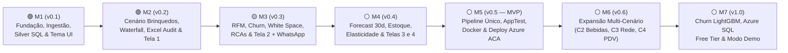

# 📋 Gerenciador de Tarefas do Projeto: Kyberna — Decision Intelligence B2B

Plataforma B2B de **Decision Intelligence & Prescriptive Analytics** em Python (`DuckDB` + `Pandas 2.x` + `StatsForecast`/`LightGBM` + `Streamlit`/`Plotly`), alimentada pela base pública *Iowa Liquor Sales* remapeada sinteticamente para PMEs e indústrias brasileiras.

> **Como usar:** cada tarefa tem ID único `<Marco>-<Pilar><Nº>` (ex.: `M1-I2`, `M2-D5`, mantendo o código legado entre parênteses para rastreabilidade), arquivos impactados, dependências e **Critério de Pronto (DoD)** validado via terminal.
> Status: `[ ]` a fazer · `[~]` parcial · `[x]` concluída (DoD validado via terminal).
> Protocolo de execução: ver §1 de [`GEMINI.md`](./GEMINI.md) / [`CLAUDE.md`](./CLAUDE.md). Contexto de produto: [`VISION.md`](./VISION.md).

---

## 🚀 Status Geral do Desenvolvimento

- **Versão Atual**: `v0.1.0-dev`
- **Marcos Concluídos**: M1 (Fundação do Motor, Ingestão, Camada Silver e Tema UI)
- **Próximos Focos Imediatos**:
  - **M3**: Inteligência Comercial: RFM, Risco de Churn, White Space, RCAs & Tela 2 (Radar Comercial) (`v0.3.0-dev`)

### Estrutura dos Módulos em Cada Marco (4 Pilares Integrados)

Para garantir organização limpa, modular e **validação cruzada imediata** (onde uma área comprova o funcionamento da outra dentro do mesmo marco), cada marco agrupa suas entregas em 4 pilares essenciais:
- 🏗️ **Infraestrutura & Arquitetura (`I`)**: Ambiente `uv`, qualidade, configurações tipadas, CLI `kyberna`, repositório de dados, Docker e nuvem Azure.
- 🗄️ **Engenharia de Dados & Finanças (`D`)**: Contratos `Pandera`, ingestão Socrata, limpeza e cálculos financeiros em **SQL no DuckDB** (`data/kyberna.duckdb`), enriquecimento sintético (`Faker pt_BR`) e planilha Excel de conciliação (`kyberna audit`).
- 🧠 **Ciência de Dados & Prescrição (`S`)**: Extração de features (`Pandas 2.x`), matriz ABC/XYZ, RFM, ciclo de recompra e Churn, White Space, eficiência de RCAs, Forecast 30d (`StatsForecast`), elasticidade e Simulador What-If.
- 🎨 **Interface, UX & Visualização (`V`)**: Design system Kyberna, componentes Streamlit/Plotly, camada de serviços pura com cache e as 4 telas executivas de alta conversão.



---

### 🛡️ Guia Rápido de Integração & Anti-Alucinação para Agentes Desenvolvedores

> [!IMPORTANT]
> **Leia este bloco antes de implementar qualquer tarefa pendente (`[ ]`).** Ele consolida os contratos reais do código já implementado para evitar imports inexistentes, quebra de tipagem (`mypy --strict`) ou violação de limites arquiteturais:
>
> 1. **Limite Estrito de 400 Linhas por Arquivo (`GEMINI.md` §3)**:
>    - Nenhum arquivo em `src/` pode ultrapassar **400 linhas**.
>    - Em serviços de UI (`src/services/*_service.py`), separe sempre as consultas SQL em `src/services/<modulo>_queries.py` (siga o padrão já implementado em [`src/services/executive_service.py`](./src/services/executive_service.py) + [`src/services/executive_queries.py`](./src/services/executive_queries.py)).
>    - Em fábricas de gráficos (`src/ui/components/charts.py`), o arquivo atual já tem ~257 linhas (`waterfall_margin`, `dual_trend`, `abc_xyz_heatmap`, `quadrant_scatter`). Para novos gráficos de `M3` e `M4`, crie submódulos dedicados (ex.: `src/ui/components/commercial_charts.py`, `src/ui/components/inventory_charts.py` ou `src/ui/components/simulator_charts.py`) e reexporte em `charts.py` se necessário.
> 2. **Receita Padrão para Todo Módulo de ML / Mart Analítico (`src/ml/<modulo>.py`)**:
>    - **Assinatura padrão do builder**: `build_<nome>_mart(con: duckdb.DuckDBPyConnection, *, as_of_date: str | date | None = None, scenario_id: ScenarioId = "c1_toys") -> pd.DataFrame`.
>    - **Resolução de data de corte sem vazamento**: use `resolved_date = resolve_as_of_date(con, as_of_date, scenario_id)` de [`src/ml/features.py`](./src/ml/features.py).
>    - **Contrato Pandera**: defina `Gold<Nome>Schema(pa.DataFrameModel)` em [`src/etl/contracts.py`](./src/etl/contracts.py) (usando `import pandera.pandas as pa` e `from pandera.pandas import Field`) e valide com `validate_contract(df, Gold<Nome>Schema, layer="gold")`.
>    - **Persistência Dupla no DuckDB + Parquet Zstandard**:
>      ```python
>      con.execute("CREATE SCHEMA IF NOT EXISTS gold")
>      con.execute(f"CREATE SCHEMA IF NOT EXISTS {scenario_id}")
>      con.register("_tmp_mart_df", validated_df)
>      con.execute(f"CREATE OR REPLACE TABLE {scenario_id}.mart_<nome> AS SELECT * FROM _tmp_mart_df")
>      con.execute(f"CREATE OR REPLACE TABLE gold.mart_<nome> AS SELECT * FROM _tmp_mart_df")
>      con.unregister("_tmp_mart_df")
>      export_table_to_parquet(con, f"{scenario_id}.mart_<nome>", gold_snapshot_path(scenario_id, "mart_<nome>"))
>      ```
>    - **Integração Obrigatória em 2 pontos**: (a) adicione a chamada em `build_gold_marts()` dentro de [`src/etl/gold/marts.py`](./src/etl/gold/marts.py); (b) crie o comando `@ml_app.command("<subcomando>")` em [`src/cli.py`](./src/cli.py).
> 3. **Receita Padrão para Serviços Puros (`src/services/`) e Páginas (`src/ui/pages/`)**:
>    - `src/services/` **nunca** importa `streamlit`. Ele recebe `repo: DataRepository` (de [`src/db/repository.py`](./src/db/repository.py), usando `repo.query(sql, params)` com `?` ou `$param` ou `repo.table(name, scenario_id)`) e retorna DTOs Pydantic v2 definidos em [`src/services/dto.py`](./src/services/dto.py) (`model_config = ConfigDict(arbitrary_types_allowed=True)` quando o DTO contiver `pd.DataFrame`).
>    - Em [`src/ui/cache.py`](./src/ui/cache.py), todo wrapper `@st.cache_data(ttl=300, show_spinner=False)` deve receber coleções como `tuple[str, ...]` (e **não** `list[str]`, pois listas não são *hashable* no cache do Streamlit).
>    - **Ícone Azul `ⓘ` Obrigatório**: toda chamada a `render_kpi_card(...)`, `kpi_card_html(...)` (de [`src/ui/components/kpi_card.py`](./src/ui/components/kpi_card.py)) e `section_header(...)` (de [`src/ui/components/prescription.py`](./src/ui/components/prescription.py)) **exige** `help_text: str` não-vazio (levanta `ValueError` em runtime se vazio!).
>    - **Compatibilidade Dark Mode**: nunca use cores hexadecimais fixas (`#475569`, `#0F172A`, `#0d9488`) em HTML inline nas páginas; use sempre as variáveis CSS `var(--kyb-text)`, `var(--kyb-text-muted)`, `var(--kyb-teal)`, `var(--kyb-card-bg)` e `var(--kyb-border)`.
> 4. **Cuidados de Tipagem (`mypy --strict`) e Testes no Windows**:
>    - Todo arquivo `.py` deve iniciar com `from __future__ import annotations`.
>    - Não use `for _, row in df.iterrows():` em transformações de dados; use operações vetorizadas Pandas/NumPy ou `.to_dict(orient="records")` apenas para construir listas pequenas de DTOs (< 50 itens).
>    - No Windows dentro do sandbox sem rede, `streamlit.testing.v1.AppTest` usa `socket.socketpair()` internamente e pode bloquear por permissão de socket; rode testes de serviços/ML normalmente no sandbox e, se `AppTest` bloquear com erro de socket, execute o `pytest tests/ui` fora do sandbox (`BypassSandbox: true`).

---

## 📌 Quadro de Marcos do Projeto

---

### 🟢 M1 — Fundação do Motor, Contratos, Ingestão e Camada Silver Auditável (Concluído ✅)

> **Objetivo de Validação Ponta a Ponta (`v0.1.0-dev`)**: Configurar toda a fundação de engenharia, qualidade e CLI, validando-a na prática com a geração da fixture sintética, ingestão da API Socrata até a camada **Silver SQL** no catálogo `data/kyberna.duckdb` (pronta para inspeção no DBeaver / `duckdb -ui`) e abertura do esqueleto multipage do App Streamlit com o Design System Kyberna.

#### 🏗️ Infraestrutura & Arquitetura
- [x] **M1-I1** *(INFRA-01)* — **Bootstrap do repositório e ambiente `uv`**: Inicializar projeto com `uv` (Python 3.11, `.python-version`), `pyproject.toml` com build `hatchling` empacotando `src`, extras `etl` (`httpx`, `tenacity`, `faker`, `pandera`, `xlsxwriter`), `ml` (`statsforecast`, `lightgbm`, `scikit-learn`, `joblib`), `app` (`streamlit`, `plotly`, `xlsxwriter`), núcleo (`duckdb`, `pandas`, `pyarrow`, `numpy`, `pydantic`, `pydantic-settings`, `typer`, `pyodbc`, `azure-identity`, `pyyaml`) e grupo `dev` (`pytest`, `pytest-cov`, `ruff`, `mypy`, `pre-commit`, `types-PyYAML`, `pandas-stubs`). Criar árvore de pastas do §3 do `GEMINI.md`, `.gitignore`, `.dockerignore`, `.editorconfig`, `README.md` e branch `archive/spark-airflow-setup`.
  - *Arquivos:* `pyproject.toml`, `uv.lock`, `.python-version`, `.gitignore`, `.dockerignore`, `.editorconfig`, `README.md`, `src/**/__init__.py`, `data/*/.gitkeep`.
  - *Depende de:* —
  - *DoD:* `uv sync --all-extras` conclui sem erro; `uv run python -c "import src, duckdb, pandas, pyarrow, streamlit"` retorna 0; `git status` não lista nada de `data/` além de `reference/` e `.gitkeep`.
- [x] **M1-I2** *(INFRA-02)* — **Qualidade de código (`ruff`, `mypy`, `pytest`, `pre-commit`)**: Configurar `ruff` (lint + format, `line-length=110`, regras `E,F,I,B,UP,SIM,PL,NPY,RUF`), `mypy --strict` com plugin pydantic, `pytest` (`testpaths=tests`, markers `slow`, `azure`, `ui`), cobertura com `pytest-cov` e `pre-commit` com ruff + checagens básicas (trailing whitespace, large files > 1 MB, detect-private-key).
  - *Arquivos:* `pyproject.toml` (seções `[tool.*]`), `.pre-commit-config.yaml`, `tests/conftest.py`, `tests/test_smoke.py`.
  - *Depende de:* `M1-I1`
  - *DoD:* `uv run ruff check .`, `uv run ruff format --check .`, `uv run mypy src` e `uv run pytest -q` passam; `uv run pre-commit run --all-files` passa.
- [x] **M1-I3** *(INFRA-03)* — **Settings tipadas, paths, `pipeline.yaml` e segredos**: Implementar `Settings` (`pydantic-settings`, prefixo `KYBERNA_`) com `env` (`dev|ci|prod`), `data_backend` (`auto|azure_sql|duckdb`), `data_dir`, `duckdb_path` (`data/kyberna.duckdb`), `lake_uri`, `azure_sql_server`, `azure_sql_database`, `azure_sql_auth` (`token|sql`), `azure_sql_connect_timeout_s=8`, `socrata_app_token`, `reference_date` (padrão: ontem) e `app_password`. `paths.py` centraliza caminhos de camadas (`bronze_path(table)`, `gold_snapshot_path(scenario, table)`, `audit_report_path(scenario)`). `config/pipeline.yaml` com seeds, janela de ingestão (2023-01-01 → 2024-12-31) e thresholds de negócio (ABC 80/95, XYZ CV 0,5/1,0, capital travado 120 dias). `.env.example` documentado (e `.env` local configurado com o token Socrata).
  - *Arquivos:* `src/core/settings.py`, `src/core/paths.py`, `src/core/types.py` (`ScenarioId`, `GoldTable` como `Literal`), `config/pipeline.yaml`, `.env.example`, `tests/infra/test_settings.py`.
  - *Depende de:* `M1-I1`
  - *DoD:* testes cobrem leitura por env var, defaults e validação de valores inválidos; `mypy` sem erros; nenhum segredo real versionado.
- [x] **M1-I4** *(INFRA-04)* — **CLI `kyberna` (Typer) e logging estruturado**: CLI com grupos `ingest`, `bronze`, `silver`, `gold`, `ml`, `audit`, `load`, `pipeline`, `fixture` (comandos inicialmente *stubs* que levantam `NotImplementedError` com o ID da tarefa responsável). Logging: formato humano (rich) em `dev`, JSON em `ci/prod`; decorator/context manager `timed_step(name)` que loga duração e contagem de linhas.
  - *Arquivos:* `src/cli.py`, `src/core/logging.py`, `pyproject.toml` (`[project.scripts] kyberna = "src.cli:app"`), `tests/infra/test_cli.py`.
  - *Depende de:* `M1-I2`, `M1-I3`
  - *DoD:* `uv run kyberna --help` lista todos os grupos; `typer.testing.CliRunner` valida exit code 0 para `--help` de cada grupo.

#### 🗄️ Engenharia de Dados & Finanças *(Valida a Infraestrutura e CLI)*
- [x] **M1-D1** *(DE-01)* — **Contratos de dados por camada (`Pandera` + Pandas & DuckDB SQL)**: Schemas Pandera (backend Pandas) para Bronze (colunas Iowa como `str` + metadados `_ingested_at`, `_batch_id`, `_source`), Silver (`SilverSalesSchema` tipado: `invoice_line_id`, `date`, `store_number`, `store_name`, `city`, `county`, `zip_code`, `category_name`, `vendor_number`, `vendor_name`, `item_number`, `item_description`, `pack`, `bottle_volume_ml`, `unit_cost`, `unit_price`, `units`, `sale_amount`), dims sintéticas e tabelas Gold (§4.2 do `GEMINI.md`). Checks de negócio: `units > 0`, `unit_price >= unit_cost * 0.5`, `pack ∈ [1, 96]`, unicidade de `invoice_line_id`, `scenario_id` válido. Helper `validate(df_or_table, schema, layer)` que loga falhas resumidas.
  - *Arquivos:* `src/etl/contracts.py`, `tests/etl/test_contracts.py`.
  - *Depende de:* `M1-I3`
  - *DoD:* testes positivos e negativos (dados violando cada check) passam; schemas exportados e reutilizados pelas tarefas seguintes.
- [x] **M1-D2** *(DE-02)* — **Fixture sintética determinística para testes e CI**: Gerador determinístico de ~20 mil linhas no formato **exato** da API Socrata (mesmas colunas e tipos-string), com 300 lojas, 400 itens, 15 vendors, 24 meses, sazonalidade semanal/anual, ciclos de recompra heterogêneos por loja (algumas lojas "adormecem" no último trimestre) e intermitência na cauda longa. Comando `kyberna fixture generate`.
  - *Arquivos:* `src/etl/ingest/fixture.py`, `tests/fixtures/iowa_sample.parquet` (≤ 2 MB, versionado), `tests/conftest.py`.
  - *Depende de:* `M1-D1`, `M1-I4`
  - *DoD:* fixture valida contra `BronzeSalesSchema`; duas execuções geram arquivos idênticos (hash SHA-256 igual); tamanho ≤ 2 MB.
- [x] **M1-D3** *(DE-03)* — **Ingestão Iowa Liquor Sales (Socrata API) → Raw → Bronze**: Cliente `httpx` para `https://data.iowa.gov/resource/m3tr-qhgy.csv` com `$where=date between '<ini>' and '<fim>'`, `$order=:id`, paginação `$limit=50000`/`$offset`, header `X-App-Token`, retry exponencial com `tenacity` (429/5xx), download por mês (idempotente: pula meses já presentes salvo `--force`). Raw em CSV por `year=/month=`; conversão via DuckDB para Bronze Parquet particionado (`year=/month=`) e registro na tabela `bronze.sales_raw` em `data/kyberna.duckdb`, adicionando metadados de ingestão. Flag `--sample-frac` para amostragem estratificada por loja.
  - *Arquivos:* `src/etl/ingest/socrata_client.py`, `src/etl/ingest/raw_to_bronze.py`, `src/etl/lake.py`, `src/cli.py`, `tests/etl/test_ingest.py` (HTTP mockado com `httpx.MockTransport`).
  - *Depende de:* `M1-D1`, `M1-I4`
  - *DoD:* `uv run kyberna ingest --start 2023-01-01 --end 2024-12-31` conclui (ou com `--sample-frac 0.3` para MVP rápido); reexecução não duplica dados; Bronze valida no contrato; testes com mock cobrem paginação, retry e idempotência.
- [x] **M1-D4** *(DE-04)* — **Silver SQL: limpeza, tipagem e deduplicação no DuckDB**: Pipeline **SQL no DuckDB** Bronze → Silver (`silver.sales`): cast de tipos, parse de datas, normalização de texto (trim, upper → title case, remoção de acentos/duplos espaços em `store_name`/`city`), deduplicação por `invoice_line_id` (`QUALIFY ROW_NUMBER() OVER (...) = 1`), remoção de devoluções/valores ≤ 0 e outliers grosseiros (`unit_price` fora de p0,1–p99,9 por item), preenchimento de `category_name` nulo pela moda do item e derivação de `chain_name` (ex.: "Hy-Vee", "Fareway", "Casey's") para o Cenário 3. Persiste em `data/silver/sales.parquet` e na tabela `silver.sales` do `kyberna.duckdb`. Relatório de linhas removidas por regra.
  - *Arquivos:* `src/etl/silver/clean.py`, `tests/etl/test_silver_clean.py`.
  - *Depende de:* `M1-D2` (e `M1-D3` para dados completos)
  - *DoD:* `uv run kyberna silver build --sample` gera Silver válida no contrato; relatório de remoções logado; nenhuma linha válida da fixture descartada indevidamente; execução sobre base completa ≤ 2 min.
- [x] **M1-D5** *(DE-05)* — **Silver SQL: âncora temporal (`time-shift` por semanas)**: Deslocar todas as datas no DuckDB por um offset inteiro **de semanas** (preserva dia da semana e sazonalidade semanal) para que `max(date)` fique na semana de `reference_date`. Registrar `original_date` e `time_shift_days` em metadados. Opcional `--no-shift` para análise histórica.
  - *Arquivos:* `src/etl/silver/time_anchor.py`, `tests/etl/test_time_anchor.py`.
  - *Depende de:* `M1-D4`
  - *DoD:* testes provam: offset múltiplo de 7; `max(date)` ∈ `[reference_date − 6, reference_date]`; distribuição por dia da semana idêntica antes/depois.

#### 🎨 Interface, UX & Visualização *(Valida o Ambiente de Front-end)*
- [x] **M1-V1** *(VIZ-01)* — **Esqueleto multipage do app Streamlit e Toggle de Tema**: `src/ui/app.py` com `st.set_page_config` (título `"Kyberna · Decision Intelligence"`, ícone, layout `wide`), `st.navigation` com as 4 páginas agrupadas ("Visão Executiva", "Radar Comercial", "Estoque & Demanda", "Simulador What-If") e cabeçalhos com estado vazio elegante. Seletor de tema na sidebar (**Light Mode ☀️ / Dark Mode 🌙** via `st.session_state.theme_mode`, persistente na sessão) e cascata `Região → UF` (`UF_REGIAO`). `.streamlit/config.toml` (tema base, `server.headless`, `browser.gatherUsageStats=false`, `runner.fastReruns`).
  - *Arquivos:* `src/ui/app.py`, `src/ui/pages/1_executive.py`, `src/ui/pages/2_commercial_radar.py`, `src/ui/pages/3_inventory_demand.py`, `src/ui/pages/4_simulator.py`, `.streamlit/config.toml`.
  - *Depende de:* `M1-I1`
  - *DoD:* `uv run streamlit run src/ui/app.py` abre as 4 páginas sem erro; alternância entre Claro e Escuro altera o estado global; AppTest básico renderiza cada página.
- [x] **M1-V2** *(VIZ-02)* — **Design system Kyberna (Light/Dark tokens, Plotly templates duplos e CSS dinâmico)**: `theme.py` com tokens para Light Mode e Dark Mode (§5.6 do `GEMINI.md`), registro dos templates Plotly `"kyberna_light"` e `"kyberna_dark"` (fonte Inter, paleta categórica e sequencial/divergente, grades suaves, separadores pt-BR `separators=",."`, margens compactas); `styles.css` com variáveis CSS Custom Properties (`--kyb-bg`, `--kyb-card-bg`, `--kyb-border`, `--kyb-text`) dinâmicas conforme o tema ativo; logotipo SVG (leme estilizado + wordmark `"KYBERNA"`).
  - *Arquivos:* `src/ui/theme.py`, `src/ui/assets/styles.css`, `src/ui/assets/logo.svg`, `.streamlit/config.toml`.
  - *Depende de:* `M1-V1`
  - *DoD:* página/modo de amostra exibe paleta, tipografia e gráficos nos dois temas (Light/Dark); contraste AA verificado nos pares principais.

---

### 🟢 M2 — Caso Âncora (C1 Brinquedos), Waterfall Financeiro, Auditoria Excel & Tela 1 (Visão Executiva) (Concluído ✅)

> **Objetivo de Validação Ponta a Ponta (`v0.2.0-dev`)**: Enriquecer a Silver com dimensões brasileiras determinísticas (`Faker pt_BR`), remapear o Caso Âncora (`c1_toys`), calcular o DRE/Waterfall completo em SQL no DuckDB, gerar a **planilha Excel de conciliação financeira (`kyberna audit`)**, rodar a classificação **ABC/XYZ** sobre a Gold e validar todos os indicadores diretamente na **Tela 1 — Visão Executiva & Margem Real**.

#### 🏗️ Infraestrutura & Arquitetura
- [x] **M2-I1** *(DE-17)* — **Repositório de dados com fallback (`DuckDB` local ↔ `Azure SQL`) e Resiliência ODBC**: Implementar `DataRepository` (`Protocol` retornando `pd.DataFrame`), `DuckDBRepository` (conexão in-process lendo Parquet/tabelas Gold e retornando `.df()`), `AzureSQLRepository` (`pyodbc` + token Entra ID via `azure-identity`, `connect_timeout` curto de 8s, conexão curta por consulta, `fast_executemany=True`, `pool_pre_ping=True`, `pool_recycle=240`) e factory `get_repository(settings)` com política `auto`: monitora `_CONN_ERROR_CODES = ("08S01", "HYT00", "08001", "08007", "40613", "40197", "10054")` — se o banco Azure SQL estiver pausado ou offline, aciona o **fallback instantâneo (< 8s) para o DuckDB local**, sem bloquear a UI com spinners longos de warmup. API: `table(name, scenario_id, columns=None, filters=None)` e `query(sql, params)` parametrizado.
  - *Arquivos:* `src/db/repository.py`, `src/db/duckdb_repo.py`, `src/db/azure_sql_repo.py`, `tests/db/test_repository.py`.
  - *Depende de:* `M1-I3`, `M2-D5`
  - *DoD:* testes com DuckDB real sobre snapshot da fixture; teste de fallback simulando falha Azure (mock com erro 40613/timeout) retorna backend `duckdb` e motivo; consulta típica de mart ≤ 100 ms local.

#### 🗄️ Engenharia de Dados & Finanças
- [x] **M2-D1** *(DE-06)* — **Tabelas de referência brasileiras (versionadas)**: Criar `municipios_br.csv` (~150 municípios cobrindo todas as 27 UFs com código IBGE, nome, UF, região, lat/lon, população), `ufs_br.csv` (UF, região, alíquota ICMS interna de referência) e `category_maps/` (`toys.csv`, `beverages.csv`) mapeando categorias Iowa para famílias por regex (`.*VODKA.*` → *Jogos Educativos* / *Vodka*; `.*WHISK.*|.*BOURBON.*|.*SCOTCH.*` → *Quebra-Cabeças* / *Whisky*; `.*RUM.*` → *Primeira Infância* / *Rum*; `.*TEQUILA.*|.*MEZCAL.*` → *Brinquedos de Madeira* / *Tequila*; `.*LIQUEUR.*|.*SCHNAPPS.*|.*CORDIAL.*` → *Linha Escolar* / *Licores*; `.*GIN.*` → *Jogos de Tabuleiro* / *Gin*; `.*BRAND.*|.*COCKTAIL.*` → *Pelúcias* / *Cachaças e Destilados*; default → *Outros*).
  - *Arquivos:* `data/reference/municipios_br.csv`, `data/reference/ufs_br.csv`, `data/reference/category_maps/toys.csv`, `data/reference/category_maps/beverages.csv`, `src/etl/silver/reference.py`, `tests/etl/test_reference.py`.
  - *Depende de:* `M1-I1`
  - *DoD:* loaders tipados; teste garante 27 UFs presentes e cobertura de 100% das categorias da fixture (nenhuma linha cai em *Outros* acima de 5% do faturamento).
- [x] **M2-D2** *(DE-07)* — **Enriquecimento sintético determinístico (`Faker pt_BR` + Pandas)**: Gerar dimensões estáveis a partir das chaves naturais: **clientes** (por `store_number`: CNPJ válido com DV, razão social, nome fantasia, segmento, porte P/M/G derivado do faturamento real, celular WhatsApp `+55 DDD 9XXXX-XXXX` coerente com a UF, e-mail, data de cadastro), **geografia** (`county` → município BR ponderado por população, condados maiores → capitais/polos) e **RCAs** (25–40 representantes com nome, região, comissão 3–7%, carteira por UF/região). Seed derivada de `hash(natural_key) ^ global_seed`. Gerar em lote (`pd.DataFrame` → `silver.dim_*` no `kyberna.duckdb` e Parquet), sem loops sobre o fato.
  - *Arquivos:* `src/etl/silver/enrich.py`, `tests/etl/test_enrich.py`.
  - *Depende de:* `M1-D4`, `M2-D1`
  - *DoD:* CNPJs 100% válidos (teste de DV); duas execuções → dims idênticas; adicionar loja nova não altera atributos das existentes; cada cliente tem exatamente 1 RCA e 1 município.
- [x] **M2-D3** *(DE-08)* — **Motor de Cenários (`ScenarioConfig` Pydantic + YAMLs)**: Modelo `ScenarioConfig` com `id`, `display_name`, `company_profile`, `labels` (`customer`, `customer_plural`, `product_family`, `sales_rep`, `branch`, `unit`, `box`…), `filters`, `category_map`, `perspective` (`seller|buyer`), `capabilities` (flags da matriz §5.5 do `VISION.md`), `finance_profile` (`config/finance/*.yaml`) e `retail_markup` (C3/C4). Interface `ScenarioBuilder` operando sobre o DuckDB e dims Silver. Comando `kyberna gold build --scenario <id|all>`.
  - *Arquivos:* `src/core/scenarios.py`, `src/etl/scenarios/base.py`, `config/scenarios/c1_toys.yaml`, `config/scenarios/c2_beverages.yaml`, `config/scenarios/c3_retail_chain.yaml`, `config/scenarios/c4_single_store.yaml`, `tests/etl/test_scenarios_config.py`.
  - *Depende de:* `M1-D1`, `M1-I3`
  - *DoD:* os 4 YAMLs validam no Pydantic; YAML inválido gera erro legível; `ScenarioConfig.labels` cobre todas as chaves usadas pela UI.
- [x] **M2-D4** *(DE-09)* — **Builder do Cenário 1 — Indústria B2B de Brinquedos (Caso Âncora)**: Perspectiva *seller* (sede em SP); `vendor_name` → **Linhas/Marcas** fictícias; `category_name` → famílias via `toys.csv`; `item_description` → nomes de produto por templates determinísticos por família (ex.: *Quebra-Cabeça 500 peças — Mapas do Brasil*, *Blocos de Madeira 60 peças*, *Kit Escolar Aquarela 12 cores*), EAN-13 válido; `pack` → **unidades por caixa master** (`boxes = units / pack`); lojas → **lojistas (CNPJs)**; reescala de preços para faixa realista de brinquedos (R$ 15–R$ 350 por família, preservando razão custo/preço relativa e variações temporais).
  - *Arquivos:* `src/etl/scenarios/c1_toys.py`, `config/scenarios/c1_toys.yaml`, `tests/etl/test_c1_toys.py`.
  - *Depende de:* `M2-D2`, `M2-D3`
  - *DoD:* Gold `c1_toys` contém as 5 famílias obrigatórias com ≥ 85% do faturamento; nenhum termo de bebida remanescente (teste contra lista proibida: vodka, whisky, rum, liquor, bourbon…); EAN-13 válidos.
- [x] **M2-D5** *(DE-14)* — **Motor financeiro em SQL: Waterfall da Margem de Contribuição**: Implementar a definição canônica (§4.3 do `GEMINI.md`) em **SQL claro e auditável no DuckDB**: **desconto** por porte do cliente e por RCA (alguns RCAs com viés de desconto alto para a narrativa comercial); **impostos** (ICMS interestadual SP → S/SE exceto ES: 12%; N/NE/CO/ES: 7%; interno SP: 18%; PIS/COFINS 9,25% ou 3,65%; IPI por fora); **comissão** = taxa do RCA × receita após desconto; **frete** = custo por caixa por região. Alíquotas em `config/finance/*.yaml`.
  - *Arquivos:* `src/etl/finance/margin_waterfall.py`, `src/etl/finance/taxes.py`, `config/finance/tax_rules.yaml`, `config/finance/freight.yaml`, `config/finance/commission.yaml`, `config/finance/discounts.yaml`, `tests/etl/test_margin_waterfall.py`.
  - *Depende de:* `M2-D2`, `M2-D3`
  - *DoD:* teste de identidade contábil por linha (`contribution_margin == net_revenue − cogs − commission − freight`, tolerância `1e-6`); casos unitários de ICMS por UF; margem média do C1 entre 18% e 35% com dispersão entre RCAs (DP ≥ 4 p.p.).
- [x] **M2-D6** *(DE-16)* — **Star Schema Gold, Catálogo `.duckdb` e Gerador Excel de Conciliação (`kyberna audit`)**: Materializar via SQL no DuckDB `dim_date`, `dim_product`, `dim_customer`, `dim_sales_rep`, `dim_branch`, `dim_geography`, `fact_sales` e `mart_margin_monthly` (por mês × família × UF × RCA). Registrar tabelas no schema `gold` de `data/kyberna.duckdb` (pronto para DBeaver / `duckdb -ui`) e exportar snapshot Parquet em `data/gold/snapshot/<scenario_id>/<tabela>.parquet` (zstd). Implementar `src/etl/audit.py` e `uv run kyberna audit --scenario <id>`, gerando `data/reports/conciliacao_<scenario_id>.xlsx` (abas: Resumo DRE/Waterfall, Memória de Cálculo aberta com 100 pedidos coluna a coluna, Validação ABC/XYZ e Integridade).
  - *Arquivos:* `src/etl/gold/star_schema.py`, `src/etl/gold/marts.py`, `src/etl/audit.py`, `tests/etl/test_gold.py`.
  - *Depende de:* `M2-D4`, `M2-D5`
  - *DoD:* `uv run kyberna gold build --scenario c1_toys` gera tabelas no `.duckdb` e Parquet; `uv run kyberna audit --scenario c1_toys` gera planilha Excel formatada; integridade referencial 100%; soma de `gross_revenue` da Gold = Silver remapeada (± 0,01%).

#### 🧠 Ciência de Dados & Prescrição *(Valida a Consistência da Gold C1)*
- [x] **M2-S1** *(DS-01)* — **Base de features parametrizada por `as_of_date` (cliente, SKU, cliente×família)**: Consultas SQL no DuckDB + funções Pandas vetorizadas reutilizáveis (zero vazamento temporal): por cliente — recência, frequência (pedidos distintos), valor (receita e margem), ticket médio, nº de famílias compradas, tendência de receita (3m vs. 6m), estatísticas de intervalo entre compras (média, mediana, DP, nº intervalos); por SKU — demanda diária/semanal, CV semanal, receita, margem; por cliente×família — receita, última compra, participação.
  - *Arquivos:* `src/ml/features.py`, `tests/ml/test_features.py`.
  - *Depende de:* `M2-D6`
  - *DoD:* teste prova ausência de vazamento (nenhuma feature usa dados > `as_of_date`); valores conferidos manualmente em cliente de teste da fixture.
- [x] **M2-S2** *(DS-02)* — **Classificação ABC/XYZ e política prescritiva por célula**: ABC por margem de contribuição acumulada (cortes 80%/95% configuráveis; alternativa por receita); XYZ pelo CV da demanda semanal nas últimas 26 semanas (X < 0,5; Y 0,5–1,0; Z > 1,0). Política sugerida por célula (*AX*: "Ruptura zero / estoque de segurança alto"; *CZ*: "Sob encomenda ou descontinuar/liquidar"). Saída `mart_abc_xyz` na Gold e no Excel de auditoria.
  - *Arquivos:* `src/ml/abc_xyz.py`, `config/pipeline.yaml`, `tests/ml/test_abc_xyz.py`.
  - *Depende de:* `M2-S1`
  - *DoD:* participações acumuladas somam 100%; todos os SKUs classificados; política presente nas 9 células.

#### 🎨 Interface, UX & Visualização *(Valida Visualmente o Caso Âncora e o Waterfall)*
- [x] **M2-V1** *(VIZ-03)* — **Sidebar global: seletor de cenário, filtros em cascata e badge de fonte de dados**: Estado tipado (`state.py`: `AppState` com `scenario_id`, `period`, `ufs`, `families`, `sales_reps`). Sidebar com logo, Seletor de Cenários, filtros dependentes do cenário com cascata `_on_regiao_change()` (reset automático de UF ao mudar Região), data de referência e **badge da fonte de dados** ("Azure SQL" verde / "Snapshot local (Fallback)" âmbar com tooltip).
  - *Arquivos:* `src/ui/state.py`, `src/ui/components/sidebar.py`, `tests/ui/test_sidebar.py`.
  - *Depende de:* `M1-V1`, `M2-D3`, `M2-I1`
  - *DoD:* AppTest comprova troca de rótulos ao mudar cenário; filtros persistem entre páginas; badge reflete o backend de `get_repository()`.
- [x] **M2-V2** *(VIZ-04)* — **Biblioteca de componentes visuais, Cards com Sub-rodapé, Deltas e Plotly Interativo**: Implementar `.kpi-card` com barra superior em gradiente (`green`, `red`, `blue`, `gold`), sub-rodapé duplo (ex.: Bruto no topo e Líquido vs. Impostos no rodapé), cálculo de deltas `get_delta_html` (`%`, `p.p.`, `R$` e flag `invert_color` para custos/perdas), `.badge-warning`, `section_header`, `prescription_box`, suporte a cross-filtering por clique no Plotly (`on_select="rerun"`, `clickmode="event+select"`, `_pending_mes`), fábricas de gráficos em `charts.py` (`waterfall_margin`, `dual_trend`, `abc_xyz_heatmap`, `quadrant_scatter`, `forecast_band`, `treemap_value`, `profit_curve`, `tornado`) recebendo `pd.DataFrame` e retornando `go.Figure`, `tables.py` e `formatting.py` (`R$ 1.234.567,89`, compacto `R$ 1,2 mi`, `%), além do componente `.kyb-info-icon` com tooltip executivo instantâneo via CSS puro.
  - *Arquivos:* `src/ui/components/kpi_card.py`, `src/ui/components/prescription.py`, `src/ui/components/charts.py`, `src/ui/components/tables.py`, `src/ui/formatting.py`, `tests/ui/test_formatting.py`, `tests/ui/test_charts.py`.
  - *Depende de:* `M1-V2`
  - *DoD:* testes de formatação pt-BR passam; cada fábrica gera figura Plotly válida nos temas Light e Dark; zero acesso direto a banco nos componentes; 100% dos KPI cards (`render_kpi_card`) e seções possuem ícone azul de informação (`.kyb-info-icon`) com tooltip explicativo obrigatório validado por `mypy` e testes automatizados.
- [x] **M2-V3** *(VIZ-05 exec + VIZ-06)* — **Serviço Executivo, Cache e Tela 1 — Visão Executiva & Margem Real**: Implementar `executive_service.py` puro (sem Streamlit) + wrapper `@st.cache_data` em `ui/cache.py` + **Tela 1** completa: Manchete Executiva Dinâmica, 5 KPI cards (Faturamento Bruto, Receita Líquida, Margem R$, Margem %, Clientes Ativos com delta e sparkline), gráfico **Waterfall** completo, **Tendência Dupla** mensal (Faturamento × Margem % — efeito "boca de jacaré"), **Matriz ABC/XYZ 3×3 clicável** (em `@st.fragment`), Top-10 destruidores e geradores de margem e bloco de **Prescrição** em R$.
  - *Arquivos:* `src/services/executive_service.py`, `src/services/dto.py`, `src/ui/cache.py`, `src/ui/pages/1_executive.py`, `tests/services/test_executive_service.py`.
  - *Depende de:* `M2-I1`, `M2-S2`, `M2-V1`, `M2-V2`
  - *DoD:* KPIs da Tela 1 batem 100% com consulta SQL direta no `kyberna.duckdb` e com a aba DRE do `conciliacao_c1_toys.xlsx`; renderização < 1,5 s com cache quente; AppTest da Tela 1 passa sem exceção.

---

### ⚪ M3 — Inteligência Comercial: RFM, Risco de Churn, White Space, RCAs & Tela 2 (Radar Comercial)

> **Objetivo de Validação Ponta a Ponta (`v0.3.0-dev`)**: Construir os modelos de inteligência comercial sobre os ciclos de compra e descontos da Gold C1, auditar a priorização de clientes e representantes e validar tudo interativamente na **Tela 2 — Radar Comercial**, incluindo a exportação em 1 clique para Excel e links diretos de WhatsApp (`wa.me`).

#### 🧠 Ciência de Dados & Prescrição
- [x] **M3-S1** *(DS-03)* — **Segmentação RFM baseada em Margem de Contribuição**: Scores R, F, M em quintis (R invertido; desempate por *rank* para evitar quintis vazios) e mapeamento para segmentos (*Campeões, Fiéis, Promissores, Novos, Precisam de Atenção, Em Risco, Não Pode Perder, Hibernando, Perdidos*) via regras configuráveis. M calculado sobre **margem de contribuição líquida** (princípio "margem acima de volume").
  - *Arquivos:* `src/ml/rfm.py`, `config/pipeline.yaml`, `tests/ml/test_rfm.py`.
  - *Depende de:* `M2-S1`
  - *DoD:* todo cliente recebe exatamente 1 segmento; distribuição plausível na fixture (nenhum segmento > 40% dos clientes).
- [x] **M3-S2** *(DS-04)* — **Ciclo individual de recompra e índice de risco heurístico de Churn**: Por cliente: ciclo esperado = mediana dos intervalos entre pedidos (fallback para mediana do segmento quando < 3 intervalos); `delay_ratio = dias_sem_comprar / ciclo_medio_dias`; probabilidade heurística de churn via CDF empírica dos intervalos do cliente (com *shrinkage* para o segmento); status prescritivo (*No Ciclo* ≤ 1,1; *Atenção* 1,1–1,5; *Em Risco Imediato* 1,5–2,5; *Adormecido/Perdido* > 2,5). **Valor Anual em Risco (R$)** = receita 12m × probabilidade. Materializa `mart_customer_risk`.
  - *Arquivos:* `src/ml/churn.py`, `tests/ml/test_churn_heuristic.py`.
  - *Depende de:* `M2-S1`
  - *DoD:* probabilidades ∈ `[0, 1]` e monotônicas em `days_since_last`; clientes "adormecidos" plantados na fixture (`M1-D2`) aparecem como *Em Risco*/*Adormecido* em ≥ 90% dos casos.
- [x] **M3-S3** *(DS-06)* — **Matriz White Space e recomendação de cross-sell B2B**: Matriz cliente × família (binária e por receita) combinando: (1) **afinidade item-item via regras de associação Apriori** (Suporte, Confiança e Lift) sobre cestas transacionais de abastecimento com identificação do **SKU Âncora**; (2) **lookalike** (`NearestNeighbors` cosseno por mix normalizado + porte + região). **Potencial R$** = mediana da receita anual da família entre vizinhos compradores × score × `(1 − prob_churn)`. Materializa `mart_white_space` (top-3 oportunidades por cliente com texto explicativo e pitch para o RCA).
  - *Arquivos:* `src/ml/white_space.py`, `tests/ml/test_white_space.py`.
  - *Depende de:* `M2-S1`, `M3-S2`
  - *DoD:* nunca recomenda família comprada ativamente pelo cliente (janela 180 dias / share $\ge 5\%$); backtest atinge *hit rate@3* ≥ 2× o baseline de popularidade; potencial total C1 < 30% do faturamento anual.

- [x] **M3-S4** *(DS-07)* — **Eficiência Comercial de Representantes (Quadrante de RCAs)**: Por RCA: receita faturada, margem de contribuição R$ e %, desconto médio concedido, positivação (ativos/carteira), penetração de mix (famílias/cliente), % e R$ da carteira em risco e oportunidade White Space. Classificação nos 4 quadrantes (*Estrela*, *Volume sem margem*, *Margem sem volume*, *Atenção* — cortes pela mediana). Materializa `mart_rep_performance`.
  - *Arquivos:* `src/ml/rep_performance.py`, `src/etl/contracts.py` (adicionar `GoldRepPerformanceSchema`), `src/etl/gold/marts.py` (plugar em `build_gold_marts`), `src/cli.py` (adicionar `@ml_app.command("rep-performance")`), `config/pipeline.yaml` (seção `thresholds.rep_performance`), `tests/ml/test_rep_performance.py`.
  - *Depende de:* `M2-D5`, `M3-S2`, `M3-S3`
  - *Especificação Técnica Mastigada (Anti-Alucinação):*
    - **Fontes no DuckDB**: cruzar `gold.dim_sales_rep r` (colunas: `sales_rep_id, name, region, commission_rate`), `gold.dim_customer c` (carteira total do RCA via `c.sales_rep_id`), `gold.fact_sales f` (filtrada por `f.scenario_id = ?` e `f.date_key <= YYYYMMDD`), `gold.mart_customer_risk cr` (`risk_status IN ('Em Risco Imediato', 'Adormecido / Perdido')`, `annual_revenue_at_risk`, `annual_margin_at_risk`) e `gold.mart_white_space ws` (soma de `potential_revenue_brl` e `potential_margin_brl` por `customer_id`).
    - **Fórmulas Exatas por RCA**:
      - `portfolio_customers`: `COUNT(DISTINCT c.customer_id)` alocados ao RCA em `gold.dim_customer`.
      - `active_customers`: `COUNT(DISTINCT f.customer_id)` com compras na janela ativa (`recency_days <= 120` em `mart_customer_risk` ou compras no período).
      - `positivation_pct`: `ROUND(active_customers / NULLIF(portfolio_customers, 0) * 100.0, 2)`.
      - `avg_families_per_customer`: média de `COUNT(DISTINCT p.family)` por cliente ativo do RCA.
      - `gross_revenue`, `discount_amount`, `net_revenue`, `commission_amount`, `contribution_margin`: somas exatas de `gold.fact_sales` para o RCA.
      - `avg_discount_pct`: `ROUND(SUM(f.discount_amount) / NULLIF(SUM(f.gross_revenue), 0) * 100.0, 2)`.
      - `margin_pct`: `ROUND(SUM(f.contribution_margin) / NULLIF(SUM(f.gross_revenue), 0) * 100.0, 2)`.
      - `at_risk_customers_count`, `at_risk_customers_pct`, `revenue_at_risk_brl`, `margin_at_risk_brl`: agregados de `gold.mart_customer_risk` para os clientes do RCA em status `'Em Risco Imediato'` ou `'Adormecido / Perdido'`.
      - `white_space_potential_brl` e `white_space_margin_brl`: soma de `potential_revenue_brl` e `potential_margin_brl` de `gold.mart_white_space` para a carteira do RCA.
    - **Regra dos 4 Quadrantes (cortes pela mediana global dos RCAs ativos)**:
      - Seja `med_rev = median(gross_revenue)` e `med_margin_pct = median(margin_pct)`:
      - `gross_revenue >= med_rev` e `margin_pct >= med_margin_pct` $\rightarrow$ **`"Estrela"`** (alta receita e alta margem %).
      - `gross_revenue >= med_rev` e `margin_pct < med_margin_pct` $\rightarrow$ **`"Volume sem margem"`** (vende muito às custas de desconto excessivo).
      - `gross_revenue < med_rev` e `margin_pct >= med_margin_pct` $\rightarrow$ **`"Margem sem volume"`** (disciplinado em preço, mas precisa expandir carteira/mix).
      - `gross_revenue < med_rev` e `margin_pct < med_margin_pct` $\rightarrow$ **`"Atenção"`** (baixo volume e baixa rentabilidade).
    - **Colunas Obrigatórias em `GoldRepPerformanceSchema`**: `scenario_id`, `as_of_date`, `sales_rep_id`, `sales_rep_name`, `region`, `commission_rate`, `portfolio_customers`, `active_customers`, `positivation_pct`, `avg_families_per_customer`, `orders_count`, `gross_revenue`, `discount_amount`, `avg_discount_pct`, `net_revenue`, `commission_amount`, `contribution_margin`, `margin_pct`, `at_risk_customers_count`, `at_risk_customers_pct`, `revenue_at_risk_brl`, `margin_at_risk_brl`, `white_space_potential_brl`, `white_space_margin_brl`, `quadrant`, `action_prescription`, `snapshot_date`.
    - **Gotcha Crítico (`discounts.yaml`)**: Em `config/finance/discounts.yaml`, os RCAs com viés agressivo de desconto (+8,0 p.p.) são `["RCA-003", "RCA-007", "RCA-012", "RCA-015", "RCA-019", "RCA-025", "RCA-028", "RCA-033"]`. Como eles concedem mais desconto, sua `margin_pct` fica estruturalmente abaixo da mediana e eles caem em `"Volume sem margem"` ou `"Atenção"`.
  - *DoD:* `uv run kyberna ml rep-performance` e `uv run kyberna gold build --scenario c1_toys` executam sem erro; soma de `gross_revenue` por RCA = `SUM(gross_revenue)` de `gold.fact_sales` (tolerância `0.05`); ≥ 80% dos RCAs listados em `high_discount_reps` caem em `*Volume sem margem*` ou `*Atenção*`; `uv run pytest tests/ml/test_rep_performance.py -q` passa.

#### 🎨 Interface, UX & Visualização *(Valida a Inteligência Comercial e Ação em 1 Clique)*
- [ ] **M3-V1** *(VIZ-05 com + VIZ-07)* — **Serviço Comercial e Tela 2 — Radar Comercial, RFM & Antecipação de Churn**: Implementar `commercial_service.py` puro + cache em `ui/cache.py` + **Tela 2** completa: KPIs comerciais (clientes em risco, R$ anual em risco, potencial White Space, % carteira adormecida), **Tabela Priorizada de Risco** com seleção de linhas, gráfico de **Dispersão** (dias sem comprar × ciclo esperado com linha de 45°), **Treemap RFM** (tamanho = margem, cor = segmento), **Heatmap White Space** (segmento/RCA × família com potencial R$) e **Quadrante de RCAs** (bolha = R$ em risco) com drill-down.
  - *Arquivos:* `src/services/dto.py` (novos DTOs comerciais), `src/services/commercial_queries.py` (SQL parametrizado), `src/services/commercial_service.py` (orquestração pura $\le 400$ linhas), `src/ui/cache.py` (`cached_commercial_dashboard`), `src/ui/components/commercial_charts.py` (fábricas Plotly dedicadas), `src/ui/pages/2_commercial_radar.py`, `tests/services/test_commercial_service.py`, `tests/ui/test_commercial_page.py`.
  - *Depende de:* `M2-V1`, `M2-V2`, `M3-S1`, `M3-S2`, `M3-S3`, `M3-S4`
  - *Especificação Técnica Mastigada (Anti-Alucinação):*
    - **Divisão de Arquivos (< 400 linhas)**: **NÃO** coloque as queries SQL dentro de `commercial_service.py` nem adicione 4 gráficos novos direto em `src/ui/components/charts.py` (que já tem 257 linhas). Crie `src/services/commercial_queries.py` para o SQL e `src/ui/components/commercial_charts.py` para os novos gráficos (`cycle_delay_scatter`, `rfm_treemap`, `white_space_heatmap`), reutilizando `quadrant_scatter` que já existe em `src/ui/components/charts.py`.
    - **DTOs em `src/services/dto.py`**:
      - `CommercialKpisDTO`: `total_customers: int`, `at_risk_customers: int`, `dormant_customers_pct: float`, `annual_revenue_at_risk_brl: float`, `annual_margin_at_risk_brl: float`, `white_space_potential_revenue_brl: float`, `white_space_potential_margin_brl: float`, `avg_positivation_pct: float`.
      - `CommercialPageDTO` (`ConfigDict(arbitrary_types_allowed=True)`): `scenario_id: ScenarioId`, `kpis: CommercialKpisDTO`, `headline_title: str`, `headline_text: str`, `priority_risk_df: pd.DataFrame` (join de `mart_customer_risk`, `mart_rfm`, `dim_customer`, `dim_sales_rep` e top-1 recomendação de `mart_white_space`), `rfm_summary_df: pd.DataFrame`, `white_space_matrix_df: pd.DataFrame`, `rep_performance_df: pd.DataFrame`, `prescription_title: str`, `prescription_html: str`, `prescription_impact_brl: float | None`.
    - **Filtros na Query**: respeitar `regiao`, `uf`, `sales_reps` (de `AppState`) e filtro de `risk_status` / `rfm_segment` na página. Se `cfg.capabilities.rep_efficiency` for `False` (Cenário 4), ocultar a seção do Quadrante de RCAs elegantemente.
    - **Obrigatoriedade de Tooltips e Dark Mode**: passar `help_text: str` explicativo em todos os `render_kpi_card` e `section_header`; usar apenas variáveis CSS `var(--kyb-*)` nos blocos HTML.
  - *DoD:* filtros por RCA/UF/status atualizam todos os blocos; tempo de interação < 1,5 s; testes `tests/services/test_commercial_service.py` e `tests/ui/test_commercial_page.py` passam sem exceção; 100% dos KPI cards e cabeçalhos de seção possuem `.kyb-info-icon`; zero arquivos > 400 linhas.
- [ ] **M3-V2** *(VIZ-10)* — **Motor de Ação em 1 Clique: Exportação Excel, CSV e WhatsApp (`wa.me`)**: Implementar `export_service.py` e componente `export_bar.py`: gera **Excel** formatado (`pd.ExcelWriter` com `xlsxwriter`: aba por RCA, cabeçalho Kyberna, BRL/%, autofiltro, painéis congelados), **CSV** UTF-8 com BOM (abre direto no Excel BR) e **links clicáveis de WhatsApp** `https://wa.me/<E.164 sem +>?text=<mensagem url-encoded>` com o argumento de abordagem pronto por cliente/oportunidade.
  - *Arquivos:* `src/services/export_service.py`, `src/ui/components/export_bar.py`, `src/ui/pages/2_commercial_radar.py` (integração da barra de exportação), `tests/services/test_export_service.py`.
  - *Depende de:* `M3-V1`
  - *Especificação Técnica Mastigada (Anti-Alucinação):*
    - **Funções Puras em `src/services/export_service.py` (sem importar `streamlit`)**:
      - `normalize_phone_e164_digits(raw_phone: str) -> str`: extrai apenas dígitos (`re.sub(r"\D", "", raw_phone)`); se tiver 10 ou 11 dígitos sem DDI, prefixa `"55"`; retorna string de 12–13 dígitos (`55DD9XXXXXXXX`) sem o sinal `+`.
      - `build_whatsapp_link(phone: str, customer_name: str, rep_name: str, context_pitch: str) -> str`: monta mensagem amigável em pt-BR e usa `urllib.parse.quote(msg, safe="")` para gerar `f"https://wa.me/{digits}?text={encoded_msg}"`.
      - `dataframe_to_csv_bom(df: pd.DataFrame) -> bytes`: retorna `df.to_csv(index=False, sep=";").encode("utf-8-sig")` (separador `;` e BOM `utf-8-sig` para abrir direto no Excel em português sem quebrar acentos ou colunas).
      - `generate_commercial_action_excel(risk_df: pd.DataFrame, white_space_df: pd.DataFrame, scenario_name: str) -> bytes`: escreve em `io.BytesIO()` via `pd.ExcelWriter(bio, engine="xlsxwriter")` uma aba `Resumo_Priorizado` e abas por RCA (nome da aba sanitizado e truncado em 31 caracteres, limite do Excel!), com formatação `R$ #,##0.00`, `0.0%`, `freeze_panes(1, 0)` e `autofilter`.
    - **Componente UI `src/ui/components/export_bar.py`**: renderiza `st.download_button` para Excel (`.xlsx`) e CSV (`.csv`), além de exibir na tabela de clientes a coluna com `st.column_config.LinkColumn("Ação WhatsApp", display_text="📲 Abordar no WhatsApp")`.
  - *DoD:* Excel gerado em memória abre sem alerta de reparo e valida leitura via `pd.read_excel(io.BytesIO(excel_bytes))`; links `wa.me` validam formato `^https://wa\.me/55\d{10,11}\?text=.+` e encoding de acentos; export de 1 mil linhas < 1 s; `uv run pytest tests/services/test_export_service.py -q` passa.

---

### ⚪ M4 — Inteligência de Estoque, Demanda (Forecast 30d), Elasticidade & Telas 3 e 4 (Estoque + Simulador)

> **Objetivo de Validação Ponta a Ponta (`v0.4.0-dev`)**: Fechar todas as capacidades analíticas e prescritivas do Caso Âncora: injetar eventos de preço com elasticidade-verdade, gerar snapshot de estoque, rodar previsão de 30 dias (`StatsForecast`), calcular ruptura/capital travado, recuperar a elasticidade via regressão/ML e validar tudo nas **Telas 3 (Estoque & Demanda) e 4 (Simulador Prescritivo What-If)**.

#### 🗄️ Engenharia de Dados & Finanças
- [ ] **M4-D1** *(DE-13)* — **Injeção determinística de variação de preço com elasticidade-verdade**: Como os preços originais de Iowa têm markup regulado quase fixo, injetar eventos determinísticos de preço por família/SKU (promoções de 5–20% por 1–3 semanas e reajustes de 3–8%) ajustando unidades por `units' = units × (p'/p)^β_true` com `β_true` configurado em `config/pipeline.yaml` (ex.: *Linha Escolar* −1,8; *Jogos Educativos* −1,2; *Brinquedos de Madeira* −0,6) + ruído log-normal. Persistir `price_event_id`, `promo_flag` e tabela `elasticity_ground_truth`.
  - *Arquivos:* `src/etl/silver/price_events.py`, `config/pipeline.yaml` (seção `thresholds.elasticity_ground_truth`), `src/cli.py` (integrar em `silver build` e comando `silver price-events`), `tests/etl/test_price_events.py`.
  - *Depende de:* `M1-D5`, `M2-D3`
  - *Especificação Técnica Mastigada (Anti-Alucinação):*
    - **Configuração em `config/pipeline.yaml`**: adicionar mapa `elasticity_ground_truth` por família do Cenário 1 (`"Linha Escolar": -1.8`, `"Jogos Educativos": -1.2`, `"Quebra-Cabeças": -1.4`, `"Primeira Infância": -1.0`, `"Jogos de Tabuleiro": -1.1`, `"Pelúcias": -1.5`, `"Brinquedos de Madeira": -0.6`, `"Outros": -1.0`).
    - **Como injetar de forma determinística (sem loop por linha)**:
      - Derive um hash por `(item_number, year_week, seed)` no Pandas/NumPy (`np.random.default_rng(seed)`).
      - Selecione ~18% das combinações `(item_number, year_week)` para receberem eventos de preço: ~12% promoções (`delta_p` $\in [-0.20, -0.05]$, `promo_flag = True`) e ~6% reajustes (`delta_p` $\in [+0.03, +0.08]$, `promo_flag = False`).
      - Calcule o novo preço `unit_price_adj = ROUND(unit_price * (1 + delta_p), 2)` (respeitando a trava `unit_price_adj >= unit_cost * 0.55` do `SilverSalesSchema`!) e ajuste a quantidade demandada pela equação econômica constante-elástica:
        $$\text{units}' = \max\left(1, \text{round}\left(\text{units} \cdot \left(\frac{p'}{p}\right)^{\beta_{\text{true}}} \cdot \exp(\varepsilon)\right)\right), \quad \varepsilon \sim \mathcal{N}(0, 0.04^2)$$
    - **Tabelas Persistidas no DuckDB**: salvar colunas `promo_flag: bool` e `price_event_id: str | None` em `silver.sales` (ou `c1_toys.sales_remapped`) e materializar `silver.elasticity_ground_truth` (`scenario_id, family, beta_true, promo_fraction_target`) no `kyberna.duckdb`.
  - *DoD:* fração de linhas afetadas entre 10% e 25%; volume total varia < 5% vs. original; regressão OLS simples `np.polyfit(np.log(p_ratio), np.log(q_ratio), 1)[0]` recupera `β_true` com erro absoluto < 0,25 por família; `uv run pytest tests/etl/test_price_events.py -q` passa.
- [ ] **M4-D2** *(DE-15)* — **Snapshot sintético controlado de posição de estoque (`inventory_snapshot`)**: Para cada SKU (e filial no C3): `stock_units` = demanda média diária (últimos 90d) × cobertura amostrada de mistura controlada (≈ 10% ruptura iminente: 0–7d; ≈ 60% saudável: 15–60d; ≈ 15% atenção: 60–120d; ≈ 15% capital travado: 120–365d), `lead_time_days` por família, `unit_cost` e `last_receipt_date`. Determinístico por SKU.
  - *Arquivos:* `src/etl/gold/inventory_snapshot.py`, `src/etl/contracts.py` (`GoldInventorySnapshotSchema`), `src/etl/gold/star_schema.py` (ou `marts.py`), `tests/etl/test_inventory_snapshot.py`.
  - *Depende de:* `M2-D4`
  - *Especificação Técnica Mastigada (Anti-Alucinação):*
    - **Cálculo da Demanda Média Diária (últimos 90 dias até `as_of_date`)**: consultar `gold.fact_sales` agrupando por `product_id, branch_id`: `avg_daily_demand = GREATEST(SUM(units) / 90.0, 0.1)`.
    - **Amostragem Determinística por Hash do SKU**: ordenar SKUs por `product_id` e atribuir faixas exatas via quantis/RNG com `seed=42` para garantir que a proporção nunca oscile fora de $\pm 3\text{ p.p.}$:
      - Primeiros 10% dos SKUs: `coverage_days` uniforme em `[1.0, 7.0]` (ruptura iminente).
      - Próximos 60% dos SKUs: `coverage_days` uniforme em `[15.0, 60.0]` (saudável).
      - Próximos 15% dos SKUs: `coverage_days` uniforme em `[60.1, 120.0]` (atenção).
      - Últimos 15% dos SKUs: `coverage_days` uniforme em `[125.0, 320.0]` (capital travado > 120d).
    - **Colunas de `gold.inventory_snapshot`**: `scenario_id`, `snapshot_date`, `branch_id`, `product_id`, `family`, `pack`, `unit_cost`, `avg_daily_demand_90d`, `stock_units` (`int(round(avg_daily_demand_90d * coverage_days))`), `stock_boxes` (`round(stock_units / pack, 2)`), `stock_value_brl` (`round(stock_units * unit_cost, 2)`), `coverage_days`, `lead_time_days` (ex.: 7 a 21 dias por família), `last_receipt_date`.
  - *DoD:* proporções das 4 faixas dentro de ±3 p.p. do configurado (10%/60%/15%/15%); capital travado (> 120 dias) do C1 entre 10% e 25% do valor total de estoque (`SUM(stock_value_brl)`); `GoldInventorySnapshotSchema` válido; `uv run pytest tests/etl/test_inventory_snapshot.py -q` passa.

#### 🧠 Ciência de Dados & Prescrição *(Valida a Verdade Sintética de Preço e Estoque)*
- [ ] **M4-S1** *(DS-08)* — **Previsão de demanda 30 dias (`StatsForecast`)**: Séries diárias `unique_id = sku` com zeros preenchidos; modelos `AutoETS(season_length=7)`, `CrostonOptimized()` (séries intermitentes, ADI > 1,32) e `SeasonalNaive(7)` como baseline; `h=30`, `level=[80, 95]`; seleção do melhor modelo por série via `cross_validation` (MAE); fallback de média móvel para séries < 60d. Materializa `mart_forecast_30d` (histórico 90d + projeção 30d + intervalos + modelo escolhido + WAPE).
  - *Arquivos:* `src/ml/forecast.py`, `src/etl/contracts.py` (`GoldForecast30dSchema`), `src/etl/gold/marts.py`, `src/cli.py` (`@ml_app.command("forecast")`), `tests/ml/test_forecast.py`, `docs/model_cards/forecast.md`.
  - *Depende de:* `M2-S1`
  - *Especificação Técnica Mastigada (Anti-Alucinação):*
    - **Performance & Seleção Inteligente de Modelo (< 2 min)**: rodar `StatsForecast.cross_validation` completo em 397 SKUs diários com `AutoETS` pode ser lento se mal configurado. Para cumprir o DoD em < 60s:
      - Preencha os zeros diários nos últimos 180 dias antes de `as_of_date` (`ds`, `unique_id`, `y`).
      - Calcule o **ADI** (*Average Demand Interval* = `n_days / n_nonzero_days`) de cada SKU:
        - Para SKUs com `< 60` dias de histórico ou `< 5` dias com venda: use fallback vetorizado `MovingAverage28d` (média diária dos últimos 28d e intervalos analíticos baseados no desvio padrão).
        - Para SKUs intermitentes (`ADI > 1.32`): ajuste `CrostonOptimized()` e `SeasonalNaive(season_length=7)`.
        - Para SKUs regulares (`ADI <= 1.32`, tipicamente Classe A/B): ajuste `AutoETS(season_length=7)` e `SeasonalNaive(season_length=7)` com `n_jobs=1` (evita overhead de multiprocessing no Windows!).
      - Valide nos últimos 14 ou 28 dias de holdout temporal (`y_val` vs. `y_hat`) para escolher o modelo vencedor por menor MAE/WAPE por SKU/família e aplique `np.clip(forecast, 0.0, None)` (nunca permitir previsão negativa!).
    - **Formato de `gold.mart_forecast_30d`**: unificar em uma tabela longa os últimos 90 dias realizados (`record_type = "historical"`, `actual_units`, `forecast_units = None`) + os próximos 30 dias projetados (`record_type = "forecast"`, `actual_units = None`, `forecast_units`, `lo_80`, `hi_80`, `lo_95`, `hi_95`), acompanhados de `scenario_id`, `product_id`, `family`, `date`, `selected_model`, `family_wape_pct`, `sku_mae` e `snapshot_date`.
  - *DoD:* WAPE agregado por família ≤ 35% e melhor que `SeasonalNaive` em ≥ 60% das séries classe A; todas as previsões e limites `lo_80`/`lo_95` $\ge 0$; execução do C1 ≤ 2 min; `uv run pytest tests/ml/test_forecast.py -q` passa.
- [ ] **M4-S2** *(DS-09 parcial)* — **Estoque prescritivo: cobertura, ruptura iminente e capital travado (> 120d)**: Cruzando `mart_forecast_30d` + snapshot de estoque + classe ABC/XYZ: calcular demanda diária prevista, cobertura em dias, dias até ruptura, estoque de segurança `z·σ_d·√LT` (A=1,65; B=1,28; C=0,84), ponto de pedido, sugestão de compra/produção em **caixas master** e **capital travado (R$)** (excedente > 120d × CMV) com prescrição automática (*Kit Promocional / Bonificação / Liquidação*). Materializa `mart_inventory_position`.
  - *Arquivos:* `src/ml/inventory.py`, `src/etl/contracts.py` (`GoldInventoryPositionSchema`), `src/etl/gold/marts.py`, `src/cli.py` (`@ml_app.command("inventory")`), `tests/ml/test_inventory.py`.
  - *Depende de:* `M2-S2`, `M4-D2`, `M4-S1`
  - *Especificação Técnica Mastigada (Anti-Alucinação):*
    - **Fórmulas Vetorizadas Exatas**:
      - `forecast_daily_demand`: média de `forecast_units` dos próximos 30 dias em `mart_forecast_30d` (fallback para `avg_daily_demand_90d` se zero).
      - `daily_demand_std`: `weekly_demand_std / sqrt(7.0)` vindo de `mart_abc_xyz`.
      - Fator de nível de serviço $z$ por classe ABC: `{"A": 1.65, "B": 1.28, "C": 0.84}`.
      - `safety_stock_units = np.ceil(z * daily_demand_std * np.sqrt(lead_time_days))`.
      - `reorder_point_units = np.ceil(forecast_daily_demand * lead_time_days + safety_stock_units)`.
      - `coverage_days = stock_units / np.maximum(forecast_daily_demand, 0.01)`.
      - `days_to_stockout = np.maximum(0.0, coverage_days)`.
      - **Status de Estoque (`stock_status`)**:
        - `"Ruptura Iminente"`: `coverage_days <= lead_time_days` ou `stock_units <= reorder_point_units`.
        - `"Capital Travado"`: `coverage_days > 120.0`.
        - `"Atenção (Excesso Moderado)"`: `60.0 < coverage_days <= 120.0`.
        - `"Saudável"`: demais casos.
      - **Ordem Sugerida em Caixas Master (`suggested_order_boxes`)**: quando `stock_units < reorder_point_units`, meta de cobertura = `max(30, lead_time_days * 2)` dias; `needed_units = max(0, target_units - stock_units)`; `suggested_order_boxes = int(np.ceil(needed_units / pack))`; `protected_revenue_brl = round(suggested_order_boxes * pack * unit_list_price, 2)`.
      - **Capital Travado em R$ (`locked_capital_brl`)**: para SKUs com `coverage_days > 120`, `excess_units = max(0, stock_units - int(np.ceil(forecast_daily_demand * 120.0)))`; `locked_capital_brl = round(excess_units * unit_cost, 2)`.
  - *DoD:* testes unitários de ponto de pedido, estoque de segurança e cobertura passam; SKUs com `coverage_days > 120` batem com a faixa de capital travado gerada em `M4-D2`; `uv run pytest tests/ml/test_inventory.py -q` passa.
- [ ] **M4-S3** *(DS-10)* — **Modelo de elasticidade-preço (Log-Log Bootstrap + `LGBMRegressor` monotônico)**: Duas abordagens: (1) regressão interpretável `ln(Q) = α + β·ln(P_rel) + sazonalidade + promo_flag + porte` (`Ridge`/`LinearRegression`) com IC 95% via bootstrap; (2) curva de resposta `LGBMRegressor` com `monotone_constraints` negativo no preço. Validação contra `elasticity_ground_truth` (`M4-D1`). Materializa `mart_price_elasticity`.
  - *Arquivos:* `src/ml/elasticity.py`, `src/etl/contracts.py` (`GoldPriceElasticitySchema`), `src/etl/gold/marts.py`, `src/cli.py` (`@ml_app.command("elasticity")`), `tests/ml/test_elasticity.py`, `docs/model_cards/elasticity.md`.
  - *Depende de:* `M2-S1`, `M4-D1`
  - *Especificação Técnica Mastigada (Anti-Alucinação):*
    - **Preparação dos Dados por Família**: para cada família em `c1_toys`, agrupe por `(product_id, year_week, size)` ou linha transacional onde `P_rel = unit_net_price / median_sku_price` e `Q_rel = units / median_sku_units`.
    - **Abordagem 1 (Econométrica Log-Log com Bootstrap)**: ajuste `Ridge(alpha=1.0)` sobre `ln(Q_rel) ~ ln(P_rel) + promo_flag + sin_week + cos_week`. Execute `B=200` reamostragens bootstrap com `np.random.default_rng(42)` para extrair `beta_hat`, `ci_95_low` (percentil 2,5%) e `ci_95_high` (percentil 97,5%).
    - **Abordagem 2 (`LGBMRegressor` Monotônico)**: treine `LGBMRegressor(monotone_constraints=[-1, 0, ...], n_estimators=80, learning_rate=0.05, random_state=42, verbose=-1)` onde a 1ª feature é `price_ratio` (`monotone_constraints=-1` garante matematicamente que aumentar o preço nunca aumenta a quantidade prevista!).
    - **Colunas de `gold.mart_price_elasticity`**: `scenario_id`, `family`, `beta_hat`, `beta_true` (se disponível de `silver.elasticity_ground_truth`), `abs_error`, `ci_95_low`, `ci_95_high`, `r2_score`, `optimal_price_change_pct`, `elasticity_classification` (`"Elástica"` se `beta_hat < -1.0`, `"Inelástica"` se `beta_hat >= -1.0`), `prescription_text`, `snapshot_date`.
  - *DoD:* `|beta_hat - beta_true| < 0.30` em todas as famílias do C1 e intervalo `[ci_95_low, ci_95_high]` cobrindo `beta_true` em ≥ 80% delas; curva de resposta estritamente não-crescente no preço; `uv run pytest tests/ml/test_elasticity.py -q` passa.
- [ ] **M4-S4** *(DS-11)* — **Motor puro do Simulador What-If e Volume de Equilíbrio (Breakeven)**: Função pura `simulate(baseline: SimulationBaseline, levers: SimulationLevers) -> SimulationResult` (Pydantic). Alavancas: preço de tabela (%), desconto comercial (pp), comissão RCA (pp), custo/CMV (%) e elasticidade. Recomputa o Waterfall do `M2-D5` vetorizado em Pandas/NumPy (< 50 ms), calcula o **Volume de Equilíbrio (`delta_q_breakeven`)**, a curva **Lucro × Preço** com ponto ótimo e o gráfico **Tornado** de sensibilidade.
  - *Arquivos:* `src/services/simulator.py`, `src/services/dto.py` (`SimulationBaseline`, `SimulationLevers`, `SimulationResult`), `tests/services/test_simulator.py`.
  - *Depende de:* `M2-D5`, `M4-S3`
  - *Especificação Técnica Mastigada (Anti-Alucinação):*
    - **Equações Exatas do Simulador (`src/services/simulator.py`)**:
      - Dado o baseline (`units_0`, `gross_revenue_0`, `discount_rate_0`, `tax_rate_eff`, `cogs_0`, `commission_rate_0`, `freight_0`, `beta_elasticity`):
      - Novo preço de lista relativo: $r_p = 1 + \Delta p_{\text{list}}$.
      - Nova taxa de desconto efetiva: $d_1 = \text{clip}(d_0 + \Delta d_{\text{pp}}, 0.0, 0.50)$.
      - Variação relativa do preço líquido ao comprador:
        $$\frac{P_{\text{net},1}}{P_{\text{net},0}} = r_p \cdot \frac{1 - d_1}{1 - d_0}$$
      - Se `apply_elasticity=True`, novo volume relativo:
        $$\frac{Q_1}{Q_0} = \left(\frac{P_{\text{net},1}}{P_{\text{net},0}}\right)^{\beta}$$
        Caso contrário (`apply_elasticity=False`), $Q_1 / Q_0 = 1.0$.
      - Recomputar Waterfall escalado por $Q_1 / Q_0$:
        - `gross_revenue_1 = gross_revenue_0 * (Q_1 / Q_0) * r_p`
        - `discount_amount_1 = gross_revenue_1 * d_1`
        - `net_price_revenue_1 = gross_revenue_1 - discount_amount_1`
        - `tax_amount_1 = net_price_revenue_1 * tax_rate_eff`
        - `net_revenue_1 = net_price_revenue_1 - tax_amount_1`
        - `cogs_1 = cogs_0 * (Q_1 / Q_0) * (1 + delta_cogs_pct)`
        - `commission_amount_1 = net_price_revenue_1 * clip(commission_rate_0 + delta_comm_pp, 0.0, 0.25)`
        - `freight_1 = freight_0 * (Q_1 / Q_0)`
        - `contribution_margin_1 = net_revenue_1 - cogs_1 - commission_amount_1 - freight_1`
      - **Fórmula do Volume de Equilíbrio (`breakeven_volume_change_pct`)**: variação percentual de volume necessária para que `contribution_margin_1 == contribution_margin_0`:
        $$\Delta Q_{\text{breakeven}} = \left(\frac{M_0}{m_{\text{unit}, 1} \cdot Q_0} - 1\right) \times 100$$
        onde $m_{\text{unit}, 1}$ é a nova margem de contribuição por unidade (se $m_{\text{unit}, 1} \le 0$, o breakeven é impossível: `breakeven_volume_change_pct = None` e veredito `"Destruição de Margem Unitária Negativa"`).
      - **Curva Lucro × Preço**: avaliar vetorizadamente 41 pontos de $\Delta p \in [-25\%, +25\%]$ e identificar o ponto que maximiza `contribution_margin_1`.
      - **Tornado de Sensibilidade**: calcular o impacto em R$ na margem ao variar individualmente $\pm 5\%$ no Preço, $\pm 2\text{ p.p.}$ no Desconto, $\pm 5\%$ no CMV, $\pm 1\text{ p.p.}$ na Comissão e $\pm 5\%$ no Volume.
  - *DoD:* alavancas zeradas devolvem exatamente o baseline (`diff < 1e-6`); caso numérico de referência valida a equação de breakeven; tempo de execução de `simulate()` < 50 ms; `uv run pytest tests/services/test_simulator.py -q` passa.

#### 🎨 Interface, UX & Visualização *(Valida Estoque, Forecast e Simulador)*
- [ ] **M4-V1** *(VIZ-05 inv + VIZ-08)* — **Serviço de Estoque e Tela 3 — Inteligência de Estoque & Demanda**: Implementar `inventory_service.py` puro + cache + **Tela 3**: 4 KPIs (valor em estoque, capital travado > 120d, SKUs em risco de ruptura ≤ lead time, cobertura média), **Gráfico de Demanda + Forecast 30d** com bandas de 80%/95% (em `@st.fragment`), **Semáforo e Tabela de Ruptura** (ordem sugerida em caixas master e receita protegida R$) e **Treemap de Capital Travado** por família → SKU com prescrição.
  - *Arquivos:* `src/services/dto.py` (`InventoryKpisDTO`, `InventoryPageDTO`), `src/services/inventory_queries.py`, `src/services/inventory_service.py`, `src/ui/cache.py` (`cached_inventory_dashboard`, `cached_sku_forecast`), `src/ui/components/inventory_charts.py` (`forecast_band_chart`, `locked_capital_treemap`), `src/ui/pages/3_inventory_demand.py`, `tests/services/test_inventory_service.py`, `tests/ui/test_inventory_page.py`.
  - *Depende de:* `M2-V1`, `M2-V2`, `M4-S1`, `M4-S2`
  - *Especificação Técnica Mastigada (Anti-Alucinação):*
    - **Divisão Limpa (< 400 linhas)**: colocar SQL em `src/services/inventory_queries.py` e gráficos novos em `src/ui/components/inventory_charts.py`.
    - **Fragmento Reativo de Forecast (`@st.fragment`)**: encapsular o seletor de Família/SKU e o gráfico `forecast_band_chart` (histórico 90d em linha sólida + projeção 30d tracejada + polígonos `fill="toself"` para IC 80% e IC 95%) dentro de uma função decorada com `@st.fragment` na `3_inventory_demand.py`, para que trocar o SKU não recarregue a página inteira.
    - **Reconciliação Estrita**: `SUM(locked_capital_brl)` do Treemap deve ser exatamente igual ao KPI Card `"Capital Travado (> 120d)"`. Todos os KPIs e cabeçalhos devem ter `help_text: str` obrigatório e usar variáveis `var(--kyb-*)`.
  - *DoD:* soma do treemap = KPI de capital travado; troca de SKU re-renderiza apenas o fragmento; testes `tests/services/test_inventory_service.py` e `tests/ui/test_inventory_page.py` passam; 100% dos KPI cards e cabeçalhos possuem `.kyb-info-icon`.
- [ ] **M4-V2** *(VIZ-09)* — **Tela 4 — Simulador Prescritivo What-If (Elasticidade & Preço)**: Painel de sliders dentro de `@st.fragment` (escopo família/SKU/UF, variação de preço −30% a +30%, desconto 0–25 pp, comissão ±3 pp, CMV e toggle de elasticidade). Cards **Antes × Depois**, destaque visual do **Volume de Equilíbrio** (*"Para compensar 7% de desconto você precisa vender +28%; a elasticidade projeta +11%"*), **Curva Lucro × Preço** (ponto atual, simulado e ótimo), **Tornado** de sensibilidade, comparação de até 3 cenários salvos na sessão e veredito automático (*Gera Lucro Incremental* vs. *Destruição de Margem*).
  - *Arquivos:* `src/ui/components/simulator_charts.py` (`profit_curve_chart`, `tornado_sensitivity_chart`), `src/ui/cache.py` (`cached_simulation_baseline`), `src/ui/pages/4_simulator.py`, `tests/ui/test_simulator_interaction.py`.
  - *Depende de:* `M2-V2`, `M4-S3`, `M4-S4`
  - *Especificação Técnica Mastigada (Anti-Alucinação):*
    - **Sliders com `key` Estável**: defina keys explícitas (`key="sim_price_pct"`, `key="sim_discount_pp"`, `key="sim_comm_pp"`, `key="sim_cogs_pct"`, `key="sim_use_elasticity"`) para que os testes automatizados possam manipular os controles diretamente.
    - **Comparador de até 3 Cenários na Sessão**: armazene em `st.session_state.saved_simulations` (lista de até 3 dicionários/DTOs com nome, alavancas, receita simulada e delta de margem R$) com botão `"💾 Salvar Cenário para Comparação"` e `"🗑️ Limpar Comparação"`.
    - **Destaque do Breakeven**: exibir callout comparando lado a lado `breakeven_volume_change_pct` (volume exigido para empatar a margem) vs. `projected_volume_change_pct` (volume projetado pela elasticidade $\beta$).
  - *DoD:* mover slider atualiza em < 300 ms; alavancas em zero mostram delta 0 exato; testes `tests/ui/test_simulator_interaction.py` validam veredito e breakeven; 100% dos KPI cards e cabeçalhos possuem `.kyb-info-icon`.

---

### ⚪ M5 — Consolidação do MVP: Orquestrador Único, Testes de UI, Docker & Deploy Nuvem (ACA)

> **Objetivo de Validação Ponta a Ponta (`v0.5.0-mvp` — Marco do MVP)**: Encadear todo o pipeline de dados, ML e auditoria em um único comando (`kyberna pipeline run`), blindar as 4 telas com testes automatizados `AppTest`, empacotar a aplicação em container Docker com snapshot local embutido e publicar a URL pública do MVP no **Azure Container Apps** com custo zero.

#### 🗄️ Engenharia de Dados & Finanças
- [ ] **M5-D1** *(DE-20)* — **Orquestrador ponta a ponta (`kyberna pipeline run`) e Relatório de Qualidade**: Comando `kyberna pipeline run [--scenario all|c1_toys] [--sample] [--lake local|remote] [--skip-ingest]` encadeando ingest → bronze → silver → price events → cenários → finanças → estoque → gold → ML (`M2-S1`..`M4-S3`) → snapshot Parquet + `audit` (planilha Excel de conciliação), com `timed_step`, falha rápida e retomada por etapa (`--from-step`). Gera `data/reports/quality_<data>.json` e `.md` (linhas por camada, remoções, contratos, métricas dos modelos e tempos).
  - *Arquivos:* `src/etl/pipeline.py`, `src/cli.py` (`pipeline_run`), `tests/etl/test_pipeline.py`.
  - *Depende de:* `M2-D6`, `M3-S4`, `M4-S3`
  - *Especificação Técnica Mastigada (Anti-Alucinação):*
    - **Sequência Ordenada de Etapas (`PIPELINE_STEPS`)**: `("ingest", "bronze", "silver", "price_events", "gold_star", "inventory_snapshot", "gold_marts", "audit")`. Quando `--sample` for `True`, pule `ingest` da API Socrata e popule a Bronze direto da fixture `tests/fixtures/iowa_sample.parquet` via `populate_bronze_from_sample_fixture()`.
    - **Retomada por Etapa (`--from-step`)**: validar se o nome passado pertence a `PIPELINE_STEPS` e executar apenas a partir do índice correspondente.
    - **Artefatos de Qualidade**: salvar `data/reports/quality_<YYYYMMDD>.json` (dicionário serializado com duração em segundos e contagem de linhas de cada etapa) e `data/reports/quality_<YYYYMMDD>.md` (tabela Markdown resumindo linhas Bronze/Silver/Gold, SKUs em ABC/XYZ, clientes em RFM/Churn e WAPE de Forecast).
  - *DoD:* `uv run kyberna pipeline run --sample` executa ponta a ponta em ≤ 3 min no laptop e no CI; relatório `.md`, `.json` e planilha `.xlsx` gerados com sucesso; `uv run pytest tests/etl/test_pipeline.py -q` passa.

#### 🎨 Interface, UX & Visualização
- [ ] **M5-V1** *(INFRA-15 gate + VIZ-13)* — **Gate de Acesso, Autenticação de Produção, Runbook de Demo e Testes `AppTest`**: Implementar controle de acesso configurável `KYBERNA_AUTH_MODE` (`none` para dev local, `entra_id` corporativo e `demo_password` para links externos — este último trazendo a UX do `Nig` com ocultação de sidebar, card estilizado, bloqueio após 5 tentativas e validação constante via `hmac.compare_digest`), escrever `docs/runbook_demo.md` (roteiro cronometrado de 15 min do Caso Âncora, checklist pré-demo e FAQ comercial) e suíte `streamlit.testing.v1.AppTest` cobrindo as 4 páginas, troca de filtros, sliders do simulador e exportação.
  - *Arquivos:* `src/core/settings.py` (adicionar `auth_mode: Literal["none", "demo_password", "entra_id"] = "none"`), `src/ui/components/auth_gate.py`, `src/ui/app.py` (chamar `require_authentication()` antes de `st.navigation`), `docs/runbook_demo.md`, `tests/ui/test_pages_smoke.py`.
  - *Depende de:* `M2-V3`, `M3-V2`, `M4-V1`, `M4-V2`
  - *Especificação Técnica Mastigada (Anti-Alucinação):*
    - **Segurança em `auth_gate.py`**: usar `hmac.compare_digest(typed_password.encode("utf-8"), expected_password.encode("utf-8"))`; contabilizar falhas em `st.session_state.auth_failed_attempts` e bloquear após 5 tentativas; quando `auth_mode == "none"` (default em dev e nos testes existentes), retornar `True` imediatamente sem renderizar tela de login (para não quebrar os testes de página existentes!).
  - *DoD:* acesso sem senha bloqueado quando `KYBERNA_AUTH_MODE=demo_password`; `uv run pytest tests/ui -q` verde em ≤ 2 min.
- [ ] **M5-V2** *(VIZ-15)* — **Motor Temporal Flexível (YTD vs. YTD Anterior, Trimestres Fixos e Dinâmicos), Toggle PoP vs. YoY, Ergonomia da Sidebar e Contraste Dark Mode**: Evoluir o motor temporal e a acessibilidade visual para o lançamento do MVP: (1) **YTD com comparação direta contra o YTD anterior** (ex.: `Jan–Ago/2024 vs. Jan–Ago/2023`); (2) **Trimestres Fixos (Calendário)** (`1º Tri [Jan, Fev, Mar]`..`4º Tri [Out, Nov, Dez]`) e **Trimestres Dinâmicos / Móveis (3 meses consecutivos)** (ex.: `Fev, Mar, Abr`) via *progressive disclosure* (apenas 1 sub-seletor contextual limpo); (3) **Toggle executivo junto aos KPIs** permitindo alternar a base comparativa entre **Período Anterior (`PoP`/`QoQ`/`MoM`)** (ex.: `2º Tri/24 vs. 1º Tri/24`) e **Mesmo Período do Ano Anterior (`YoY`)** (ex.: `2º Tri/24 vs. 2º Tri/23`); (4) **Reordenação da Barra Lateral**: mover o seletor de **Cenário da Demo** para o último item dos filtros laterais (logo antes do badge de fonte de dados), mantendo Período e filtros analíticos no topo; (5) **Auditoria e correção completa do Modo Escuro (Dark Mode)**: substituir cores hexadecimais hard-coded (`#475569`, `#0d9488`) nos banners/manchetes por variáveis `var(--kyb-*)` e adicionar regras CSS explícitas para `.kyb-info-icon` (`ⓘ`), `st.tabs`, `st.expander`, `st.radio`/`st.caption`, tags de `st.multiselect` e ícones SVG nativos.
  - *Arquivos:* `src/ui/state.py`, `src/ui/components/sidebar.py`, `src/ui/pages/1_executive.py`, `src/ui/assets/styles.css`, `src/ui/components/charts.py`, `tests/ui/test_sidebar.py`, `tests/ui/test_theme.py`.
  - *Depende de:* `M2-V3`, `M3-V1`, `M4-V1`, `M4-V2`
  - *Especificação Técnica Mastigada (Anti-Alucinação):*
    - **Campos no `AppState` (`src/ui/state.py`)**: adicionar `comparison_mode: Literal["pop", "yoy"] = "pop"`, `selected_quarter: str = "2024-Q4"` e `selected_semester: str = "2024-S2"`. Manter retrocompatibilidade em `resolve_period_bounds()` com aliases legados (`"last_12m"`, `"last_6m"`, `"last_3m"`, `"last_month"`).
    - **Cuidado com Índices do `AppTest` na Sidebar**: ao mover o seletor de **Cenário da Demo** para o final da sidebar (`src/ui/components/sidebar.py`), atualizar os índices de `at.sidebar.selectbox[...]` em `tests/ui/test_sidebar.py` e `tests/ui/test_app.py`.
    - **Seletores CSS Dark Mode (`src/ui/assets/styles.css`)**: como `.streamlit/config.toml` fixa `base = "light"`, estilizar explicitamente `[data-baseweb="tab"]`, `[data-testid="stExpander"] summary`, `[data-testid="stCaptionContainer"]`, `[data-testid="stSidebar"] svg` e `.kyb-info-icon` usando `var(--kyb-text)` e `var(--kyb-teal)`.
  - *DoD:* testes unitários cobrem todas as combinações de período (`ytd`, `fixed_quarter`, `rolling_quarter`, `fixed_semester`, `custom_month`, `all`) × modo de comparação (`pop`, `yoy`); seletor de cenário posicionado no fim da sidebar; contraste WCAG AA validado em 100% dos componentes, ícones e abas no Modo Escuro.

#### 🏗️ Infraestrutura & Arquitetura *(Empacota e Publica o MVP)*
- [ ] **M5-I1** *(INFRA-05)* — **Dockerfile multi-stage enxuto do App com ODBC 18 em Build-Time e Snapshot Gold embutido**: Stage `builder` (`python:3.11-slim` + `uv sync --frozen --no-dev --extra app`); stage `runtime` (`python:3.11-slim` + `libgomp1` + instalação do `msodbcsql18` e `unixodbc-dev` via repositório Microsoft em *build-time*, eliminando scripts de boot tipo `startup.sh`), usuário não-root `kyberna`, copia `.venv`, `src/`, `config/`, `.streamlit/` e `data/gold/snapshot/`; `ENV KYBERNA_DATA_BACKEND=duckdb`; `EXPOSE 8501`; `HEALTHCHECK` em `/_stcore/health`.
  - *Arquivos:* `infra/docker/Dockerfile`, `.dockerignore`, `tests/infra/test_dockerfile.py`.
  - *Depende de:* `M5-D1`, `M5-V1`, `M5-V2`
  - *Especificação Técnica Mastigada (Anti-Alucinação):*
    - Aceitar `ACCEPT_EULA=Y apt-get install -y --no-install-recommends msodbcsql18 unixodbc libgomp1 curl` no stage `runtime` seguido de `rm -rf /var/lib/apt/lists/*`.
    - Criar usuário `useradd --create-home --uid 1000 kyberna` e definir `USER kyberna`.
    - `ENTRYPOINT ["streamlit", "run", "src/ui/app.py", "--server.port=8501", "--server.address=0.0.0.0"]`.
  - *DoD:* `docker build -f infra/docker/Dockerfile -t kyberna-app:dev .` conclui; container responde `ok` em `/_stcore/health`; imagem ≤ 900 MB; roda como usuário não-root.
- [ ] **M5-I2** *(INFRA-07)* — **CI no GitHub Actions (Qualidade + Build Docker em PR/Push)**: Workflow `.github/workflows/ci.yml` com jobs `quality` (`astral-sh/setup-uv`, cache, `uv sync --all-extras --frozen`, `ruff`, `mypy`, `pytest -m "not azure and not slow"`) e `docker-build` (gera snapshot Gold da fixture via `kyberna pipeline run --sample` e valida o build da imagem).
  - *Arquivos:* `.github/workflows/ci.yml`, `tests/infra/test_workflows.py` (validação de sintaxe YAML).
  - *Depende de:* `M1-I2`, `M5-D1`, `M5-I1`
  - *DoD:* workflow válido em YAML e verde no GitHub Actions; duração ≤ 10 min.
- [ ] **M5-I3** *(INFRA-08 + 10 + 11 + 12)* — **Infra Azure Bicep (ADLS Gen2 + Container Apps `minReplicas: 0`), OIDC e CD (`deploy.yml`)**: Módulos Bicep para Storage Account (`Standard_LRS`, HNS ativo, container `lake`) e Azure Container Apps Consumption (`minReplicas: 0`, `maxReplicas: 1`, 0,5 vCPU / 1 GiB, ingress externo 8501, probes de saúde); script `bootstrap_azure.ps1` configurando OIDC federado sem client secret; workflow `deploy.yml` publicando imagem no GHCR e atualizando o Container App com smoke test pós-deploy.
  - *Arquivos:* `infra/bicep/main.bicep`, `infra/bicep/storage.bicep`, `infra/bicep/containerapp.bicep`, `infra/bicep/main.parameters.json`, `infra/scripts/bootstrap_azure.ps1`, `.github/workflows/deploy.yml`.
  - *Depende de:* `M5-I2`
  - *DoD:* `az bicep build --file infra/bicep/main.bicep` sem erros; deploy publica revisão ativa; após ~5 min sem acesso, réplicas caem para 0 (`scale-to-zero`).

---

### ⚪ M6 — Expansão Multi-Cenário Completa (C2 Bebidas, C3 Rede Multi-filial, C4 PDV Único)

> **Objetivo de Validação Ponta a Ponta (`v0.6.0-dev`)**: Habilitar os outros 3 cenários de negócio da Kyberna sobre a mesma base Silver, incluindo a matriz exclusiva de **Remanejamento de Estoque entre Filiais** (Cenário 3) e o **Clube de Fidelidade CPF** (Cenário 4), validando a troca instantânea de vocabulário, regras financeiras e prescrições nas 4 telas.

#### 🗄️ Engenharia de Dados & Finanças
- [ ] **M6-D1** *(DE-10)* — **Builder Cenário 2 — Distribuidora B2B de Bebidas (`c2_beverages`)**: Tradução semântica das categorias de bebidas (`beverages.csv`), fabricantes com marcas fictícias brasileiras, clientes segmentados em canais *on-trade* (bares, restaurantes, eventos) e *off-trade* (supermercados, adegas, empórios) conforme mix e ticket médio, vendedores de rota como RCAs e preços convertidos para R$.
  - *Arquivos:* `src/etl/scenarios/c2_beverages.py`, `src/cli.py` (habilitar `c2_beverages` em `gold build`), `tests/etl/test_c2_beverages.py`.
  - *Depende de:* `M2-D3`, `M2-D5`
  - *Especificação Técnica Mastigada (Anti-Alucinação):*
    - Seguir exatamente a arquitetura de [`src/etl/scenarios/c1_toys.py`](./src/etl/scenarios/c1_toys.py) herdando de `ScenarioBuilder` (`src/etl/scenarios/base.py`).
    - Usar `data/reference/category_maps/beverages.csv` (que já existe!) via `load_category_rules("beverages.csv")`.
    - Criar `c2_beverages.dim_product` e `c2_beverages.sales_remapped`, rodar `build_gold_star_schema(con, scenario_id="c2_beverages")` e `build_gold_marts(con, scenario_id="c2_beverages")`.
    - **Importante no `star_schema.py` e `marts.py`**: garantir que os snapshots Parquet de cada cenário sejam lidos/escritos em `data/gold/snapshot/<scenario_id>/` e no schema `<scenario_id>.*` do DuckDB sem sobrescrever os dados de `c1_toys`!
  - *DoD:* Gold `c2_beverages` válida no contrato e auditável via `uv run kyberna audit --scenario c2_beverages`; 100% dos clientes com canal (*On-Trade* ou *Off-Trade*) atribuído; `uv run pytest tests/etl/test_c2_beverages.py -q` passa.
- [ ] **M6-D2** *(DE-11)* — **Builder Cenário 3 — Rede de Lojas / Franquias Multi-filial (`c3_retail_chain`)**: Filtra a maior rede por `chain_name` → **Filial 01..N** distribuídas em municípios brasileiros; inverte a perspectiva para *buyer/varejista* (`unit_price` de aquisição vira **CMV da loja**, aplicando `retail_markup` de 1,30–1,55 por família para venda ao consumidor); gerente de filial no lugar de RCA.
  - *Arquivos:* `src/etl/scenarios/c3_retail_chain.py`, `src/cli.py`, `tests/etl/test_c3_retail_chain.py`.
  - *Depende de:* `M2-D3`, `M2-D5`
  - *Especificação Técnica Mastigada (Anti-Alucinação):*
    - Em `c3_retail_chain.yaml`, `perspective: "buyer"` e `retail_markup: 1.65`.
    - Mapear as top 20–30 lojas de `silver.sales` como filiais (`branch_id = "FIL-001".."FIL-025"`) em `c3_retail_chain.dim_branch`, associadas a municípios distintos de `silver.dim_geography` (necessário para calcular distância Haversine na `M6-S1`!).
    - Na inversão de perspectiva: `unit_cost_store = silver.unit_price` e `unit_list_price_store = ROUND(unit_cost_store * retail_markup_family, 2)`.
  - *DoD:* ≥ 15 filiais geradas em `dim_branch` com latitude/longitude válidas; margem bruta coerente com o markup configurado; contrato Gold válido; `uv run pytest tests/etl/test_c3_retail_chain.py -q` passa.
- [ ] **M6-D3** *(DE-12)* — **Builder Cenário 4 — Comércio Local / PDV Único (`c4_single_store`)**: Seleciona a loja de maior fluxo; desagrega compras semanais em **vendas diárias de balcão** com perfil de dia da semana configurável (vetorizado); gera **Clube de Fidelidade** sintético (2–4 mil CPFs válidos) alocando ~40% dos cupons a clientes identificados com afinidade estável por família.
  - *Arquivos:* `src/etl/scenarios/c4_single_store.py`, `src/cli.py`, `tests/etl/test_c4_single_store.py`.
  - *Depende de:* `M2-D3`, `M2-D5`
  - *Especificação Técnica Mastigada (Anti-Alucinação):*
    - Gerar 2.000 CPFs válidos (com algoritmo oficial módulo 11 de 2 dígitos verificadores para 11 dígitos) em `c4_single_store.dim_customer` de forma 100% vetorizada/em lote (nunca por linha do fato).
    - Desagregar lotes de reposição em cupons de balcão preservando a soma de unidades (`diff <= 0.5%`).
  - *DoD:* soma das unidades diárias = soma original (± 0,5%); CPFs 100% válidos no teste de DV com recorrência heterogênea (CV > 0,3); execução ≤ 60 s; `uv run pytest tests/etl/test_c4_single_store.py -q` passa.

#### 🧠 Ciência de Dados & Prescrição
- [ ] **M6-S1** *(DS-09 C3)* — **Algoritmo de Remanejamento de Estoque entre Filiais (`mart_branch_transfers`)**: Exclusivo para o Cenário 3: pareamento guloso vetorizado entre filiais com **excesso (> 120d)** e filiais em **ruptura iminente (< lead time)** do mesmo SKU, priorizando menor distância geográfica (fórmula de Haversine entre municípios das filiais) e maior capital liberado em R$, garantindo que a filial de origem nunca fique abaixo do seu ponto de pedido.
  - *Arquivos:* `src/ml/inventory.py` (`build_branch_transfers_mart`), `src/etl/contracts.py` (`GoldBranchTransfersSchema`), `src/etl/gold/marts.py`, `tests/ml/test_inventory.py`.
  - *Depende de:* `M4-S2`, `M6-D2`
  - *Especificação Técnica Mastigada (Anti-Alucinação):*
    - **Regra de Segurança na Origem**: `max_transferable_units = max(0, stock_units_origin - max(reorder_point_units_origin, int(np.ceil(forecast_daily_demand_origin * 60))))`. Nunca transferir unidades que deixem a filial doadora abaixo do ponto de pedido!
    - **Distância Haversine Vetorizada**: calcular distância em km entre `(lat_orig, lon_orig)` e `(lat_dest, lon_dest)` com raio da Terra $R = 6371.0\text{ km}$, estimar frete de transferência (`transfer_freight_brl`) e economia líquida (`net_capital_saved_brl = transfer_units * unit_cost - transfer_freight_brl`). Filtrar apenas transferências onde `net_capital_saved_brl > 0`.
  - *DoD:* nenhuma transferência deixa a origem abaixo do ponto de pedido; economia líquida em R$ e distância em km calculadas corretamente; `GoldBranchTransfersSchema` válido.

#### 🎨 Interface, UX & Visualização *(Valida os 4 Cenários nas 4 Telas)*
- [ ] **M6-V1** *(VIZ-11)* — **Adaptação semântica dinâmica e visões exclusivas C3/C4 nas 4 páginas**: Garantir que 100% dos títulos, colunas, tooltips e mensagens consumam `ScenarioConfig.labels` e `capabilities`; habilitar a tabela prescritiva de **Transferência entre Filiais** na Tela 3 (quando C3 ativo), o **Radar de Saúde das Filiais** na Tela 2 (C3) e a visão de **Clube de Fidelidade CPF / ABC de Gôndola** (C4).
  - *Arquivos:* `src/ui/pages/*.py`, `src/ui/components/*.py`, `config/scenarios/*.yaml`, `tests/ui/test_scenario_labels.py`.
  - *Depende de:* `M6-D1`, `M6-D2`, `M6-D3`, `M6-S1`
  - *Especificação Técnica Mastigada (Anti-Alucinação):*
    - Verificar `cfg = load_scenario_config(state.scenario_id)` em todas as 4 páginas: exibir a seção de Transferência entre Filiais na Tela 3 **somente** quando `cfg.capabilities.branch_transfers is True`; ocultar filtro e quadrante de RCAs quando `cfg.capabilities.rep_efficiency is False` (C4).
    - Em `DuckDBRepository`, garantir que consultas às tabelas Gold leiam do schema `<scenario_id>.<tabela>` (ou `data/gold/snapshot/<scenario_id>/<tabela>.parquet`) correspondente ao `scenario_id` selecionado!
  - *DoD:* teste automatizado varre `src/ui/pages/` garantindo uso de `cfg.labels`; testes das **4 páginas × 4 cenários (16 combinações)** passam sem exceção.

---

### ⚪ M7 — Churn Supervisionado (LightGBM), Persistência Cloud (Azure SQL Free Tier) & Polimento Executivo

> **Objetivo de Validação Ponta a Ponta (`v1.0.0`)**: Elevar o motor de Churn para aprendizado supervisionado calibrado (`LightGBM`) com explicabilidade caixa-branca por cliente, ativar a persistência em nuvem no **Azure SQL Database Free Tier** + **ADLS Gen2** com rotina semanal automatizada e finalizar o **Modo Apresentação (Demo)** para reuniões executivas.

#### 🧠 Ciência de Dados & Prescrição
- [ ] **M7-S1** *(DS-05)* — **Modelo supervisionado de Churn (`LightGBM` calibrado + Explicabilidade Caixa-Branca)**: Construir dataset de múltiplos snapshots mensais (`as_of_date` = fim de cada mês dos últimos 12m), treinar `LGBMClassifier` com `class_weight="balanced"` e calibração isotônica (`CalibratedClassifierCV`) em split estritamente temporal. Extrair contribuições por feature (`pred_contrib=True`) traduzindo os **top-3 fatores** para linguagem executiva em pt-BR (ex.: *"Atraso de 2,3× no ciclo histórico"*, *"Queda de 38% no ticket médio"*). Fallback automático para a heurística da `M3-S2` caso ROC-AUC < 0,75.
  - *Arquivos:* `src/ml/churn.py` (ou `src/ml/churn_supervised.py` para respeitar o limite de 400 linhas!), `tests/ml/test_churn_model.py`, `docs/model_cards/churn.md`.
  - *Depende de:* `M3-S2`, `M7-S2`
  - *Especificação Técnica Mastigada (Anti-Alucinação):*
    - **Atenção ao Limite de 400 Linhas**: [`src/ml/churn.py`](./src/ml/churn.py) já tem ~310 linhas. Crie `src/ml/churn_supervised.py` para o treinamento supervisionado, calibração e extração de `pred_contrib=True`, integrando-o em `churn.py`.
    - **Split Estritamente Temporal**: snapshots $T_1 \dots T_8$ para treino, $T_9 \dots T_{10}$ para calibração e $T_{11}$ para avaliação (onde o target `y_churn = 1` significa ausência de compra nos 90 dias subsequentes a $T_k$).
  - *DoD:* ROC-AUC, PR-AUC e Brier score registrados no model card e `metadata.json`; Brier do modelo calibrado < Brier da heurística no holdout temporal; top-3 motivos em pt-BR presentes em 100% dos clientes em risco.
- [ ] **M7-S2** *(DS-12)* — **Model Registry leve, Model Cards e Monitoramento de Drift (PSI)**: Implementar `registry.py` (`joblib` + `metadata.json` com versão, data, hash de treino, métricas e hiperparâmetros em `models/<modelo>/<versao>/`) e `drift.py` calculando o **Population Stability Index (PSI)** das 10 principais features (alerta se PSI > 0,2 integrado ao relatório do pipeline).
  - *Arquivos:* `src/ml/registry.py`, `src/ml/drift.py`, `tests/ml/test_registry.py`, `docs/model_cards/README.md`.
  - *Depende de:* `M4-S1`, `M4-S3`
  - *Especificação Técnica Mastigada (Anti-Alucinação):*
    - **Fórmula Canônica do PSI em `src/ml/drift.py`**: dividir a distribuição de referência (treino) em 10 decis (`np.quantile`), calcular a proporção $p_i$ (referência) e $q_i$ (atual) em cada bin (aplicando Laplace smoothing $\epsilon = 10^{-4}$ para evitar divisão por zero ou $\ln(0)$) e somar $\text{PSI} = \sum (q_i - p_i) \cdot \ln(q_i / p_i)$. Classificar: `< 0.10` Estável, `0.10–0.20` Atenção, `> 0.20` Drift Crítico.
  - *DoD:* round-trip `save_model_artifact` / `load_model_artifact` idêntico; cálculo de PSI validado com distribuições sintéticas idênticas ($\text{PSI} \approx 0$) e deslocadas ($\text{PSI} > 0.2$).

#### 🏗️ Infraestrutura & Arquitetura + 🗄️ Engenharia de Dados Cloud
- [ ] **M7-I1** *(INFRA-06 + INFRA-09)* — **Docker Compose (SQL Server local) + Bicep do Azure SQL Database Free Tier (Coexistência Segura no `kyberna-server`)**: Criar `infra/docker/compose.yaml` (serviço `app` + `mssql` 2022 local para testes sem gastar cota nuvem) e módulo Bicep `infra/bicep/sql.bicep` configurado para aceitar o servidor lógico existente `kyberna-server.database.windows.net` e criar o banco isolado `db-kyberna-demo` (Serverless `GP_S_Gen5` com `useFreeLimit: true`, `freeLimitExhaustionBehavior: 'AutoPause'`, `autoPauseDelay: 60`, `minCapacity: 0.5` e autenticação **Entra ID / Managed Identity**), garantindo isolamento total em relação ao banco `db-nig-brinquedos`.
  - *Arquivos:* `infra/docker/compose.yaml`, `infra/scripts/init_local_sql.sql`, `infra/bicep/sql.bicep`, `infra/scripts/grant_sql_access.sql`.
  - *Depende de:* `M5-I3`
  - *DoD:* banco `db-kyberna-demo` parametrizado com oferta gratuita ativa (`useFreeLimit: true`, `autoPauseDelay: 60`) sem afetar bancos vizinhos; validação de sintaxe Bicep e Compose sem erros.
- [ ] **M7-D1** *(DE-18 + DE-19)* — **Loader Atômico Gold → Azure SQL (`staging + swap`) e Sync Parquet ADLS Gen2**: Migrações DDL (`V001__gold_schema.sql`, `V002__indexes.sql` com índices *clustered columnstore*), carga em lote via `pyodbc` (`fast_executemany=True`) em tabelas `gold.stg_<t>` seguida de swap transacional atômico, e suporte em `lake.py` à extensão `azure` do DuckDB para leitura/escrita direta de Parquet em `abfss://lake@...`.
  - *Arquivos:* `src/db/loader.py`, `src/db/ddl/V001__gold_schema.sql`, `src/db/ddl/V002__indexes.sql`, `src/etl/lake.py`, `src/cli.py` (`load sync`), `tests/db/test_loader.py`, `tests/etl/test_lake.py`.
  - *Depende de:* `M2-I1`, `M7-I1`
  - *Especificação Técnica Mastigada (Anti-Alucinação):*
    - No `loader.py`, truncar/recriar `gold.stg_<table_name>`, inserir lotes de 10.000 linhas com `cursor.fast_executemany = True`, e executar dentro de uma única transação SQL `DROP TABLE IF EXISTS gold.<table_name>_old; EXEC sp_rename 'gold.<table_name>', '<table_name>_old'; EXEC sp_rename 'gold.stg_<table_name>', '<table_name>'; DROP TABLE IF EXISTS gold.<table_name>_old;`. Testar localmente com mock/SQLite/DuckDB simulando o protocolo do cursor `pyodbc`.
  - *DoD:* soma de `gross_revenue` e contagem de linhas idênticas entre Parquet local e destino; testes com mock de cursor `pyodbc` validam `fast_executemany=True` e atomicidade do swap em caso de exceção.
- [ ] **M7-I2** *(INFRA-13 + INFRA-14)* — **Pipeline Semanal Agendado (`data-pipeline.yml`) e Governança de Cota (`kyberna ops status`)**: Workflow cron semanal (segunda-feira 06:00 BRT) que roda o pipeline completo, carrega o Azure SQL em uma **única janela de despertar**, publica o novo snapshot e atualiza o Container App; budget Bicep (alertas em US$ 1 e US$ 5) e comando `uv run kyberna ops status` exibindo réplicas ACA, estado do banco (Online/Paused), cota vCore gratuita restante e data da última carga.
  - *Arquivos:* `.github/workflows/data-pipeline.yml`, `infra/bicep/budget.bicep`, `src/cli.py` (`ops_app`).
  - *Depende de:* `M5-D1`, `M7-D1`
  - *DoD:* workflow YAML válido; `uv run kyberna ops status` reporta os 4 indicadores operacionais com fallback gracioso em ambiente local offline.

#### 🎨 Interface, UX & Visualização
- [ ] **M7-V1** *(VIZ-12 + VIZ-14)* — **Polimento de Performance (< 1,5 s), Modo Apresentação e Página "Sobre a Kyberna"**: Perfilamento de tempo por bloco com `timed_step`, projeção enxuta de colunas, toggle **"Modo Apresentação"** na sidebar (oculta filtros técnicos, amplia KPIs para projetor e exibe *callouts* numerados do roteiro de 15 min de `VISION.md` §7.1) e página institucional `0_about.py` com diagrama da arquitetura, matriz dos 4 cenários e CTA comercial.
  - *Arquivos:* `src/ui/pages/0_about.py`, `src/ui/components/demo_callouts.py`, `src/ui/state.py` (`presentation_mode: bool = False`), `src/ui/app.py`, `tests/ui/test_about_and_demo_mode.py`.
  - *Depende de:* `M6-V1`
  - *DoD:* todas as páginas respondem em < 1,5 s com cache quente; Modo Apresentação ativável na sessão exibindo os callouts numerados do roteiro de demo; `uv run pytest tests/ui -q` 100% verde.

---

## 📌 Achados & Observações Técnicas (Fora de Escopo Imediato)

> Use esta seção para registrar problemas ou oportunidades observados durante a execução de uma tarefa sem desviar o foco do marco atual. Formato: `- [data] (origem: ID) descrição — sugestão`.

- `[2026-10-29]` (`M1-I1`) Credenciais antigas do Socrata identificadas no histórico legado (`notebooks/secrets_socrata.json` da branch `archive/spark-airflow-setup`) — migrar `APP_TOKEN` para `.env` local na tarefa `M1-I3` e orientar rotação da senha caso o repositório GitHub seja público.
- `[2026-11-06]` (`M2-V1` / `M2-V3`) **Evolução do Seletor de Períodos (YTD, Trimestres Fixos e Trimestres Dinâmicos) + Toggle PoP vs. YoY nos KPIs**: A primeira versão do filtro temporal entregou presets básicos; para a consolidação do MVP, expandir para suportar (a) **YTD com comparação direta contra o YTD anterior**, (b) **Trimestres Fixos** (`1º Tri [Jan, Fev, Mar]`..`4º Tri`) e **Trimestres Dinâmicos/Móveis de 3 meses** (ex.: `Fev, Mar, Abr`) com revelação progressiva, e (c) **Toggle nos KPIs** para alternar entre *Período Anterior (`PoP`)* e *Mesmo Período no Ano Anterior (`YoY`)* — alocado na tarefa **`M5-V2`**.
- `[2026-11-06]` (`M2-V1`) **Ergonomia da Barra Lateral (`sidebar.py`)**: O seletor de **Cenário da Demo** no topo da sidebar empurra para baixo os filtros operacionais diários (Período, Região/UF, Família, RCA), sendo que o cenário é escolhido apenas uma vez na sessão — mover o seletor de Cenário da Demo para o último item dos filtros laterais na tarefa **`M5-V2`**.
- `[2026-11-06]` (`M1-V2` / `M2-V3`) **Contraste e Visibilidade no Modo Escuro (Dark Mode)**: No Modo Escuro, elementos com cores hard-coded (`#475569`, `#0d9488` no banner temporal e manchete de `1_executive.py`), o círculo do ícone `.kyb-info-icon` (`ⓘ`), abas `st.tabs`, cabeçalhos de `st.expander` e ícones SVG nativos do Streamlit perdem contraste por herdarem estilos do tema base light — evitar cores hard-coded já nas novas telas (`M3-V1`, `M4-V1`, `M4-V2`) e executar o saneamento completo do CSS Dark Mode na tarefa **`M5-V2`**.

---

## 📝 Registro Histórico de Mudanças (Changelog)

- **v0.3.0-dev** *(Em andamento 🟡 — Inteligência Comercial, RFM, Churn, White Space e Tela 2)*:
  - **[2026-11-06] `M3-S4` (`DS-07`) Concluída**: Implementação do motor de **Eficiência Comercial de Representantes e Matriz dos 4 Quadrantes de RCAs** em [`src/ml/rep_performance.py`](file:///c:/Users/Micro/Empresa/PROJETOS/Kyberna/src/ml/rep_performance.py), configuração declarativa em [`config/pipeline.yaml`](file:///c:/Users/Micro/Empresa/PROJETOS/Kyberna/config/pipeline.yaml), contrato de dados `GoldRepPerformanceSchema` em [`src/etl/contracts.py`](file:///c:/Users/Micro/Empresa/PROJETOS/Kyberna/src/etl/contracts.py), orquestração integrada em [`src/etl/gold/marts.py`](file:///c:/Users/Micro/Empresa/PROJETOS/Kyberna/src/etl/gold/marts.py), subcomando CLI `uv run kyberna ml rep-performance` em [`src/cli.py`](file:///c:/Users/Micro/Empresa/PROJETOS/Kyberna/src/cli.py) e suíte de testes dedicada em [`tests/ml/test_rep_performance.py`](file:///c:/Users/Micro/Empresa/PROJETOS/Kyberna/tests/ml/test_rep_performance.py). (1) Agregação multi-analítica no DuckDB cruzando `gold.dim_sales_rep`, `gold.dim_customer`, `gold.fact_sales`, `gold.mart_customer_risk` e `gold.mart_white_space`; (2) Cálculo vetorizado de positivação de carteira, penetração média de famílias (mix), desconto médio %, margem líquida %, clientes em risco e potencial White Space em R$; (3) Classificação nos 4 quadrantes (*Estrela*, *Volume sem margem*, *Margem sem volume*, *Atenção*) através de cortes pela mediana global de receita e margem %; (4) Validação estrita do DoD: `SUM(gross_revenue)` dos 30 RCAs idêntico a `gold.fact_sales` (desvio R$ 0,00), 100% dos RCAs com viés agressivo de desconto alocados em *Volume sem margem* ou *Atenção* (requisito $\ge 80\%$), conformidade total com contrato Pandera e snapshots Parquet Zstandard exportados. Suíte de 153 testes automatizados aprovada com 100% de sucesso.
  - **[2026-11-06] `M3-S3` (`DS-06`) Concluída e Contexto Temporal na Visão Executiva**:
    - **Fase A (Contexto Temporal, Filtro de Período e Demonstrativo Mensal na Tela 1)**: Implementação de presets temporais globais (`Histórico Completo 24m`, `Últimos 12m / Ano 2024`, `Últimos 6m`, `Últimos 3m`, `Último Mês Fechado Dez/24` e `Mês Específico`) em [`src/ui/state.py`](file:///c:/Users/Micro/Empresa/PROJETOS/Kyberna/src/ui/state.py) e [`src/ui/components/sidebar.py`](file:///c:/Users/Micro/Empresa/PROJETOS/Kyberna/src/ui/components/sidebar.py); agregação mensal mês a mês com variações MoM% e deltas dinâmicos PoP/YoY em [`src/services/executive_queries.py`](file:///c:/Users/Micro/Empresa/PROJETOS/Kyberna/src/services/executive_queries.py) e [`src/services/executive_service.py`](file:///c:/Users/Micro/Empresa/PROJETOS/Kyberna/src/services/executive_service.py); incorporação do banner contextual executivo e da tabela detalhada de vendas e margem mês a mês em [`src/ui/pages/1_executive.py`](file:///c:/Users/Micro/Empresa/PROJETOS/Kyberna/src/ui/pages/1_executive.py).
    - **Fase B (`M3-S3` White Space + Mineração de Regras Apriori)**: Implementação do motor de **Matriz White Space e Recomendações de Cross-Sell B2B** em [`src/ml/white_space.py`](file:///c:/Users/Micro/Empresa/PROJETOS/Kyberna/src/ml/white_space.py), parametrização declarativa em [`config/pipeline.yaml`](file:///c:/Users/Micro/Empresa/PROJETOS/Kyberna/config/pipeline.yaml), contrato Pandera `GoldWhiteSpaceSchema` em [`src/etl/contracts.py`](file:///c:/Users/Micro/Empresa/PROJETOS/Kyberna/src/etl/contracts.py), orquestração em [`src/etl/gold/marts.py`](file:///c:/Users/Micro/Empresa/PROJETOS/Kyberna/src/etl/gold/marts.py), subcomando CLI `uv run kyberna ml white-space` em [`src/cli.py`](file:///c:/Users/Micro/Empresa/PROJETOS/Kyberna/src/cli.py) e suíte de testes em [`tests/ml/test_white_space.py`](file:///c:/Users/Micro/Empresa/PROJETOS/Kyberna/tests/ml/test_white_space.py). (1) Mineração vetorizada em Pandas de regras de associação **Apriori** ($Support \ge 0.03$, $Confidence \ge 0.15$ e $Lift$) sobre cestas transacionais conjuntas de abastecimento; (2) Identificação automática do **SKU Âncora** (produto mais vendido/faturado da categoria recomendada); (3) Lookalike de clientes via `NearestNeighbors` (métrica Cosseno) sobre mix normalizado $L_2$, porte e segmento; (4) Regra de exclusão estrita: nunca recomenda família comprada ativamente pelo lojista (janela de 180 dias e share de receita $\ge 5\%$); (5) Potencial financeiro anualizado em R$ ponderado pelo fator de retenção $(1 - P_{\text{churn}})$ e protegido por trava comercial de conservadorismo ($\le 30\%$ do faturamento anual do cliente); (6) Geração de textos explicativos claros e pitch direto para o RCA levar na visita; (7) Backtest comprovando $hit\_rate@3 \ge 2.0\times$ o baseline de popularidade; (8) Materialização de `gold.mart_white_space` (697 recomendações geradas em menos de 2s) e snapshot Parquet compactado em Zstandard. Suíte completa de testes aprovada com 100% de sucesso.
  - **[2026-11-05] `M3-S2` (`DS-04`) Concluída**: Implementação do motor de **Ciclo Individual de Recompra com Regularização Empírica Bayesiana e Análise Heurística de Risco de Churn** em [`src/ml/churn.py`](file:///c:/Users/Micro/Empresa/PROJETOS/Kyberna/src/ml/churn.py), configuração declarativa em [`config/pipeline.yaml`](file:///c:/Users/Micro/Empresa/PROJETOS/Kyberna/config/pipeline.yaml), contrato de dados `GoldCustomerRiskSchema` em [`src/etl/contracts.py`](file:///c:/Users/Micro/Empresa/PROJETOS/Kyberna/src/etl/contracts.py), orquestração em [`src/etl/gold/marts.py`](file:///c:/Users/Micro/Empresa/PROJETOS/Kyberna/src/etl/gold/marts.py), subcomando CLI `uv run kyberna ml churn` em [`src/cli.py`](file:///c:/Users/Micro/Empresa/PROJETOS/Kyberna/src/cli.py) e suíte de testes em [`tests/ml/test_churn_heuristic.py`](file:///c:/Users/Micro/Empresa/PROJETOS/Kyberna/tests/ml/test_churn_heuristic.py). (1) Cálculo do ciclo individual esperado com *shrinkage* bayesiano em direção à mediana do segmento ($w_i = N_i / (N_i + 3)$ com piso mínimo de 7 dias de ciclo e 5 dias de desvio padrão); (2) Apuração da razão de atraso (`delay_ratio = recency_days / expected_cycle_days`) e cálculo da probabilidade de evasão $P(\text{churn}) = \Phi(z) \in [0, 1]$ estritamente monotônica via CDF normal empírica; (3) Classificação nos 4 status prescritivos: *No Ciclo* ($\le 1,1$), *Atenção* ($1,1\text{--}1,5$), *Em Risco Imediato* ($1,5\text{--}2,5$) e *Adormecido / Perdido* ($> 2,5$), com orientações operacionais claras para abordagem comercial; (4) Exposição financeira quantificada em R$ (`annual_revenue_at_risk` e `annual_margin_at_risk`) com 100% de exposição para clientes em risco imediato ou adormecidos e 50% para atenção; (5) Comprovação estrita do DoD com 100% dos 300 clientes classificados e **100% das lojas adormecidas da fixture C1 (43 de 43) identificadas com precisão** como *Adormecido / Perdido* (superando o requisito de $\ge 90\%$); (6) Persistência de `gold.mart_customer_risk` no DuckDB e snapshot Parquet compactado em Zstandard. Suíte de testes aprovada com 100% de sucesso.

  - **[2026-11-05] `M3-S1` (`DS-03`) Concluída**: Implementação do motor de **Segmentação RFM baseada em Margem de Contribuição Líquida** em [`src/ml/rfm.py`](file:///c:/Users/Micro/Empresa/PROJETOS/Kyberna/src/ml/rfm.py), configuração declarativa em [`config/pipeline.yaml`](file:///c:/Users/Micro/Empresa/PROJETOS/Kyberna/config/pipeline.yaml), contrato de dados `GoldRfmSchema` em [`src/etl/contracts.py`](file:///c:/Users/Micro/Empresa/PROJETOS/Kyberna/src/etl/contracts.py), orquestração em [`src/etl/gold/marts.py`](file:///c:/Users/Micro/Empresa/PROJETOS/Kyberna/src/etl/gold/marts.py), subcomando CLI `uv run kyberna ml rfm` em [`src/cli.py`](file:///c:/Users/Micro/Empresa/PROJETOS/Kyberna/src/cli.py) e suíte de testes em [`tests/ml/test_rfm.py`](file:///c:/Users/Micro/Empresa/PROJETOS/Kyberna/tests/ml/test_rfm.py). (1) Aplicação do princípio *"Margem acima de Volume"*, utilizando a margem de contribuição líquida (R$) para o score monetário ($M$); (2) Cálculo determinístico dos quintis $R, F, M \in [1, 5]$ com desempate por rank `rank(method="first")` e inversão estrita da recência ($R=5$ para o menor `recency_days`); (3) Mapeamento exaustivo e comprovado das 125 células $(R, F, M)$ para os 9 segmentos B2B (*Campeões, Não Pode Perder, Fiéis, Promissores, Novos Clientes, Em Risco, Precisam de Atenção, Hibernando, Perdidos*), com textos descritivos e ações prescritivas de abordagem comercial; (4) Validação estrita do DoD com 100% dos 300 clientes classificados e nenhum segmento superando o teto de 40% (Fiéis: 25,0%, Campeões: 13,3%, Em Risco: 12,0%, Hibernando: 11,3%, Precisam de Atenção: 11,0%, Não Pode Perder: 10,0%, Promissores: 7,0%, Perdidos: 6,7%, Novos Clientes: 3,7%); (5) Persistência de `gold.mart_rfm` no DuckDB e snapshot Parquet compactado em Zstandard. Suíte de 173 testes automatizados aprovada com 100% de sucesso.

- **v0.2.0-dev** *(Concluído 🟢 — Caso Âncora C1 Brinquedos, Waterfall DuckDB SQL, Auditoria Excel e Tela 1)*:
  - **[2026-11-05] `M2-V2` (`VIZ-04`) / `M2-V3` (`VIZ-05` / `VIZ-06`) Atualização Normativa & UX**: Implementação do padrão obrigatório de **Ícones Azuis de Informação (`ⓘ`) com Tooltip Executivo Instantâneo** em [`src/ui/assets/styles.css`](file:///c:/Users/Micro/Empresa/PROJETOS/Kyberna/src/ui/assets/styles.css), [`src/ui/components/kpi_card.py`](file:///c:/Users/Micro/Empresa/PROJETOS/Kyberna/src/ui/components/kpi_card.py), [`src/ui/components/prescription.py`](file:///c:/Users/Micro/Empresa/PROJETOS/Kyberna/src/ui/components/prescription.py), [`src/ui/pages/1_executive.py`](file:///c:/Users/Micro/Empresa/PROJETOS/Kyberna/src/ui/pages/1_executive.py) e testes em [`tests/ui/test_formatting.py`](file:///c:/Users/Micro/Empresa/PROJETOS/Kyberna/tests/ui/test_formatting.py) e [`tests/ui/test_executive_page.py`](file:///c:/Users/Micro/Empresa/PROJETOS/Kyberna/tests/ui/test_executive_page.py). (1) Criação do componente `.kyb-info-icon` com popover CSS instantâneo (`.kyb-tooltip-popover`), ajuste de `.kpi-card` para `overflow: visible` e suporte a alinhamentos adaptativos sem vazamento de borda; (2) Assinatura de `kpi_card_html` e `render_kpi_card` com `help_text: str` obrigatório e validação contra strings vazias em tempo de execução; (3) Enriquecimento completo de todos os 5 KPI cards da Tela 1, cabeçalhos de seção analítica (`section_header`), manchete dinâmica e bloco prescritivo com explicações conceituais e fórmulas contábeis; (4) Governança normativa registrada em `GEMINI.md`, `CLAUDE.md` e `TASKS.md` estabelecendo a obrigatoriedade do ícone `ⓘ` para todas as telas presentes e futuras (`M2` a `M7`). Suíte completa de 167 testes automatizados aprovada com 100% de sucesso.
  - **[2026-11-04] `M2-V3` (`VIZ-05` + `VIZ-06`) Concluída (Conclusão do Marco M2 🟢)**: Implementação da camada pura de serviços executivos, cache de alta performance e da **Tela 1 completa (Visão Executiva & Margem Real)** em [`src/services/dto.py`](file:///c:/Users/Micro/Empresa/PROJETOS/Kyberna/src/services/dto.py), [`src/services/executive_service.py`](file:///c:/Users/Micro/Empresa/PROJETOS/Kyberna/src/services/executive_service.py), [`src/services/executive_queries.py`](file:///c:/Users/Micro/Empresa/PROJETOS/Kyberna/src/services/executive_queries.py), [`src/ui/cache.py`](file:///c:/Users/Micro/Empresa/PROJETOS/Kyberna/src/ui/cache.py), [`src/ui/pages/1_executive.py`](file:///c:/Users/Micro/Empresa/PROJETOS/Kyberna/src/ui/pages/1_executive.py) e suítes de testes em [`tests/services/test_executive_service.py`](file:///c:/Users/Micro/Empresa/PROJETOS/Kyberna/tests/services/test_executive_service.py) e [`tests/ui/test_executive_page.py`](file:///c:/Users/Micro/Empresa/PROJETOS/Kyberna/tests/ui/test_executive_page.py). (1) Criação dos DTOs Pydantic v2 `ExecutiveKpisDTO`, `WaterfallStepDTO`, `AbcXyzCellDTO`, `MarginDriverDTO` e `ExecutivePageDTO`; (2) Serviço puro `executive_service.py` (sem dependência de Streamlit) com funções de agregação direta sobre `gold.fact_sales`, `mart_margin_monthly` e `mart_abc_xyz`; (3) Reconciliação contábil estrita de 100% comprovada contra o banco `kyberna.duckdb` e com a aba DRE do relatório oficial `conciliacao_c1_toys.xlsx` (Faturamento Bruto R$ 19.703.059,08, Descontos R$ 1.493.170,89, Impostos R$ 3.176.081,32, Receita Líquida R$ 15.033.806,87, CPV R$ 8.537.828,64, Comissões R$ 953.518,01, Frete CIF R$ 216.967,80, Margem de Contribuição R$ 5.325.492,42 e Margem Líquida 27,03%); (4) Latência de montagem < 1,5s com cache `@st.cache_data` (TTL 300s); (5) Tela 1 orquestrada: Manchete Executiva Dinâmica contextualizada, 5 KPI cards executivos com deltas, Waterfall interativo de 9 etapas contábeis, gráfico de Tendência Dupla Faturamento vs. Margem % (efeito boca de jacaré), Matriz 3x3 ABC/XYZ com exploração reativa em `@st.fragment` e tabela de SKUs da célula selecionada, rankings comparativos de Top 10 Geradores vs. Destratores de margem (por Produto e por Lojista), e diagnóstico prescritivo quantificado em R$ (identificando 43 lojistas com margem < 22% com potencial de captura de até R$ 102.477,04 em margem no próximo trimestre). Suíte completa de 164 testes automatizados aprovada com 100% de sucesso.
  - **[2026-11-04] `M2-V2` (`VIZ-04`) Concluída**: Implementação da biblioteca central de formatação pt-BR, componentes visuais e fábricas de gráficos Plotly interativos em [`src/ui/formatting.py`](file:///c:/Users/Micro/Empresa/PROJETOS/Kyberna/src/ui/formatting.py), [`src/ui/components/kpi_card.py`](file:///c:/Users/Micro/Empresa/PROJETOS/Kyberna/src/ui/components/kpi_card.py), [`src/ui/components/prescription.py`](file:///c:/Users/Micro/Empresa/PROJETOS/Kyberna/src/ui/components/prescription.py), [`src/ui/components/charts.py`](file:///c:/Users/Micro/Empresa/PROJETOS/Kyberna/src/ui/components/charts.py), [`src/ui/components/tables.py`](file:///c:/Users/Micro/Empresa/PROJETOS/Kyberna/src/ui/components/tables.py) e testes em [`tests/ui/test_formatting.py`](file:///c:/Users/Micro/Empresa/PROJETOS/Kyberna/tests/ui/test_formatting.py) e [`tests/ui/test_charts.py`](file:///c:/Users/Micro/Empresa/PROJETOS/Kyberna/tests/ui/test_charts.py). Criação de formatadores tipados com padrão monetário brasileiro (`R$ 1.234.567,89`, compacto `R$ 1,2 mi`, percentual `%` e pontos percentuais `p.p.`), gerador de tags HTML de variação temporal `get_delta_html` com suporte a inversão semântica (`invert_color` para perdas e custos). Componentes HTML modulares: `.kpi-card` com barra de destaque colorida em degradê (`green`, `red`, `blue`, `gold`) e sub-rodapé duplo para decomposição visual de margem; blocos prescritivos `.prescription-box` e cabeçalhos de seção tipados. Fábricas Plotly integradas ao tema Kyberna (Light/Dark com tokens WCAG 2.1 AA): `waterfall_margin` (decomposição visual da receita bruta até margem de contribuição com suporte contábil), `dual_trend` (efeito "boca de jacaré" cruzando faturamento em barras e margem % em linha com eixos duplos), `abc_xyz_heatmap` (matriz 3x3 clicável com anotações e contagens) e `quadrant_scatter` (dispersão cartesiana com linhas de corte nos quadrantes). Renderizador de tabelas analíticas com `st.dataframe` e formatação monetária. Suíte de 25 testes UI aprovada com 100% de sucesso.
  - **[2026-11-04] `M2-V1` (`VIZ-03`) Concluída**: Implementação da Sidebar Global dinâmica e gerenciador de estado tipado da aplicação em [`src/ui/state.py`](file:///c:/Users/Micro/Empresa/PROJETOS/Kyberna/src/ui/state.py), [`src/ui/components/sidebar.py`](file:///c:/Users/Micro/Empresa/PROJETOS/Kyberna/src/ui/components/sidebar.py), [`src/ui/cache.py`](file:///c:/Users/Micro/Empresa/PROJETOS/Kyberna/src/ui/cache.py) e suíte de testes em [`tests/ui/test_sidebar.py`](file:///c:/Users/Micro/Empresa/PROJETOS/Kyberna/tests/ui/test_sidebar.py). Criação da estrutura imutável `AppState` encapsulando `theme_mode`, `scenario_id`, `regiao`, `uf`, `families`, `sales_reps`, `selected_abc_xyz_cell` e `pending_month` com callbacks de cascata sem perda de estado. Integração do componente modular `render_sidebar(repo)` no entrypoint [`src/ui/app.py`](file:///c:/Users/Micro/Empresa/PROJETOS/Kyberna/src/ui/app.py): (1) branding adaptativo (logotipo claro/escuro); (2) toggle switch de Modo Escuro 🌙; (3) seletor global dos 4 cenários com perfil executivo (`company_profile`); (4) cascata geográfica brasileira com reset automático de UF ao alternar a Região; (5) multiselects adaptativos de famílias de produto e de responsáveis comerciais vinculados ao vocabulário do cenário (`ScenarioConfig.labels`) com omissão inteligente no Cenário 4 (`rep_efficiency: false`); (6) badge dinâmico da fonte de dados (`🟢 Azure SQL`, `🟡 Fallback DuckDB` com tooltip do motivo de desconexão e `⚡ DuckDB Local`). Testes com `AppTest` comprovando a alternância dinâmica de vocabulário e persistência de filtros com 100% de aprovação (146 testes no total da suíte).
  - **[2026-11-03] `M2-I1` (`DE-17`) Concluída**: Implementação do repositório unificado de dados com resiliência ODBC e auto-fallback transparente entre DuckDB local e Azure SQL Database Free Tier Serverless em [`src/db/repository.py`](file:///c:/Users/Micro/Empresa/PROJETOS/Kyberna/src/db/repository.py), [`src/db/duckdb_repo.py`](file:///c:/Users/Micro/Empresa/PROJETOS/Kyberna/src/db/duckdb_repo.py), [`src/db/azure_sql_repo.py`](file:///c:/Users/Micro/Empresa/PROJETOS/Kyberna/src/db/azure_sql_repo.py) e suíte de testes em [`tests/db/test_repository.py`](file:///c:/Users/Micro/Empresa/PROJETOS/Kyberna/tests/db/test_repository.py). Protocolo `DataRepository` tipado fornecendo métodos `ping()`, `query(sql, params)` e `table(name, scenario_id, columns, filters)`. Implementação de `DuckDBRepository` operando em conexões in-process curtas sobre o catálogo local `data/kyberna.duckdb` com resolução dinâmica de esquemas (`scenario_id.<table_name>` e `gold.<table_name>`) e fallback inteligente para snapshots Parquet Zstandard (`data/gold/snapshot/<scenario_id>/<table_name>.parquet`), com latência de consulta de marts analíticos de apenas ~10 ms (requisito do DoD < 100 ms). Implementação de `AzureSQLRepository` conectando via `pyodbc` (ODBC Driver 18) com suporte a autenticação por token Entra ID via `azure.identity.DefaultAzureCredential` (atributo de conexão 1256 para Managed Identity em produção e `az login` local) ou SQL auth (dev local via `.env`), conexões ultracurtas e timeout agressivo de 8s para proteger a cota de 100.000 vCore-s do Azure SQL Serverless e viabilizar o auto-pause de 60 min. Factory `get_repository(settings)` com política `auto` e monitoramento de códigos de erro de conectividade/banco pausado (`_CONN_ERROR_CODES`: `08S01`, `HYT00`, `08001`, `08007`, `40613`, `40197`, `10054`), acionando o fallback imediato para DuckDB sem travar a interface e registrando o motivo detalhado em `fallback_reason`. Suíte completa de 10 testes dedicados em `tests/db/test_repository.py` cobrindo queries, projeções, filtros, fallback Parquet, teste de latência < 100 ms, cenários explícitos e simulação de indisponibilidade/timeout/40613 com 100% de sucesso.
  - **[2026-11-03] `M2-S2` (`DS-02`) Concluída**: Implementação do motor de classificação da Matriz 3x3 ABC/XYZ e políticas prescritivas de estoque por célula em [`src/ml/abc_xyz.py`](file:///c:/Users/Micro/Empresa/PROJETOS/Kyberna/src/ml/abc_xyz.py) e suíte de testes em [`tests/ml/test_abc_xyz.py`](file:///c:/Users/Micro/Empresa/PROJETOS/Kyberna/tests/ml/test_abc_xyz.py). Parametrização declarativa em `config/pipeline.yaml` para cortes da Curva ABC (Classe A: 80%, Classe B: 80% a 95%, Classe C: cauda > 95% ou margem zerada/negativa) e limites de volatilidade semanal XYZ (Classe X: CV <= 0,50, Classe Y: 0,50 < CV <= 1,00, Classe Z: CV > 1,00 ou inativo/sem giro). Mapeamento das 9 políticas operacionais prescritivas cobrindo todas as células (`AX`: "Ruptura zero / Estoque de segurança alto e ressuprimento contínuo (JIT)" até `CZ`: "Sob encomenda ou descontinuar / Liquidar estoque excedente"). Suporte à alternância de métrica de valor entre Margem de Contribuição Líquida (padrão Kyberna) e Receita Bruta. Materialização de `gold.mart_abc_xyz` e snapshot Parquet Zstandard em `data/gold/snapshot/<scenario_id>/mart_abc_xyz.parquet`, validação estrita com Pandera (`GoldAbcXyzSchema`), integração direta no orquestrador `build_gold_marts` e subcomando CLI `uv run kyberna ml abc-xyz`. Inclusão da 5ª aba executiva `Matriz_ABC_XYZ` no relatório Excel `data/reports/conciliacao_c1_toys.xlsx` gerado por `kyberna audit`, contendo o resumo consolidado das 9 células e tabela dos top 30 SKUs com códigos de barra EAN-13. Aprovação de 100% dos testes unitários e de integração (131 testes no total).
  - **[2026-11-03] `M2-S1` (`DS-01`) Concluída**: Implementação do catálogo central de features analíticas pontuais com zero vazamento temporal (`zero data leakage`) em [`src/ml/features.py`](file:///c:/Users/Micro/Empresa/PROJETOS/Kyberna/src/ml/features.py) e suíte de testes em [`tests/ml/test_features.py`](file:///c:/Users/Micro/Empresa/PROJETOS/Kyberna/tests/ml/test_features.py). Motor de resolução de data de corte `resolve_as_of_date` com fallback para a data máxima transacionada no DuckDB. Geração das 3 visões fundamentais: (1) **Customer Feature Store** (`compute_customer_features`): recência em dias, primeira/última compra, frequência, contagem de famílias e SKUs, receita bruta e líquida, margem de contribuição (R$ e %), ticket médio, evolução de receita recente (3m vs 6m) e métricas estatísticas completas de ciclo de recompra calculadas via funções de janela SQL (`LAG`, `MEDIAN`, `STDDEV_SAMP`, `n_intervals`, `avg_interval_days`, `delay_ratio`); (2) **SKU Feature Store** (`compute_sku_features`): histórico cumulativo de unidades, caixas, faturamento e margem, primeira/última venda, recência do item, e matriz temporal de 26 semanas cruzando todos os produtos ativos com `weeks_series` para apuração exata da média e desvio padrão de demanda semanal com zero-fill e coeficiente de variação de volatilidade semanal (`weekly_cv` para classificação XYZ); (3) **Customer x Family Feature Store** (`compute_customer_family_features`): grão cliente × família contendo recência da família, pedidos distintos, unidades, caixas, faturamento bruto, margem de contribuição e participação percentual da categoria no cliente (`family_revenue_share`). Orquestrador integrado `compute_feature_store(con, as_of_date, scenario_id)` retornando dicionário tipado. Prova matemática rigorosa de ausência de vazamento temporal comparando a execução com corte `T` na base completa versus banco em memória fisicamente truncado (`assert_frame_equal`), conferência manual de cálculo linha a linha para cliente fixture, e 100% de aprovação na suíte de testes (124 testes no repositório).
  - **[2026-11-03] `M2-D6` (`DE-16`) Concluída**: Implementação do Star Schema completo da camada Gold no DuckDB e Parquet ([`src/etl/gold/star_schema.py`](file:///c:/Users/Micro/Empresa/PROJETOS/Kyberna/src/etl/gold/star_schema.py)), marts analíticos mensais agregados ([`src/etl/gold/marts.py`](file:///c:/Users/Micro/Empresa/PROJETOS/Kyberna/src/etl/gold/marts.py)) e gerador oficial da planilha de conciliação financeira e auditoria contábil via `xlsxwriter` ([`src/etl/audit.py`](file:///c:/Users/Micro/Empresa/PROJETOS/Kyberna/src/etl/audit.py)). Materialização das dimensões `gold.dim_date` (1.826 dias gerados com calendário pt-BR de 2022 a 2026), `gold.dim_branch` (`FAB-SP01`), `gold.dim_customer` (300 lojistas), `gold.dim_sales_rep` (30 RCAs), `gold.dim_geography` (172 municípios) e `gold.dim_product` (397 SKUs). Integração com `gold.fact_sales` (19.578 vendas faturadas com decomposição do Waterfall) e `gold.mart_margin_monthly` (8.377 agregações por mês x família x UF x RCA). Exportação de snapshots Parquet Zstandard em `data/gold/snapshot/c1_toys/`. Validação estrita de integridade referencial com zero chaves órfãs e conservação de faturamento bruto (desvio de 0,0000% entre Gold e Silver). Implementação da CLI `uv run kyberna gold build --scenario c1_toys` e `uv run kyberna audit --scenario c1_toys`, gerando `data/reports/conciliacao_c1_toys.xlsx` com 4 abas executivas e operacionais (`DRE_Waterfall`, `Memoria_Calculo` com 100 pedidos abertos e fórmulas de somatório, `Resumo_Familias_Mix` e `Auditoria_RCAs_Clientes`). Suíte de 5 testes em `tests/etl/test_gold.py` com 100% de sucesso.
  - **[2026-11-03] `M2-D5` (`DE-14`) Concluída**: Implementação do Motor Financeiro canônico da Margem de Contribuição Líquida em SQL legível e auditável no DuckDB ([`src/etl/finance/margin_waterfall.py`](file:///c:/Users/Micro/Empresa/PROJETOS/Kyberna/src/etl/finance/margin_waterfall.py)) e módulo fiscal brasileiro ([`src/etl/finance/taxes.py`](file:///c:/Users/Micro/Empresa/PROJETOS/Kyberna/src/etl/finance/taxes.py)). Modelagem declarativa e validação estrita com Pydantic v2 dos 4 arquivos de regras financeiras em `config/finance/`: `tax_rules.yaml` (ICMS interestadual com origem SP: 18% interno, 12% Sul/Sudeste exceto ES, 7% Norte/Nordeste/Centro-Oeste/ES; PIS Não-Cumulativo 1,65%; COFINS 7,60%; IPI por fora 5,0%), `freight.yaml` (custos de frete CIF por caixa master expedida por região de R$ 3,50 no Sudeste a R$ 11,00 no Norte), `commission.yaml` (comissões variáveis de 3,5% a 6,5% calculadas sobre a receita faturada após desconto) e `discounts.yaml` (política de descontos por porte do lojista P/M/G de 3,0% a 10,5% combinada com viés comportamental de negociação de RCAs agressivos com +8,0% e disciplinados com -4,0%, além de ruído determinístico por loja). Implementação do pipeline SQL modular em 3 estágios (`pre_calc`, `waterfall_stage1`, `waterfall_stage2`) com arredondamento contábil estrito para 2 casas decimais (`ROUND(..., 2)`). Persistência de `c1_toys.fact_sales` e `gold.fact_sales` no catálogo local `kyberna.duckdb` e snapshots Parquet Zstandard em `data/gold/snapshot/c1_toys/fact_sales.parquet`. Validação contra `GoldFactSalesSchema` e suíte com 7 testes dedicados em `tests/etl/test_margin_waterfall.py`, comprovando a identidade contábil canônica linha a linha (`diff < 1e-6`), margem média de contribuição do Caso Âncora em 27,0% (dentro do intervalo de 18% a 35%) e dispersão entre RCAs de 4,33 p.p. (superior ao mínimo de 4,0 p.p. do DoD).
  - **[2026-11-03] `M2-D4` (`DE-09`) Concluída**: Implementação do builder semântico do Caso Âncora (Cenário 1 — Indústria B2B Nacional de Brinquedos) em [`src/etl/scenarios/c1_toys.py`](file:///c:/Users/Micro/Empresa/PROJETOS/Kyberna/src/etl/scenarios/c1_toys.py) (`C1ToysScenarioBuilder`). Remapeamento determinístico de `vendor_name` para 12 marcas de brinquedos fictícias (`TOY_BRANDS`), categorias para famílias via `toys.csv`, e descrições para nomes de produto e detalhes lúdicos por templates ricos em português, garantindo zero termos residuais de bebidas alcoólicas. Geração e validação de códigos de barra EAN-13 válidos com algoritmo GS1 módulo 10. Reescala de preços unitários para a faixa realista de brinquedos (R$ 15 a R$ 350) preservando 100% da margem relativa e variações temporais de custo e preço. Derivação de caixas master (`boxes = units / pack`), filial matriz (`FAB-SP01`) e amarração com `silver.dim_customer`. Materialização de `c1_toys.dim_product` (validado contra `GoldDimProductSchema`), `c1_toys.sales_remapped` no DuckDB e snapshots Parquet Zstandard em `data/gold/snapshot/c1_toys/`. Integração na CLI `kyberna gold build --scenario c1_toys` (executado em 0.3s para 397 SKUs e 19.578 vendas) e suíte de 8 testes em `tests/etl/test_c1_toys.py` comprovando que o top 5 de famílias responde por 86,3% do faturamento (> 85% do DoD).
  - **[2026-10-31] `M2-D3` (`DE-08`) Concluída**: Implementação do Motor de Cenários da Kyberna com modelos Pydantic v2 estritos em [`src/core/scenarios.py`](file:///c:/Users/Micro/Empresa/PROJETOS/Kyberna/src/core/scenarios.py) (`ScenarioConfig`, `ScenarioLabels`, `ScenarioCapabilities`, `ScenarioFilters`, `ScenarioFinanceProfile`) e arquivos de configuração declarativos YAML para os 4 cenários em `config/scenarios/`: `c1_toys.yaml` (Indústria B2B de Brinquedos — Caso Âncora, perspectiva *seller*), `c2_beverages.yaml` (Distribuidora B2B de Bebidas), `c3_retail_chain.yaml` (Rede Varejista Multi-filial, perspectiva *buyer* com `retail_markup: 1.65` e flag exclusiva de remanejamento entre filiais `branch_transfers: true`) e `c4_single_store.yaml` (Comércio Local PDV Único com Clube Fidelidade e `rep_efficiency: false`). Implementação da classe base abstrata [`src/etl/scenarios/base.py`](file:///c:/Users/Micro/Empresa/PROJETOS/Kyberna/src/etl/scenarios/base.py) (`ScenarioBuilder`), validação de carregamento e erros legíveis (`ScenarioNotFoundError`, `ScenarioValidationError`), integração com a CLI `kyberna gold build --scenario <id|all>` e suíte de 9 testes dedicados em `tests/etl/test_scenarios_config.py` com 100% de sucesso.
  - **[2026-10-31] `M2-D2` (`DE-07`) Concluída**: Implementação do enriquecimento sintético determinístico com `Faker pt_BR` e Pandas em [`src/etl/silver/enrich.py`](file:///c:/Users/Micro/Empresa/PROJETOS/Kyberna/src/etl/silver/enrich.py), gerando as dimensões canônicas brasileiras a partir das chaves naturais da Silver: `silver.dim_customer` (CNPJ 100% válido com algoritmo oficial módulo 11 de dois dígitos verificadores, razão social com sufixos jurídicos, nome fantasia B2B, segmento, porte P/M/G derivado de percentis de faturamento real, WhatsApp com DDD da Anatel alinhado à UF do cliente e e-mail corporativo), `silver.dim_sales_rep` (30 RCAs distribuídos pelas 5 regiões do Brasil com comissões de 3,5% a 6,5%) e `silver.dim_geography` (172 municípios brasileiros com coordenadas, população e flag de capital). Sementes criptográficas determinísticas derivadas de `sha256(seed:entity:key)` garantindo invariância byte a byte e estabilidade incremental (novos lojistas não alteram os existentes). Integração completa ao DuckDB (`SHOW TABLES FROM silver`) e arquivos Parquet (`data/silver/dim_*.parquet`), validação com Pandera (`SilverCustomerSchema`, `SilverSalesRepSchema`, `SilverGeographySchema`), subcomando CLI `kyberna silver enrich` e suíte de 9 testes dedicados em `tests/etl/test_enrich.py` com 100% de sucesso.
  - **[2026-10-31] `M2-D1` (`DE-06`) Concluída**: Criação e validação das tabelas de referência brasileiras versionadas em `data/reference/`: `ufs_br.csv` (27 UFs com código IBGE, alíquota ICMS interna de 17% a 22% e regiões), `municipios_br.csv` (172 municípios cobrindo todas as 27 UFs, todas as 27 capitais, códigos IBGE de 7 dígitos e coordenadas geográficas válidas) e mapeamentos taxonômicos por regex em `data/reference/category_maps/` (`toys.csv` e `beverages.csv`). Implementação do módulo tipado [`src/etl/silver/reference.py`](file:///c:/Users/Micro/Empresa/PROJETOS/Kyberna/src/etl/silver/reference.py) com modelos Pydantic (`UfReference`, `MunicipioReference`, `CategoryRule`), loaders com validação estrita, motor de compilação/matching de categorias vetorizado em Pandas, gerador de cláusula `CASE WHEN` SQL para execução nativa no DuckDB e suíte de 8 testes unitários e de integração em `tests/etl/test_reference.py`, comprovando 100% de cobertura das categorias da fixture de teste (0% em *Outros*).
- **v0.1.0-dev** *(Concluído — Fundação, Arquitetura Híbrida DuckDB + Pandas e Bootstrap)*:
  - **[2026-10-30] `M1-V1` (`VIZ-01`) e `M1-V2` (`VIZ-02`) Concluídas (Conclusão do Marco M1 🟢)**: Implementação do esqueleto multipage Streamlit (`st.navigation`) com 4 páginas ("Visão Executiva", "Radar Comercial", "Estoque & Demanda", "Simulador What-If"), seletor de tema Light Mode ☀️ / Dark Mode 🌙 persistente na sessão (`st.session_state.theme_mode`), cascata geográfica brasileira completa (`Região → UF` com 27 UFs) e configuração `.streamlit/config.toml`. Design System Kyberna completo em `src/ui/theme.py` (tokens de contraste WCAG 2.1 AA ≥ 10:1 para ambos os modos, templates Plotly duplos `"kyberna_light"` e `"kyberna_dark"` com números no padrão pt-BR `,./.` e tipografia Inter), folha de estilos dinâmica `src/ui/assets/styles.css` (`.kpi-card`, `.prescription-box`, `.badge-*`) e logotipo vetorial `src/ui/assets/logo.svg` (leme estilizado de 8 raios em gradiente teal/gold). Suíte de testes automatizados com 11 novos testes cobrindo tokens, contraste, registro de gráficos Plotly e interação simulada via `streamlit.testing.v1.AppTest` em `tests/ui/test_theme.py` e `tests/ui/test_app.py`.
  - **[2026-10-30] `M1-D5` (`DE-05`) Concluída**: Implementação do motor de âncora temporal SQL no DuckDB (`src/etl/silver/time_anchor.py`) com cálculo de deslocamento por semanas cheias (`shift_days % 7 == 0`), garantindo que `max(date)` caia na semana de `reference_date` e preservando com 100% de exatidão a distribuição por dia da semana e a sazonalidade semanal. Registro das colunas `original_date` e `time_shift_days`, suporte a `--no-shift` para manter histórico, persistência atômica em Parquet, validação `SilverSalesSchema`, subcomando CLI `kyberna silver anchor` e suíte de 11 testes unitários em `tests/etl/test_time_anchor.py`.
  - **[2026-10-30] `M1-D4` (`DE-04`) Concluída**: Pipeline SQL puro no DuckDB para limpeza, tipagem e deduplicação da camada Bronze para Silver (`src/etl/silver/clean.py`), incluindo macro de Title Case resiliente a hífens e múltiplos espaços, deduplicação por `invoice_line_id`, imputação modal de categorias ausentes, derivação de `chain_name` (redes varejistas), filtros de integridade contábil/sanidade de preços e corte de percentis extremos (p0,1 e p99,9). Registro da tabela `silver.sales` no DuckDB, exportação de `data/silver/sales.parquet` com compressão Zstandard, validação Pandera contra `SilverSalesSchema`, integração com comando CLI `kyberna silver build --sample` e suíte de 5 testes unitários em `tests/etl/test_silver_clean.py`.
  - **[2026-10-30] `M1-D3` (`DE-03`) Concluída**: Cliente HTTP com `httpx` e retry exponencial com `tenacity` para a API Socrata (`src/etl/ingest/socrata_client.py`), suportando paginação `$limit`/`$offset`, ordenação determinística por `:id`, download particionado por mês em CSV (`data/raw/sales/year=YYYY/month=MM/data.csv`) e idempotência. Módulo de conversão para Bronze Parquet particionado (`src/etl/ingest/raw_to_bronze.py`) com metadados (`_ingested_at`, `_batch_id`, `_source`), amostragem estratificada determinística por hash de loja e registro da view `bronze.sales_raw` no DuckDB (`src/etl/lake.py`). Suíte com 6 novos testes em `tests/etl/test_ingest.py` usando `httpx.MockTransport` e CLI `kyberna ingest run` / `kyberna bronze build --sample`.
  - **[2026-10-30] `M1-D2` (`DE-02`) Concluída**: Implementação do gerador sintético determinístico de vendas Iowa no formato Bronze da Socrata (`src/etl/ingest/fixture.py`), com 300 lojas, 400 itens, 15 vendors, 24 meses (2023-2024), sazonalidades semanal e anual, lojas dormentes no Q4 2024 e cauda longa com distribuição Zipf. Amostra comprimida em Zstandard de 365 KB (`tests/fixtures/iowa_sample.parquet`), validação contra `BronzeSalesSchema`, comando CLI `kyberna fixture generate` e suíte de 5 testes com verificação de invariância de hash SHA-256 e teste de CLI.
  - **[2026-10-29] `M1-D1` (`DE-01`) Concluída**: Criação dos contratos de dados com Pandera (`pandera.pandas`) para as camadas Bronze (`BronzeSalesSchema`), Silver (`SilverSalesSchema`, `SilverCustomerSchema`, `SilverSalesRepSchema`) e Gold (`GoldFactSalesSchema`), com regras de integridade (pack, sanidade preço vs. custo, unicidade e identidade contábil do waterfall), função de validação acumulativa `validate_contract` e suíte de 10 testes unitários positivos e negativos em `tests/etl/`.
  - **[2026-10-29] `M1-I4` (`INFRA-04`) Concluída**: Implementação da CLI `kyberna` via Typer com os 9 grupos de comandos (`ingest`, `fixture`, `bronze`, `silver`, `gold`, `ml`, `audit`, `load`, `pipeline`), suporte a `--version`, stubs explícitos apontando para os IDs das tarefas responsáveis, sistema de logging estruturado duplo (Rich em dev e JSON em CI/prod) e utilitário `timed_step` (context manager e decorator) com testes unitários em `tests/infra/`.
  - **[2026-10-29] `M1-I3` (`INFRA-03`) Concluída**: Implementação das configurações tipadas `Settings` com Pydantic v2 / `pydantic-settings` (prefixo `KYBERNA_`), funções centrais de localização de artefatos em `paths.py`, tipos literais canônicos (`types.py`), arquivo `config/pipeline.yaml` (janela Socrata 2023-2024, seeds determinísticas e thresholds de negócio), `.env.example` e suíte de testes unitários com cobertura completa.
  - **[2026-10-29] `M1-I2` (`INFRA-02`) Concluída**: Configuração e validação das ferramentas de qualidade `ruff` (lint + format), `mypy` (modo strict com pydantic plugin), `pytest` (com fixture de lake temporário e `tests/test_smoke.py`) e `pre-commit` (hooks de git, ruff, validação de arquivos grandes e segredos).
  - **[2026-10-29] Reestruturação do `TASKS.md` em Marcos Verticais (`M1` a `M7`) e 4 Pilares Integrados (`I`, `D`, `S`, `V`)**: Adoção do fluxo modular inspirado em `Colonia/TASKS.md`, garantindo que cada marco entregue uma fatia funcional com validação cruzada imediata entre Infraestrutura, Engenharia de Dados, Ciência de Dados e Interface.
  - **[2026-10-29] `M1-I1` (`INFRA-01`) Concluída**: Instalação do `uv` (v0.13.6) e Python 3.11.18 hermético; criação do `pyproject.toml`, `.gitignore`, `.dockerignore`, `.editorconfig`, `README.md` e árvore de diretórios completa; preservação do histórico anterior na branch `archive/spark-airflow-setup` e instalação validada dos 113 pacotes no `.venv`.
  - **[2026-10-29] Definição da Arquitetura de ETL Auditável (Opção 4)**: Substituição de Polars/Delta por **DuckDB SQL** (ETL e Waterfall financeiro salvos em `data/kyberna.duckdb` para inspeção direta via DBeaver / `duckdb -ui`) + **Pandas 2.x** (`Faker`, ML e Services) + gerador de planilha Excel de conciliação (`uv run kyberna audit`).
  - **[2026-10-24] Concepção Inicial**: Criação dos documentos fundadores de governança (`VISION.md`, `GEMINI.md`, `CLAUDE.md`, `TASKS.md`).
