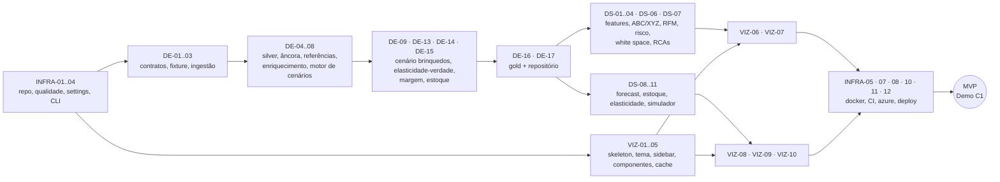

# TASKS.md — Backlog do Protótipo Comercial Kyberna

> **Como usar:** cada tarefa tem ID único (`INFRA-xx`, `DE-xx`, `DS-xx`, `VIZ-xx`), prioridade, estimativa, arquivos, dependências e **Critério de Pronto (DoD)**.
> Status: `[ ]` a fazer · `[~]` parcial (ver *Notas*) · `[x]` concluída (DoD validado via terminal).
> Prioridade: **P0** = MVP da Semana 1 · **P1** = Semana 2 · **P2** = polimento/roadmap.
> Protocolo de execução: ver §1 de [`GEMINI.md`](./GEMINI.md) / [`CLAUDE.md`](./CLAUDE.md). Contexto de produto: [`VISION.md`](./VISION.md).

---

## 🧭 Ordem de Execução — Caminho Crítico do MVP (Semana 1)

**Definição de MVP:** Cenário 1 (Indústria de Brinquedos) com as **4 telas funcionais** sobre o *fallback* local (DuckDB + Parquet), dados reais de Iowa remapeados, modelos materializados na Gold, app containerizado e publicado no Azure Container Apps. Os Cenários 2–4, o modelo LightGBM de churn e a carga no Azure SQL entram na Semana 2 (exceto se sobrar folga).

| Dia          | Foco                              | Tarefas                                                                            | Saída verificável                                                                                     |
| ------------ | --------------------------------- | ---------------------------------------------------------------------------------- | ------------------------------------------------------------------------------------------------------- |
| **D1** | Fundação                        | INFRA-01, INFRA-02, INFRA-03, INFRA-04, DE-01, DE-02, DE-06                        | `uv run pytest` verde; `uv run kyberna --help`; fixture gerada                                      |
| **D2** | Dados de verdade                  | DE-03 (download em background), DE-04, DE-05, DE-07, DE-08                         | Silver Parquet + `kyberna.duckdb` com âncora temporal + dims sintéticas determinísticas            |
| **D3** | Cenário âncora + finanças      | DE-09, DE-13, DE-14, DE-15, DE-16, DE-17                                           | Gold `c1_toys` com `fact_sales` + waterfall de margem + estoque; repositório DuckDB                |
| **D4** | Inteligência comercial + UI base | DS-01, DS-02, DS-03, DS-04, DS-06, DS-07 · VIZ-01, VIZ-02, VIZ-03, VIZ-04, VIZ-05 | Marts `abc_xyz`, `customer_risk`, `white_space`, `rep_performance`; app abre com tema e seletor |
| **D5** | Previsão, preço e telas 1–2    | DS-08, DS-09, DS-10, DS-11 · VIZ-06, VIZ-07                                       | Forecast 30d + elasticidade recuperada; Telas 1 e 2 navegáveis                                         |
| **D6** | Telas 3–4 + container            | VIZ-08, VIZ-09, VIZ-10 · INFRA-05, INFRA-07                                       | 4 telas completas; imagem Docker rodando local; CI verde                                                |
| **D7** | Nuvem + ensaio de demo            | INFRA-08, INFRA-10, INFRA-11, INFRA-12, VIZ-13, INFRA-15                           | URL pública no ACA; smoke tests; roteiro de demo ensaiado                                              |

**Semana 2 (P1):** DE-10, DE-11, DE-12, VIZ-11 (Cenários 2–4) → DS-05 (churn LightGBM) → INFRA-09, DE-18, DE-19 (Azure SQL + ADLS) → INFRA-13, DE-20 (pipeline agendado) → DS-12, VIZ-12, INFRA-14.

> [!TIP]
> Paralelização segura: DE-03 (download de ~2 anos da API) roda em background enquanto DE-04/DE-05 são desenvolvidos contra a fixture de DE-02. A trilha VIZ-01..05 não depende de dados reais — pode começar no D1 por outro agente.

---

## Trilha 1 — `[INFRA]` Infraestrutura, Repositório, Docker, Azure SQL Free Tier & Container Apps

### [x] INFRA-01 · Bootstrap do repositório `P0` `~2h`

- **Descrição:** Inicializar projeto com `uv` (Python 3.11, `.python-version`), `pyproject.toml` com build `hatchling` empacotando `src`, extras `etl` (httpx, tenacity, faker, pandera, xlsxwriter), `ml` (statsforecast, lightgbm, scikit-learn, joblib), `app` (streamlit, plotly, xlsxwriter), núcleo (duckdb, pandas, pyarrow, numpy, pydantic, pydantic-settings, typer, pyodbc, azure-identity, pyyaml) e grupo `dev` (pytest, pytest-cov, ruff, mypy, pre-commit, types-PyYAML, pandas-stubs). Criar toda a árvore de pastas do §3 do `GEMINI.md` com `__init__.py` e `.gitkeep`; `.gitignore` (data/* exceto `reference/`, `models/`, `.env`, `.venv`), `.dockerignore`, `.editorconfig`, `README.md` (quickstart em PowerShell), `git init`.
- **Arquivos:** `pyproject.toml`, `uv.lock`, `.python-version`, `.gitignore`, `.dockerignore`, `.editorconfig`, `README.md`, `src/**/__init__.py`, `data/*/.gitkeep`.
- **Depende de:** —
- **DoD:** `uv sync --all-extras` conclui sem erro; `uv run python -c "import src, duckdb, pandas, pyarrow, streamlit"` retorna 0; `git status` não lista nada de `data/` além de `reference/` e `.gitkeep`.
- **Notas:** —

### [ ] INFRA-02 · Qualidade de código (ruff, mypy, pytest, pre-commit) `P0` `~1h`

- **Descrição:** Configurar `ruff` (lint + format, `line-length=110`, regras `E,F,I,B,UP,SIM,PL,NPY,RUF`), `mypy --strict` com plugin pydantic, `pytest` (`testpaths=tests`, markers `slow`, `azure`, `ui`), cobertura com `pytest-cov`, `pre-commit` com ruff + checagens básicas (trailing whitespace, large files > 1 MB, detect-private-key).
- **Arquivos:** `pyproject.toml` (seções `[tool.*]`), `.pre-commit-config.yaml`, `tests/conftest.py`, `tests/test_smoke.py`.
- **Depende de:** INFRA-01
- **DoD:** `uv run ruff check .`, `uv run ruff format --check .`, `uv run mypy src` e `uv run pytest -q` passam; `uv run pre-commit run --all-files` passa.

### [ ] INFRA-03 · Settings tipadas, paths e segredos `P0` `~1,5h`

- **Descrição:** `Settings` (pydantic-settings, prefixo `KYBERNA_`) com: `env` (`dev|ci|prod`), `data_backend` (`auto|azure_sql|duckdb`), `data_dir`, `duckdb_path` (`data/kyberna.duckdb`), `lake_uri` (local ou `abfss://lake@<conta>.dfs.core.windows.net`), `azure_sql_server`, `azure_sql_database`, `azure_sql_auth` (`token|sql`), `azure_sql_connect_timeout_s=8`, `socrata_app_token`, `reference_date` (padrão: ontem), `app_password`. `paths.py` centraliza caminhos de camadas (`bronze_path(table)`, `gold_snapshot_path(scenario, table)`, `audit_report_path(scenario)`). `config/pipeline.yaml` com seeds, janela de ingestão (2023-01-01 → 2024-12-31) e thresholds de negócio (ABC 80/95, XYZ CV 0,5/1,0, capital travado 120 dias). `.env.example` documentado.
- **Arquivos:** `src/core/settings.py`, `src/core/paths.py`, `src/core/types.py` (`ScenarioId`, `GoldTable` como `Literal`), `config/pipeline.yaml`, `.env.example`, `tests/infra/test_settings.py`.
- **Depende de:** INFRA-01
- **DoD:** testes cobrem leitura por env var, defaults e validação de valores inválidos; `mypy` sem erros; nenhum segredo real versionado.

### [ ] INFRA-04 · CLI `kyberna` (Typer) e logging estruturado `P0` `~1,5h`

- **Descrição:** CLI com grupos `ingest`, `bronze`, `silver`, `gold`, `ml`, `audit`, `load`, `pipeline`, `fixture` (comandos inicialmente *stubs* que levantam `NotImplementedError` com o ID da tarefa responsável). Logging: formato humano (rich) em `dev`, JSON em `ci/prod`; decorator/context manager `timed_step(name)` que loga duração e contagem de linhas.
- **Arquivos:** `src/cli.py`, `src/core/logging.py`, `pyproject.toml` (`[project.scripts] kyberna = "src.cli:app"`), `tests/infra/test_cli.py`.
- **Depende de:** INFRA-02, INFRA-03
- **DoD:** `uv run kyberna --help` lista todos os grupos; `typer.testing.CliRunner` valida exit code 0 para `--help` de cada grupo.

### [ ] INFRA-05 · Dockerfile multi-stage do app `P0` `~3h`

- **Descrição:** Stage `builder` (`python:3.11-slim` + binário `uv` copiado de `ghcr.io/astral-sh/uv`) executa `uv sync --frozen --no-dev --extra app --no-install-project` e depois copia `src/`. Stage `runtime` (`python:3.11-slim`): instala `libgomp1`, `curl`, `gnupg` e `msodbcsql18` (repositório Microsoft, `ACCEPT_EULA=Y`), remove caches apt; copia `.venv`, `src/`, `config/`, `.streamlit/` e `data/gold/` (snapshot do fallback); usuário não-root `kyberna`; `ENV KYBERNA_DATA_BACKEND=duckdb`; `EXPOSE 8501`; `HEALTHCHECK` via `curl -f http://localhost:8501/_stcore/health`; `CMD streamlit run src/ui/app.py --server.port=8501 --server.address=0.0.0.0 --server.headless=true`.
- **Arquivos:** `infra/docker/Dockerfile`, `.dockerignore`.
- **Depende de:** INFRA-01, VIZ-01 (entrypoint existir), DE-16 (snapshot Gold)
- **DoD:** `docker build -f infra/docker/Dockerfile -t kyberna-app:dev .` conclui; `docker run -p 8501:8501 kyberna-app:dev` responde `ok` em `/_stcore/health`; imagem ≤ 900 MB (`docker images`); container roda como não-root (`docker exec ... whoami` ≠ root).

### [ ] INFRA-06 · Docker Compose local (app + SQL Server opcional) `P1` `~1,5h`

- **Descrição:** `compose.yaml` com serviço `app` e serviço opcional `mssql` (`mcr.microsoft.com/mssql/server:2022-latest`, profile `sql`) para testar o loader/repositório Azure SQL sem consumir a cota da nuvem. Script de init que cria o banco `kyberna` e o schema `gold`.
- **Arquivos:** `infra/docker/compose.yaml`, `infra/scripts/init_local_sql.sql`, `README.md` (seção "SQL local").
- **Depende de:** INFRA-05
- **DoD:** `docker compose -f infra/docker/compose.yaml --profile sql up -d` sobe ambos; `uv run kyberna load azure-sql --target local --scenario c1_toys` carrega dados (validado após DE-18).

### [ ] INFRA-07 · CI no GitHub Actions (PR e push na `main`) `P0` `~2h`

- **Descrição:** Workflow com jobs `quality` (`astral-sh/setup-uv`, cache, `uv sync --all-extras --frozen`, ruff, mypy, pytest com cobertura e `-m "not azure and not slow"`) e `docker-build` (build sem push, `docker/build-push-action` com cache GHA). `concurrency` por branch, `timeout-minutes: 15`. O CI usa apenas a fixture (DE-02); gera snapshot Gold de amostra antes do build (no MVP: `uv run kyberna gold build --scenario c1_toys --sample` + `uv run kyberna ml run --scenario c1_toys --sample`; após DE-20: `uv run kyberna pipeline run --sample`).
- **Arquivos:** `.github/workflows/ci.yml`.
- **Depende de:** INFRA-02, INFRA-05, DE-02
- **DoD:** workflow verde em PR de teste; duração total ≤ 10 min; falha proposital de lint bloqueia o PR.

### [ ] INFRA-08 · Bicep: Storage Account ADLS Gen2 `P0` `~1,5h`

- **Descrição:** Módulo Bicep com Storage Account `Standard_LRS`, `isHnsEnabled: true`, TLS 1.2, acesso público a blobs desabilitado, container `lake`. Atribuição de papel `Storage Blob Data Contributor` para a identidade do pipeline e `Storage Blob Data Reader` para a Managed Identity do app. `main.bicep` orquestra módulos com parâmetros (`location=brazilsouth` ou região com free tier disponível, `prefix=kyb`).
- **Arquivos:** `infra/bicep/main.bicep`, `infra/bicep/storage.bicep`, `infra/bicep/main.parameters.json`.
- **Depende de:** —
- **DoD:** `az bicep build --file infra/bicep/main.bicep` sem erros/avisos; `az deployment group what-if` mostra apenas os recursos esperados; após deploy, `az storage fs list` lista `lake`.
- **Notas:** Validar disponibilidade das ofertas gratuitas na região escolhida antes do deploy.

### [ ] INFRA-09 · Bicep: Azure SQL Database Free Tier `P1` `~2h`

- **Descrição:** Servidor lógico com administrador **Entra ID** (sem senha SQL em prod), banco `kyberna` com `sku: GP_S_Gen5` (serverless), `useFreeLimit: true`, `freeLimitExhaustionBehavior: 'AutoPause'`, `autoPauseDelay: 60`, `minCapacity: 0.5`. Firewall: "Allow Azure services" + IP de dev parametrizado. Script SQL pós-deploy: `CREATE SCHEMA gold`, usuário contido para a Managed Identity do app (`db_datareader` restrito ao schema `gold`) e para a identidade do pipeline (`db_ddladmin` + escrita no `gold`).
- **Arquivos:** `infra/bicep/sql.bicep`, `infra/scripts/grant_sql_access.sql`, `docs/runbook_demo.md` (seção cota).
- **Depende de:** INFRA-08
- **DoD:** banco criado com oferta gratuita ativa (portal mostra "Free amount remaining"); conexão via token Entra ID funciona a partir do laptop (`uv run kyberna db ping`); auto-pause confirmado após 60 min ociosos.
- **Notas:** Documentar a economia de cota: cada "despertar" consome ≥ 1.800 vCore-s (0,5 vCore × 3.600 s).

### [ ] INFRA-10 · Bicep: Container Apps Environment + Container App `P0` `~2,5h`

- **Descrição:** Environment Consumption (sem Log Analytics obrigatório; logs via `az containerapp logs`), Container App com imagem do GHCR, `minReplicas: 0`, `maxReplicas: 1`, 0,5 vCPU / 1 GiB, ingress externo `targetPort: 8501`, `transport: auto` (WebSocket), probes de liveness/readiness em `/_stcore/health`, Managed Identity *user-assigned*, secrets (`app-password`, credencial de pull do GHCR se privado) e env vars (`KYBERNA_ENV=prod`, `KYBERNA_DATA_BACKEND`).
- **Arquivos:** `infra/bicep/containerapp.bicep`, `infra/bicep/main.bicep`.
- **Depende de:** INFRA-05, INFRA-08
- **DoD:** URL pública abre o app; após ~5 min sem conexões, réplicas = 0 (`az containerapp replica list`); cold start medido < 30 s e registrado nas *Notas*.

### [ ] INFRA-11 · Autenticação GitHub → Azure via OIDC `P0` `~1h`

- **Descrição:** App Registration/Service Principal com *federated credentials* para `repo:<org>/kyberna:ref:refs/heads/main` e `environment:prod`; papéis mínimos (Contributor no Resource Group, Storage Blob Data Contributor). GitHub Environment `prod` com variáveis `AZURE_CLIENT_ID`, `AZURE_TENANT_ID`, `AZURE_SUBSCRIPTION_ID`, `AZURE_RG`. Script de bootstrap idempotente em PowerShell.
- **Arquivos:** `infra/scripts/bootstrap_azure.ps1`, `docs/runbook_demo.md` (seção setup).
- **Depende de:** INFRA-08
- **DoD:** workflow de teste executa `azure/login@v2` com OIDC e `az group show` com sucesso; nenhum client secret armazenado no GitHub.

### [ ] INFRA-12 · CD: build, push GHCR e deploy no Container Apps `P0` `~2h`

- **Descrição:** `deploy.yml` disparado em push na `main` (após CI verde) e manual (`workflow_dispatch`): gera snapshot Gold (baixa de `lake/gold/snapshot/` no ADLS se disponível; senão o mesmo comando de amostra do INFRA-07). **No MVP**, antes do DE-19 existir, o snapshot real gerado no laptop é publicado manualmente com `az storage fs directory upload -f lake -s data/gold/snapshot -d gold/snapshot --recursive --auth-mode login`, garantindo que a demo pública use dados reais remapeados, nunca a fixture), build da imagem, push para `ghcr.io/<org>/kyberna-app:{sha,latest}`, `az containerapp update --image ...:sha`. Smoke test pós-deploy com `curl` no health endpoint (com retry para cold start).
- **Arquivos:** `.github/workflows/deploy.yml`.
- **Depende de:** INFRA-07, INFRA-10, INFRA-11
- **DoD:** push na `main` publica nova revisão ativa; smoke test verde; rollback documentado (`az containerapp revision activate`).

### [ ] INFRA-13 · Workflow agendado do pipeline de dados e retreino `P1` `~2h`

- **Descrição:** `data-pipeline.yml` com `schedule: cron '0 9 * * 1'` (segunda 06:00 BRT) + `workflow_dispatch` com inputs (`scenario`, `full_refresh`). Passos: OIDC login → `uv sync --extra etl --extra ml` → `kyberna pipeline run --scenario all --lake remote` → `kyberna load azure-sql --scenario all` (uma única janela de despertar do banco) → upload do snapshot Gold como artifact → disparo do `deploy.yml`. `timeout-minutes: 45`, `concurrency: data-pipeline`.
- **Arquivos:** `.github/workflows/data-pipeline.yml`.
- **Depende de:** DE-20, DE-18, DE-19, INFRA-11
- **DoD:** execução manual verde; tempo total registrado (meta ≤ 25 min ⇒ ≤ ~110 min/mês, dentro dos 2.000 min); relatório de qualidade (DE-20) anexado como artifact.

### [ ] INFRA-14 · Governança de custo e observabilidade `P1` `~1,5h`

- **Descrição:** Budget no Resource Group (alerta em US$ 1 e US$ 5), alertas de métrica de cota gratuita do Azure SQL (free amount remaining < 20%), comando `kyberna ops status` que mostra: réplicas do ACA, estado do banco (Online/Paused), cota restante e data da última carga Gold. Documentar limites free: ACA (180 mil vCPU-s, 360 mil GiB-s, 2 mi requisições/mês), Azure SQL (100 mil vCore-s, 32 GB), Actions (2.000 min).
- **Arquivos:** `infra/bicep/budget.bicep`, `src/cli.py` (grupo `ops`), `docs/runbook_demo.md`.
- **Depende de:** INFRA-09, INFRA-10
- **DoD:** budget visível no portal; `uv run kyberna ops status` retorna os 4 indicadores; alertas testados com limiar artificial.

### [ ] INFRA-15 · Runbook de demo e proteção de acesso `P0` `~1,5h`

- **Descrição:** Gate de senha simples no app (`KYBERNA_APP_PASSWORD`, comparação com `hmac.compare_digest`, estado em sessão). Runbook: checklist pré-demo (abrir URL 10 min antes para cold start; se demo "ao vivo" no Azure SQL, acordar o banco com `kyberna db wake` 5 min antes), roteiro de 15 min por cenário (baseado no §6 do `VISION.md`), plano B offline (`docker run` local) e FAQ técnico para perguntas de prospects (segurança, LGPD, integração ERP).
- **Arquivos:** `src/ui/components/auth_gate.py`, `docs/runbook_demo.md`.
- **Depende de:** VIZ-01
- **DoD:** acesso sem senha bloqueado (teste AppTest); runbook revisado pelo usuário; ensaio cronometrado ≤ 15 min registrado nas *Notas*.

---

## Trilha 2 — `[DE]` Data Engineering

### [ ] DE-01 · Contratos de dados por camada (Pandera + Pandas & DuckDB SQL) `P0` `~2h`

- **Descrição:** Schemas Pandera (backend Pandas) para Bronze (todas as colunas Iowa como `str` + metadados `_ingested_at`, `_batch_id`, `_source`), Silver (`SilverSalesSchema` tipado: `invoice_line_id`, `date`, `store_number`, `store_name`, `city`, `county`, `zip_code`, `category_name`, `vendor_number`, `vendor_name`, `item_number`, `item_description`, `pack`, `bottle_volume_ml`, `unit_cost`, `unit_price`, `units`, `sale_amount`), dims sintéticas e tabelas Gold (§4.2 do `GEMINI.md`). Checks de negócio: `units > 0`, `unit_price >= unit_cost * 0.5`, `pack ∈ [1, 96]`, unicidade de `invoice_line_id`, `scenario_id` válido. Helper `validate(df_or_table, schema, layer)` que loga falhas resumidas.
- **Arquivos:** `src/etl/contracts.py`, `tests/etl/test_contracts.py`.
- **Depende de:** INFRA-03
- **DoD:** testes positivos e negativos (dados violando cada check) passam; schemas exportados e reutilizados pelas tarefas seguintes.

### [ ] DE-02 · Fixture sintética para testes e CI `P0` `~2h`

- **Descrição:** Gerador determinístico de ~20 mil linhas no formato **exato** da API Socrata (mesmas colunas e tipos-string), com 300 lojas, 400 itens, 15 vendors, 24 meses, sazonalidade semanal/anual, ciclos de recompra heterogêneos por loja (algumas lojas "adormecem" no último trimestre) e intermitência na cauda longa. Comando `kyberna fixture generate`.
- **Arquivos:** `src/etl/ingest/fixture.py`, `tests/fixtures/iowa_sample.parquet` (≤ 2 MB, versionado), `tests/conftest.py`.
- **Depende de:** DE-01, INFRA-04
- **DoD:** fixture valida contra `BronzeSalesSchema`; duas execuções geram arquivos idênticos (hash SHA-256 igual); tamanho ≤ 2 MB.

### [ ] DE-03 · Ingestão Iowa Liquor Sales (Socrata API) → Raw → Bronze `P0` `~4h`

- **Descrição:** Cliente `httpx` para `https://data.iowa.gov/resource/m3tr-qhgy.csv` com `$where=date between '<ini>' and '<fim>'`, `$order=:id`, paginação `$limit=50000`/`$offset`, header `X-App-Token` opcional, retry exponencial com `tenacity` (429/5xx), download por mês (idempotente: pula meses já presentes salvo `--force`). Raw em CSV por `year=/month=`; conversão via DuckDB para Bronze Parquet particionado (`year=/month=`) e registro na tabela `bronze.sales_raw` em `data/kyberna.duckdb`, adicionando metadados de ingestão. Flag `--sample-frac` para amostragem estratificada por loja.
- **Arquivos:** `src/etl/ingest/socrata_client.py`, `src/etl/ingest/raw_to_bronze.py`, `src/etl/lake.py`, `src/cli.py`, `tests/etl/test_ingest.py` (HTTP mockado com `httpx.MockTransport`).
- **Depende de:** DE-01, INFRA-04
- **DoD:** `uv run kyberna ingest --start 2023-01-01 --end 2024-12-31` conclui (registrar linhas e tempo nas *Notas*); reexecução não duplica dados (contagem idêntica); Bronze valida no contrato; testes com mock cobrem paginação, retry e idempotência.
- **Notas:** Volume esperado: alguns milhões de linhas/ano. Se o download completo for lento, usar `--sample-frac 0.3` para o MVP.

### [ ] DE-04 · Silver: limpeza, tipagem e deduplicação (DuckDB SQL) `P0` `~3h`

- **Descrição:** Pipeline **SQL no DuckDB** Bronze → Silver (`silver.sales`): cast de tipos, parse de datas, normalização de texto (trim, upper → title case, remoção de acentos/duplos espaços em `store_name`/`city`), deduplicação por `invoice_line_id` (`QUALIFY ROW_NUMBER() OVER (...) = 1`), remoção de devoluções/valores ≤ 0 e outliers grosseiros (`unit_price` fora de p0,1–p99,9 por item), preenchimento de `category_name` nulo pela moda do item, derivação de `chain_name` (prefixo da rede extraído de `store_name`, ex.: "Hy-Vee", "Fareway", "Casey's") para o Cenário 3. Persiste em `data/silver/sales.parquet` e na tabela `silver.sales` do `kyberna.duckdb`. Relatório de linhas removidas por regra.
- **Arquivos:** `src/etl/silver/clean.py`, `tests/etl/test_silver_clean.py`.
- **Depende de:** DE-03 (ou DE-02 para desenvolvimento)
- **DoD:** `uv run kyberna silver build --sample` gera Silver válida no contrato; relatório de remoções logado; teste garante que nenhuma linha válida da fixture é descartada indevidamente; execução sobre a base completa ≤ 2 min (registrar).

### [ ] DE-05 · Silver: âncora temporal (time-shift via SQL) `P0` `~1h`

- **Descrição:** Deslocar todas as datas no DuckDB por um offset inteiro **de semanas** (preserva dia da semana e sazonalidade semanal) para que `max(date)` fique na semana de `reference_date`. Registrar `original_date` e `time_shift_days` em metadados. Opcional `--no-shift` para análise histórica.
- **Arquivos:** `src/etl/silver/time_anchor.py`, `tests/etl/test_time_anchor.py`.
- **Depende de:** DE-04
- **DoD:** testes provam: offset múltiplo de 7; `max(date)` ∈ [reference_date − 6, reference_date]; distribuição por dia da semana idêntica antes/depois.
- **Notas:** A sazonalidade anual (ex.: picos de fim de ano) desloca até 3 dias — aceitável para a demo.

### [ ] DE-06 · Tabelas de referência brasileiras (versionadas) `P0` `~2h`

- **Descrição:** `municipios_br.csv` com ~150 municípios (código IBGE, nome, UF, região, latitude, longitude, população) cobrindo todas as 27 UFs com peso populacional; `ufs_br.csv` (UF, região, alíquota ICMS interna de referência); `category_maps/` com mapeamentos categoria Iowa → família por cenário (`toys.csv`, `beverages.csv`) baseados em regex sobre `category_name` (ex.: `.*VODKA.*` → *Jogos Educativos* / *Vodka*; `.*WHISK.*|.*BOURBON.*|.*SCOTCH.*` → *Quebra-Cabeças* / *Whisky*; `.*RUM.*` → *Primeira Infância* / *Rum*; `.*TEQUILA.*|.*MEZCAL.*` → *Brinquedos de Madeira* / *Tequila*; `.*LIQUEUR.*|.*SCHNAPPS.*|.*CORDIAL.*` → *Linha Escolar* / *Licores*; `.*GIN.*` → *Jogos de Tabuleiro* / *Gin*; `.*BRANDY.*|.*COCKTAIL.*` → *Pelúcias* / *Cachaças e Destilados Nacionais*; default → *Outros*).
- **Arquivos:** `data/reference/municipios_br.csv`, `data/reference/ufs_br.csv`, `data/reference/category_maps/toys.csv`, `data/reference/category_maps/beverages.csv`, `src/etl/silver/reference.py`, `tests/etl/test_reference.py`.
- **Depende de:** INFRA-01
- **DoD:** loaders tipados; teste garante 27 UFs presentes e cobertura de 100% das categorias da fixture (nenhuma linha cai em *Outros* acima de 5% do faturamento).

### [ ] DE-07 · Enriquecimento sintético determinístico (Faker `pt_BR` + Pandas) `P0` `~4h`

- **Descrição:** Gerar dimensões estáveis a partir das chaves naturais: **clientes** (por `store_number`: CNPJ válido com dígito verificador, razão social, nome fantasia, segmento, porte P/M/G derivado do faturamento real, telefone celular WhatsApp `+55 DDD 9XXXX-XXXX` coerente com a UF, e-mail, data de cadastro), **geografia** (cada `county` de Iowa → município BR por amostragem ponderada por população, preservando a concentração: condados de maior venda → capitais/polos), **RCAs** (25–40 representantes com nome, região de atuação, taxa de comissão 3–7%, carteira atribuída por UF/região com balanceamento de faturamento). Seed derivada de `hash(natural_key) ^ global_seed` (não depender da ordem). Gerar em lote (listas → `pd.DataFrame` → salvas em `silver.dim_*` no `kyberna.duckdb` e Parquet), sem loops sobre o fato.
- **Arquivos:** `src/etl/silver/enrich.py`, `tests/etl/test_enrich.py`.
- **Depende de:** DE-04, DE-06
- **DoD:** CNPJs 100% válidos (teste de DV); duas execuções → dims idênticas; adicionar uma loja nova não altera os atributos das existentes (teste); cada cliente tem exatamente um RCA e um município.

### [ ] DE-08 · Motor de Cenários (`ScenarioConfig` + YAML) `P0` `~3h`

- **Descrição:** Modelo Pydantic `ScenarioConfig`: `id`, `display_name`, `company_profile` (nome fictício, UF de origem), `labels` (customer, customer_plural, product_family, sales_rep, branch, unit, box…), `filters` (ex.: rede/loja alvo), `category_map` (arquivo), `perspective` (`seller|buyer`), `capabilities` (flags da matriz §5.5 do `VISION.md`), `finance_profile` (referência a `config/finance/*.yaml`), `retail_markup` (C3/C4). Interface `ScenarioBuilder` (Protocol) operando sobre a conexão DuckDB e dims Silver para materializar as tabelas Gold. Registro de cenários e comando `kyberna gold build --scenario <id|all>`.
- **Arquivos:** `src/core/scenarios.py`, `src/etl/scenarios/base.py`, `config/scenarios/c1_toys.yaml`, `config/scenarios/c2_beverages.yaml`, `config/scenarios/c3_retail_chain.yaml`, `config/scenarios/c4_single_store.yaml`, `tests/etl/test_scenarios_config.py`.
- **Depende de:** DE-01, INFRA-03
- **DoD:** os 4 YAMLs validam no Pydantic; YAML inválido gera erro legível; `ScenarioConfig.labels` cobre todas as chaves usadas pela UI (lista em teste).

### [ ] DE-09 · Cenário 1 — Indústria de Brinquedos (Caso Âncora) `P0` `~4h`

- **Descrição:** Builder `c1_toys` (SQL no DuckDB + mapeamento determinístico de SKUs em Pandas): perspectiva *seller* (a empresa é o fabricante fictício com sede em SP); `vendor_name` → **Linhas/Marcas** com nomes lúdicos fictícios; `category_name` → famílias de brinquedos via `toys.csv`; `item_description` → nomes de produto gerados por templates determinísticos por família (ex.: *Quebra-Cabeça 500 peças — Mapas do Brasil*, *Blocos de Madeira 60 peças*, *Jogo da Memória Bilíngue*, *Kit Escolar Aquarela 12 cores*), EAN-13 válido; `pack` → **unidades por caixa master**; `boxes = units / pack`; lojas → **lojistas (CNPJs)**; RCAs da DE-07; reescala de preços para faixa realista de brinquedos (preço unitário de venda R$ 15–R$ 350 por família, preservando a razão custo/preço relativa e as variações temporais da base).
- **Arquivos:** `src/etl/scenarios/c1_toys.py`, `config/scenarios/c1_toys.yaml`, `tests/etl/test_c1_toys.py`.
- **Depende de:** DE-07, DE-08
- **DoD:** Gold `c1_toys` contém as 5 famílias obrigatórias (*Jogos Educativos, Primeira Infância, Brinquedos de Madeira, Quebra-Cabeças, Linha Escolar*) com ≥ 85% do faturamento; nenhum termo de bebida remanescente em textos visíveis (teste com lista de termos proibidos: vodka, whisky, rum, liquor, bourbon…); EAN-13 válidos; contrato Gold válido.

### [ ] DE-10 · Cenário 2 — Distribuidora B2B de Bebidas `P1` `~2,5h`

- **Descrição:** Builder `c2_beverages`: semântica de bebidas traduzida (`beverages.csv`), fabricantes com nomes fictícios brasileiros, clientes segmentados em canal *on-trade* (bares, restaurantes) e *off-trade* (empórios, supermercados, adegas) a partir do perfil de compra (mix e ticket), vendedores no papel de RCAs, preços convertidos para R$ com fator configurável.
- **Arquivos:** `src/etl/scenarios/c2_beverages.py`, `config/scenarios/c2_beverages.yaml`, `tests/etl/test_c2_beverages.py`.
- **Depende de:** DE-08, DE-07, DE-14
- **DoD:** Gold `c2_beverages` válida; descrições de produto em pt-BR; canal on/off-trade atribuído a 100% dos clientes.

### [ ] DE-11 · Cenário 3 — Rede de Lojas / Franquias `P1` `~3h`

- **Descrição:** Builder `c3_retail_chain`: filtra a maior rede por `chain_name` (configurável) → **Filial 01..N** (ordenadas por faturamento) com municípios BR; perspectiva *buyer*: `unit_price` original vira **custo**, preço ao consumidor = custo × `retail_markup` por família (ex.: 1,30–1,55); vendas ao consumidor aproximadas pelas compras da filial (sell-in como proxy de sell-out, declarado no YAML); sem RCA (gerente de loja como responsável).
- **Arquivos:** `src/etl/scenarios/c3_retail_chain.py`, `config/scenarios/c3_retail_chain.yaml`, `tests/etl/test_c3_retail_chain.py`.
- **Depende de:** DE-08, DE-07, DE-14
- **DoD:** ≥ 15 filiais; margem bruta por família coerente com o markup configurado (teste); `dim_branch` com município/UF; contrato válido.

### [ ] DE-12 · Cenário 4 — Comércio Local (PDV Único) `P1` `~4h`

- **Descrição:** Builder `c4_single_store`: seleciona a loja de maior volume; desagrega as compras semanais em **vendas diárias** com perfil de dia da semana configurável (vetorizado via DuckDB/Pandas); cria **Clube de Fidelidade** sintético (2–4 mil CPFs válidos) e aloca ~40% das vendas a tickets identificados por meio de amostragem vetorizada com afinidade cliente↔família estável (o restante = consumidor anônimo); preço ao consumidor com markup varejo.
- **Arquivos:** `src/etl/scenarios/c4_single_store.py`, `config/scenarios/c4_single_store.yaml`, `tests/etl/test_c4_single_store.py`.
- **Depende de:** DE-08, DE-07, DE-14
- **DoD:** soma das unidades diárias = soma das compras originais (± arredondamento ≤ 0,5%); clientes do clube com recorrência heterogênea (CV do intervalo entre compras > 0,3 na média); contrato válido; execução ≤ 60 s.

### [ ] DE-13 · Injeção de variação de preço com elasticidade-verdade `P0` `~3h`

- **Descrição:** Os preços de Iowa são quase fixos (markup regulado), o que impede estimar elasticidade. Injetar, de forma determinística, **eventos de preço** por família/SKU (promoções de 5–20% por 1–3 semanas e reajustes permanentes de 3–8%) e ajustar as unidades por `units' = units × (p'/p)^β_true`, com `β_true` por família definido em `config/pipeline.yaml` (ex.: *Linha Escolar* −1,8; *Jogos Educativos* −1,2; *Brinquedos de Madeira* −0,6) mais ruído log-normal. Persistir `price_event_id`, `promo_flag` e a tabela `elasticity_ground_truth` para validação do DS-10.
- **Arquivos:** `src/etl/silver/price_events.py`, `config/pipeline.yaml`, `tests/etl/test_price_events.py`.
- **Depende de:** DE-05, DE-08
- **DoD:** fração de linhas afetadas entre 10% e 25%; volume total varia < 5% vs. original; teste de regressão log-log simples sobre os dados injetados recupera `β_true` com erro absoluto < 0,25 por família.
- **Notas:** Documentar no `docs/data_dictionary.md` que a elasticidade é **calibrada sinteticamente** (transparência com o prospect).

### [ ] DE-14 · Motor financeiro: waterfall da margem de contribuição (DuckDB SQL) `P0` `~3h`

- **Descrição:** Implementar a definição canônica (§4.3 do `GEMINI.md`) em **SQL claro e auditável no DuckDB**: **desconto** por porte do cliente e por RCA (alguns RCAs com viés de desconto alto — insumo para a narrativa da Tela 2); **impostos**: ICMS interestadual a partir da UF de origem (SP → S/SE exceto ES: 12%; N/NE/CO/ES: 7%; interno SP: 18%), PIS/COFINS (regime configurável: 9,25% não-cumulativo ou 3,65% cumulativo), IPI por fora (alíquota por família, configurável, não entra na margem); **comissão** = taxa do RCA × receita após desconto; **frete** = custo por caixa por região (tabela). Todas as alíquotas em `config/finance/*.yaml`, com aviso de simplificação.
- **Arquivos:** `src/etl/finance/margin_waterfall.py`, `src/etl/finance/taxes.py`, `config/finance/tax_rules.yaml`, `config/finance/freight.yaml`, `config/finance/commission.yaml`, `config/finance/discounts.yaml`, `tests/etl/test_margin_waterfall.py`.
- **Depende de:** DE-07, DE-08
- **DoD:** teste de identidade contábil por linha (`contribution_margin == net_revenue − cogs − commission − freight`, tolerância 1e-6); casos unitários de ICMS por par origem/destino; margem de contribuição média do C1 entre 18% e 35% com dispersão relevante entre RCAs (desvio-padrão ≥ 4 p.p.).

### [ ] DE-15 · Snapshot sintético de estoque `P0` `~2,5h`

- **Descrição:** Para cada SKU (e filial no C3): `stock_units` = demanda média diária (últimos 90 dias) × cobertura amostrada de mistura controlada (≈ 10% ruptura iminente: 0–7 dias; ≈ 60% saudável: 15–60 dias; ≈ 15% alto: 60–120 dias; ≈ 15% excesso: 120–365 dias), `lead_time_days` por família (fabricação/compra), `unit_cost`, `last_receipt_date`. Determinístico por SKU.
- **Arquivos:** `src/etl/gold/inventory_snapshot.py`, `tests/etl/test_inventory_snapshot.py`.
- **Depende de:** DE-09 (e DE-11 para o C3)
- **DoD:** proporções das faixas dentro de ±3 p.p. do configurado; capital travado (> 120 dias) do C1 entre 10% e 25% do valor total de estoque; contrato válido.

### [ ] DE-16 · Gold: star schema, marts base, catálogo `.duckdb` e Relatório Excel de Conciliação `P0` `~3,5h`

- **Descrição:** Materializar via SQL no DuckDB por cenário `dim_date`, `dim_product`, `dim_customer`, `dim_sales_rep`, `dim_branch`, `dim_geography`, `fact_sales`, `mart_margin_monthly` (por mês × família × UF × RCA) e `mart_inventory_position` (base). Salvar tabelas no schema `gold` de `data/kyberna.duckdb` (pronto para DBeaver / `duckdb -ui`) e exportar **snapshot Parquet** compacto em `data/gold/snapshot/<scenario_id>/<tabela>.parquet` (zstd) para o fallback e imagem Docker. Implementar também `src/etl/audit.py` e o comando `uv run kyberna audit --scenario <id>`, gerando `data/reports/conciliacao_<scenario_id>.xlsx` (abas: Resumo DRE/Waterfall, Amostra de 100 pedidos com memória de cálculo coluna a coluna, Validação de Integridade).
- **Arquivos:** `src/etl/gold/star_schema.py`, `src/etl/gold/marts.py`, `src/etl/audit.py`, `tests/etl/test_gold.py`.
- **Depende de:** DE-09, DE-14, DE-15
- **DoD:** `uv run kyberna gold build --scenario c1_toys` gera todas as tabelas no `.duckdb` e Parquet; `uv run kyberna audit --scenario c1_toys` gera a planilha Excel formatada; integridade referencial testada; snapshot completo de um cenário ≤ 60 MB; soma de `gross_revenue` da Gold = Silver remapeada (± 0,01%).

### [ ] DE-17 · Repositório de dados com fallback (DuckDB local ↔ Azure SQL) `P0` `~3h`

- **Descrição:** `DataRepository` (Protocol retornando `pd.DataFrame`), `DuckDBRepository` (conexão in-process lendo os Parquet do snapshot via views `CREATE VIEW gold_<t> AS SELECT * FROM read_parquet(...)` e retornando `.df()`), `AzureSQLRepository` (pyodbc + token Entra ID via `azure-identity`, `connect_timeout` curto, conexão por consulta, retorno `pd.DataFrame`), factory `get_repository(settings)` com política `auto` (tenta Azure SQL; em erro 40613/timeout/driver ausente → DuckDB + motivo registrado). API de alto nível: `table(name, scenario_id, columns=None, filters=None)` e `query(sql, params)` parametrizado.
- **Arquivos:** `src/db/repository.py`, `src/db/duckdb_repo.py`, `src/db/azure_sql_repo.py`, `tests/db/test_repository.py`.
- **Depende de:** DE-16, INFRA-03
- **DoD:** testes com DuckDB real sobre snapshot de fixture; teste de fallback simulando falha de conexão Azure (mock) retorna backend `duckdb` e motivo; consulta típica de mart ≤ 100 ms local.

### [ ] DE-18 · Loader Gold → Azure SQL `P1` `~3h`

- **Descrição:** Migrações SQL versionadas (`V001__gold_schema.sql`, `V002__indexes.sql`) com tabela `gold.schema_version`; carga por tabela via **staging** (`gold.stg_<t>`) com bulk insert (`pyodbc` `fast_executemany=True` em lotes de 50 mil linhas) e troca atômica (`BEGIN TRAN; DELETE alvo WHERE scenario_id=?; INSERT SELECT FROM stg; COMMIT`). Índices *clustered columnstore* em `fact_sales` e marts grandes. Comando `kyberna load azure-sql --scenario <id|all> [--target local|azure]`. Toda a carga em uma única sessão para minimizar despertares.
- **Arquivos:** `src/db/loader.py`, `src/db/ddl/V001__gold_schema.sql`, `src/db/ddl/V002__indexes.sql`, `tests/db/test_loader.py` (marker `azure`; roda contra SQL Server local do INFRA-06).
- **Depende de:** DE-16, INFRA-09 (ou INFRA-06 para teste local)
- **DoD:** contagens de linhas e soma de `gross_revenue` idênticas entre snapshot Parquet e Azure SQL por cenário; recarga é idempotente; tempo de carga do C1 registrado (meta ≤ 5 min).

### [ ] DE-19 · Sync do lakehouse com ADLS Gen2 `P1` `~2h`

- **Descrição:** `lake.py` resolve URIs locais (`data/...`) ou remotas (`abfss://lake@<conta>.dfs.core.windows.net/...`) a partir de `Settings.lake_uri`; DuckDB configurado com a extensão oficial `azure` (`CREATE SECRET (TYPE azure, PROVIDER credential_chain, ...)`) para ler/escrever Parquet diretamente no ADLS Gen2 sem precisar de `deltalake`. Flag global `--lake local|remote`.
- **Arquivos:** `src/etl/lake.py`, `src/cli.py`, `tests/etl/test_lake.py`.
- **Depende de:** INFRA-08, DE-16
- **DoD:** `uv run kyberna gold build --scenario c1_toys --lake remote` escreve Parquet no ADLS e o DuckDB remoto lê a mesma contagem; testes locais não exigem credenciais (remoto sob marker `azure`).

### [ ] DE-20 · Orquestrador do pipeline e relatório de qualidade `P1` `~2,5h`

- **Descrição:** `kyberna pipeline run [--scenario all] [--sample] [--lake local|remote] [--skip-ingest]` encadeando ingest → bronze → silver → price events → cenários → finanças → estoque → gold → ML (DS) → snapshot + `audit` (Excel de conciliação), com `timed_step`, falha rápida e retomada por etapa (`--from-step`). Relatório `data/reports/quality_<data>.json` + `.md` (linhas por camada, remoções por regra, checagens de contrato, métricas dos modelos, tempos).
- **Arquivos:** `src/etl/pipeline.py`, `src/cli.py`, `tests/etl/test_pipeline.py`.
- **Depende de:** DE-16, DS-02..DS-10
- **DoD:** `uv run kyberna pipeline run --sample` executa ponta a ponta em ≤ 3 min no laptop e no CI; relatório e planilha de conciliação gerados e legíveis.

---

## Trilha 3 — `[DS]` Data Science

### [ ] DS-01 · Base de features (cliente, SKU, cliente×família) `P0` `~3h`

- **Descrição:** Consultas SQL no DuckDB + funções Pandas vetorizadas reutilizáveis, todas parametrizadas por `as_of_date` (evita vazamento temporal): por cliente — recência, frequência (pedidos distintos), valor (receita e margem), ticket médio, nº de famílias compradas, tendência de receita (inclinação 3 vs. 6 meses), estatísticas de intervalo entre compras (média, mediana, desvio, nº de intervalos); por SKU — demanda diária/semanal, CV semanal, receita, margem; por cliente×família — receita, última compra, participação.
- **Arquivos:** `src/ml/features.py`, `tests/ml/test_features.py`.
- **Depende de:** DE-16
- **DoD:** teste prova ausência de vazamento (nenhuma feature usa dados > `as_of_date`); valores conferidos manualmente em cliente de teste da fixture.

### [ ] DS-02 · Classificação ABC/XYZ `P0` `~1,5h`

- **Descrição:** ABC por margem de contribuição acumulada (cortes 80%/95% configuráveis; alternativa por receita via parâmetro); XYZ pelo CV da demanda semanal nas últimas 26 semanas (X < 0,5; Y 0,5–1,0; Z > 1,0). Política sugerida por célula (ex.: AX "estoque de segurança alto, nunca faltar"; CZ "sob encomenda ou descontinuar"). Saída `mart_abc_xyz` por cenário (e por filial no C3).
- **Arquivos:** `src/ml/abc_xyz.py`, `config/pipeline.yaml`, `tests/ml/test_abc_xyz.py`.
- **Depende de:** DS-01
- **DoD:** participações acumuladas somam 100%; todos os SKUs classificados; política presente nas 9 células.

### [ ] DS-03 · Segmentação RFM `P0` `~2h`

- **Descrição:** Scores R, F, M em quintis (R invertido; desempate por *rank* para evitar quintis vazios), mapeamento para segmentos (Campeões, Leais, Promissores, Novos, Precisam de Atenção, Em Risco, Não Pode Perder, Hibernando, Perdidos) via tabela de regras configurável. M baseado em **margem de contribuição**, não receita (princípio "margem acima de volume").
- **Arquivos:** `src/ml/rfm.py`, `config/pipeline.yaml`, `tests/ml/test_rfm.py`.
- **Depende de:** DS-01
- **DoD:** todo cliente recebe exatamente um segmento; distribuição de segmentos plausível na fixture (nenhum segmento com > 40% dos clientes).

### [ ] DS-04 · Ciclo de recompra e índice de risco heurístico `P0` `~2h`

- **Descrição:** Por cliente: ciclo esperado = mediana dos intervalos entre pedidos (fallback para mediana do segmento/família quando < 3 intervalos); `overdue_ratio = days_since_last / expected_cycle`; probabilidade heurística de churn via CDF empírica dos intervalos do próprio cliente (com *shrinkage* para a distribuição do segmento); status: *Ativo* (ratio < 1), *Atenção* (1–1,5), *Adormecido* (1,5–3), *Perdido* (> 3 ou > 365 dias). **Receita anual em risco** = receita 12m × probabilidade. Saída parcial de `mart_customer_risk`.
- **Arquivos:** `src/ml/churn.py` (parte heurística), `tests/ml/test_churn_heuristic.py`.
- **Depende de:** DS-01
- **DoD:** probabilidades ∈ [0, 1] e monotônicas em `days_since_last` (teste de propriedade); clientes "adormecidos" plantados na fixture (DE-02) aparecem como *Adormecido*/*Perdido* em ≥ 90% dos casos.

### [ ] DS-05 · Modelo de churn supervisionado (LightGBM) `P1` `~4h`

- **Descrição:** Dataset com múltiplos *snapshots* mensais (`as_of_date` = fim de cada mês dos últimos 12): features do DS-01 + `overdue_ratio` + segmento RFM; rótulo = sem compra nos 60 dias seguintes (configurável). Split temporal (últimos 2 snapshots para teste). `LGBMClassifier` com `class_weight` balanceado e calibração isotônica (`CalibratedClassifierCV` com `cv` pré-ajustado em janela de validação). Explicabilidade: `pred_contrib=True` → top-3 fatores traduzidos para pt-BR ("Atraso de 2,3× no ciclo de compra", "Queda de 40% no ticket"). Probabilidade final = modelo (se ROC-AUC ≥ 0,75 no teste) senão heurística do DS-04.
- **Arquivos:** `src/ml/churn.py`, `src/ml/registry.py`, `tests/ml/test_churn_model.py`, `docs/model_cards/churn.md`.
- **Depende de:** DS-04, DS-12
- **DoD:** ROC-AUC, PR-AUC e Brier registrados no `metadata.json`; Brier do modelo calibrado < Brier da heurística no conjunto de teste; top-3 fatores preenchidos para 100% dos clientes em risco; model card publicado.

### [ ] DS-06 · Matriz White Space e recomendação de cross-sell `P0` `~3,5h`

- **Descrição:** Matriz cliente × família (binária e por receita). Dois sinais combinados: (1) **afinidade item-item** — similaridade cosseno entre famílias na matriz binária (scikit-learn `cosine_similarity` em matriz esparsa); (2) **lookalike** — vizinhos mais próximos (`NearestNeighbors`, métrica cosseno) do cliente por perfil de mix normalizado + porte + região; score = taxa de adoção da família entre os vizinhos × afinidade com as famílias já compradas. **Potencial R$** = mediana da receita anual da família entre vizinhos que a compram × score × (1 − prob. churn). Saída `mart_white_space` (top-3 oportunidades por cliente + matriz agregada segmento × família com penetração %).
- **Arquivos:** `src/ml/white_space.py`, `tests/ml/test_white_space.py`.
- **Depende de:** DS-01, DS-04
- **DoD:** nunca recomenda família que o cliente já compra (teste); backtest: ocultando 20% das compras cliente×família mais recentes, *hit rate@3* ≥ 2× o baseline de popularidade (registrar valor); potencial total do C1 coerente (< 30% do faturamento anual).

### [ ] DS-07 · Eficiência de Representantes (RCA) `P0` `~2h`

- **Descrição:** Por RCA: receita, margem de contribuição R$ e %, desconto médio concedido, positivação (clientes ativos/carteira), penetração de mix (famílias por cliente), % da carteira em risco e R$ em risco, oportunidade White Space da carteira. Quadrantes: *Estrela* (volume e margem altos), *Volume sem margem*, *Margem sem volume*, *Atenção* (cortes pela mediana). Saída `mart_rep_performance`.
- **Arquivos:** `src/ml/rep_performance.py`, `tests/ml/test_rep_performance.py`.
- **Depende de:** DS-04, DS-06, DE-14
- **DoD:** soma da receita por RCA = receita total do cenário; RCAs com viés de desconto injetado (DE-14) caem no quadrante *Volume sem margem* ou *Atenção*.

### [ ] DS-08 · Previsão de demanda 30 dias (StatsForecast) `P0` `~4h`

- **Descrição:** Séries `unique_id = sku` (e `sku|filial` no C3) em frequência diária com zeros preenchidos; modelos `AutoETS(season_length=7)`, `CrostonOptimized()` (séries intermitentes, ADI > 1,32), `SeasonalNaive(7)` como baseline; `h=30`, `level=[80, 95]`; seleção do melhor modelo por série via `cross_validation` (3 janelas, `step_size=30`) usando MAE; séries com < 60 dias de histórico → média móvel da família rateada. Paralelismo `n_jobs=-1`. Agregar também por família. Saída `mart_forecast_30d` (histórico 90d + previsão + intervalos + modelo escolhido + WAPE).
- **Arquivos:** `src/ml/forecast.py`, `tests/ml/test_forecast.py` (marker `slow` para o full), `docs/model_cards/forecast.md`.
- **Depende de:** DS-01
- **DoD:** WAPE agregado por família ≤ 35% e melhor que SeasonalNaive em ≥ 60% das séries A (registrar); previsões ≥ 0; tempo de treino do C1 ≤ 5 min no runner do GitHub (registrar).

### [ ] DS-09 · Estoque prescritivo: ruptura, capital travado e remanejamento `P0` `~3h`

- **Descrição:** Com `mart_forecast_30d` + snapshot de estoque: demanda diária prevista, **cobertura em dias**, **dias até ruptura**, estoque de segurança `z·σ_d·√LT` (z por classe ABC: A=1,65; B=1,28; C=0,84), ponto de pedido, quantidade sugerida (arredondada para caixas master), **capital travado** (excedente acima de 120 dias × custo) com ação sugerida por classe (AX/BX → reduzir compras; CZ → liquidação/bonificação; família sazonal → manter até a data sazonal). **C3:** remanejamento entre filiais — pareamento guloso vetorizado entre filiais com excesso e com ruptura do mesmo SKU, priorizando menor distância (haversine entre municípios) e maior valor liberado. Saídas: `mart_inventory_position`, `mart_branch_transfers`.
- **Arquivos:** `src/ml/inventory.py`, `tests/ml/test_inventory.py`.
- **Depende de:** DS-08, DS-02, DE-15
- **DoD:** casos unitários de ponto de pedido e cobertura; nenhuma transferência deixa a filial de origem abaixo do seu ponto de pedido (teste); capital travado reconciliado com DE-15.

### [ ] DS-10 · Modelo de elasticidade-preço `P0` `~3,5h`

- **Descrição:** Duas abordagens complementares: (1) **interpretável** — regressão log-log por família `ln(Q) = α + β·ln(P_rel) + sazonalidade (semana do ano, dia da semana) + promo_flag + porte do cliente` (scikit-learn `Ridge`/`LinearRegression`), com intervalo de confiança de β via bootstrap (200 reamostragens); (2) **não linear** — `LGBMRegressor` com `monotone_constraints` negativo no preço para curvas de resposta por família. Validação contra `elasticity_ground_truth` (DE-13). Saída `mart_price_elasticity`: família, β, IC 95%, R², n observações, curva de resposta (grid de −30% a +30%).
- **Arquivos:** `src/ml/elasticity.py`, `tests/ml/test_elasticity.py`, `docs/model_cards/elasticity.md`.
- **Depende de:** DE-13, DS-01
- **DoD:** |β̂ − β_true| < 0,3 em todas as famílias do C1 e IC 95% cobrindo β_true em ≥ 80% delas; curvas monotônicas decrescentes (teste); model card declara a calibração sintética.

### [ ] DS-11 · Motor do Simulador What-If (puro) `P0` `~3h`

- **Descrição:** Função pura `simulate(baseline: SimulationBaseline, levers: SimulationLevers) -> SimulationResult` (Pydantic). Alavancas: variação de preço de lista (%), desconto comercial (pp), comissão (pp), elasticidade (override opcional; padrão = β estimado), escopo (família/SKU/segmento/UF). Cálculos: `Q' = Q·(P'/P)^β`; recomputa receita, impostos, CMV, comissão, frete e margem pelo mesmo waterfall do DE-14; **volume de equilíbrio** `ΔQ%_breakeven = d / (m − d)` (d = redução de preço líquido relativa, m = margem de contribuição unitária % pré-mudança); curva Lucro × Preço (grid) com ponto ótimo; sensibilidade (tornado) ±1 desvio em cada alavanca. Cálculo vetorizado (grid inteiro em uma operação Pandas/NumPy) para resposta < 50 ms.
- **Arquivos:** `src/services/simulator.py`, `src/services/dto.py`, `tests/services/test_simulator.py`.
- **Depende de:** DS-10, DE-14
- **DoD:** alavancas zeradas devolvem exatamente o baseline; caso numérico de referência (preço −10%, β = −2, margem 30%) confere com cálculo manual documentado no teste; volume de equilíbrio confere com fórmula fechada; benchmark < 50 ms.

### [ ] DS-12 · Registry leve, model cards, retreino e drift `P1` `~2,5h`

- **Descrição:** `registry.py`: salvar/carregar artefatos (`joblib`) + `metadata.json` (versão semântica, data, `as_of_date`, hash dos dados de treino, métricas, hiperparâmetros, seed) em `models/<modelo>/<versão>/` e no ADLS (`lake/models/`). Drift: PSI das 10 principais features entre treino anterior e atual (alerta se PSI > 0,2) incluído no relatório do DE-20. Política: retreino semanal no pipeline; promoção automática só se métricas não piorarem > 5%.
- **Arquivos:** `src/ml/registry.py`, `src/ml/drift.py`, `tests/ml/test_registry.py`, `docs/model_cards/README.md`.
- **Depende de:** DS-05, DS-08, DS-10
- **DoD:** round-trip salvar/carregar idêntico; PSI calculado e testado com distribuições conhecidas; regra de promoção testada.

---

## Trilha 4 — `[DATAVIZ]` Streamlit App

### [ ] VIZ-01 · Esqueleto multipage do app `P0` `~2h`

- **Descrição:** `src/ui/app.py` com `st.set_page_config` (título "Kyberna · Decision Intelligence", ícone, layout `wide`), `st.navigation` com as 4 páginas agrupadas ("Visão Executiva", "Radar Comercial", "Estoque & Demanda", "Simulador What-If"), gate de autenticação (INFRA-15) e renderização da sidebar global. Páginas iniciais com cabeçalho e estado vazio elegante. `.streamlit/config.toml` (tema base, `server.headless`, `browser.gatherUsageStats=false`, `runner.fastReruns`).
- **Arquivos:** `src/ui/app.py`, `src/ui/pages/1_executive.py`, `src/ui/pages/2_commercial_radar.py`, `src/ui/pages/3_inventory_demand.py`, `src/ui/pages/4_simulator.py`, `.streamlit/config.toml`.
- **Depende de:** INFRA-01
- **DoD:** `uv run streamlit run src/ui/app.py` abre as 4 páginas sem erro; AppTest básico renderiza cada página.

### [ ] VIZ-02 · Design system Kyberna (tokens, Plotly template, CSS, logo) `P0` `~3h`

- **Descrição:** `theme.py` com tokens (§5.6 do `GEMINI.md`), registro do template Plotly `"kyberna"` (fonte Inter, paleta categórica e sequencial/divergente, grades suaves, hoverlabel escuro, separadores pt-BR `separators=",."`, margens compactas) definido como padrão; `styles.css` mínimo injetado uma vez (fonte Inter via Google Fonts, cards com sombra suave, sidebar navy, bloco de prescrição com borda `brass_500`, micro-animações de hover discretas); logotipo SVG (leme estilizado + wordmark "KYBERNA").
- **Arquivos:** `src/ui/theme.py`, `src/ui/assets/styles.css`, `src/ui/assets/logo.svg`, `.streamlit/config.toml`.
- **Depende de:** VIZ-01
- **DoD:** página de amostra (`?page=design` apenas em `dev`) exibe paleta, tipografia e um gráfico de cada tipo com o tema; captura de tela anexada nas *Notas*; contraste de texto AA verificado nos pares principais.

### [ ] VIZ-03 · Sidebar global: seletor de cenário, filtros e badge de fonte `P0` `~2,5h`

- **Descrição:** Estado tipado (`state.py`: `AppState` com `scenario_id`, `period` (últimos 3/6/12 meses, ano corrente, personalizado), `ufs`, `families`, `sales_reps`). Sidebar: logo, **Seletor de Cenários** (4 opções com ícone e descrição curta vindos do `ScenarioConfig`), filtros dependentes do cenário (RCA oculto no C3/C4 conforme `capabilities`), data de referência dos dados, **badge da fonte de dados** ("Azure SQL" verde / "Snapshot local" âmbar, com tooltip do motivo do fallback). Trocar cenário reseta filtros incompatíveis.
- **Arquivos:** `src/ui/state.py`, `src/ui/components/sidebar.py`, `tests/ui/test_sidebar.py`.
- **Depende de:** VIZ-01, DE-08, DE-17
- **DoD:** AppTest: trocar cenário altera rótulos da página (ex.: "Lojistas" → "PDVs"); filtros persistem entre páginas; badge reflete o backend retornado por `get_repository()`.

### [ ] VIZ-04 · Biblioteca de componentes `P0` `~3h`

- **Descrição:** `kpi_card(label, value, delta, delta_is_good, sparkline, help)`; `section_header(title, subtitle)`; `prescription_box(title, actions: list[str], impact_brl)`; `charts.py` (fábricas: `waterfall_margin`, `dual_trend`, `abc_xyz_heatmap`, `quadrant_scatter`, `forecast_band`, `treemap_value`, `profit_curve`, `tornado`) recebendo `pd.DataFrame` e retornando `go.Figure`; `tables.py` (tabela formatada com colunas BRL/%/datas, barras inline via `st.column_config`); `formatting.py` (BRL, %, números compactos "R$ 1,2 mi").
- **Arquivos:** `src/ui/components/kpi_card.py`, `src/ui/components/prescription.py`, `src/ui/components/charts.py`, `src/ui/components/tables.py`, `src/ui/formatting.py`, `tests/ui/test_formatting.py`, `tests/ui/test_charts.py`.
- **Depende de:** VIZ-02
- **DoD:** testes de formatação pt-BR (`1234567.891` → `R$ 1.234.567,89`; compacto `R$ 1,2 mi`); cada fábrica de gráfico gera figura válida com a fixture; nenhum componente acessa repositório/serviços diretamente.

### [ ] VIZ-05 · Camada de serviços e cache da UI `P0` `~3h`

- **Descrição:** Services puros (sem Streamlit) que leem do `DataRepository` e retornam DTOs/`pd.DataFrame` prontos para exibir: `executive_service` (KPIs, waterfall, tendência, ABC/XYZ, top/bottom margem), `commercial_service` (risco, RFM, white space, RCAs), `inventory_service` (forecast, ruptura, capital travado, transferências), `export_service`. `ui/cache.py` envolve cada função com `@st.cache_data(ttl=3600, show_spinner=False)` usando argumentos hasháveis (`scenario_id`, filtros como `tuple`); `@st.cache_resource` para o repositório.
- **Arquivos:** `src/services/executive_service.py`, `src/services/commercial_service.py`, `src/services/inventory_service.py`, `src/services/export_service.py`, `src/services/dto.py`, `src/ui/cache.py`, `tests/services/test_*.py`.
- **Depende de:** DE-17, VIZ-01
- **DoD:** `grep` confirma ausência de `import streamlit` em `src/services`; testes dos services contra snapshot da fixture; segunda chamada cacheada < 10 ms.

### [ ] VIZ-06 · Tela 1 — Visão Executiva & Margem Real `P0` `~4h`

- **Descrição:** Linha de 5 KPI cards (Faturamento Bruto, Receita Líquida, Margem de Contribuição R$, Margem %, Clientes Ativos — com delta vs. período anterior equivalente e sparkline); **waterfall** Bruto → Descontos → Impostos → CMV → Comissões → Frete → Margem; **tendência dupla** mensal Faturamento × Margem (eixo secundário para %); **matriz ABC/XYZ** 3×3 clicável (nº SKUs, R$, política) que filtra a tabela abaixo (via `@st.fragment`); top-10 destruidores e construtores de margem (SKU ou cliente, alternável); bloco de **Prescrição** com 3 ações e impacto estimado em R$.
- **Arquivos:** `src/ui/pages/1_executive.py`, `src/services/executive_service.py`.
- **Depende de:** VIZ-03, VIZ-04, VIZ-05, DS-02
- **DoD:** valores dos KPIs conferem com consulta SQL direta no DuckDB (teste de service); renderização completa < 1,5 s com cache quente; AppTest renderiza nos 4 cenários (ou mensagem adequada se capacidade indisponível); captura de tela nas *Notas*.

### [ ] VIZ-07 · Tela 2 — Radar Comercial, RFM & Antecipação de Churn `P0` `~5h`

- **Descrição:** KPIs (clientes em risco, R$ anual em risco, potencial White Space, % da carteira adormecida); **tabela de risco** ordenada por R$ em risco (cliente, cidade/UF, RCA, dias sem comprar vs. ciclo, probabilidade, status, top fatores, oportunidade nº 1) com seleção de linhas; **dispersão** dias desde última compra × ciclo esperado (linha de 45°, cor = status); **treemap RFM** (tamanho = margem, cor = segmento); **heatmap White Space** (segmento ou RCA × família, cor = penetração, anotação = potencial R$); **quadrante de RCAs** (x = receita, y = margem %, bolha = R$ em risco) com drill-down na carteira do RCA; barra de exportação (VIZ-10). Para C3: "Radar de Filiais" (ranking e sortimento); para C4: clube de fidelidade (conforme `capabilities`).
- **Arquivos:** `src/ui/pages/2_commercial_radar.py`, `src/services/commercial_service.py`.
- **Depende de:** VIZ-05, DS-03, DS-04, DS-06, DS-07
- **DoD:** filtros por RCA/UF/status refletem em todos os blocos; seleção na tabela habilita exportação apenas dos selecionados; AppTest nos 4 cenários; tempo de interação < 1,5 s.

### [ ] VIZ-08 · Tela 3 — Inteligência de Estoque & Demanda `P0` `~4h`

- **Descrição:** KPIs (valor total em estoque, capital travado > 120 dias, SKUs em risco de ruptura em ≤ lead time, cobertura média ponderada); **gráfico de previsão** (seletor de família/SKU em `@st.fragment`: histórico 90d + previsão 30d com bandas 80/95% e linha de estoque projetado); **tabela de ruptura** (dias até ruptura, lead time, ponto de pedido, sugestão em caixas master); **treemap de capital travado** por família → SKU com ação sugerida; **C3:** tabela de remanejamento entre filiais (origem → destino, unidades, R$ liberado, distância).
- **Arquivos:** `src/ui/pages/3_inventory_demand.py`, `src/services/inventory_service.py`.
- **Depende de:** VIZ-05, DS-08, DS-09
- **DoD:** soma do treemap = KPI de capital travado; troca de SKU re-renderiza apenas o fragmento (verificável por contador de rerun em `dev`); AppTest nos 4 cenários.

### [ ] VIZ-09 · Tela 4 — Simulador Prescritivo What-If `P0` `~5h`

- **Descrição:** Painel de alavancas dentro de `@st.fragment`: escopo (família/SKU/segmento/UF), sliders de preço (−30% a +30%), desconto comercial (0–25 pp), comissão (±3 pp), elasticidade (padrão = β estimado; faixa = IC 95%; toggle "usar valor do modelo"). Saídas: cards antes × depois (volume, faturamento, margem R$ e %, com delta colorido); **volume de equilíbrio** em destaque ("Para compensar 7% de desconto você precisa vender +28%; o modelo projeta +11%"); **curva Lucro × Preço** com ponto atual, simulado e ótimo; **tornado** de sensibilidade; botão "Salvar cenário" (até 3 cenários comparados lado a lado na sessão). Prescrição automática: "Recomendado / Não recomendado" com justificativa.
- **Arquivos:** `src/ui/pages/4_simulator.py`, `src/services/simulator.py`.
- **Depende de:** VIZ-04, DS-10, DS-11
- **DoD:** mover um slider atualiza resultados em < 300 ms (apenas o fragmento re-executa); alavancas em zero mostram delta 0 exato; AppTest altera sliders via `key` e verifica saída; captura de tela nas *Notas*.

### [ ] VIZ-10 · Exportação de listas de ação (Excel, CSV, WhatsApp) `P0` `~3h`

- **Descrição:** `export_service`: gera **Excel** formatado (`pd.ExcelWriter` com `xlsxwriter`: aba por RCA, cabeçalho Kyberna, BRL/%, filtros automáticos, colunas congeladas), **CSV** UTF-8 com BOM (abre correto no Excel BR) e **links WhatsApp** `https://wa.me/<E.164 sem +>?text=<mensagem url-encoded>` com template por cenário (ex.: "Olá, {nome_fantasia}! Notamos que faz {dias} dias desde seu último pedido. Temos novidades em {familia_oportunidade}…"). Componente `export_bar` com `st.download_button` (Excel/CSV) e tabela de links clicáveis agrupados por RCA. Nome de arquivo com cenário e data.
- **Arquivos:** `src/services/export_service.py`, `src/ui/components/export_bar.py`, `config/scenarios/*.yaml` (templates de mensagem), `tests/services/test_export_service.py`.
- **Depende de:** VIZ-07, VIZ-05
- **DoD:** Excel abre sem alerta de reparo e com formatação BRL (teste lê de volta com `pd.read_excel`); links `wa.me` válidos (teste de formato E.164 e encoding de acentos); export de 1 mil linhas < 1 s.

### [ ] VIZ-11 · Adaptação semântica e de capacidades por cenário `P1` `~3h`

- **Descrição:** Todas as páginas consomem `ScenarioConfig.labels` e `capabilities`: rótulos, títulos, tooltips e mensagens mudam por cenário; blocos sem capacidade são substituídos pela variante do cenário (C3: Radar de Filiais + remanejamento; C4: clube de fidelidade + ABC de gôndola) ou por um estado vazio explicativo. Varredura para eliminar strings de negócio hard-coded nas páginas.
- **Arquivos:** `src/ui/pages/*.py`, `src/ui/components/*.py`, `config/scenarios/*.yaml`, `tests/ui/test_scenario_labels.py`.
- **Depende de:** VIZ-06..VIZ-09, DE-10, DE-11, DE-12
- **DoD:** teste varre o código das páginas e falha se encontrar rótulos de negócio literais (lista: "Lojista", "PDV", "Filial", "RCA"…); AppTest das 4 páginas × 4 cenários sem exceção.

### [ ] VIZ-12 · Performance e polimento de UX `P1` `~3h`

- **Descrição:** Perfilar cada página (tempo por bloco com `timed_step` em `dev`); projeção de colunas nas consultas; pré-agregações faltantes adicionadas aos marts (coordenar com DE); `@st.fragment` em todos os blocos com interação local; *skeletons*/spinners discretos; estados vazios e de erro elegantes (fonte indisponível, filtro sem resultados); responsividade para projetor 1366×768 e 1920×1080.
- **Arquivos:** `src/ui/**`, `src/services/**`.
- **Depende de:** VIZ-06..VIZ-10
- **DoD:** tabela de tempos antes/depois registrada nas *Notas*; todas as páginas < 1,5 s com cache quente e < 4 s com cache frio (snapshot local); validação visual nas duas resoluções.

### [ ] VIZ-13 · Testes de UI (Streamlit AppTest) `P0` `~2,5h`

- **Descrição:** Smoke tests parametrizados (página × cenário) com `streamlit.testing.v1.AppTest`, usando snapshot da fixture e `KYBERNA_DATA_BACKEND=duckdb`; testes de interação: trocar cenário, alterar filtro, mover sliders do simulador, acionar exportação; verificação de ausência de exceções e presença dos KPIs.
- **Arquivos:** `tests/ui/test_pages_smoke.py`, `tests/ui/test_simulator_interaction.py`, `tests/conftest.py`.
- **Depende de:** VIZ-06..VIZ-10
- **DoD:** `uv run pytest tests/ui -q` verde no laptop e no CI em ≤ 2 min.

### [ ] VIZ-14 · Modo Demo e página "Sobre a Kyberna" `P2` `~3h`

- **Descrição:** Toggle "Modo Apresentação" na sidebar: oculta controles técnicos, aumenta fontes dos KPIs, exibe *callouts* numerados do roteiro de demo (VISION §6) em cada tela; página "Sobre a Kyberna" com proposta de valor, os 4 cenários, como funciona (diagrama simplificado), planos e CTA "Agende seu Raio-X Kyberna".
- **Arquivos:** `src/ui/pages/0_about.py`, `src/ui/components/demo_callouts.py`, `src/ui/state.py`.
- **Depende de:** VIZ-11
- **DoD:** modo apresentação ativável/desativável sem recarregar a sessão; callouts alinhados ao roteiro do runbook (INFRA-15); validação visual registrada.

---

## 📌 Achados (fora de escopo, registrados durante a execução)

> Use esta seção para registrar problemas ou ideias observados fora da tarefa em andamento. Formato: `- [data] (origem: ID) descrição — sugestão de tarefa`.

- _(vazio)_

---

## 🗒️ Registro de Execução

> Uma linha por tarefa concluída. Formato: `| data | ID | resumo | comando de validação |`

| Data       | ID | Resumo                                                                                              | Validação     |
| ---------- | -- | --------------------------------------------------------------------------------------------------- | --------------- |
| 2026-10-24 | — | Criação dos documentos de governança (`VISION.md`, `GEMINI.md`, `CLAUDE.md`, `TASKS.md`) | Revisão manual |
| 2026-10-29 | — | Atualização da arquitetura de ETL para Opção 4 (DuckDB SQL + Pandas 2.x + Catálogo `.duckdb` + Conciliação Excel `kyberna audit`) em `GEMINI.md`, `CLAUDE.md` e `TASKS.md` | Revisão manual |
| 2026-10-29 | INFRA-01 | Bootstrap do repositório com uv, Python 3.11, pyproject.toml, estrutura e branch de arquivo | `uv sync --all-extras` & `uv run python -c "import src, duckdb, pandas, pyarrow, streamlit"` |
