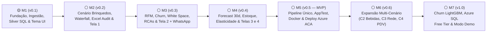

# 📋 Gerenciador de Tarefas do Projeto: Kyberna — Decision Intelligence B2B

Plataforma B2B de **Decision Intelligence & Prescriptive Analytics** em Python (`DuckDB` + `Pandas 2.x` + `StatsForecast`/`LightGBM` + `Streamlit`/`Plotly`), alimentada pela base pública *Iowa Liquor Sales* remapeada sinteticamente para PMEs e indústrias brasileiras.

> **Como usar:** cada tarefa tem ID único `<Marco>-<Pilar><Nº>` (ex.: `M1-I2`, `M2-D5`, mantendo o código legado entre parênteses para rastreabilidade), arquivos impactados, dependências e **Critério de Pronto (DoD)** validado via terminal.
> Status: `[ ]` a fazer · `[~]` parcial · `[x]` concluída (DoD validado via terminal).
> Protocolo de execução: ver §1 de [`GEMINI.md`](./GEMINI.md) / [`CLAUDE.md`](./CLAUDE.md). Contexto de produto: [`VISION.md`](./VISION.md).

---

## 🚀 Status Geral do Desenvolvimento

- **Versão Atual**: `v0.1.0-dev`
- **Marcos Concluídos**: M1 (Fundação do Motor, Ingestão, Camada Silver e Tema UI)
- **Próximos Focos Imediatos**:
  - **M2**: Caso Âncora (C1 Brinquedos), Waterfall Financeiro, Auditoria Excel (`kyberna audit`) e Tela 1 Executiva (`v0.2.0-dev`)

### Estrutura dos Módulos em Cada Marco (4 Pilares Integrados)

Para garantir organização limpa, modular e **validação cruzada imediata** (onde uma área comprova o funcionamento da outra dentro do mesmo marco), cada marco agrupa suas entregas em 4 pilares essenciais:
- 🏗️ **Infraestrutura & Arquitetura (`I`)**: Ambiente `uv`, qualidade, configurações tipadas, CLI `kyberna`, repositório de dados, Docker e nuvem Azure.
- 🗄️ **Engenharia de Dados & Finanças (`D`)**: Contratos `Pandera`, ingestão Socrata, limpeza e cálculos financeiros em **SQL no DuckDB** (`data/kyberna.duckdb`), enriquecimento sintético (`Faker pt_BR`) e planilha Excel de conciliação (`kyberna audit`).
- 🧠 **Ciência de Dados & Prescrição (`S`)**: Extração de features (`Pandas 2.x`), matriz ABC/XYZ, RFM, ciclo de recompra e Churn, White Space, eficiência de RCAs, Forecast 30d (`StatsForecast`), elasticidade e Simulador What-If.
- 🎨 **Interface, UX & Visualização (`V`)**: Design system Kyberna, componentes Streamlit/Plotly, camada de serviços pura com cache e as 4 telas executivas de alta conversão.

---

## 📌 Quadro de Marcos do Projeto

---

### 🟢 M1 — Fundação do Motor, Contratos, Ingestão e Camada Silver Auditável (Concluído ✅)

> **Objetivo de Validação Ponta a Ponta (`v0.1.0-dev`)**: Configurar toda a fundação de engenharia, qualidade e CLI, validando-a na prática com a geração da fixture sintética, ingestão da API Socrata até a camada **Silver SQL** no catálogo `data/kyberna.duckdb` (pronta para inspeção no DBeaver / `duckdb -ui`) e abertura do esqueleto multipage do App Streamlit com o Design System Kyberna.

#### 🏗️ Infraestrutura & Arquitetura
- [x] **M1-I1** *(INFRA-01)* — **Bootstrap do repositório e ambiente `uv`**: Inicializar projeto com `uv` (Python 3.11, `.python-version`), `pyproject.toml` com build `hatchling` empacotando `src`, extras `etl` (`httpx`, `tenacity`, `faker`, `pandera`, `xlsxwriter`), `ml` (`statsforecast`, `lightgbm`, `scikit-learn`, `joblib`), `app` (`streamlit`, `plotly`, `xlsxwriter`), núcleo (`duckdb`, `pandas`, `pyarrow`, `numpy`, `pydantic`, `pydantic-settings`, `typer`, `pyodbc`, `azure-identity`, `pyyaml`) e grupo `dev` (`pytest`, `pytest-cov`, `ruff`, `mypy`, `pre-commit`, `types-PyYAML`, `pandas-stubs`). Criar árvore de pastas do §3 do `GEMINI.md`, `.gitignore`, `.dockerignore`, `.editorconfig`, `README.md` e branch `archive/spark-airflow-setup`.
  - *Arquivos:* `pyproject.toml`, `uv.lock`, `.python-version`, `.gitignore`, `.dockerignore`, `.editorconfig`, `README.md`, `src/**/__init__.py`, `data/*/.gitkeep`.
  - *Depende de:* —
  - *DoD:* `uv sync --all-extras` conclui sem erro; `uv run python -c "import src, duckdb, pandas, pyarrow, streamlit"` retorna 0; `git status` não lista nada de `data/` além de `reference/` e `.gitkeep`.
- [x] **M1-I2** *(INFRA-02)* — **Qualidade de código (`ruff`, `mypy`, `pytest`, `pre-commit`)**: Configurar `ruff` (lint + format, `line-length=110`, regras `E,F,I,B,UP,SIM,PL,NPY,RUF`), `mypy --strict` com plugin pydantic, `pytest` (`testpaths=tests`, markers `slow`, `azure`, `ui`), cobertura com `pytest-cov` e `pre-commit` com ruff + checagens básicas (trailing whitespace, large files > 1 MB, detect-private-key).
  - *Arquivos:* `pyproject.toml` (seções `[tool.*]`), `.pre-commit-config.yaml`, `tests/conftest.py`, `tests/test_smoke.py`.
  - *Depende de:* `M1-I1`
  - *DoD:* `uv run ruff check .`, `uv run ruff format --check .`, `uv run mypy src` e `uv run pytest -q` passam; `uv run pre-commit run --all-files` passa.
- [x] **M1-I3** *(INFRA-03)* — **Settings tipadas, paths, `pipeline.yaml` e segredos**: Implementar `Settings` (`pydantic-settings`, prefixo `KYBERNA_`) com `env` (`dev|ci|prod`), `data_backend` (`auto|azure_sql|duckdb`), `data_dir`, `duckdb_path` (`data/kyberna.duckdb`), `lake_uri`, `azure_sql_server`, `azure_sql_database`, `azure_sql_auth` (`token|sql`), `azure_sql_connect_timeout_s=8`, `socrata_app_token`, `reference_date` (padrão: ontem) e `app_password`. `paths.py` centraliza caminhos de camadas (`bronze_path(table)`, `gold_snapshot_path(scenario, table)`, `audit_report_path(scenario)`). `config/pipeline.yaml` com seeds, janela de ingestão (2023-01-01 → 2024-12-31) e thresholds de negócio (ABC 80/95, XYZ CV 0,5/1,0, capital travado 120 dias). `.env.example` documentado (e `.env` local configurado com o token Socrata).
  - *Arquivos:* `src/core/settings.py`, `src/core/paths.py`, `src/core/types.py` (`ScenarioId`, `GoldTable` como `Literal`), `config/pipeline.yaml`, `.env.example`, `tests/infra/test_settings.py`.
  - *Depende de:* `M1-I1`
  - *DoD:* testes cobrem leitura por env var, defaults e validação de valores inválidos; `mypy` sem erros; nenhum segredo real versionado.
- [x] **M1-I4** *(INFRA-04)* — **CLI `kyberna` (Typer) e logging estruturado**: CLI com grupos `ingest`, `bronze`, `silver`, `gold`, `ml`, `audit`, `load`, `pipeline`, `fixture` (comandos inicialmente *stubs* que levantam `NotImplementedError` com o ID da tarefa responsável). Logging: formato humano (rich) em `dev`, JSON em `ci/prod`; decorator/context manager `timed_step(name)` que loga duração e contagem de linhas.
  - *Arquivos:* `src/cli.py`, `src/core/logging.py`, `pyproject.toml` (`[project.scripts] kyberna = "src.cli:app"`), `tests/infra/test_cli.py`.
  - *Depende de:* `M1-I2`, `M1-I3`
  - *DoD:* `uv run kyberna --help` lista todos os grupos; `typer.testing.CliRunner` valida exit code 0 para `--help` de cada grupo.

#### 🗄️ Engenharia de Dados & Finanças *(Valida a Infraestrutura e CLI)*
- [x] **M1-D1** *(DE-01)* — **Contratos de dados por camada (`Pandera` + Pandas & DuckDB SQL)**: Schemas Pandera (backend Pandas) para Bronze (colunas Iowa como `str` + metadados `_ingested_at`, `_batch_id`, `_source`), Silver (`SilverSalesSchema` tipado: `invoice_line_id`, `date`, `store_number`, `store_name`, `city`, `county`, `zip_code`, `category_name`, `vendor_number`, `vendor_name`, `item_number`, `item_description`, `pack`, `bottle_volume_ml`, `unit_cost`, `unit_price`, `units`, `sale_amount`), dims sintéticas e tabelas Gold (§4.2 do `GEMINI.md`). Checks de negócio: `units > 0`, `unit_price >= unit_cost * 0.5`, `pack ∈ [1, 96]`, unicidade de `invoice_line_id`, `scenario_id` válido. Helper `validate(df_or_table, schema, layer)` que loga falhas resumidas.
  - *Arquivos:* `src/etl/contracts.py`, `tests/etl/test_contracts.py`.
  - *Depende de:* `M1-I3`
  - *DoD:* testes positivos e negativos (dados violando cada check) passam; schemas exportados e reutilizados pelas tarefas seguintes.
- [x] **M1-D2** *(DE-02)* — **Fixture sintética determinística para testes e CI**: Gerador determinístico de ~20 mil linhas no formato **exato** da API Socrata (mesmas colunas e tipos-string), com 300 lojas, 400 itens, 15 vendors, 24 meses, sazonalidade semanal/anual, ciclos de recompra heterogêneos por loja (algumas lojas "adormecem" no último trimestre) e intermitência na cauda longa. Comando `kyberna fixture generate`.
  - *Arquivos:* `src/etl/ingest/fixture.py`, `tests/fixtures/iowa_sample.parquet` (≤ 2 MB, versionado), `tests/conftest.py`.
  - *Depende de:* `M1-D1`, `M1-I4`
  - *DoD:* fixture valida contra `BronzeSalesSchema`; duas execuções geram arquivos idênticos (hash SHA-256 igual); tamanho ≤ 2 MB.
- [x] **M1-D3** *(DE-03)* — **Ingestão Iowa Liquor Sales (Socrata API) → Raw → Bronze**: Cliente `httpx` para `https://data.iowa.gov/resource/m3tr-qhgy.csv` com `$where=date between '<ini>' and '<fim>'`, `$order=:id`, paginação `$limit=50000`/`$offset`, header `X-App-Token`, retry exponencial com `tenacity` (429/5xx), download por mês (idempotente: pula meses já presentes salvo `--force`). Raw em CSV por `year=/month=`; conversão via DuckDB para Bronze Parquet particionado (`year=/month=`) e registro na tabela `bronze.sales_raw` em `data/kyberna.duckdb`, adicionando metadados de ingestão. Flag `--sample-frac` para amostragem estratificada por loja.
  - *Arquivos:* `src/etl/ingest/socrata_client.py`, `src/etl/ingest/raw_to_bronze.py`, `src/etl/lake.py`, `src/cli.py`, `tests/etl/test_ingest.py` (HTTP mockado com `httpx.MockTransport`).
  - *Depende de:* `M1-D1`, `M1-I4`
  - *DoD:* `uv run kyberna ingest --start 2023-01-01 --end 2024-12-31` conclui (ou com `--sample-frac 0.3` para MVP rápido); reexecução não duplica dados; Bronze valida no contrato; testes com mock cobrem paginação, retry e idempotência.
- [x] **M1-D4** *(DE-04)* — **Silver SQL: limpeza, tipagem e deduplicação no DuckDB**: Pipeline **SQL no DuckDB** Bronze → Silver (`silver.sales`): cast de tipos, parse de datas, normalização de texto (trim, upper → title case, remoção de acentos/duplos espaços em `store_name`/`city`), deduplicação por `invoice_line_id` (`QUALIFY ROW_NUMBER() OVER (...) = 1`), remoção de devoluções/valores ≤ 0 e outliers grosseiros (`unit_price` fora de p0,1–p99,9 por item), preenchimento de `category_name` nulo pela moda do item e derivação de `chain_name` (ex.: "Hy-Vee", "Fareway", "Casey's") para o Cenário 3. Persiste em `data/silver/sales.parquet` e na tabela `silver.sales` do `kyberna.duckdb`. Relatório de linhas removidas por regra.
  - *Arquivos:* `src/etl/silver/clean.py`, `tests/etl/test_silver_clean.py`.
  - *Depende de:* `M1-D2` (e `M1-D3` para dados completos)
  - *DoD:* `uv run kyberna silver build --sample` gera Silver válida no contrato; relatório de remoções logado; nenhuma linha válida da fixture descartada indevidamente; execução sobre base completa ≤ 2 min.
- [x] **M1-D5** *(DE-05)* — **Silver SQL: âncora temporal (`time-shift` por semanas)**: Deslocar todas as datas no DuckDB por um offset inteiro **de semanas** (preserva dia da semana e sazonalidade semanal) para que `max(date)` fique na semana de `reference_date`. Registrar `original_date` e `time_shift_days` em metadados. Opcional `--no-shift` para análise histórica.
  - *Arquivos:* `src/etl/silver/time_anchor.py`, `tests/etl/test_time_anchor.py`.
  - *Depende de:* `M1-D4`
  - *DoD:* testes provam: offset múltiplo de 7; `max(date)` ∈ `[reference_date − 6, reference_date]`; distribuição por dia da semana idêntica antes/depois.

#### 🎨 Interface, UX & Visualização *(Valida o Ambiente de Front-end)*
- [x] **M1-V1** *(VIZ-01)* — **Esqueleto multipage do app Streamlit e Toggle de Tema**: `src/ui/app.py` com `st.set_page_config` (título `"Kyberna · Decision Intelligence"`, ícone, layout `wide`), `st.navigation` com as 4 páginas agrupadas ("Visão Executiva", "Radar Comercial", "Estoque & Demanda", "Simulador What-If") e cabeçalhos com estado vazio elegante. Seletor de tema na sidebar (**Light Mode ☀️ / Dark Mode 🌙** via `st.session_state.theme_mode`, persistente na sessão) e cascata `Região → UF` (`UF_REGIAO`). `.streamlit/config.toml` (tema base, `server.headless`, `browser.gatherUsageStats=false`, `runner.fastReruns`).
  - *Arquivos:* `src/ui/app.py`, `src/ui/pages/1_executive.py`, `src/ui/pages/2_commercial_radar.py`, `src/ui/pages/3_inventory_demand.py`, `src/ui/pages/4_simulator.py`, `.streamlit/config.toml`.
  - *Depende de:* `M1-I1`
  - *DoD:* `uv run streamlit run src/ui/app.py` abre as 4 páginas sem erro; alternância entre Claro e Escuro altera o estado global; AppTest básico renderiza cada página.
- [x] **M1-V2** *(VIZ-02)* — **Design system Kyberna (Light/Dark tokens, Plotly templates duplos e CSS dinâmico)**: `theme.py` com tokens para Light Mode e Dark Mode (§5.6 do `GEMINI.md`), registro dos templates Plotly `"kyberna_light"` e `"kyberna_dark"` (fonte Inter, paleta categórica e sequencial/divergente, grades suaves, separadores pt-BR `separators=",."`, margens compactas); `styles.css` com variáveis CSS Custom Properties (`--kyb-bg`, `--kyb-card-bg`, `--kyb-border`, `--kyb-text`) dinâmicas conforme o tema ativo; logotipo SVG (leme estilizado + wordmark `"KYBERNA"`).
  - *Arquivos:* `src/ui/theme.py`, `src/ui/assets/styles.css`, `src/ui/assets/logo.svg`, `.streamlit/config.toml`.
  - *Depende de:* `M1-V1`
  - *DoD:* página/modo de amostra exibe paleta, tipografia e gráficos nos dois temas (Light/Dark); contraste AA verificado nos pares principais.

---

### 🟡 M2 — Caso Âncora (C1 Brinquedos), Waterfall Financeiro, Auditoria Excel & Tela 1 (Visão Executiva) (Em Andamento 🔄)

> **Objetivo de Validação Ponta a Ponta (`v0.2.0-dev`)**: Enriquecer a Silver com dimensões brasileiras determinísticas (`Faker pt_BR`), remapear o Caso Âncora (`c1_toys`), calcular o DRE/Waterfall completo em SQL no DuckDB, gerar a **planilha Excel de conciliação financeira (`kyberna audit`)**, rodar a classificação **ABC/XYZ** sobre a Gold e validar todos os indicadores diretamente na **Tela 1 — Visão Executiva & Margem Real**.

#### 🏗️ Infraestrutura & Arquitetura
- [ ] **M2-I1** *(DE-17)* — **Repositório de dados com fallback (`DuckDB` local ↔ `Azure SQL`) e Resiliência ODBC**: Implementar `DataRepository` (`Protocol` retornando `pd.DataFrame`), `DuckDBRepository` (conexão in-process lendo Parquet/tabelas Gold e retornando `.df()`), `AzureSQLRepository` (`pyodbc` + token Entra ID via `azure-identity`, `connect_timeout` curto de 8s, conexão curta por consulta, `fast_executemany=True`, `pool_pre_ping=True`, `pool_recycle=240`) e factory `get_repository(settings)` com política `auto`: monitora `_CONN_ERROR_CODES = ("08S01", "HYT00", "08001", "08007", "40613", "40197", "10054")` — se o banco Azure SQL estiver pausado ou offline, aciona o **fallback instantâneo (< 8s) para o DuckDB local**, sem bloquear a UI com spinners longos de warmup. API: `table(name, scenario_id, columns=None, filters=None)` e `query(sql, params)` parametrizado.
  - *Arquivos:* `src/db/repository.py`, `src/db/duckdb_repo.py`, `src/db/azure_sql_repo.py`, `tests/db/test_repository.py`.
  - *Depende de:* `M1-I3`, `M2-D5`
  - *DoD:* testes com DuckDB real sobre snapshot da fixture; teste de fallback simulando falha Azure (mock com erro 40613/timeout) retorna backend `duckdb` e motivo; consulta típica de mart ≤ 100 ms local.

#### 🗄️ Engenharia de Dados & Finanças
- [x] **M2-D1** *(DE-06)* — **Tabelas de referência brasileiras (versionadas)**: Criar `municipios_br.csv` (~150 municípios cobrindo todas as 27 UFs com código IBGE, nome, UF, região, lat/lon, população), `ufs_br.csv` (UF, região, alíquota ICMS interna de referência) e `category_maps/` (`toys.csv`, `beverages.csv`) mapeando categorias Iowa para famílias por regex (`.*VODKA.*` → *Jogos Educativos* / *Vodka*; `.*WHISK.*|.*BOURBON.*|.*SCOTCH.*` → *Quebra-Cabeças* / *Whisky*; `.*RUM.*` → *Primeira Infância* / *Rum*; `.*TEQUILA.*|.*MEZCAL.*` → *Brinquedos de Madeira* / *Tequila*; `.*LIQUEUR.*|.*SCHNAPPS.*|.*CORDIAL.*` → *Linha Escolar* / *Licores*; `.*GIN.*` → *Jogos de Tabuleiro* / *Gin*; `.*BRAND.*|.*COCKTAIL.*` → *Pelúcias* / *Cachaças e Destilados*; default → *Outros*).
  - *Arquivos:* `data/reference/municipios_br.csv`, `data/reference/ufs_br.csv`, `data/reference/category_maps/toys.csv`, `data/reference/category_maps/beverages.csv`, `src/etl/silver/reference.py`, `tests/etl/test_reference.py`.
  - *Depende de:* `M1-I1`
  - *DoD:* loaders tipados; teste garante 27 UFs presentes e cobertura de 100% das categorias da fixture (nenhuma linha cai em *Outros* acima de 5% do faturamento).
- [x] **M2-D2** *(DE-07)* — **Enriquecimento sintético determinístico (`Faker pt_BR` + Pandas)**: Gerar dimensões estáveis a partir das chaves naturais: **clientes** (por `store_number`: CNPJ válido com DV, razão social, nome fantasia, segmento, porte P/M/G derivado do faturamento real, celular WhatsApp `+55 DDD 9XXXX-XXXX` coerente com a UF, e-mail, data de cadastro), **geografia** (`county` → município BR ponderado por população, condados maiores → capitais/polos) e **RCAs** (25–40 representantes com nome, região, comissão 3–7%, carteira por UF/região). Seed derivada de `hash(natural_key) ^ global_seed`. Gerar em lote (`pd.DataFrame` → `silver.dim_*` no `kyberna.duckdb` e Parquet), sem loops sobre o fato.
  - *Arquivos:* `src/etl/silver/enrich.py`, `tests/etl/test_enrich.py`.
  - *Depende de:* `M1-D4`, `M2-D1`
  - *DoD:* CNPJs 100% válidos (teste de DV); duas execuções → dims idênticas; adicionar loja nova não altera atributos das existentes; cada cliente tem exatamente 1 RCA e 1 município.
- [x] **M2-D3** *(DE-08)* — **Motor de Cenários (`ScenarioConfig` Pydantic + YAMLs)**: Modelo `ScenarioConfig` com `id`, `display_name`, `company_profile`, `labels` (`customer`, `customer_plural`, `product_family`, `sales_rep`, `branch`, `unit`, `box`…), `filters`, `category_map`, `perspective` (`seller|buyer`), `capabilities` (flags da matriz §5.5 do `VISION.md`), `finance_profile` (`config/finance/*.yaml`) e `retail_markup` (C3/C4). Interface `ScenarioBuilder` operando sobre o DuckDB e dims Silver. Comando `kyberna gold build --scenario <id|all>`.
  - *Arquivos:* `src/core/scenarios.py`, `src/etl/scenarios/base.py`, `config/scenarios/c1_toys.yaml`, `config/scenarios/c2_beverages.yaml`, `config/scenarios/c3_retail_chain.yaml`, `config/scenarios/c4_single_store.yaml`, `tests/etl/test_scenarios_config.py`.
  - *Depende de:* `M1-D1`, `M1-I3`
  - *DoD:* os 4 YAMLs validam no Pydantic; YAML inválido gera erro legível; `ScenarioConfig.labels` cobre todas as chaves usadas pela UI.
- [ ] **M2-D4** *(DE-09)* — **Builder do Cenário 1 — Indústria B2B de Brinquedos (Caso Âncora)**: Perspectiva *seller* (sede em SP); `vendor_name` → **Linhas/Marcas** fictícias; `category_name` → famílias via `toys.csv`; `item_description` → nomes de produto por templates determinísticos por família (ex.: *Quebra-Cabeça 500 peças — Mapas do Brasil*, *Blocos de Madeira 60 peças*, *Kit Escolar Aquarela 12 cores*), EAN-13 válido; `pack` → **unidades por caixa master** (`boxes = units / pack`); lojas → **lojistas (CNPJs)**; reescala de preços para faixa realista de brinquedos (R$ 15–R$ 350 por família, preservando razão custo/preço relativa e variações temporais).
  - *Arquivos:* `src/etl/scenarios/c1_toys.py`, `config/scenarios/c1_toys.yaml`, `tests/etl/test_c1_toys.py`.
  - *Depende de:* `M2-D2`, `M2-D3`
  - *DoD:* Gold `c1_toys` contém as 5 famílias obrigatórias com ≥ 85% do faturamento; nenhum termo de bebida remanescente (teste contra lista proibida: vodka, whisky, rum, liquor, bourbon…); EAN-13 válidos.
- [ ] **M2-D5** *(DE-14)* — **Motor financeiro em SQL: Waterfall da Margem de Contribuição**: Implementar a definição canônica (§4.3 do `GEMINI.md`) em **SQL claro e auditável no DuckDB**: **desconto** por porte do cliente e por RCA (alguns RCAs com viés de desconto alto para a narrativa comercial); **impostos** (ICMS interestadual SP → S/SE exceto ES: 12%; N/NE/CO/ES: 7%; interno SP: 18%; PIS/COFINS 9,25% ou 3,65%; IPI por fora); **comissão** = taxa do RCA × receita após desconto; **frete** = custo por caixa por região. Alíquotas em `config/finance/*.yaml`.
  - *Arquivos:* `src/etl/finance/margin_waterfall.py`, `src/etl/finance/taxes.py`, `config/finance/tax_rules.yaml`, `config/finance/freight.yaml`, `config/finance/commission.yaml`, `config/finance/discounts.yaml`, `tests/etl/test_margin_waterfall.py`.
  - *Depende de:* `M2-D2`, `M2-D3`
  - *DoD:* teste de identidade contábil por linha (`contribution_margin == net_revenue − cogs − commission − freight`, tolerância `1e-6`); casos unitários de ICMS por UF; margem média do C1 entre 18% e 35% com dispersão entre RCAs (DP ≥ 4 p.p.).
- [ ] **M2-D6** *(DE-16)* — **Star Schema Gold, Catálogo `.duckdb` e Gerador Excel de Conciliação (`kyberna audit`)**: Materializar via SQL no DuckDB `dim_date`, `dim_product`, `dim_customer`, `dim_sales_rep`, `dim_branch`, `dim_geography`, `fact_sales` e `mart_margin_monthly` (por mês × família × UF × RCA). Registrar tabelas no schema `gold` de `data/kyberna.duckdb` (pronto para DBeaver / `duckdb -ui`) e exportar snapshot Parquet em `data/gold/snapshot/<scenario_id>/<tabela>.parquet` (zstd). Implementar `src/etl/audit.py` e `uv run kyberna audit --scenario <id>`, gerando `data/reports/conciliacao_<scenario_id>.xlsx` (abas: Resumo DRE/Waterfall, Memória de Cálculo aberta com 100 pedidos coluna a coluna, Validação ABC/XYZ e Integridade).
  - *Arquivos:* `src/etl/gold/star_schema.py`, `src/etl/gold/marts.py`, `src/etl/audit.py`, `tests/etl/test_gold.py`.
  - *Depende de:* `M2-D4`, `M2-D5`
  - *DoD:* `uv run kyberna gold build --scenario c1_toys` gera tabelas no `.duckdb` e Parquet; `uv run kyberna audit --scenario c1_toys` gera planilha Excel formatada; integridade referencial 100%; soma de `gross_revenue` da Gold = Silver remapeada (± 0,01%).

#### 🧠 Ciência de Dados & Prescrição *(Valida a Consistência da Gold C1)*
- [ ] **M2-S1** *(DS-01)* — **Base de features parametrizada por `as_of_date` (cliente, SKU, cliente×família)**: Consultas SQL no DuckDB + funções Pandas vetorizadas reutilizáveis (zero vazamento temporal): por cliente — recência, frequência (pedidos distintos), valor (receita e margem), ticket médio, nº de famílias compradas, tendência de receita (3m vs. 6m), estatísticas de intervalo entre compras (média, mediana, DP, nº intervalos); por SKU — demanda diária/semanal, CV semanal, receita, margem; por cliente×família — receita, última compra, participação.
  - *Arquivos:* `src/ml/features.py`, `tests/ml/test_features.py`.
  - *Depende de:* `M2-D6`
  - *DoD:* teste prova ausência de vazamento (nenhuma feature usa dados > `as_of_date`); valores conferidos manualmente em cliente de teste da fixture.
- [ ] **M2-S2** *(DS-02)* — **Classificação ABC/XYZ e política prescritiva por célula**: ABC por margem de contribuição acumulada (cortes 80%/95% configuráveis; alternativa por receita); XYZ pelo CV da demanda semanal nas últimas 26 semanas (X < 0,5; Y 0,5–1,0; Z > 1,0). Política sugerida por célula (*AX*: "Ruptura zero / estoque de segurança alto"; *CZ*: "Sob encomenda ou descontinuar/liquidar"). Saída `mart_abc_xyz` na Gold e no Excel de auditoria.
  - *Arquivos:* `src/ml/abc_xyz.py`, `config/pipeline.yaml`, `tests/ml/test_abc_xyz.py`.
  - *Depende de:* `M2-S1`
  - *DoD:* participações acumuladas somam 100%; todos os SKUs classificados; política presente nas 9 células.

#### 🎨 Interface, UX & Visualização *(Valida Visualmente o Caso Âncora e o Waterfall)*
- [ ] **M2-V1** *(VIZ-03)* — **Sidebar global: seletor de cenário, filtros em cascata e badge de fonte de dados**: Estado tipado (`state.py`: `AppState` com `scenario_id`, `period`, `ufs`, `families`, `sales_reps`). Sidebar com logo, Seletor de Cenários, filtros dependentes do cenário com cascata `_on_regiao_change()` (reset automático de UF ao mudar Região), data de referência e **badge da fonte de dados** ("Azure SQL" verde / "Snapshot local (Fallback)" âmbar com tooltip).
  - *Arquivos:* `src/ui/state.py`, `src/ui/components/sidebar.py`, `tests/ui/test_sidebar.py`.
  - *Depende de:* `M1-V1`, `M2-D3`, `M2-I1`
  - *DoD:* AppTest comprova troca de rótulos ao mudar cenário; filtros persistem entre páginas; badge reflete o backend de `get_repository()`.
- [ ] **M2-V2** *(VIZ-04)* — **Biblioteca de componentes visuais, Cards com Sub-rodapé, Deltas e Plotly Interativo**: Implementar `.kpi-card` com barra superior em gradiente (`green`, `red`, `blue`, `gold`), sub-rodapé duplo (ex.: Bruto no topo e Líquido vs. Impostos no rodapé), cálculo de deltas `get_delta_html` (`%`, `p.p.`, `R$` e flag `invert_color` para custos/perdas), `.badge-warning`, `section_header`, `prescription_box`, suporte a cross-filtering por clique no Plotly (`on_select="rerun"`, `clickmode="event+select"`, `_pending_mes`), fábricas de gráficos em `charts.py` (`waterfall_margin`, `dual_trend`, `abc_xyz_heatmap`, `quadrant_scatter`, `forecast_band`, `treemap_value`, `profit_curve`, `tornado`) recebendo `pd.DataFrame` e retornando `go.Figure`, `tables.py` e `formatting.py` (`R$ 1.234.567,89`, compacto `R$ 1,2 mi`, `%`).
  - *Arquivos:* `src/ui/components/kpi_card.py`, `src/ui/components/prescription.py`, `src/ui/components/charts.py`, `src/ui/components/tables.py`, `src/ui/formatting.py`, `tests/ui/test_formatting.py`, `tests/ui/test_charts.py`.
  - *Depende de:* `M1-V2`
  - *DoD:* testes de formatação pt-BR passam; cada fábrica gera figura Plotly válida nos temas Light e Dark; zero acesso direto a banco nos componentes.
- [ ] **M2-V3** *(VIZ-05 exec + VIZ-06)* — **Serviço Executivo, Cache e Tela 1 — Visão Executiva & Margem Real**: Implementar `executive_service.py` puro (sem Streamlit) + wrapper `@st.cache_data` em `ui/cache.py` + **Tela 1** completa: Manchete Executiva Dinâmica, 5 KPI cards (Faturamento Bruto, Receita Líquida, Margem R$, Margem %, Clientes Ativos com delta e sparkline), gráfico **Waterfall** completo, **Tendência Dupla** mensal (Faturamento × Margem % — efeito "boca de jacaré"), **Matriz ABC/XYZ 3×3 clicável** (em `@st.fragment`), Top-10 destruidores e geradores de margem e bloco de **Prescrição** em R$.
  - *Arquivos:* `src/services/executive_service.py`, `src/services/dto.py`, `src/ui/cache.py`, `src/ui/pages/1_executive.py`, `tests/services/test_executive_service.py`.
  - *Depende de:* `M2-I1`, `M2-S2`, `M2-V1`, `M2-V2`
  - *DoD:* KPIs da Tela 1 batem 100% com consulta SQL direta no `kyberna.duckdb` e com a aba DRE do `conciliacao_c1_toys.xlsx`; renderização < 1,5 s com cache quente; AppTest da Tela 1 passa sem exceção.

---

### ⚪ M3 — Inteligência Comercial: RFM, Risco de Churn, White Space, RCAs & Tela 2 (Radar Comercial)

> **Objetivo de Validação Ponta a Ponta (`v0.3.0-dev`)**: Construir os modelos de inteligência comercial sobre os ciclos de compra e descontos da Gold C1, auditar a priorização de clientes e representantes e validar tudo interativamente na **Tela 2 — Radar Comercial**, incluindo a exportação em 1 clique para Excel e links diretos de WhatsApp (`wa.me`).

#### 🧠 Ciência de Dados & Prescrição
- [ ] **M3-S1** *(DS-03)* — **Segmentação RFM baseada em Margem de Contribuição**: Scores R, F, M em quintis (R invertido; desempate por *rank* para evitar quintis vazios) e mapeamento para segmentos (*Campeões, Fiéis, Promissores, Novos, Precisam de Atenção, Em Risco, Não Pode Perder, Hibernando, Perdidos*) via regras configuráveis. M calculado sobre **margem de contribuição líquida** (princípio "margem acima de volume").
  - *Arquivos:* `src/ml/rfm.py`, `config/pipeline.yaml`, `tests/ml/test_rfm.py`.
  - *Depende de:* `M2-S1`
  - *DoD:* todo cliente recebe exatamente 1 segmento; distribuição plausível na fixture (nenhum segmento > 40% dos clientes).
- [ ] **M3-S2** *(DS-04)* — **Ciclo individual de recompra e índice de risco heurístico de Churn**: Por cliente: ciclo esperado = mediana dos intervalos entre pedidos (fallback para mediana do segmento quando < 3 intervalos); `delay_ratio = dias_sem_comprar / ciclo_medio_dias`; probabilidade heurística de churn via CDF empírica dos intervalos do cliente (com *shrinkage* para o segmento); status prescritivo (*No Ciclo* ≤ 1,1; *Atenção* 1,1–1,5; *Em Risco Imediato* 1,5–2,5; *Adormecido/Perdido* > 2,5). **Valor Anual em Risco (R$)** = receita 12m × probabilidade. Materializa `mart_customer_risk`.
  - *Arquivos:* `src/ml/churn.py`, `tests/ml/test_churn_heuristic.py`.
  - *Depende de:* `M2-S1`
  - *DoD:* probabilidades ∈ `[0, 1]` e monotônicas em `days_since_last`; clientes "adormecidos" plantados na fixture (`M1-D2`) aparecem como *Em Risco*/*Adormecido* em ≥ 90% dos casos.
- [ ] **M3-S3** *(DS-06)* — **Matriz White Space e recomendação de cross-sell B2B**: Matriz cliente × família (binária e por receita) combinando: (1) **afinidade item-item** (`cosine_similarity` entre famílias); (2) **lookalike** (`NearestNeighbors` cosseno por mix normalizado + porte + região). **Potencial R$** = mediana da receita anual da família entre vizinhos compradores × score × `(1 − prob_churn)`. Materializa `mart_white_space` (top-3 oportunidades por cliente + matriz agregada segmento × família).
  - *Arquivos:* `src/ml/white_space.py`, `tests/ml/test_white_space.py`.
  - *Depende de:* `M2-S1`, `M3-S2`
  - *DoD:* nunca recomenda família já comprada pelo cliente; backtest ocultando 20% das compras cliente×família atinge *hit rate@3* ≥ 2× o baseline de popularidade; potencial total C1 < 30% do faturamento anual.
- [ ] **M3-S4** *(DS-07)* — **Eficiência Comercial de Representantes (Quadrante de RCAs)**: Por RCA: receita faturada, margem de contribuição R$ e %, desconto médio concedido, positivação (ativos/carteira), penetração de mix (famílias/cliente), % e R$ da carteira em risco e oportunidade White Space. Classificação nos 4 quadrantes (*Estrela*, *Volume sem margem*, *Margem sem volume*, *Atenção* — cortes pela mediana). Materializa `mart_rep_performance`.
  - *Arquivos:* `src/ml/rep_performance.py`, `tests/ml/test_rep_performance.py`.
  - *Depende de:* `M2-D5`, `M3-S2`, `M3-S3`
  - *DoD:* soma da receita por RCA = receita total do cenário; RCAs com viés de desconto injetado na `M2-D5` caem no quadrante *Volume sem margem* ou *Atenção*.

#### 🎨 Interface, UX & Visualização *(Valida a Inteligência Comercial e Ação em 1 Clique)*
- [ ] **M3-V1** *(VIZ-05 com + VIZ-07)* — **Serviço Comercial e Tela 2 — Radar Comercial, RFM & Antecipação de Churn**: Implementar `commercial_service.py` puro + cache em `ui/cache.py` + **Tela 2** completa: KPIs comerciais (clientes em risco, R$ anual em risco, potencial White Space, % carteira adormecida), **Tabela Priorizada de Risco** com seleção de linhas, gráfico de **Dispersão** (dias sem comprar × ciclo esperado com linha de 45°), **Treemap RFM** (tamanho = margem, cor = segmento), **Heatmap White Space** (segmento/RCA × família com potencial R$) e **Quadrante de RCAs** (bolha = R$ em risco) com drill-down.
  - *Arquivos:* `src/services/commercial_service.py`, `src/ui/pages/2_commercial_radar.py`, `tests/services/test_commercial_service.py`.
  - *Depende de:* `M2-V1`, `M2-V2`, `M3-S1`, `M3-S2`, `M3-S3`, `M3-S4`
  - *DoD:* filtros por RCA/UF/status atualizam todos os blocos; tempo de interação < 1,5 s; AppTest da Tela 2 passa sem exceção.
- [ ] **M3-V2** *(VIZ-10)* — **Motor de Ação em 1 Clique: Exportação Excel, CSV e WhatsApp (`wa.me`)**: Implementar `export_service.py` e componente `export_bar.py`: gera **Excel** formatado (`pd.ExcelWriter` com `xlsxwriter`: aba por RCA, cabeçalho Kyberna, BRL/%, autofiltro, painéis congelados), **CSV** UTF-8 com BOM (abre direto no Excel BR) e **links clicáveis de WhatsApp** `https://wa.me/<E.164 sem +>?text=<mensagem url-encoded>` com o argumento de abordagem pronto por cliente/oportunidade.
  - *Arquivos:* `src/services/export_service.py`, `src/ui/components/export_bar.py`, `config/scenarios/*.yaml` (templates de mensagem), `tests/services/test_export_service.py`.
  - *Depende de:* `M3-V1`
  - *DoD:* Excel abre sem alerta de reparo e valida leitura via `pd.read_excel`; links `wa.me` validam formato E.164 e encoding de acentos; export de 1 mil linhas < 1 s.

---

### ⚪ M4 — Inteligência de Estoque, Demanda (Forecast 30d), Elasticidade & Telas 3 e 4 (Estoque + Simulador)

> **Objetivo de Validação Ponta a Ponta (`v0.4.0-dev`)**: Fechar todas as capacidades analíticas e prescritivas do Caso Âncora: injetar eventos de preço com elasticidade-verdade, gerar snapshot de estoque, rodar previsão de 30 dias (`StatsForecast`), calcular ruptura/capital travado, recuperar a elasticidade via regressão/ML e validar tudo nas **Telas 3 (Estoque & Demanda) e 4 (Simulador Prescritivo What-If)**.

#### 🗄️ Engenharia de Dados & Finanças
- [ ] **M4-D1** *(DE-13)* — **Injeção determinística de variação de preço com elasticidade-verdade**: Como os preços originais de Iowa têm markup regulado quase fixo, injetar eventos determinísticos de preço por família/SKU (promoções de 5–20% por 1–3 semanas e reajustes de 3–8%) ajustando unidades por `units' = units × (p'/p)^β_true` com `β_true` configurado em `config/pipeline.yaml` (ex.: *Linha Escolar* −1,8; *Jogos Educativos* −1,2; *Brinquedos de Madeira* −0,6) + ruído log-normal. Persistir `price_event_id`, `promo_flag` e tabela `elasticity_ground_truth`.
  - *Arquivos:* `src/etl/silver/price_events.py`, `config/pipeline.yaml`, `tests/etl/test_price_events.py`.
  - *Depende de:* `M1-D5`, `M2-D3`
  - *DoD:* fração de linhas afetadas entre 10% e 25%; volume total varia < 5% vs. original; regressão log-log simples recupera `β_true` com erro absoluto < 0,25 por família.
- [ ] **M4-D2** *(DE-15)* — **Snapshot sintético controlado de posição de estoque (`inventory_snapshot`)**: Para cada SKU (e filial no C3): `stock_units` = demanda média diária (últimos 90d) × cobertura amostrada de mistura controlada (≈ 10% ruptura iminente: 0–7d; ≈ 60% saudável: 15–60d; ≈ 15% atenção: 60–120d; ≈ 15% capital travado: 120–365d), `lead_time_days` por família, `unit_cost` e `last_receipt_date`. Determinístico por SKU.
  - *Arquivos:* `src/etl/gold/inventory_snapshot.py`, `tests/etl/test_inventory_snapshot.py`.
  - *Depende de:* `M2-D4`
  - *DoD:* proporções das faixas dentro de ±3 p.p. do configurado; capital travado (> 120 dias) do C1 entre 10% e 25% do valor total de estoque; contrato Gold válido.

#### 🧠 Ciência de Dados & Prescrição *(Valida a Verdade Sintética de Preço e Estoque)*
- [ ] **M4-S1** *(DS-08)* — **Previsão de demanda 30 dias (`StatsForecast`)**: Séries diárias `unique_id = sku` com zeros preenchidos; modelos `AutoETS(season_length=7)`, `CrostonOptimized()` (séries intermitentes, ADI > 1,32) e `SeasonalNaive(7)` como baseline; `h=30`, `level=[80, 95]`; seleção do melhor modelo por série via `cross_validation` (MAE); fallback de média móvel para séries < 60d. Materializa `mart_forecast_30d` (histórico 90d + projeção 30d + intervalos + modelo escolhido + WAPE).
  - *Arquivos:* `src/ml/forecast.py`, `tests/ml/test_forecast.py`, `docs/model_cards/forecast.md`.
  - *Depende de:* `M2-S1`
  - *DoD:* WAPE agregado por família ≤ 35% e melhor que `SeasonalNaive` em ≥ 60% das séries classe A; previsões ≥ 0; treino do C1 ≤ 5 min.
- [ ] **M4-S2** *(DS-09 parcial)* — **Estoque prescritivo: cobertura, ruptura iminente e capital travado (> 120d)**: Cruzando `mart_forecast_30d` + snapshot de estoque + classe ABC/XYZ: calcular demanda diária prevista, cobertura em dias, dias até ruptura, estoque de segurança `z·σ_d·√LT` (A=1,65; B=1,28; C=0,84), ponto de pedido, sugestão de compra/produção em **caixas master** e **capital travado (R$)** (excedente > 120d × CMV) com prescrição automática (*Kit Promocional / Bonificação / Liquidação*). Materializa `mart_inventory_position`.
  - *Arquivos:* `src/ml/inventory.py`, `tests/ml/test_inventory.py`.
  - *Depende de:* `M2-S2`, `M4-D2`, `M4-S1`
  - *DoD:* testes unitários de ponto de pedido e cobertura; capital travado reconciliado com `M4-D2`.
- [ ] **M4-S3** *(DS-10)* — **Modelo de elasticidade-preço (Log-Log Bootstrap + `LGBMRegressor` monotônico)**: Duas abordagens: (1) regressão interpretável `ln(Q) = α + β·ln(P_rel) + sazonalidade + promo_flag + porte` (`Ridge`/`LinearRegression`) com IC 95% via bootstrap; (2) curva de resposta `LGBMRegressor` com `monotone_constraints` negativo no preço. Validação contra `elasticity_ground_truth` (`M4-D1`). Materializa `mart_price_elasticity`.
  - *Arquivos:* `src/ml/elasticity.py`, `tests/ml/test_elasticity.py`, `docs/model_cards/elasticity.md`.
  - *Depende de:* `M2-S1`, `M4-D1`
  - *DoD:* `|β̂ − β_true| < 0,3` em todas as famílias do C1 e IC 95% cobrindo `β_true` em ≥ 80% delas; curvas estritamente decrescentes.
- [ ] **M4-S4** *(DS-11)* — **Motor puro do Simulador What-If e Volume de Equilíbrio (Breakeven)**: Função pura `simulate(baseline: SimulationBaseline, levers: SimulationLevers) -> SimulationResult` (Pydantic). Alavancas: preço de tabela (%), desconto comercial (pp), comissão RCA (pp), custo/CMV (%) e elasticidade. Recomputa o Waterfall do `M2-D5` vetorizado em Pandas/NumPy (< 50 ms), calcula o **Volume de Equilíbrio (`delta_q_breakeven`)**, a curva **Lucro × Preço** com ponto ótimo e o gráfico **Tornado** de sensibilidade.
  - *Arquivos:* `src/services/simulator.py`, `src/services/dto.py`, `tests/services/test_simulator.py`.
  - *Depende de:* `M2-D5`, `M4-S3`
  - *DoD:* alavancas zeradas devolvem exatamente o baseline; caso numérico de referência (−10% preço, β = −2, margem 30%) bate com cálculo manual; resposta < 50 ms.

#### 🎨 Interface, UX & Visualização *(Valida Estoque, Forecast e Simulador)*
- [ ] **M4-V1** *(VIZ-05 inv + VIZ-08)* — **Serviço de Estoque e Tela 3 — Inteligência de Estoque & Demanda**: Implementar `inventory_service.py` puro + cache + **Tela 3**: 4 KPIs (valor em estoque, capital travado > 120d, SKUs em risco de ruptura ≤ lead time, cobertura média), **Gráfico de Demanda + Forecast 30d** com bandas de 80%/95% (em `@st.fragment`), **Semáforo e Tabela de Ruptura** (ordem sugerida em caixas master e receita protegida R$) e **Treemap de Capital Travado** por família → SKU com prescrição.
  - *Arquivos:* `src/services/inventory_service.py`, `src/ui/pages/3_inventory_demand.py`, `tests/services/test_inventory_service.py`.
  - *Depende de:* `M2-V1`, `M2-V2`, `M4-S1`, `M4-S2`
  - *DoD:* soma do treemap = KPI de capital travado; troca de SKU re-renderiza apenas o fragmento; AppTest da Tela 3 passa sem exceção.
- [ ] **M4-V2** *(VIZ-09)* — **Tela 4 — Simulador Prescritivo What-If (Elasticidade & Preço)**: Painel de sliders dentro de `@st.fragment` (escopo família/SKU/UF, variação de preço −30% a +30%, desconto 0–25 pp, comissão ±3 pp, CMV e toggle de elasticidade). Cards **Antes × Depois**, destaque visual do **Volume de Equilíbrio** (*"Para compensar 7% de desconto você precisa vender +28%; a elasticidade projeta +11%"*), **Curva Lucro × Preço** (ponto atual, simulado e ótimo), **Tornado** de sensibilidade, comparação de até 3 cenários salvos na sessão e veredito automático (*Gera Lucro Incremental* vs. *Destruição de Margem*).
  - *Arquivos:* `src/ui/pages/4_simulator.py`, `tests/ui/test_simulator_interaction.py`.
  - *Depende de:* `M2-V2`, `M4-S3`, `M4-S4`
  - *DoD:* mover slider atualiza em < 300 ms; alavancas em zero mostram delta 0 exato; AppTest altera sliders via `key` e valida veredito.

---

### ⚪ M5 — Consolidação do MVP: Orquestrador Único, Testes de UI, Docker & Deploy Nuvem (ACA)

> **Objetivo de Validação Ponta a Ponta (`v0.5.0-mvp` — Marco do MVP)**: Encadear todo o pipeline de dados, ML e auditoria em um único comando (`kyberna pipeline run`), blindar as 4 telas com testes automatizados `AppTest`, empacotar a aplicação em container Docker com snapshot local embutido e publicar a URL pública do MVP no **Azure Container Apps** com custo zero.

#### 🗄️ Engenharia de Dados & Finanças
- [ ] **M5-D1** *(DE-20)* — **Orquestrador ponta a ponta (`kyberna pipeline run`) e Relatório de Qualidade**: Comando `kyberna pipeline run [--scenario all|c1_toys] [--sample] [--lake local|remote] [--skip-ingest]` encadeando ingest → bronze → silver → price events → cenários → finanças → estoque → gold → ML (`M2-S1`..`M4-S3`) → snapshot Parquet + `audit` (planilha Excel de conciliação), com `timed_step`, falha rápida e retomada por etapa (`--from-step`). Gera `data/reports/quality_<data>.json` e `.md` (linhas por camada, remoções, contratos, métricas dos modelos e tempos).
  - *Arquivos:* `src/etl/pipeline.py`, `src/cli.py`, `tests/etl/test_pipeline.py`.
  - *Depende de:* `M2-D6`, `M3-S4`, `M4-S3`
  - *DoD:* `uv run kyberna pipeline run --sample` executa ponta a ponta em ≤ 3 min no laptop e no CI; relatório `.md` e planilha `.xlsx` gerados com sucesso.

#### 🎨 Interface, UX & Visualização
- [ ] **M5-V1** *(INFRA-15 gate + VIZ-13)* — **Gate de Acesso, Autenticação de Produção, Runbook de Demo e Testes `AppTest`**: Implementar controle de acesso configurável `KYBERNA_AUTH_MODE` (`none` para dev local, `entra_id` corporativo e `demo_password` para links externos — este último trazendo a UX do `Nig` com ocultação de sidebar, card estilizado, bloqueio após 5 tentativas e validação constante via `hmac.compare_digest`), escrever `docs/runbook_demo.md` (roteiro cronometrado de 15 min do Caso Âncora, checklist pré-demo e FAQ comercial) e suíte `streamlit.testing.v1.AppTest` cobrindo as 4 páginas, troca de filtros, sliders do simulador e exportação.
  - *Arquivos:* `src/ui/components/auth_gate.py`, `docs/runbook_demo.md`, `tests/ui/test_pages_smoke.py`.
  - *Depende de:* `M2-V3`, `M3-V2`, `M4-V1`, `M4-V2`
  - *DoD:* acesso sem senha bloqueado em teste de demo; `uv run pytest tests/ui -q` verde em ≤ 2 min.

#### 🏗️ Infraestrutura & Arquitetura *(Empacota e Publica o MVP)*
- [ ] **M5-I1** *(INFRA-05)* — **Dockerfile multi-stage enxuto do App com ODBC 18 em Build-Time e Snapshot Gold embutido**: Stage `builder` (`python:3.11-slim` + `uv sync --frozen --no-dev --extra app`); stage `runtime` (`python:3.11-slim` + `libgomp1` + instalação do `msodbcsql18` e `unixodbc-dev` via repositório Microsoft em *build-time*, eliminando scripts de boot tipo `startup.sh`), usuário não-root `kyberna`, copia `.venv`, `src/`, `config/`, `.streamlit/` e `data/gold/snapshot/`; `ENV KYBERNA_DATA_BACKEND=duckdb`; `EXPOSE 8501`; `HEALTHCHECK` em `/_stcore/health`.
  - *Arquivos:* `infra/docker/Dockerfile`, `.dockerignore`.
  - *Depende de:* `M5-D1`, `M5-V1`
  - *DoD:* `docker build -f infra/docker/Dockerfile -t kyberna-app:dev .` conclui; container responde `ok` em `/_stcore/health`; imagem ≤ 900 MB; roda como usuário não-root.
- [ ] **M5-I2** *(INFRA-07)* — **CI no GitHub Actions (Qualidade + Build Docker em PR/Push)**: Workflow `.github/workflows/ci.yml` com jobs `quality` (`astral-sh/setup-uv`, cache, `uv sync --all-extras --frozen`, `ruff`, `mypy`, `pytest -m "not azure and not slow"`) e `docker-build` (gera snapshot Gold da fixture via `kyberna pipeline run --sample` e valida o build da imagem).
  - *Arquivos:* `.github/workflows/ci.yml`.
  - *Depende de:* `M1-I2`, `M5-D1`, `M5-I1`
  - *DoD:* workflow verde no GitHub Actions; duração ≤ 10 min.
- [ ] **M5-I3** *(INFRA-08 + 10 + 11 + 12)* — **Infra Azure Bicep (ADLS Gen2 + Container Apps `minReplicas: 0`), OIDC e CD (`deploy.yml`)**: Módulos Bicep para Storage Account (`Standard_LRS`, HNS ativo, container `lake`) e Azure Container Apps Consumption (`minReplicas: 0`, `maxReplicas: 1`, 0,5 vCPU / 1 GiB, ingress externo 8501, probes de saúde); script `bootstrap_azure.ps1` configurando OIDC federado sem client secret; workflow `deploy.yml` publicando imagem no GHCR e atualizando o Container App com smoke test pós-deploy.
  - *Arquivos:* `infra/bicep/main.bicep`, `infra/bicep/storage.bicep`, `infra/bicep/containerapp.bicep`, `infra/bicep/main.parameters.json`, `infra/scripts/bootstrap_azure.ps1`, `.github/workflows/deploy.yml`.
  - *Depende de:* `M5-I2`
  - *DoD:* `az bicep build` sem erros; deploy publica revisão ativa; URL pública abre o app; após ~5 min sem acesso, réplicas caem para 0 (`scale-to-zero`).

---

### ⚪ M6 — Expansão Multi-Cenário Completa (C2 Bebidas, C3 Rede Multi-filial, C4 PDV Único)

> **Objetivo de Validação Ponta a Ponta (`v0.6.0-dev`)**: Habilitar os outros 3 cenários de negócio da Kyberna sobre a mesma base Silver, incluindo a matriz exclusiva de **Remanejamento de Estoque entre Filiais** (Cenário 3) e o **Clube de Fidelidade CPF** (Cenário 4), validando a troca instantânea de vocabulário, regras financeiras e prescrições nas 4 telas.

#### 🗄️ Engenharia de Dados & Finanças
- [ ] **M6-D1** *(DE-10)* — **Builder Cenário 2 — Distribuidora B2B de Bebidas (`c2_beverages`)**: Tradução semântica das categorias de bebidas (`beverages.csv`), fabricantes com marcas fictícias brasileiras, clientes segmentados em canais *on-trade* (bares, restaurantes, eventos) e *off-trade* (supermercados, adegas, empórios) conforme mix e ticket médio, vendedores de rota como RCAs e preços convertidos para R$.
  - *Arquivos:* `src/etl/scenarios/c2_beverages.py`, `config/scenarios/c2_beverages.yaml`, `tests/etl/test_c2_beverages.py`.
  - *Depende de:* `M2-D3`, `M2-D5`
  - *DoD:* Gold `c2_beverages` válida no contrato e auditável via `kyberna audit --scenario c2_beverages`; 100% dos clientes com canal atribuído.
- [ ] **M6-D2** *(DE-11)* — **Builder Cenário 3 — Rede de Lojas / Franquias Multi-filial (`c3_retail_chain`)**: Filtra a maior rede por `chain_name` → **Filial 01..N** distribuídas em municípios brasileiros; inverte a perspectiva para *buyer/varejista* (`unit_price` de aquisição vira **CMV da loja**, aplicando `retail_markup` de 1,30–1,55 por família para venda ao consumidor); gerente de filial no lugar de RCA.
  - *Arquivos:* `src/etl/scenarios/c3_retail_chain.py`, `config/scenarios/c3_retail_chain.yaml`, `tests/etl/test_c3_retail_chain.py`.
  - *Depende de:* `M2-D3`, `M2-D5`
  - *DoD:* ≥ 15 filiais geradas; margem bruta coerente com o markup configurado; `dim_branch` populada e contrato Gold válido.
- [ ] **M6-D3** *(DE-12)* — **Builder Cenário 4 — Comércio Local / PDV Único (`c4_single_store`)**: Seleciona a loja de maior fluxo; desagrega compras semanais em **vendas diárias de balcão** com perfil de dia da semana configurável (vetorizado); gera **Clube de Fidelidade** sintético (2–4 mil CPFs válidos) alocando ~40% dos cupons a clientes identificados com afinidade estável por família.
  - *Arquivos:* `src/etl/scenarios/c4_single_store.py`, `config/scenarios/c4_single_store.yaml`, `tests/etl/test_c4_single_store.py`.
  - *Depende de:* `M2-D3`, `M2-D5`
  - *DoD:* soma das unidades diárias = soma original (± 0,5%); CPFs válidos com recorrência heterogênea (CV > 0,3); execução ≤ 60 s.

#### 🧠 Ciência de Dados & Prescrição
- [ ] **M6-S1** *(DS-09 C3)* — **Algoritmo de Remanejamento de Estoque entre Filiais (`mart_branch_transfers`)**: Exclusivo para o Cenário 3: pareamento guloso vetorizado entre filiais com **excesso (> 120d)** e filiais em **ruptura iminente (< lead time)** do mesmo SKU, priorizando menor distância geográfica (fórmula de Haversine entre municípios das filiais) e maior capital liberado em R$, garantindo que a filial de origem nunca fique abaixo do seu ponto de pedido.
  - *Arquivos:* `src/ml/inventory.py`, `tests/ml/test_inventory.py`.
  - *Depende de:* `M4-S2`, `M6-D2`
  - *DoD:* nenhuma transferência deixa a origem abaixo do ponto de pedido; economia em R$ e distância em km calculadas corretamente.

#### 🎨 Interface, UX & Visualização *(Valida os 4 Cenários nas 4 Telas)*
- [ ] **M6-V1** *(VIZ-11)* — **Adaptação semântica dinâmica e visões exclusivas C3/C4 nas 4 páginas**: Garantir que 100% dos títulos, colunas, tooltips e mensagens consumam `ScenarioConfig.labels` e `capabilities`; habilitar a tabela prescritiva de **Transferência entre Filiais** na Tela 3 (quando C3 ativo), o **Radar de Saúde das Filiais** na Tela 2 (C3) e a visão de **Clube de Fidelidade CPF / ABC de Gôndola** (C4).
  - *Arquivos:* `src/ui/pages/*.py`, `src/ui/components/*.py`, `config/scenarios/*.yaml`, `tests/ui/test_scenario_labels.py`.
  - *Depende de:* `M6-D1`, `M6-D2`, `M6-D3`, `M6-S1`
  - *DoD:* teste automatizado varre `src/ui/pages/` garantindo ausência de rótulos fixos ("Lojista", "RCA" hard-coded); AppTest das **4 páginas × 4 cenários (16 combinações)** passa sem exceção.

---

### ⚪ M7 — Churn Supervisionado (LightGBM), Persistência Cloud (Azure SQL Free Tier) & Polimento Executivo

> **Objetivo de Validação Ponta a Ponta (`v1.0.0`)**: Elevar o motor de Churn para aprendizado supervisionado calibrado (`LightGBM`) com explicabilidade caixa-branca por cliente, ativar a persistência em nuvem no **Azure SQL Database Free Tier** + **ADLS Gen2** com rotina semanal automatizada e finalizar o **Modo Apresentação (Demo)** para reuniões executivas.

#### 🧠 Ciência de Dados & Prescrição
- [ ] **M7-S1** *(DS-05)* — **Modelo supervisionado de Churn (`LightGBM` calibrado + Explicabilidade Caixa-Branca)**: Construir dataset de múltiplos snapshots mensais (`as_of_date` = fim de cada mês dos últimos 12m), treinar `LGBMClassifier` com `class_weight="balanced"` e calibração isotônica (`CalibratedClassifierCV`) em split estritamente temporal. Extrair contribuições por feature (`pred_contrib=True`) traduzindo os **top-3 fatores** para linguagem executiva em pt-BR (ex.: *"Atraso de 2,3× no ciclo histórico"*, *"Queda de 38% no ticket médio"*). Fallback automático para a heurística da `M3-S2` caso ROC-AUC < 0,75.
  - *Arquivos:* `src/ml/churn.py`, `tests/ml/test_churn_model.py`, `docs/model_cards/churn.md`.
  - *Depende de:* `M3-S2`, `M7-S2`
  - *DoD:* ROC-AUC, PR-AUC e Brier score registrados; Brier do modelo calibrado < Brier da heurística no teste; top-3 motivos em pt-BR presentes em 100% dos clientes em risco.
- [ ] **M7-S2** *(DS-12)* — **Model Registry leve, Model Cards e Monitoramento de Drift (PSI)**: Implementar `registry.py` (`joblib` + `metadata.json` com versão, data, hash de treino, métricas e hiperparâmetros em `models/<modelo>/<versao>/`) e `drift.py` calculando o **Population Stability Index (PSI)** das 10 principais features (alerta se PSI > 0,2 integrado ao relatório do pipeline).
  - *Arquivos:* `src/ml/registry.py`, `src/ml/drift.py`, `tests/ml/test_registry.py`, `docs/model_cards/README.md`.
  - *Depende de:* `M4-S1`, `M4-S3`
  - *DoD:* round-trip salvar/carregar idêntico; cálculo de PSI validado com distribuições sintéticas conhecidas.

#### 🏗️ Infraestrutura & Arquitetura + 🗄️ Engenharia de Dados Cloud
- [ ] **M7-I1** *(INFRA-06 + INFRA-09)* — **Docker Compose (SQL Server local) + Bicep do Azure SQL Database Free Tier (Coexistência Segura no `kyberna-server`)**: Criar `infra/docker/compose.yaml` (serviço `app` + `mssql` 2022 local para testes sem gastar cota nuvem) e módulo Bicep `infra/bicep/sql.bicep` configurado para aceitar o servidor lógico existente `kyberna-server.database.windows.net` e criar o banco isolado `db-kyberna-demo` (Serverless `GP_S_Gen5` com `useFreeLimit: true`, `freeLimitExhaustionBehavior: 'AutoPause'`, `autoPauseDelay: 60`, `minCapacity: 0.5` e autenticação **Entra ID / Managed Identity**), garantindo isolamento total em relação ao banco `db-nig-brinquedos`.
  - *Arquivos:* `infra/docker/compose.yaml`, `infra/scripts/init_local_sql.sql`, `infra/bicep/sql.bicep`, `infra/scripts/grant_sql_access.sql`.
  - *Depende de:* `M5-I3`
  - *DoD:* banco `db-kyberna-demo` criado com oferta gratuita ativa sem afetar bancos vizinhos; `uv run kyberna db ping` conecta via token Entra ID; auto-pause de 60 min configurado.
- [ ] **M7-D1** *(DE-18 + DE-19)* — **Loader Atômico Gold → Azure SQL (`staging + swap`) e Sync Parquet ADLS Gen2**: Migrações DDL (`V001__gold_schema.sql`, `V002__indexes.sql` com índices *clustered columnstore*), carga em lote via `pyodbc` (`fast_executemany=True`) em tabelas `gold.stg_<t>` seguida de swap transacional atômico, e suporte em `lake.py` à extensão `azure` do DuckDB para leitura/escrita direta de Parquet em `abfss://lake@...`.
  - *Arquivos:* `src/db/loader.py`, `src/db/ddl/V001__gold_schema.sql`, `src/db/ddl/V002__indexes.sql`, `src/etl/lake.py`, `tests/db/test_loader.py`, `tests/etl/test_lake.py`.
  - *Depende de:* `M2-I1`, `M7-I1`
  - *DoD:* soma de `gross_revenue` e contagem de linhas idênticas entre Parquet local, ADLS e Azure SQL; recarga idempotente em ≤ 5 min por cenário.
- [ ] **M7-I2** *(INFRA-13 + INFRA-14)* — **Pipeline Semanal Agendado (`data-pipeline.yml`) e Governança de Cota (`kyberna ops status`)**: Workflow cron semanal (segunda-feira 06:00 BRT) que roda o pipeline completo, carrega o Azure SQL em uma **única janela de despertar**, publica o novo snapshot e atualiza o Container App; budget Bicep (alertas em US$ 1 e US$ 5) e comando `uv run kyberna ops status` exibindo réplicas ACA, estado do banco (Online/Paused), cota vCore gratuita restante e data da última carga.
  - *Arquivos:* `.github/workflows/data-pipeline.yml`, `infra/bicep/budget.bicep`, `src/cli.py`.
  - *Depende de:* `M5-D1`, `M7-D1`
  - *DoD:* execução manual do workflow concluída em ≤ 25 min; `kyberna ops status` reporta os 4 indicadores operacionais.

#### 🎨 Interface, UX & Visualização
- [ ] **M7-V1** *(VIZ-12 + VIZ-14)* — **Polimento de Performance (< 1,5 s), Modo Apresentação e Página "Sobre a Kyberna"**: Perfilamento de tempo por bloco com `timed_step`, projeção enxuta de colunas, toggle **"Modo Apresentação"** na sidebar (oculta filtros técnicos, amplia KPIs para projetor e exibe *callouts* numerados do roteiro de 15 min de `VISION.md` §7.1) e página institucional `0_about.py` com diagrama da arquitetura, matriz dos 4 cenários e CTA comercial.
  - *Arquivos:* `src/ui/pages/0_about.py`, `src/ui/components/demo_callouts.py`, `src/ui/state.py`, `src/ui/**`.
  - *Depende de:* `M6-V1`
  - *DoD:* todas as páginas respondem em < 1,5 s com cache quente e < 4 s com cache frio; Modo Apresentação ativável sem recarregar sessão.

---

## 📌 Achados & Observações Técnicas (Fora de Escopo Imediato)

> Use esta seção para registrar problemas ou oportunidades observados durante a execução de uma tarefa sem desviar o foco do marco atual. Formato: `- [data] (origem: ID) descrição — sugestão`.

- `[2026-10-29]` (`M1-I1`) Credenciais antigas do Socrata identificadas no histórico legado (`notebooks/secrets_socrata.json` da branch `archive/spark-airflow-setup`) — migrar `APP_TOKEN` para `.env` local na tarefa `M1-I3` e orientar rotação da senha caso o repositório GitHub seja público.

---

## 📝 Registro Histórico de Mudanças (Changelog)

- **v0.2.0-dev** *(Em andamento — Caso Âncora C1 Brinquedos, Waterfall DuckDB SQL, Auditoria Excel e Tela 1)*:
  - **[2026-10-31] `M2-D3` (`DE-08`) Concluída**: Implementação do Motor de Cenários da Kyberna com modelos Pydantic v2 estritos em [`src/core/scenarios.py`](file:///c:/Users/Micro/Empresa/PROJETOS/Kyberna/src/core/scenarios.py) (`ScenarioConfig`, `ScenarioLabels`, `ScenarioCapabilities`, `ScenarioFilters`, `ScenarioFinanceProfile`) e arquivos de configuração declarativos YAML para os 4 cenários em `config/scenarios/`: `c1_toys.yaml` (Indústria B2B de Brinquedos — Caso Âncora, perspectiva *seller*), `c2_beverages.yaml` (Distribuidora B2B de Bebidas), `c3_retail_chain.yaml` (Rede Varejista Multi-filial, perspectiva *buyer* com `retail_markup: 1.65` e flag exclusiva de remanejamento entre filiais `branch_transfers: true`) e `c4_single_store.yaml` (Comércio Local PDV Único com Clube Fidelidade e `rep_efficiency: false`). Implementação da classe base abstrata [`src/etl/scenarios/base.py`](file:///c:/Users/Micro/Empresa/PROJETOS/Kyberna/src/etl/scenarios/base.py) (`ScenarioBuilder`), validação de carregamento e erros legíveis (`ScenarioNotFoundError`, `ScenarioValidationError`), integração com a CLI `kyberna gold build --scenario <id|all>` e suíte de 9 testes dedicados em `tests/etl/test_scenarios_config.py` com 100% de sucesso.
  - **[2026-10-31] `M2-D2` (`DE-07`) Concluída**: Implementação do enriquecimento sintético determinístico com `Faker pt_BR` e Pandas em [`src/etl/silver/enrich.py`](file:///c:/Users/Micro/Empresa/PROJETOS/Kyberna/src/etl/silver/enrich.py), gerando as dimensões canônicas brasileiras a partir das chaves naturais da Silver: `silver.dim_customer` (CNPJ 100% válido com algoritmo oficial módulo 11 de dois dígitos verificadores, razão social com sufixos jurídicos, nome fantasia B2B, segmento, porte P/M/G derivado de percentis de faturamento real, WhatsApp com DDD da Anatel alinhado à UF do cliente e e-mail corporativo), `silver.dim_sales_rep` (30 RCAs distribuídos pelas 5 regiões do Brasil com comissões de 3,5% a 6,5%) e `silver.dim_geography` (172 municípios brasileiros com coordenadas, população e flag de capital). Sementes criptográficas determinísticas derivadas de `sha256(seed:entity:key)` garantindo invariância byte a byte e estabilidade incremental (novos lojistas não alteram os existentes). Integração completa ao DuckDB (`SHOW TABLES FROM silver`) e arquivos Parquet (`data/silver/dim_*.parquet`), validação com Pandera (`SilverCustomerSchema`, `SilverSalesRepSchema`, `SilverGeographySchema`), subcomando CLI `kyberna silver enrich` e suíte de 9 testes dedicados em `tests/etl/test_enrich.py` com 100% de sucesso.
  - **[2026-10-31] `M2-D1` (`DE-06`) Concluída**: Criação e validação das tabelas de referência brasileiras versionadas em `data/reference/`: `ufs_br.csv` (27 UFs com código IBGE, alíquota ICMS interna de 17% a 22% e regiões), `municipios_br.csv` (172 municípios cobrindo todas as 27 UFs, todas as 27 capitais, códigos IBGE de 7 dígitos e coordenadas geográficas válidas) e mapeamentos taxonômicos por regex em `data/reference/category_maps/` (`toys.csv` e `beverages.csv`). Implementação do módulo tipado [`src/etl/silver/reference.py`](file:///c:/Users/Micro/Empresa/PROJETOS/Kyberna/src/etl/silver/reference.py) com modelos Pydantic (`UfReference`, `MunicipioReference`, `CategoryRule`), loaders com validação estrita, motor de compilação/matching de categorias vetorizado em Pandas, gerador de cláusula `CASE WHEN` SQL para execução nativa no DuckDB e suíte de 8 testes unitários e de integração em `tests/etl/test_reference.py`, comprovando 100% de cobertura das categorias da fixture de teste (0% em *Outros*).
- **v0.1.0-dev** *(Concluído — Fundação, Arquitetura Híbrida DuckDB + Pandas e Bootstrap)*:
  - **[2026-10-30] `M1-V1` (`VIZ-01`) e `M1-V2` (`VIZ-02`) Concluídas (Conclusão do Marco M1 🟢)**: Implementação do esqueleto multipage Streamlit (`st.navigation`) com 4 páginas ("Visão Executiva", "Radar Comercial", "Estoque & Demanda", "Simulador What-If"), seletor de tema Light Mode ☀️ / Dark Mode 🌙 persistente na sessão (`st.session_state.theme_mode`), cascata geográfica brasileira completa (`Região → UF` com 27 UFs) e configuração `.streamlit/config.toml`. Design System Kyberna completo em `src/ui/theme.py` (tokens de contraste WCAG 2.1 AA ≥ 10:1 para ambos os modos, templates Plotly duplos `"kyberna_light"` e `"kyberna_dark"` com números no padrão pt-BR `,./.` e tipografia Inter), folha de estilos dinâmica `src/ui/assets/styles.css` (`.kpi-card`, `.prescription-box`, `.badge-*`) e logotipo vetorial `src/ui/assets/logo.svg` (leme estilizado de 8 raios em gradiente teal/gold). Suíte de testes automatizados com 11 novos testes cobrindo tokens, contraste, registro de gráficos Plotly e interação simulada via `streamlit.testing.v1.AppTest` em `tests/ui/test_theme.py` e `tests/ui/test_app.py`.
  - **[2026-10-30] `M1-D5` (`DE-05`) Concluída**: Implementação do motor de âncora temporal SQL no DuckDB (`src/etl/silver/time_anchor.py`) com cálculo de deslocamento por semanas cheias (`shift_days % 7 == 0`), garantindo que `max(date)` caia na semana de `reference_date` e preservando com 100% de exatidão a distribuição por dia da semana e a sazonalidade semanal. Registro das colunas `original_date` e `time_shift_days`, suporte a `--no-shift` para manter histórico, persistência atômica em Parquet, validação `SilverSalesSchema`, subcomando CLI `kyberna silver anchor` e suíte de 11 testes unitários em `tests/etl/test_time_anchor.py`.
  - **[2026-10-30] `M1-D4` (`DE-04`) Concluída**: Pipeline SQL puro no DuckDB para limpeza, tipagem e deduplicação da camada Bronze para Silver (`src/etl/silver/clean.py`), incluindo macro de Title Case resiliente a hífens e múltiplos espaços, deduplicação por `invoice_line_id`, imputação modal de categorias ausentes, derivação de `chain_name` (redes varejistas), filtros de integridade contábil/sanidade de preços e corte de percentis extremos (p0,1 e p99,9). Registro da tabela `silver.sales` no DuckDB, exportação de `data/silver/sales.parquet` com compressão Zstandard, validação Pandera contra `SilverSalesSchema`, integração com comando CLI `kyberna silver build --sample` e suíte de 5 testes unitários em `tests/etl/test_silver_clean.py`.
  - **[2026-10-30] `M1-D3` (`DE-03`) Concluída**: Cliente HTTP com `httpx` e retry exponencial com `tenacity` para a API Socrata (`src/etl/ingest/socrata_client.py`), suportando paginação `$limit`/`$offset`, ordenação determinística por `:id`, download particionado por mês em CSV (`data/raw/sales/year=YYYY/month=MM/data.csv`) e idempotência. Módulo de conversão para Bronze Parquet particionado (`src/etl/ingest/raw_to_bronze.py`) com metadados (`_ingested_at`, `_batch_id`, `_source`), amostragem estratificada determinística por hash de loja e registro da view `bronze.sales_raw` no DuckDB (`src/etl/lake.py`). Suíte com 6 novos testes em `tests/etl/test_ingest.py` usando `httpx.MockTransport` e CLI `kyberna ingest run` / `kyberna bronze build --sample`.
  - **[2026-10-30] `M1-D2` (`DE-02`) Concluída**: Implementação do gerador sintético determinístico de vendas Iowa no formato Bronze da Socrata (`src/etl/ingest/fixture.py`), com 300 lojas, 400 itens, 15 vendors, 24 meses (2023-2024), sazonalidades semanal e anual, lojas dormentes no Q4 2024 e cauda longa com distribuição Zipf. Amostra comprimida em Zstandard de 365 KB (`tests/fixtures/iowa_sample.parquet`), validação contra `BronzeSalesSchema`, comando CLI `kyberna fixture generate` e suíte de 5 testes com verificação de invariância de hash SHA-256 e teste de CLI.
  - **[2026-10-29] `M1-D1` (`DE-01`) Concluída**: Criação dos contratos de dados com Pandera (`pandera.pandas`) para as camadas Bronze (`BronzeSalesSchema`), Silver (`SilverSalesSchema`, `SilverCustomerSchema`, `SilverSalesRepSchema`) e Gold (`GoldFactSalesSchema`), com regras de integridade (pack, sanidade preço vs. custo, unicidade e identidade contábil do waterfall), função de validação acumulativa `validate_contract` e suíte de 10 testes unitários positivos e negativos em `tests/etl/`.
  - **[2026-10-29] `M1-I4` (`INFRA-04`) Concluída**: Implementação da CLI `kyberna` via Typer com os 9 grupos de comandos (`ingest`, `fixture`, `bronze`, `silver`, `gold`, `ml`, `audit`, `load`, `pipeline`), suporte a `--version`, stubs explícitos apontando para os IDs das tarefas responsáveis, sistema de logging estruturado duplo (Rich em dev e JSON em CI/prod) e utilitário `timed_step` (context manager e decorator) com testes unitários em `tests/infra/`.
  - **[2026-10-29] `M1-I3` (`INFRA-03`) Concluída**: Implementação das configurações tipadas `Settings` com Pydantic v2 / `pydantic-settings` (prefixo `KYBERNA_`), funções centrais de localização de artefatos em `paths.py`, tipos literais canônicos (`types.py`), arquivo `config/pipeline.yaml` (janela Socrata 2023-2024, seeds determinísticas e thresholds de negócio), `.env.example` e suíte de testes unitários com cobertura completa.
  - **[2026-10-29] `M1-I2` (`INFRA-02`) Concluída**: Configuração e validação das ferramentas de qualidade `ruff` (lint + format), `mypy` (modo strict com pydantic plugin), `pytest` (com fixture de lake temporário e `tests/test_smoke.py`) e `pre-commit` (hooks de git, ruff, validação de arquivos grandes e segredos).
  - **[2026-10-29] Reestruturação do `TASKS.md` em Marcos Verticais (`M1` a `M7`) e 4 Pilares Integrados (`I`, `D`, `S`, `V`)**: Adoção do fluxo modular inspirado em `Colonia/TASKS.md`, garantindo que cada marco entregue uma fatia funcional com validação cruzada imediata entre Infraestrutura, Engenharia de Dados, Ciência de Dados e Interface.
  - **[2026-10-29] `M1-I1` (`INFRA-01`) Concluída**: Instalação do `uv` (v0.13.6) e Python 3.11.18 hermético; criação do `pyproject.toml`, `.gitignore`, `.dockerignore`, `.editorconfig`, `README.md` e árvore de diretórios completa; preservação do histórico anterior na branch `archive/spark-airflow-setup` e instalação validada dos 113 pacotes no `.venv`.
  - **[2026-10-29] Definição da Arquitetura de ETL Auditável (Opção 4)**: Substituição de Polars/Delta por **DuckDB SQL** (ETL e Waterfall financeiro salvos em `data/kyberna.duckdb` para inspeção direta via DBeaver / `duckdb -ui`) + **Pandas 2.x** (`Faker`, ML e Services) + gerador de planilha Excel de conciliação (`uv run kyberna audit`).
  - **[2026-10-24] Concepção Inicial**: Criação dos documentos fundadores de governança (`VISION.md`, `GEMINI.md`, `CLAUDE.md`, `TASKS.md`).
