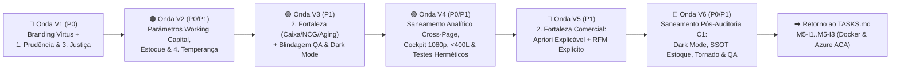

# 🛠️ Gerenciador de Refatoração & Remodelagem **Virtus** (`TASKS_REFACTORY.md`)

Plano técnico executável de **Remodelagem Estratégica para o Framework de Governança Virtus (As 4 Virtudes Cardeais)**, combinado com **Saneamento Analítico, Modularização (< 400 linhas) e Elevação de UX Executiva** da plataforma **Virtus · by Kyberna**.

> **Como usar:** cada tarefa possui ID único `<Onda>-<Pilar><Nº>` (ex.: `V1-S1`, `V1-V1`, `V2-D1`, `V3-S1`), avaliação de impacto de **1 a 5 estrelas (`⭐`)**, arquivos impactados, dependências, **Especificação Técnica Mastigada (Anti-Alucinação)** e **Critério de Pronto (DoD)** validado via terminal.
> Status: `[ ]` a fazer · `[~]` parcial · `[x]` concluída (DoD validado via terminal).
> Protocolo de execução: ver §1 de [`GEMINI.md`](./GEMINI.md) / [`CLAUDE.md`](./CLAUDE.md). Visão de produto e fórmulas canônicas: [`VISION.md`](./VISION.md). Roadmap principal: [`TASKS.md`](./TASKS.md).

---

## 🏛️ A Arquitetura das 4 Páginas no **Virtus** ("O Efeito Virtus")

Em vez de separar a gestão em silos corporativos engessados ("Comercial", "Financeiro", "Operações"), o **Virtus** estrutura a tomada de decisão pelo **comportamento do negócio** através das **4 Virtudes Cardeais**, mantendo os caminhos físicos dos 4 arquivos de página (`src/ui/pages/`) para preservar histórico Git e compatibilidade de testes, ordenados no menu via `st.navigation`:

| Ordem no Menu (`st.navigation`) | Arquivo Físico (`src/ui/pages/`) | Virtude Cardeal & Papel Executivo | Blocos Analíticos & Prescritivos Principais |
| :---: | :--- | :--- | :--- |
| **1ª** | [`1_executive.py`](./src/ui/pages/1_executive.py) | **🦉 1. PRUDÊNCIA**<br>*(Direção, Previsibilidade e Cenários — CEO / Diretor)* | • **Termômetro de Metas (Pacing)** (Receita, Margem Líquida e Caixa Operacional vs. Meta)<br>• **Projeção de Fechamento** (Tendência Dupla Histórica + Projeção 30/60/90d)<br>• **Simulador Executivo What-If (3 Alavancas)** (Preço, Desconto, Comissão/Custos + Breakeven)<br>• **Radar de Anomalias da Semana** (Alertas automáticos de desvios críticos) |
| **2ª** | [`4_simulator.py`](./src/ui/pages/4_simulator.py) | **🛡️ 2. FORTALEZA**<br>*(Solidez Financeira, Caixa e Resiliência — Diretor & Financeiro)* | • **Fôlego de Caixa (Runway) & Ponto de Equilíbrio (Dia do Break-Even Mensal)**<br>• **Ciclo Financeiro ($\text{PME} + \text{PMR} - \text{PMP}$) e Necessidade de Capital de Giro (NCG em R$)**<br>• **Risco de Concentração (Dependência)** (Curva Top 5/10 Clientes, RCAs e Famílias)<br>• **Saúde da Carteira & Exposição por Faixa de Atraso (Aging List)** |
| **3ª** | [`2_commercial_radar.py`](./src/ui/pages/2_commercial_radar.py) | **⚖️ 3. JUSTIÇA**<br>*(Equilíbrio Comercial, Margem e Valor — Comercial & Diretor)* | • **Matriz de Rentabilidade: Campeões vs. "Vampiros"** (4 Abas: `Família`, `SKU`, `Lojista`, `RCA`)<br>• **Justiça da Força de Vendas** (Quadrante de RCAs colorido por mérito de margem + Positivação/Mix)<br>• **Saúde da Base de Clientes** (Treemap RFM por Margem + Funil de 4 Estágios do Ciclo)<br>• **Explorador White Space (SKU Âncora + Pitch) & LTV/Retenção** |
| **4ª** | [`3_inventory_demand.py`](./src/ui/pages/3_inventory_demand.py) | **🏺 4. TEMPERANÇA**<br>*(Eficiência, Controle de Excessos e Desperdícios — Financeiro & Comercial)* | • **Erosão Comercial (Waterfall da Sangria de Margem em `R$` e `%`)**<br>• **Disciplina de Política Comercial** (Auditoria de Descontos Acima do Teto por RCA/Família)<br>• **Temperança de Estoque** (Matriz ABC/XYZ 3x3 + Capital Imobilizado $>120\text{d}$ vs. Ruptura Curva A)<br>• **Vazamentos Financeiros** (Custo Financeiro do Prazo Excedente + Frete/Comissões Críticas) |



---

## ⭐ Matriz Resumo de Priorização das Tarefas (`Virtus`)

| ID | Onda / Escopo | Entrega Técnica | 🎯 Utilidade | 💰 Valor (R$) | 🚀 Demo ("Uau") | ⚙️ Viabilidade (Complexidade) | Prioridade |
|---|---|---|---|---|:---:|:---:|:---:|:---:|
| **`V1-S1`** | **1. Prudência** (Backend/SQL) | Pacing de Metas, Projeção 30/60/90d, Radar de Anomalias SQL, Delta YoY real em 24m e motor rápido What-If (Breakeven) | ⭐⭐⭐⭐⭐ | ⭐⭐⭐⭐⭐ | ⭐⭐⭐⭐⭐ | ⭐⭐⭐⭐⭐ *(🟢 Baixa)* | **P0** |
| **`V1-V1`** | **1. Prudência** (UI + Nav) | Branding **Virtus** em `app.py`/`sidebar.py`/`logo.svg` + Página **1. Prudência** (`1_executive.py` + `prudence_sections.py` $< 400$ linhas) | ⭐⭐⭐⭐⭐ | ⭐⭐⭐⭐⭐ | ⭐⭐⭐⭐⭐ | ⭐⭐⭐⭐⭐ *(🟢 Baixa)* | **P0** |
| **`V1-S2`** | **3. Justiça** (Backend/SQL) | Funil do Ciclo (4 estágios), Top White Space (SKU Âncora + Pitch), LTV/Retenção por segmento RFM e 4 dimensões de Campeões vs. Vampiros | ⭐⭐⭐⭐⭐ | ⭐⭐⭐⭐⭐ | ⭐⭐⭐⭐⭐ | ⭐⭐⭐⭐⭐ *(🟢 Baixa)* | **P0** |
| **`V1-V2`** | **3. Justiça** (Gráficos + UI) | Vetorização sem `iterrows`, Quadrante RCAs colorido em pt-BR, Treemap RFM por Margem e Página **3. Justiça** (`2_commercial_radar.py` + `justice_sections.py`) | ⭐⭐⭐⭐⭐ | ⭐⭐⭐⭐⭐ | ⭐⭐⭐⭐⭐ | ⭐⭐⭐⭐⭐ *(🟢 Baixa)* | **P0** |
| **`V2-D1`** | **Finanças & Estoque** (Dados) | Criação de `config/finance/working_capital.yaml` (Custos Fixos, PMR, PMP, Teto de Desconto, Custo de Prazo) + `inventory_snapshot.py` (`M4-D2`) | ⭐⭐⭐⭐⭐ | ⭐⭐⭐⭐⭐ | ⭐⭐⭐⭐⭐ | ⭐⭐⭐⭐⭐ *(🟢 Baixa)* | **P0** |
| **`V2-S1`** | **4. Temperança** (Backend/SQL) | `temperance_service.py`: Waterfall da Sangria (`R$` e `%`), Auditoria de Desconto Acima do Teto, Vazamento de Prazo e Capital Travado ABC/XYZ | ⭐⭐⭐⭐⭐ | ⭐⭐⭐⭐⭐ | ⭐⭐⭐⭐⭐ | ⭐⭐⭐⭐⭐ *(🟢 Baixa)* | **P0** |
| **`V2-V1`** | **4. Temperança** (Gráficos + UI) | Página **4. Temperança** (`3_inventory_demand.py` + `temperance_sections.py`): Waterfall com `%`, Matriz ABC/XYZ filtrável, Capital Travado $>120\text{d}$ vs. Ruptura A | ⭐⭐⭐⭐⭐ | ⭐⭐⭐⭐⭐ | ⭐⭐⭐⭐⭐ | ⭐⭐⭐⭐⭐ *(🟢 Baixa)* | **P1** |
| **`V2-V2`** | **Cockpit 1080p & ABC/XYZ** (UI/ML) | Redesign Cockpit sem scroll (Leitura em Z / DAR: Topo 18% / Meio 45% / Base 37%), Data-Ink Ratio, limpeza de títulos Plotly e calibração estatística ABC/XYZ (18% X / 44% Y / 38% Z) | ⭐⭐⭐⭐⭐ | ⭐⭐⭐⭐⭐ | ⭐⭐⭐⭐⭐ | ⭐⭐⭐⭐⭐ *(🟢 Baixa)* | **P0** |
| **`V3-S1`** | **2. Fortaleza** (Backend/SQL) | `fortitude_service.py`: Fôlego de Caixa (Runway), Dia do Break-Even Mensal, Ciclo Financeiro ($\text{PME}+\text{PMR}-\text{PMP}$), NCG, Concentração Top 5/10 e Aging | ⭐⭐⭐⭐⭐ | ⭐⭐⭐⭐⭐ | ⭐⭐⭐⭐⭐ | ⭐⭐⭐⭐⭐ *(🟢 Baixa)* | **P1** |
| **`V3-V1`** | **2. Fortaleza** (UI + QA Global) | Página **2. Fortaleza** (`4_simulator.py` + `fortitude_sections.py`) + Saneamento Dark Mode `var(--kyb-*)` e Suíte Completa `pytest` nas 4 Virtudes | ⭐⭐⭐⭐⭐ | ⭐⭐⭐⭐⭐ | ⭐⭐⭐⭐⭐ | ⭐⭐⭐⭐⭐ *(🟢 Baixa)* | **P1** |
| **`V4-D1`** | **Fórmulas & Fallback Parquet** (Doc/DB) | Alinhamento canônico de fórmulas em `VISION.md` §6 (`MC_liq %` sobre receita bruta e custo fixo sobre receita líquida) + auto-registro de views Parquet no `DuckDBRepository.query()` quando `kyberna.duckdb` estiver ausente | ⭐⭐⭐⭐⭐ | ⭐⭐⭐⭐⭐ | ⭐⭐⭐⭐⭐ | ⭐⭐⭐⭐⭐ *(🟢 Baixa)* | **P0** |
| **`V4-S1`** | **Sincronia Temporal & SQL** (Services) | Propagação de `period_preset`/`selected_month` para Temperança e Justiça (Waterfall 100% idêntico à Prudência), parametrização SQL sem hardcodes (`temperance_queries.py`) e correção matemática de `fortitude_service.py` e `simulator.py` | ⭐⭐⭐⭐⭐ | ⭐⭐⭐⭐⭐ | ⭐⭐⭐⭐⭐ | ⭐⭐⭐⭐⭐ *(🟢 Baixa)* | **P0** |
| **`V4-V1`** | **Cockpit Header & Polimento** (UI) | Adoção de `render_cockpit_header` nas 4 páginas, títulos das 4 Virtudes no menu `app.py`, 3º slider (`_what_if_cost`) em Prudência, correção de classe CSS/tooltip em Justiça, `title=None` no Plotly e remoção de emojis/código morto | ⭐⭐⭐⭐⭐ | ⭐⭐⭐⭐⭐ | ⭐⭐⭐⭐⭐ | ⭐⭐⭐⭐⭐ *(🟢 Baixa)* | **P0** |
| **`V4-I1`** | **Modularização < 400L** (Infra/ETL/ML) | Divisão cirúrgica dos 6 módulos $>400$ linhas (`audit.py`: 1.109L, `white_space.py`: 668L, `c1_toys.py`: 662L, `cli.py`: 540L, `features.py`: 532L, `rfm.py`: 408L) preservando re-exports públicos | ⭐⭐⭐⭐ | ⭐⭐⭐⭐ | ⭐⭐⭐⭐ | ⭐⭐⭐⭐⭐ *(🟢 Baixa)* | **P1** |
| **`V4-I2`** | **Blindagem Hermética QA** (Tests) | Fixture `conftest.py` auto-bootstrap para `get_duckdb_path()`, testes de reconciliação cross-page (`Prudência == Temperança`) e suíte unitária dedicada `tests/services/test_simulator.py` | ⭐⭐⭐⭐⭐ | ⭐⭐⭐⭐⭐ | ⭐⭐⭐⭐ | ⭐⭐⭐⭐⭐ *(🟢 Baixa)* | **P1** |
| **`V5-D1`** | **Apriori Persistido** (ML/Dados) | Novo mart `mart_apriori_rules` (`family` + `sku`: Suporte, Confiança, Lift reais) + enriquecimento de `mart_white_space` com regra aplicada e SKU âncora real | ⭐⭐⭐⭐⭐ | ⭐⭐⭐⭐⭐ | ⭐⭐⭐⭐⭐ | ⭐⭐⭐⭐⭐ *(🟢 Baixa)* | **P1** |
| **`V5-S1`** | **Serviços Apriori & RFM** (Services/SQL) | Queries reais em `white_space_queries.py`, remoção de proxy falso (`* 1.5`) e do teto `LIMIT 50` nos KPIs, `rfm_segment` e aba `Regras Apriori` no Excel | ⭐⭐⭐⭐⭐ | ⭐⭐⭐⭐⭐ | ⭐⭐⭐⭐⭐ | ⭐⭐⭐⭐⭐ *(🟢 Baixa)* | **P1** |
| **`V5-V1`** | **Gráficos Apriori & Dark CSS** (Charts/CSS) | Heatmap aprimorado (9 segmentos RFM ordenados, `R$ + lojas`, contraste, zero corte) + scatter `Suporte × Confiança × Lift` (`apriori_charts.py`) + fix botões Dark Mode | ⭐⭐⭐⭐⭐ | ⭐⭐⭐⭐⭐ | ⭐⭐⭐⭐⭐ | ⭐⭐⭐⭐⭐ *(🟢 Baixa)* | **P1** |
| **`V5-V2`** | **Fortaleza Aba 1 & 2** (UI/QA) | Redesign PowerBI da Aba 1 sem KPIs duplicados, exploração livre por qualquer Segmento RFM (padrão `Todos`), tabela sem corte horizontal e `Segmento RFM` na Aba 2 | ⭐⭐⭐⭐⭐ | ⭐⭐⭐⭐⭐ | ⭐⭐⭐⭐⭐ | ⭐⭐⭐⭐⭐ *(🟢 Baixa)* | **P1** |
| **`V6-D1`** | **Motor Temporal & Forecast 30d** (Services) | Correção de `PoP`/`YoY` em `Histórico Completo` (fim do falso `+98,2%` / `183,5%` comparando 24m vs 12m) e projeção 30d real de `mart_forecast_30d` (fim do `R$ 39,2 mi` em 30d) | ⭐⭐⭐⭐⭐ | ⭐⭐⭐⭐⭐ | ⭐⭐⭐⭐⭐ | ⭐⭐⭐⭐⭐ *(🟢 Baixa)* | **P0** |
| **`V6-D2`** | **SSOT de Estoque & Escopo Global** (Services) | Unificação de `temp_dto` (`R$ 50,8k / 38 Curva A`) e `inv_dto` (`R$ 26,1k / 171 todas curvas`) sobre `mart_inventory_position` + separação Curva A vs Total ROP + selo de escopo global sob filtros | ⭐⭐⭐⭐⭐ | ⭐⭐⭐⭐⭐ | ⭐⭐⭐⭐⭐ | ⭐⭐⭐⭐⭐ *(🟢 Baixa)* | **P0** |
| **`V6-S1`** | **Simulador What-If & Tornado** (Services/UI) | Correção da inversão de sinal/cor do Tornado em `Custo/CMV`, `Comissão` e `Desconto` (`Adverso <= 0` vermelho, `Favorável >= 0` verde) + transparência de base/teto na Curva de Lucro | ⭐⭐⭐⭐⭐ | ⭐⭐⭐⭐⭐ | ⭐⭐⭐⭐⭐ | ⭐⭐⭐⭐⭐ *(🟢 Baixa)* | **P0** |
| **`V6-S2`** | **Apriori `Lift > 1.0` & Reconciliação Risco** (ML/Services) | Priorização estrita de `lift > 1.0` em `match_best_apriori_rule()`, fim do corte `LIMIT 200` na soma da Diretriz (`R$ 824,1k` vs `R$ 451,5k`) e alinhamento semântico de Carteira em Risco P2 vs P3 (`R$ 2,46 mi` vs `R$ 1,89 mi`) | ⭐⭐⭐⭐⭐ | ⭐⭐⭐⭐⭐ | ⭐⭐⭐⭐ | ⭐⭐⭐⭐⭐ *(🟢 Baixa)* | **P1** |
| **`V6-V1`** | **Dark Mode Nativo & Sidebar `?`** (UI/CSS) | `theme=None` em 100% dos `st.plotly_chart(...)`, estilização Dark Mode de BaseWeb/Selectbox/`st.dataframe` e correção do `fill` SVG em `[data-testid="stSidebar"] svg` (fim do `?` preto ilegível no Light Mode) | ⭐⭐⭐⭐⭐ | ⭐⭐⭐⭐ | ⭐⭐⭐⭐⭐ | ⭐⭐⭐⭐ *(🟡 Média)* | **P0** |
| **`V6-V2`** | **Anticolisão de 7 Gráficos Plotly** (Charts) | Alinhamento de `short_x_map` no Waterfall DRE (0/9 chaves casavam!), respiro no Heatmap RFM, offsets/fundo no Apriori Scatter e Quadrante RCAs, folga X na Elasticidade (`-1.78 Linha Escolar`), colorbar `"Margem %"` no Treemap RFM e folga Y no `dual_trend` | ⭐⭐⭐⭐⭐ | ⭐⭐⭐⭐ | ⭐⭐⭐⭐⭐ | ⭐⭐⭐⭐⭐ *(🟢 Baixa)* | **P0** |
| **`V6-V3`** | **KaTeX, Rigor Financeiro & Radar 3 Cards** (UI/Services) | Fix do bug KaTeX (`R$ ... R$`) em P1 Aba 2, correção `"Veredito da Fortaleza"` → `"Veredito de Justiça Financeira"`, renomeação de `"Erosão Recuperável: R$ 2,7 mi"`, explicitação Break-Even/Aging Proxy e Radar exibindo todos os 3 alertas (sem ocultar `Crítica`) | ⭐⭐⭐⭐⭐ | ⭐⭐⭐⭐⭐ | ⭐⭐⭐⭐⭐ | ⭐⭐⭐⭐⭐ *(🟢 Baixa)* | **P0** |
| **`V6-V4`** | **Tabelas pt-BR Sem Corte & Temperança Aba 3** (UI) | Padronização pt-BR (`R$ 43.436` / `R$ 1.214.370,74`), `NaN` → `"—"` no MoM (fim do `"None"`), remoção de colunas técnicas cruas/clipping horizontal nas 4 páginas e adição de síntese prescritiva em P4 Aba 3 + drilldown dos 4 Clientes Vampiros em P2 Aba 2 | ⭐⭐⭐⭐⭐ | ⭐⭐⭐⭐ | ⭐⭐⭐⭐ | ⭐⭐⭐⭐⭐ *(🟢 Baixa)* | **P1** |
| **`V6-I1`** | **Blindagem QA Anti-Regressão V6** (Tests) | Testes automatizados cobrindo `theme=None` via AST, sinais do Tornado, casamentos de `short_x_map`, SSOT de Estoque, `YoY`/`PoP` + Forecast 30d, anti-KaTeX, `lift > 1.0` e revalidação visual 1080p Light/Dark | ⭐⭐⭐⭐⭐ | ⭐⭐⭐⭐ | ⭐⭐⭐⭐ | ⭐⭐⭐⭐⭐ *(🟢 Baixa)* | **P1** |

---

### 🛡️ Guia Rápido de Integração & Anti-Alucinação para Execução (`Virtus`)

> [!IMPORTANT]
> **Leia este bloco antes de implementar qualquer tarefa (`V1`..`V6`).**
>
> 1. **Limite Estrito de 400 Linhas por Arquivo (`GEMINI.md` §3)**:
>    - Nenhum arquivo em `src/` pode ultrapassar **400 linhas**.
>    - Reduza `src/services/executive_service.py` (atualmente 494 linhas) e `src/ui/pages/1_executive.py` (atualmente 441 linhas) para **$< 380$ linhas** extraindo componentes visuais para `src/ui/components/prudence_sections.py` (e analogamente `justice_sections.py`, `temperance_sections.py`, `fortitude_sections.py`).
>    - Separe sempre as consultas SQL em `src/services/<modulo>_queries.py`.
> 2. **Preservação dos Caminhos Físicos das 4 Páginas**:
>    - Mantenha os arquivos `1_executive.py` (**1. Prudência**), `4_simulator.py` (**2. Fortaleza**), `2_commercial_radar.py` (**3. Justiça**) e `3_inventory_demand.py` (**4. Temperança**), ordenando-os na lista `pages` de `st.navigation(pages)` em [`src/ui/app.py`](./src/ui/app.py). Isso garante que `test_pages_render_without_exception` continue funcionando sem quebrar imports.
> 3. **Proibição Absoluta de `df.iterrows()` (`GEMINI.md` §4.4)**:
>    - Remova os loops `for _, row in df.iterrows():` hoje presentes em [`src/ui/components/charts.py`](./src/ui/components/charts.py) e [`src/ui/components/commercial_charts.py`](./src/ui/components/commercial_charts.py). Use list comprehensions vetorizadas sobre `zip(...)` ou `customdata` + `hovertemplate` nativo do Plotly.
> 4. **Ícone Azul `ⓘ` Obrigatório (`help_text: str` não-vazio)**:
>    - Todo `render_kpi_card`, `section_header`, `render_prescription_box` ou banner executivo (`info_tooltip_html`) **deve** receber um `help_text` claro em pt-BR explicando a métrica, a fórmula e a leitura executiva dentro da Virtude correspondente.
> 5. **Compatibilidade Dark Mode (`var(--kyb-*)`)**:
>    - Proibido usar cores hexadecimais estáticas (`#475569`, `#0F172A`, `#0d9488`) em strings HTML nas páginas ou seções; use sempre `var(--kyb-text)`, `var(--kyb-text-muted)`, `var(--kyb-teal)`, `var(--kyb-card-bg)` e `var(--kyb-border)`.
> 6. **Execução de Testes `AppTest` no Windows**:
>    - Testes em `tests/services/` rodam normalmente no sandbox. Testes em `tests/ui/` que instanciam `streamlit.testing.v1.AppTest` usam `socket.socketpair()` e devem ser executados com `BypassSandbox: true` e `default_timeout=10`.
> 7. **Regra de Ouro do Viewport 1080p Sem Scroll (Leitura em Z / Metodologia DAR)**:
>    - Todas as páginas Virtus devem caber perfeitamente em telas padrão **16:9 (1920×1080px) sem rolagem vertical de página** ($\le 750\text{px}$ de altura útil), organizadas na metodologia **DAR (Dashboard → Analysis → Reporting)** em 3 faixas:
>      - **Faixa 1 — Topo (~18%)**: Cabeçalho compacto `.cockpit-header` + 5 KPI Cards (`.kpi-card`).
>      - **Faixa 2 — Meio (~45%)**: Diagnóstico visual em 2 colunas lado a lado (`[1, 1]`) com gráficos Plotly de altura fixa `height=280` e revelação progressiva em `st.tabs`.
>      - **Faixa 3 — Base (~37%)**: Detalhamento operacional com **scroll exclusivamente interno (`height=210`)** em `st.dataframe` na esquerda + Veredito Prescritivo (`.prescription-box`) na direita.
> 8. **Data-Ink Ratio (Tufte) e Calibração Empírica ABC/XYZ**:
>    - Proibido duplicar títulos entre `section_header` e gráficos Plotly (`title=None` nos layouts Plotly).
>    - Proibido criar colunas laterais isoladas apenas para abrigar um `st.selectbox` deixando buraco branco abaixo. Alinhe filtros no cabeçalho ou use `label_visibility="collapsed"`.
>    - Eixos com anotações diretas nas barras/células devem simplificar ticks ou ocultar legendas redundantes.
>    - Cortes XYZ calibrados em `config/pipeline.yaml` para demanda B2B semanal com zeros (`xyz_x_cutoff: 1.50`, `xyz_y_cutoff: 2.50`), gerando uma distribuição equilibrada (≈18% X, ≈44% Y, ≈38% Z).
> 9. **Invariantes Pós-Auditoria C1 (`V6`) & Monitoramento de Teto `< 400L`**:
>    - Toda chamada `st.plotly_chart(...)` em `src/ui/` **deve** passar `theme=None` para que `.streamlit/config.toml` (`base="light"`) não sobrescreva o template `kyberna_dark`.
>    - Proibido passar strings com 2+ cifrões (`R$ ... R$`) não escapados em `st.caption()` ou `st.markdown()` (dispara renderização KaTeX); usar HTML seguro com `unsafe_allow_html=True` ou escapar `R\$`.
>    - **Atenção aos arquivos próximos do teto de 400 linhas** (medição real em `2026-11-19`): `src/ui/components/commercial_charts.py` (**396L**), `src/services/commercial_queries.py` (**396L**), `src/ui/pages/4_simulator.py` (**380L**), `src/ui/components/charts.py` (**373L**), `src/ui/components/sidebar.py` (**372L**), `src/services/simulator.py` (**370L**), `src/services/dto.py` (**361L**) e `src/ui/components/justice_sections.py` (**350L**). Sempre extrair helpers dedicados se uma edição ameaçar ultrapassar `395` linhas.

---

## 📌 Quadro Detalhado das Tarefas de Remodelagem **Virtus**

---

### 🔴 Onda V1 — Identidade **Virtus**, Página 1 (**Prudência**) e Página 3 (**Justiça**)

> **Objetivo da Onda V1**: Estabelecer a identidade visual e narrativa do **Virtus** (As 4 Virtudes Cardeais) na aplicação e entregar as duas primeiras grandes páginas apoiadas nos marts já materializados no DuckDB: **1. Prudência** (Direção, Pacing de Metas, Projeção 30/60/90d, Simulador Rápido What-If e Radar de Anomalias) e **3. Justiça** (Matriz Campeões vs. Vampiros em 4 abas, Quadrante de RCAs colorido, Funil do Ciclo de Recompra, Treemap RFM por Margem, White Space CNPJ a CNPJ com Pitch e LTV).

#### 🧠 Serviços & Consultas Analíticas (`S` / `D`)

- [x] **V1-S1** *(VIRTUS-PRUD-01)* — **Motor de Prudência: Pacing de Metas, Projeção de Fechamento (30/60/90d), Simulador Executivo What-If, Radar de Anomalias SQL e Delta YoY Real**: Evoluir `executive_service.py` e `executive_queries.py` (< 400 linhas) para alimentar a **Página 1 — Prudência** e sincronizar os filtros temporais em todas as consultas.
  - *Avaliação:* 🎯 ⭐⭐⭐⭐⭐ · 💰 ⭐⭐⭐⭐⭐ · 🚀 ⭐⭐⭐⭐⭐ · ⚙️ ⭐⭐⭐⭐⭐ *(🟢 Baixa)* · **Prioridade: P0**
  - *Arquivos:* `src/services/dto.py`, `src/services/executive_queries.py`, `src/services/executive_service.py`, `tests/services/test_executive_service.py`.
  - *Depende de:* `M2-V3`
  - *Especificação Técnica Mastigada (Anti-Alucinação):*
    - **1. Delta Dinâmico Real quando `comp_start_date_key is None` (Modo 24m / `"all"`)**:
      - Remover as constantes hardcoded (`4.4`, `3.8`, `1.8`, `-0.7`, `-7.1`) de `compute_executive_kpis()`. Quando `start_date_key is None` e `comp_start_date_key is None`, calcular os deltas comparando o **Ano 2 (`20240101` a `20241231`) contra o Ano 1 (`20230101` a `20231231`)** sob os mesmos filtros geográficos/família/RCA, ou retornar `None` caso o período anterior tenha receita zero.
    - **2. Termômetro de Metas (Pacing) em `ExecutiveKpisDTO`**:
      - Adicionar campos `revenue_target_brl: float = 0.0`, `revenue_pacing_pct: float = 100.0`, `margin_target_pct: float = 26.0` e `projected_quarter_revenue_brl: float = 0.0` (meta derivada de $+8\%$ sobre a base comparativa ou média móvel sazonal; projeção de 30/60/90d calculada a partir do ritmo diário dos últimos 90 dias).
    - **3. Radar de Anomalias (`query_prudence_anomalies()` em `executive_queries.py`)**:
      - Detectar automaticamente via SQL de 3 a 5 alertas reais nos dados filtrados: (a) família com maior queda de `margin_pct` ou maior desconto médio no período; (b) RCA com maior desvio de desconto acima da mediana; (c) quantidade e R$ de clientes Classe A/Campeões que entraram em `delay_ratio > 1.5`. Retornar lista de DTOs/dicts ou `anomalies_df: pd.DataFrame` com `severity`, `category`, `title`, `impact_brl` e `recommendation`.
    - **4. Função Pura de Simulação Rápida What-If (`simulate_quick_what_if()`)**:
      - Recebe o `ExecutiveKpisDTO` base e 3 alavancas (`price_change_pct: float`, `discount_change_pp: float`, `commission_or_cost_change_pct: float`, `elasticity: float = -1.2`) e calcula instantaneamente: `simulated_revenue_brl`, `simulated_margin_brl`, `simulated_margin_pct`, `margin_delta_brl`, `breakeven_volume_pct` e `estimated_volume_pct`.
    - **5. Propagação de Filtros e Expansão de `query_top_drivers()`**:
      - Propagar `start_date_key` e `end_date_key` em `get_top_margin_drivers()` e adicionar suporte a `by: Literal["product", "customer", "family", "sales_rep"] = "product"` (reutilizado pela Página 3 — Justiça e pela Página 1). Filtrar `families` em `get_abc_xyz_overview()`.
    - **6. Enxugamento (< 400 linhas)**:
      - Manter `src/services/executive_service.py` e `src/services/executive_queries.py` estritamente abaixo de **380 linhas**.
  - *DoD:* `simulate_quick_what_if` com alavancas em zero retorna `margin_delta_brl == 0.0`; `anomalies_df` retorna $\ge 2$ alertas reais; `executive_service.py` < 400 linhas; `uv run pytest tests/services/test_executive_service.py -q` e `uv run mypy src` passam.

- [x] **V1-S2** *(VIRTUS-JUST-01)* — **Motor de Justiça Comercial: Funil do Ciclo (4 Estágios), Campeões vs. Vampiros (4 Dimensões), Top White Space (SKU Âncora + Pitch), LTV/Retenção e Conexão Total de Filtros**: Expandir `src/services/dto.py`, `src/services/commercial_queries.py`, `src/services/commercial_service.py` e `src/ui/cache.py` para alimentar a **Página 3 — Justiça**.
  - *Avaliação:* 🎯 ⭐⭐⭐⭐⭐ · 💰 ⭐⭐⭐⭐⭐ · 🚀 ⭐⭐⭐⭐⭐ · ⚙️ ⭐⭐⭐⭐⭐ *(🟢 Baixa)* · **Prioridade: P0**
  - *Arquivos:* `src/services/dto.py`, `src/services/commercial_queries.py`, `src/services/commercial_service.py`, `src/ui/cache.py`, `tests/services/test_commercial_service.py`.
  - *Depende de:* `M3-S4`, `V1-S1`
  - *Especificação Técnica Mastigada (Anti-Alucinação):*
    - **1. Evolução de `CommercialKpisDTO` e `CommercialPageDTO` (`src/services/dto.py`)**:
      - Em `CommercialKpisDTO`: adicionar `attention_customers: int = 0`, `attention_customers_pct: float = 0.0`, `attention_revenue_brl: float = 0.0` (`1.1 < delay_ratio <= 1.5`), `avg_ltv_brl: float = 0.0` e `vampire_customers_count: int = 0` (clientes com faturamento acima da mediana mas `margin_pct < 15.0%`).
      - Em `CommercialPageDTO`: adicionar `cycle_funnel_df: pd.DataFrame`, `top_white_space_deals_df: pd.DataFrame`, `champions_df: pd.DataFrame` e `vampires_df: pd.DataFrame` (ou rankings por Família, SKU, Lojista e RCA).
    - **2. Novas Consultas em [`src/services/commercial_queries.py`](./src/services/commercial_queries.py)**:
      - **`query_cycle_health_funnel()`**: agrupa os clientes da carteira filtrada pelos 4 estágios (`No Ciclo`, `Atenção`, `Em Risco Imediato`, `Adormecido / Perdido`) com `customer_count`, `customer_share_pct`, `annual_revenue_brl`, `annual_margin_brl` e `avg_delay_ratio`.
      - **`query_top_white_space_deals()`**: consulta `gold.mart_white_space ws` com join em `dim_customer`, `dim_sales_rep` e `mart_rfm`, filtrando por `regiao`, `uf`, `sales_reps`, `rfm_segment` e **`families`** (`ws.recommended_family IN (...)`), retornando `anchor_sku_name`, `recommended_family`, `recommended_top_sku`, `affinity_lift`, `potential_revenue_brl`, `potential_margin_brl` e `action_pitch`.
      - **Enriquecimento de `query_rfm_summary()`**: adicionar cálculo de **LTV Estimado Médio (`estimated_ltv_brl`)** por segmento RFM (`ROUND(AVG(contribution_margin / GREATEST(churn_probability, 0.10)), 2)`).
      - **Conexão de Filtros**: aplicar `families` em `query_white_space_matrix_data()` e `uf`/`quadrant` em `query_rep_performance_data()`.
  - *DoD:* `cycle_funnel_df` soma 100% dos clientes filtrados; `top_white_space_deals_df` retorna `anchor_sku_name` e `action_pitch`; todos os arquivos em `src/services/` < 400 linhas; `uv run pytest tests/services/test_commercial_service.py -q` passa.

#### 🎨 Identidade Visual & Interfaces de Prudência e Justiça (`V`)

- [x] **V1-V1** *(VIRTUS-PRUD-02)* — **Branding Virtus (`app.py`, `sidebar.py`, `logo.svg`) e Página 1 — 🦉 Prudência (`1_executive.py` + `prudence_sections.py`)**: Atualizar a navegação multipage para as **4 Virtudes Cardeais** e entregar a página **1. Prudência** completa com Pacing de Metas, Tendência Dupla com Meta + Projeção, Simulador What-If de 3 Alavancas e Radar de Anomalias.
  - *Avaliação:* 🎯 ⭐⭐⭐⭐⭐ · 💰 ⭐⭐⭐⭐⭐ · 🚀 ⭐⭐⭐⭐⭐ · ⚙️ ⭐⭐⭐⭐⭐ *(🟢 Baixa)* · **Prioridade: P0**
  - *Arquivos:* `src/ui/app.py`, `src/ui/components/sidebar.py`, `src/ui/assets/logo.svg`, `src/ui/assets/logo_dark.svg`, `src/ui/components/charts.py`, `src/ui/components/prudence_sections.py` (novo), `src/ui/pages/1_executive.py`, `tests/ui/test_executive_page.py`, `tests/ui/test_app.py`.
  - *Depende de:* `V1-S1`
  - *Especificação Técnica Mastigada (Anti-Alucinação):*
    - **1. Navegação Virtus em [`src/ui/app.py`](./src/ui/app.py)**:
      - `page_title="Virtus · Decision Intelligence (by Kyberna)"`, `page_icon="🏛️"`.
      - Configurar `st.navigation(pages)` na sequência canônica das 4 Virtudes:
        1. `1_executive.py` $\rightarrow$ `title="1. Prudência · Direção"`, `icon="🦉"`, `default=True`
        2. `4_simulator.py` $\rightarrow$ `title="2. Fortaleza · Caixa & Risco"`, `icon="🛡️"`
        3. `2_commercial_radar.py` $\rightarrow$ `title="3. Justiça · Comercial & Valor"`, `icon="⚖️"`
        4. `3_inventory_demand.py` $\rightarrow$ `title="4. Temperança · Eficiência"`, `icon="🏺"`
    - **2. Logotipo SVG (`logo.svg` e `logo_dark.svg`)**:
      - Atualizar wordmark para **"VIRTUS"** com subtítulo **"DECISION INTELLIGENCE · BY KYBERNA"**.
    - **3. Estrutura da Página 1 — 🦉 Prudência (`1_executive.py` + `prudence_sections.py` < 350 linhas)**:
      - Título principal: `"🦉 1. Prudência — Visão Executiva, Previsibilidade & Direção"` (mantendo compatibilidade com testes de renderização).
      - **5 KPI Cards com Pacing e Sub-rodapé Executivo**: Faturamento Bruto (com Caixas Master e `% da Meta`), Receita Líquida (com `% Impostos`), Margem de Contribuição R$, Margem Líquida % (com `Desc.: X% | Com.+Frete: Y%`) e Projeção de Fechamento 30d / Clientes Ativos.
      - **Tendência Dupla + Linha de Meta (`dual_trend` sem `iterrows`)**: histórico mensal de Faturamento vs. Margem % com linha horizontal tracejada da Meta de Margem e destaque do ritmo projetado.
      - **Simulador Executivo de Cenários What-If (`@st.fragment`)**: 3 controles deslizantes rápidos (*Variação de Preço %*, *Desconto Comercial Adicional %*, *Ajuste de Comissão/Custo %*) exibindo em tempo real os cards Antes $\times$ Depois e o veredito de **Volume de Equilíbrio (Breakeven)**.
      - **Radar de Anomalias (Alertas de Prudência)** + Demonstrativo Mensal / Matriz Resumo.
      - Substituir todas as cores fixas (`#475569`, `#0d9488`) por `var(--kyb-text-muted)` e `var(--kyb-teal)`.
  - *DoD:* zero `iterrows()` em `charts.py`; `1_executive.py` e `prudence_sections.py` < 400 linhas; testes em `tests/ui/test_executive_page.py` e `tests/ui/test_app.py` passam 100%.

- [x] **V1-V2** *(VIRTUS-JUST-02)* — **Gráficos Vetorizados e Página 3 — Justiça (`2_commercial_radar.py` + `justice_sections.py`)**: Vetorizar `cycle_delay_scatter`, `rfm_treemap` (por Margem Líquida) e `quadrant_scatter` (4 cores em pt-BR) e construir a página **3. Justiça** unindo Campeões vs. Vampiros (4 Abas), Quadrante da Força de Vendas, Saúde da Carteira (Funil do Ciclo + RFM + LTV) e Explorador White Space (SKU Âncora + Pitch).
  - *Avaliação:* 🎯 ⭐⭐⭐⭐⭐ · 💰 ⭐⭐⭐⭐⭐ · 🚀 ⭐⭐⭐⭐⭐ · ⚙️ ⭐⭐⭐⭐⭐ *(🟢 Baixa)* · **Prioridade: P0**
  - *Arquivos:* `src/ui/components/commercial_charts.py`, `src/ui/components/charts.py`, `src/ui/components/justice_sections.py` (novo), `src/ui/pages/2_commercial_radar.py`, `tests/ui/test_charts.py`, `tests/ui/test_commercial_page.py`.
  - *Depende de:* `V1-S2`, `V1-V1`
  - *Especificação Técnica Mastigada (Anti-Alucinação):*
    - **1. Refatoração dos Gráficos (`commercial_charts.py` e `charts.py`)**:
      - Remover `for _, row in subset.iterrows():` de `cycle_delay_scatter()`, usando `customdata` vetorizado e adicionando linha guia para `1.1x` (*Janela Ideal*).
      - Em `rfm_treemap()`, definir tamanho por **Margem de Contribuição Líquida (`contribution_margin`)** e exibir LTV estimado no hover.
      - Em `quadrant_scatter()`, traduzir eixos para português (`"Faturamento Bruto (R$)"`, `"Margem Líquida (%)"`) e colorir cada quadrante (*Estrela* = verde, *Volume sem margem* = vermelho, *Margem sem volume* = azul/teal, *Atenção* = âmbar).
    - **2. Estrutura da Página 3 — Justiça (`2_commercial_radar.py` + `justice_sections.py` < 350 linhas)**:
      - Banner de Escopo + Manchete Dinâmica Real (`dto.headline_title` / `dto.headline_text`) + Filtros Táticos In-Page (*Status do Ciclo* e *Segmento RFM*).
      - **5 KPI Cards de Justiça Comercial**: *Lojistas em Risco Crítico*, *Receita Anual em Risco*, *Janela Ideal Pré-Churn (1,1x–1,5x)*, *Potencial White Space (R$)* e *Positivação & LTV Médio*.
      - **Bloco 1 — Matriz de Rentabilidade (Campeões vs. "Vampiros")**: as **4 Abas de Geradores vs. Detratores de Margem** (`Por Família`, `Por Produto (SKU)`, `Por Lojista`, `Por Representante`), separando quem gera lucro líquido de quem drena margem.
      - **Bloco 2 — Justiça da Força de Vendas (Performance Comercial)**: `quadrant_scatter` colorido + tabela completa de RCAs com `Positivação %`, `Mix (Fam./Cli)`, `Desc. Médio %`, `Margem %` e `Risco Carteira`.
      - **Bloco 3 — Saúde da Base de Clientes & Eficiência de Retenção**: Funil de 4 Estágios do Ciclo de Recompra + Tabela Caixa-Branca + `rfm_treemap` + `white_space_heatmap` + Aba de **Top Oportunidades Cross-Sell CNPJ a CNPJ (`SKU Âncora` + `Pitch`)** e Aba de **Retenção & LTV por Segmento RFM**.
  - *DoD:* zero `iterrows()` em `commercial_charts.py`; `2_commercial_radar.py` e `justice_sections.py` < 400 linhas; testes em `tests/ui/test_charts.py` e `tests/ui/test_commercial_page.py` passam 100%.

---

### 🟠 Onda V2 — Parâmetros de Capital de Giro, Estoque e Página 4 (**Temperança**)

> **Objetivo da Onda V2**: Criar a base de parâmetros financeiros de governança (`config/finance/working_capital.yaml`) e o snapshot determinístico de estoque (`inventory_snapshot.py`), implementando a **Página 4 — Temperança** (`3_inventory_demand.py`) focada em estancar desperdícios: **Waterfall da Erosão Comercial**, **Auditoria de Descontos Acima da Política**, **Matriz ABC/XYZ + Capital Imobilizado (> 120 dias) vs. Ruptura Curva A** e **Vazamentos Financeiros de Prazo**.

#### 🗄️ Engenharia de Dados & Finanças (`D`)

- [x] **V2-D1** *(VIRTUS-FIN-01 + M4-D2)* — **Parâmetros de Capital de Giro (`working_capital.yaml`) e Snapshot Determinístico de Posição de Estoque (`inventory_snapshot.py`)**: Criar o arquivo de configuração financeira de governança e materializar `gold.inventory_snapshot` no DuckDB e Parquet.
  - *Avaliação:* 🎯 ⭐⭐⭐⭐⭐ · 💰 ⭐⭐⭐⭐⭐ · 🚀 ⭐⭐⭐⭐⭐ · ⚙️ ⭐⭐⭐⭐⭐ *(🟢 Baixa)* · **Prioridade: P0**
  - *Arquivos:* `config/finance/working_capital.yaml` (novo), `src/etl/gold/inventory_snapshot.py`, `src/etl/contracts.py` (`GoldInventorySnapshotSchema`), `src/etl/gold/star_schema.py`, `tests/etl/test_inventory_snapshot.py`.
  - *Depende de:* `M2-D5`
  - *Especificação Técnica Mastigada (Anti-Alucinação):*
    - **1. `config/finance/working_capital.yaml`**:
      - Definir por cenário (`c1_toys`, `c2_beverages`, `c3_retail_chain`, `c4_single_store`):
        - `fixed_cost_pct_of_avg_net_revenue`: ex. `0.14` (14% da receita líquida média mensal como Custo Fixo Estrutural para cálculo do Break-Even) e `cash_reserve_months_target: 3.5`.
        - `pmr_days_by_size`: `{"P": 28, "M": 42, "G": 56}`, `high_discount_rep_extra_pmr_days: 18`, `standard_term_days: 30`.
        - `pmp_supplier_days`: `35` (Prazo Médio de Pagamento a fornecedores).
        - `monthly_capital_cost_rate`: `0.0135` (1,35% a.m. para cálculo do Custo Financeiro do Prazo Excedente).
    - **2. `src/etl/gold/inventory_snapshot.py` (`build_inventory_snapshot`)**:
      - Calcular `avg_daily_demand_90d` por `(product_id, branch_id)` a partir de `gold.fact_sales`.
      - Ordenar SKUs por `product_id` e atribuir `coverage_days` determinístico (`seed=42`): 10% em `[1.0, 7.0]` (ruptura iminente), 60% em `[15.0, 60.0]` (saudável), 15% em `[60.1, 120.0]` (atenção) e 15% em `[125.0, 320.0]` (capital travado > 120d).
      - Persistir `gold.inventory_snapshot` e `<scenario_id>.inventory_snapshot` no `kyberna.duckdb` e exportar Parquet Zstandard.
  - *DoD:* `GoldInventorySnapshotSchema` valida 100%; proporções de estoque dentro de $\pm 3\text{ p.p.}$; `uv run pytest tests/etl/test_inventory_snapshot.py -q` passa.

#### 🧠 Serviços & Interface de Temperança (`S` / `V`)

- [x] **V2-S1** *(VIRTUS-TEMP-01)* — **Serviço de Temperança (`temperance_service.py` + `temperance_queries.py`): Erosão Comercial, Descontos Acima da Política, Vazamentos Financeiros e Capital Imobilizado**: Implementar o serviço puro da **Página 4 — Temperança**.
  - *Avaliação:* 🎯 ⭐⭐⭐⭐⭐ · 💰 ⭐⭐⭐⭐⭐ · 🚀 ⭐⭐⭐⭐⭐ · ⚙️ ⭐⭐⭐⭐⭐ *(🟢 Baixa)* · **Prioridade: P0**
  - *Arquivos:* `src/services/dto.py` (`TemperanceKpisDTO`, `TemperancePageDTO`), `src/services/temperance_queries.py` (novo), `src/services/temperance_service.py` (novo), `src/ui/cache.py` (`cached_temperance_dashboard`), `tests/services/test_temperance_service.py` (novo).
  - *Depende de:* `V2-D1`
  - *Especificação Técnica Mastigada (Anti-Alucinação):*
    - **1. Métricas Calculadas em `TemperanceKpisDTO` e `TemperancePageDTO`**:
      - **Erosão Comercial Total (`total_commercial_erosion_brl`)**: soma de `discount_amount + freight_amount + commission_amount` e Waterfall completo (`waterfall_df` com `amount` e `pct_of_gross`).
      - **Desconto Fora da Política (`excess_discount_brl`)**: cruzando `gold.fact_sales f` com `gold.dim_customer c` e os tetos de `config/finance/discounts.yaml` (`P: 3%`, `M: 6%`, `G: 10%`), soma o valor em R$ concedido acima do teto do porte do cliente (`SUM(GREATEST(0.0, f.discount_amount - f.gross_revenue * policy_cap_rate))`), agrupado por RCA e por Família (`policy_violations_df`).
      - **Vazamento Financeiro de Prazo (`financial_term_leak_brl`)**: custo financeiro de prazos concedidos acima de 30 dias usando `working_capital.yaml`.
      - **Temperança de Estoque (`locked_capital_brl`, `stockout_risk_skus_count`, `abc_xyz_summary_df`, `inventory_items_df`)**: cruza `gold.inventory_snapshot` com `gold.mart_abc_xyz` e `gold.dim_product`, calculando `locked_capital_brl` (excesso $>120\text{d} \times \text{unit\_cost}$), SKUs Classe A em Ruptura Iminente (`coverage_days <= lead_time_days`) com sugestão de reposição em **Caixas Master**, e prescrição de queima/liquidação para SKUs `CZ`/`BY` travados.
  - *DoD:* `SUM(locked_capital_brl)` positivo e consistente com `inventory_snapshot`; `excess_discount_brl` identifica os RCAs com viés agressivo de desconto; arquivos < 400 linhas; `uv run pytest tests/services/test_temperance_service.py -q` passa.

- [x] **V2-V1** *(VIRTUS-TEMP-02)* — **Página 4 — 🏺 Temperança (`3_inventory_demand.py` + `temperance_sections.py` + `temperance_inventory_section.py`)**: Construir a interface completa de **4. Temperança — Eficiência, Controle de Excessos e Desperdícios**.
  - *Avaliação:* 🎯 ⭐⭐⭐⭐⭐ · 💰 ⭐⭐⭐⭐⭐ · 🚀 ⭐⭐⭐⭐⭐ · ⚙️ ⭐⭐⭐⭐⭐ *(🟢 Baixa)* · **Prioridade: P1**
  - *Arquivos:* `src/ui/components/temperance_sections.py` (novo), `src/ui/pages/3_inventory_demand.py`, `tests/ui/test_temperance_page.py` (novo).
  - *Depende de:* `V2-S1`
  - *Especificação Técnica Mastigada (Anti-Alucinação):*
    - **1. 5 KPI Cards de Temperança**:
      - *Sangria Comercial (Descontos)* (`discount_amount` e `% Bruto`), *Desconto Fora da Política* (`excess_discount_brl`, accent `"red"`), *Capital Travado (> 120 dias)* (`locked_capital_brl`, accent `"gold"`), *Ruptura Iminente (Curva A)* (`stockout_risk_skus_count` e Receita Protegida R$) e *Vazamento Financeiro de Prazo* (`financial_term_leak_brl`).
    - **2. Seção 1 — Erosão Comercial & Disciplina de Política**:
      - Gráfico **Waterfall da Margem Real (`R$` e `%`)** lado a lado com o ranking/gráfico de **Violação de Teto de Desconto e Vazamento de Prazo por RCA e Família**.
    - **3. Seção 2 — Temperança de Estoque & Matriz ABC/XYZ (`@st.fragment`)**:
      - **Heatmap ABC/XYZ 3x3 interativo** + duas abas acionáveis:
        - `🛑 Capital Imobilizado (> 120 dias)`: SKUs superestocados com R$ travado e prescrição (*Kit Promocional / Bonificação / Liquidação*).
        - `🚨 Semáforo de Ruptura (Curva A/B)`: SKUs com cobertura menor que o Lead Time, exibindo **Ordem Sugerida em Caixas Master** e **Receita Protegida (R$)**.
    - **4. Veredito de Temperança (`render_prescription_box`)**: quantifica o total em R$ recuperável somando o fim dos descontos fora do teto + liberação de 25% do estoque travado.
  - *DoD:* `3_inventory_demand.py` e `temperance_sections.py` < 400 linhas; 100% dos KPIs e cabeçalhos com `.kyb-info-icon`; AppTest em `tests/ui/test_temperance_page.py` passa sem erros.

- [x] **V2-V2** *(VIRTUS-COCKPIT-01)* — **Redesign Cockpit Executivo 1080p Sem Scroll (Leitura em Z / Metodologia DAR), Saneamento Data-Ink Ratio e Recalibração da Matriz ABC/XYZ**: Reestruturar as 4 páginas para o formato de tela única (1920×1080px sem rolagem de página vertical), eliminar poluição visual de títulos duplicados no Plotly, embutir filtros sem buracos brancos e calibrar os cortes XYZ para a distribuição empírica real de vendas B2B.
  - *Avaliação:* 🎯 ⭐⭐⭐⭐⭐ · 💰 ⭐⭐⭐⭐⭐ · 🚀 ⭐⭐⭐⭐⭐ · ⚙️ ⭐⭐⭐⭐⭐ *(🟢 Baixa)* · **Prioridade: P0**
  - *Arquivos:* `config/pipeline.yaml`, `src/ml/abc_xyz.py`, `src/ui/assets/styles.css`, `src/ui/components/charts.py`, `src/ui/components/commercial_charts.py`, `src/ui/components/prescription.py`, `src/ui/pages/1_executive.py`, `src/ui/pages/2_commercial_radar.py`, `src/ui/pages/3_inventory_demand.py`, `tests/ui/test_executive_page.py`, `tests/ui/test_commercial_page.py`, `tests/ui/test_temperance_page.py`, `tests/ui/test_app.py`.
  - *Depende de:* `V1-V1`, `V1-V2`, `V2-V1`
  - *Especificação Técnica Mastigada (Anti-Alucinação):*
    - **1. Arquitetura de 3 Faixas Horizontais (DAR)**:
      - Faixa 1 (Topo ~18%): cabeçalho compacto `.cockpit-header` + 5 KPI cards.
      - Faixa 2 (Meio ~45%): 2 colunas lado a lado (`st.columns([1, 1])`) com gráficos Plotly `height=280` e revelação progressiva em abas `st.tabs`.
      - Faixa 3 (Base ~37%): tabelas ricas com scroll restrito exclusivamente ao interior do componente (`height=210`) na esquerda + veredito prescritivo na direita.
    - **2. Saneamento de Data-Ink Ratio na Matriz ABC/XYZ (`charts.py`)**:
      - Remover o título interno duplicado do Plotly (`title=None`).
      - Eixo X e Y com ticks autodescritivos (`["X · Regular", "Y · Sazonal", "Z · Intermitente"]` e `["Classe A (80%)", "Classe B (15%)", "Classe C (5%)"]`), ocultando títulos redundantes e setas longas.
      - Eliminar a coluna lateral vazia do seletor de células; alinhar no topo com `label_visibility="collapsed"`.
    - **3. Recalibração dos Cortes XYZ em `config/pipeline.yaml` e `abc_xyz.py`**:
      - `xyz_x_cutoff: 1.50` e `xyz_y_cutoff: 2.50` adequados para séries semanais com preenchimento de zeros em 26 semanas (mediana real de CV = 2,21).
      - Reconstrução de `gold.mart_abc_xyz` passando de 93% em Z para 18% X (71 SKUs), 44% Y (175 SKUs) e 38% Z (151 SKUs), tornando todas as 9 células úteis e equilibradas.
  - *DoD:* zero scroll de página vertical em 1080p; gráficos com `height=280` e tabelas com `height=210`; `mart_abc_xyz` calibrado com 18% X / 44% Y / 38% Z; `tests/ui/test_app.py`, `test_executive_page.py`, `test_commercial_page.py` e `test_temperance_page.py` 100% verdes.

---

### 🟢 Onda V3 — Página 2 (**Fortaleza**: Solidez de Caixa, NCG & Risco) e Blindagem Cross-Page

> **Objetivo da Onda V3**: Completar o fluxo das 4 Virtudes implementando a **Página 2 — Fortaleza** (`4_simulator.py` + `fortitude_service.py`) com Fôlego de Caixa, Dia do Break-Even Mensal, Ciclo Financeiro ($\text{PME} + \text{PMR} - \text{PMP}$), Necessidade de Capital de Giro (NCG), Risco de Concentração (Top 5/10) e Aging List da Carteira, fechando com validação 100% verde de `pytest`, `mypy` e `ruff`.

#### 🧠 Serviços & Interface de Fortaleza (`S` / `V`)

- [x] **V3-S1** *(VIRTUS-FORT-01)* — **Serviço de Fortaleza (`fortitude_service.py` + `fortitude_queries.py`): Fôlego de Caixa, Break-Even Mensal, Ciclo Financeiro (NCG), Risco de Concentração e Aging List**: Implementar o serviço puro da **Página 2 — Fortaleza**.
  - *Avaliação:* 🎯 ⭐⭐⭐⭐⭐ · 💰 ⭐⭐⭐⭐⭐ · 🚀 ⭐⭐⭐⭐⭐ · ⚙️ ⭐⭐⭐⭐⭐ *(🟢 Baixa)* · **Prioridade: P1**
  - *Arquivos:* `src/services/dto.py` (`FortitudeKpisDTO`, `FortitudePageDTO`), `src/services/fortitude_queries.py` (novo), `src/services/fortitude_service.py` (novo), `src/ui/cache.py` (`cached_fortitude_dashboard`), `tests/services/test_fortitude_service.py` (novo).
  - *Depende de:* `V2-D1`
  - *Especificação Técnica Mastigada (Anti-Alucinação):*
    - **1. Cálculos Canônicos em `FortitudeKpisDTO` e `FortitudePageDTO` (§6.5 do `VISION.md`)**:
      - **Ponto de Equilíbrio (`breakeven_revenue_brl` e `breakeven_day_of_month`)**: usando o Custo Fixo do período (`working_capital.yaml`) e a `margin_pct` real da seleção, calcula a receita mínima para pagar 100% da estrutura e o **Dia do Mês do Break-Even** (`int(np.clip(np.ceil(30.0 * breakeven_revenue / max(monthly_gross_rev, 1.0)), 1, 30))`).
      - **Fôlego de Caixa (`cash_runway_months` e `free_cash_generation_brl`)**: geração operacional líquida ($\text{Margem de Contribuição} - \text{Custos Fixos}$) e meses de sobrevivência cobertos pela reserva operacional.
      - **Ciclo Financeiro e NCG (`pme_days`, `pmr_days`, `pmp_days`, `cash_conversion_cycle_days`, `ncg_brl`)**:
        - `pme_days`: média ponderada de `coverage_days` de `gold.inventory_snapshot`.
        - `pmr_days`: média ponderada do prazo de recebimento dos pedidos em `gold.fact_sales` segundo o porte do cliente e o RCA (`working_capital.yaml`).
        - `pmp_days`: prazo médio de pagamento a fornecedores (`35` dias no C1).
        - `cash_conversion_cycle_days = pme_days + pmr_days - pmp_days`.
        - `ncg_brl`: capital de giro exigido em R$ para financiar os dias do ciclo financeiro.
      - **Risco de Concentração (`concentration_df`, `top5_customers_share_pct`, `top10_customers_share_pct`, `top2_families_share_pct`)**: participação acumulada dos Top Clientes, Top RCAs e Top Famílias na Receita e na Margem.
      - **Aging List / Saúde de Recebíveis e Carteira (`aging_buckets_df`)**: distribuição da carteira e da receita exposta nas faixas *Em Dia / No Ciclo*, *15–30 dias (Atenção)*, *31–60 dias (Risco Imediato)* e *> 60 dias (Crítico / Adormecido)*.
  - *DoD:* equações de Break-Even e Ciclo Financeiro ($\text{PME} + \text{PMR} - \text{PMP}$) validadas por testes unitários; arquivos < 400 linhas; `uv run pytest tests/services/test_fortitude_service.py -q` passa.

- [x] **V3-V1** *(VIRTUS-FORT-02 + QA)* — **Página 2 — 🛡️ Fortaleza (`4_simulator.py` + `fortitude_sections.py`), Saneamento Dark Mode Global e Blindagem `pytest`**: Construir a interface da **Página 2 — Fortaleza** e validar as **4 Páginas do Virtus** ponta a ponta.
  - *Avaliação:* 🎯 ⭐⭐⭐⭐⭐ · 💰 ⭐⭐⭐⭐⭐ · 🚀 ⭐⭐⭐⭐⭐ · ⚙️ ⭐⭐⭐⭐⭐ *(🟢 Baixa)* · **Prioridade: P1**
  - *Arquivos:* `src/ui/components/fortitude_sections.py` (novo), `src/ui/pages/4_simulator.py`, `tests/ui/test_fortitude_page.py` (novo), `tests/ui/test_app.py`, `TASKS.md`, `TASKS_REFACTORY.md`.
  - *Depende de:* `V1-V2`, `V2-V1`, `V3-S1`
  - *Especificação Técnica Mastigada (Anti-Alucinação):*
    - **1. Estrutura da Página 2 — 🛡️ Fortaleza (`4_simulator.py` + `fortitude_sections.py` < 350 linhas) em Cockpit Z-Pattern (3 Faixas)**:
      - **Faixa 1 — Topo (Status em 5s)**: Cabeçalho Cockpit + **5 KPI Cards de Fortaleza**: *Dia do Break-Even Mensal* (ex.: `"Dia 18 do mês"`, rodapé `Meta: R$ X`), *Geração Livre de Caixa* (`free_cash_generation_brl` e `Runway: Y meses`), *Ciclo Financeiro de Caixa* (`cash_conversion_cycle_days` dias, rodapé `PME + PMR - PMP`), *Necessidade de Cap. Giro (NCG)* (`ncg_brl`) e *Concentração Top 10 Clientes* (`top10_customers_share_pct`).
      - **Faixa 2 — Meio (Diagnóstico Visual em 2 Colunas `height=280`)**:
        - Coluna Esquerda: Abas *Ciclo Financeiro (PME, PMR, PMP)* vs. *Ponto de Equilíbrio Mensal* (gráfico comparativo horizontal das barras e curva acumulada do Break-Even).
        - Coluna Direita: Abas *Risco de Concentração (Top 5/10)* vs. *Exposição por Aging da Carteira* (treemap/barras de concentração e faixas de aging).
      - **Faixa 3 — Base (Detalhamento & Ação em 2 Colunas)**:
        - Coluna Esquerda: Abas com scroll interno `height=210` (*Clientes em Atraso / Aging* e *Concentração por Carteira*).
        - Coluna Direita: *Veredito de Fortaleza (`render_prescription_box`)* com recomendação quantificada em R$ de liberação de NCG ao reduzir o PMR médio e o PME.
    - **2. Auditoria Global de Qualidade (`Ruff`, `Mypy`, `Pytest`, `< 400 linhas`, Dark Mode)**:
      - Garantir que todos os arquivos em `src/services/` e `src/ui/` possuam estritamente `< 400 linhas`, zero `iterrows()` e zero cores hexadecimais chumbadas fora de `theme.py`.
  - *DoD:*
    - `uv run ruff check .` e `uv run ruff format --check .` passam sem alertas;
    - `uv run mypy src` retorna 0 erros;
    - `uv run pytest -q` (incluindo `tests/services` e `tests/ui` nas 4 páginas Virtus) 100% verde;
    - Tarefas `M3-V1` e `M4-D2` sincronizadas como `[x]` em `TASKS.md`.

---

### 🟣 Onda V4 — Saneamento de Consistência Analítica Cross-Page, Cockpit 1080p, Modularização Estrita (`< 400L`) & Blindagem Hermética (`v0.4.4-qa-virtus`)

> **Objetivo da Onda V4**: Resolver de forma definitiva os 9 achados da Auditoria Arquitetural e de Qualidade (`v0.4.3`), garantindo: (1) alinhamento canônico de fórmulas em `VISION.md` §6 e resiliência Parquet-only no `DuckDBRepository.query()`; (2) sincronia matemática 100% ao centavo entre as 4 páginas sob qualquer filtro de período da sidebar, eliminação de constantes SQL chumbadas em `temperance_queries.py` e correção das fórmulas de Custo Fixo/NCG (`fortitude_service.py`) e Simulador What-If (`simulator.py`); (3) adoção do cabeçalho compacto `.cockpit-header` nas 4 telas, títulos das 4 Virtudes no menu, 3º slider (`_what_if_cost`), limpeza de `title=None` no Plotly e remoção de emojis/código morto; (4) modularização estrita (`< 400` linhas) dos 6 arquivos de ETL/ML/CLI; e (5) suíte de testes 100% hermética (`conftest.py` auto-bootstrap) com testes de reconciliação cross-page.

#### 🗄️ Documentação Canônica & Repositório de Dados (`D`)

- [x] **V4-D1** *(VIRTUS-QA-DOC)* — **Alinhamento Canônico de Fórmulas (`VISION.md` §6) e Resiliência Parquet-Only no `DuckDBRepository` (`duckdb_repo.py`)**: Sincronizar a documentação canônica de fórmulas com a DRE contábil auditada e garantir que `DuckDBRepository.query()` funcione 100% em ambientes sem `data/kyberna.duckdb` (apenas snapshots Parquet).
  - *Avaliação:* 🎯 ⭐⭐⭐⭐⭐ · 💰 ⭐⭐⭐⭐⭐ · 🚀 ⭐⭐⭐⭐⭐ · ⚙️ ⭐⭐⭐⭐⭐ *(🟢 Baixa)* · **Prioridade: P0**
  - *Arquivos:* `VISION.md`, `src/db/duckdb_repo.py`, `tests/db/test_repository.py`.
  - *Depende de:* `V3-V1`
  - *Especificação Técnica Mastigada (Anti-Alucinação):*
    - **1. Alinhamento de `VISION.md` §6.1 e §6.5 com a DRE Auditada**:
      - Em [`VISION.md`](./VISION.md) (linha ~177, seção `6.1 Waterfall da Margem de Contribuição`), explicitar que o indicador primário de `MC_liq (%)` na DRE executiva, nos marts (`mart_margin_monthly`, `mart_abc_xyz`, `mart_rep_performance`) e na planilha `conciliacao_<cenario>.xlsx` é calculado sobre a **Receita Bruta Tabelada (`gross_revenue`)**:
        $$\text{MC}_{\text{líq}} (\%) = \frac{\text{MC}_{\text{líq}}}{\text{Receita Bruta}} \times 100 \quad \left(\text{exibindo complementarmente } \frac{\text{MC}_{\text{líq}}}{\text{Receita Líquida de Impostos}} \times 100 \text{ no subtítulo do KPI Card}\right)$$
      - Em [`VISION.md`](./VISION.md) (seção `6.5 Governança de Caixa e Solvência — Fortaleza`), explicitar que `Custos_Fixos_Mensais = Receita_Liquida_Media_Mensal * fixed_cost_pct_of_avg_net_revenue` (conforme chave de `config/finance/working_capital.yaml`) e que `NCG = (Receita_Liquida_Media_Mensal / 30) * max(Ciclo_Financeiro_Dias, 0)`.
    - **2. Auto-Registro de Views Parquet em `DuckDBRepository.query()` (`src/db/duckdb_repo.py`)**:
      - Atualmente, em [`src/db/duckdb_repo.py`](./src/db/duckdb_repo.py) (linhas 111–125), quando `self.db_path.exists()` é `False` (ex.: container Docker `M5-I1` ou CI limpo contendo apenas `data/gold/snapshot/<scenario_id>/*.parquet`), `query()` abre `duckdb.connect(":memory:")` vazio, causando `Catalog Error: Table with name fact_sales does not exist!` em todos os serviços (`SELECT ... FROM gold.fact_sales`).
      - **Correção**: criar um método auxiliar privado `_bootstrap_memory_views_from_parquet(self, con: duckdb.DuckDBPyConnection) -> None` chamado dentro de `query()` quando `not self.db_path.exists()`. Esse método deve:
        1. Executar `CREATE SCHEMA IF NOT EXISTS gold;`.
        2. Inspecionar `self.gold_dir / "snapshot"` para cada diretório `<scenario_id>` existente (com prioridade para `"c1_toys"` para o alias `gold.<tabela>`), criando `CREATE SCHEMA IF NOT EXISTS <scenario_id>;` e registrando `CREATE OR REPLACE VIEW <scenario_id>.<stem> AS SELECT * FROM read_parquet('<parquet_path_posix>')` para cada arquivo `.parquet`.
        3. Para o cenário padrão (`c1_toys`, ou união por cenário quando aplicável), registrar `CREATE OR REPLACE VIEW gold.<stem> AS SELECT * FROM read_parquet(...)` para todas as tabelas Gold (`fact_sales`, `dim_*`, `mart_*`, `inventory_snapshot`).
  - *DoD:* teste dedicado em `tests/db/test_repository.py` instanciando `DuckDBRepository(db_path=tmp_path / "non_existent.duckdb", gold_dir=...)` executa `repo.query("SELECT COUNT(*) AS n FROM gold.fact_sales WHERE scenario_id = ?", ["c1_toys"])` com sucesso retornando `n > 0`; `uv run pytest tests/db/test_repository.py -q` passa.

---

#### 🧠 Serviços Analíticos, Sincronia Temporal & Parametrização SQL (`S`)

- [x] **V4-S1** *(VIRTUS-QA-SVC)* — **Sincronia do Filtro Temporal Global nas 4 Páginas, Parametrização SQL Sem Hardcodes (`temperance_queries.py`) e Correção Matemática de `fortitude_service.py` e `simulator.py`**: Garantir que o filtro global de período da sidebar governe consistentemente as páginas, eliminar literais SQL hard-coded e corrigir as equações de Custo Fixo/NCG e Simulador What-If.
  - *Avaliação:* 🎯 ⭐⭐⭐⭐⭐ · 💰 ⭐⭐⭐⭐⭐ · 🚀 ⭐⭐⭐⭐⭐ · ⚙️ ⭐⭐⭐⭐⭐ *(🟢 Baixa)* · **Prioridade: P0**
  - *Arquivos:* `src/services/temperance_queries.py`, `src/services/temperance_policy_queries.py`, `src/services/temperance_service.py`, `src/services/commercial_service.py`, `src/services/commercial_queries.py`, `src/services/prudence_anomalies.py`, `src/services/fortitude_service.py`, `src/services/simulator.py`, `src/ui/cache.py`, `src/ui/pages/2_commercial_radar.py`, `src/ui/pages/3_inventory_demand.py`.
  - *Depende de:* `V4-D1`
  - *Especificação Técnica Mastigada (Anti-Alucinação):*
    - **1. Propagação do Filtro Temporal Global (`period_preset`, `selected_month`) para Temperança (Página 4) e Justiça (Página 3)**:
      - Em [`src/services/temperance_queries.py`](./src/services/temperance_queries.py) (`build_temperance_filter_clauses`, linhas 27–75): adicionar parâmetros opcionais `start_date_key: int | None = None` e `end_date_key: int | None = None`. Quando ambos forem fornecidos, adicionar `f"{alias}date_key BETWEEN ? AND ?"` e `[start_date_key, end_date_key]` em `sales_where` / `sales_params`.
      - Em [`src/services/temperance_service.py`](./src/services/temperance_service.py) (`build_temperance_dashboard`, linhas 35–85): receber `period_preset: str = "all"` e `selected_month: str | None = None`, resolver `(start_key, end_key)` usando `resolve_period_bounds(bounds["min_date"], bounds["max_date"], period_preset, selected_month)` de `src.services.executive_queries` (buscando `bounds = get_dataset_date_bounds(repo, scenario_id)`), e repassar `start_date_key=start_key, end_date_key=end_key` para `build_temperance_filter_clauses`.
      - Em [`src/ui/cache.py`](./src/ui/cache.py) (`cached_temperance_dashboard`, linhas 195–227) e [`src/ui/pages/3_inventory_demand.py`](./src/ui/pages/3_inventory_demand.py) (linhas 37–43): incluir `period_preset: str = "all"` e `selected_month: str | None = None` na assinatura do cache e passá-los a partir de `state.period_preset` e `state.selected_month`. **Resultado**: o Waterfall da Página 4 (Temperança) baterá centavo por centavo com o Waterfall da Página 1 (Prudência) para qualquer período filtrado!
      - Em [`src/services/commercial_service.py`](./src/services/commercial_service.py) (`build_commercial_dashboard`, linhas 151–195), [`src/ui/cache.py`](./src/ui/cache.py) (`cached_commercial_dashboard`, linhas 157–189) e [`src/ui/pages/2_commercial_radar.py`](./src/ui/pages/2_commercial_radar.py) (linhas 41–50): adicionar `period_preset: str = "all"` e `selected_month: str | None = None`, resolvendo `(start_key, end_key)` via `resolve_period_bounds` e passando `start_date_key=start_key, end_date_key=end_key` para `get_top_margin_drivers(...)` (que já aceita `start_date_key` e `end_date_key` na assinatura em `executive_service.py:217-227`!).
    - **2. Eliminação de Constantes de Negócio Chumbadas e `f-strings` SQL (`GEMINI.md` §5.1 e §5.2)**:
      - Em [`src/services/temperance_queries.py`](./src/services/temperance_queries.py) (linhas 90–126, 267–271, 329–332): substituir os valores chumbados no SQL (`0.030`, `0.065`, `0.105`, `'RCA-005','RCA-012','RCA-019','RCA-025','RCA-028'`, `28.0`, `42.0`, `56.0`, `18.0`, `30.0`, `0.0135`) por parâmetros lidos dinamicamente de `load_discounts_config()` (`src/etl/finance/margin_waterfall.py`) e `load_working_capital_config(scenario_id)` (`src/etl/gold/inventory_snapshot.py`), passados como parâmetros `?` nas queries.
      - Em [`src/services/commercial_queries.py`](./src/services/commercial_queries.py) (linhas 115 e 281) e [`src/services/prudence_anomalies.py`](./src/services/prudence_anomalies.py) (linha 89): substituir `WHERE scenario_id = '{scenario_id}'` por placeholder parametrizado `WHERE scenario_id = ?` adicionando `scenario_id` na lista de `params`.
    - **3. Correção Matemática de Custos Fixos e NCG em `src/services/fortitude_service.py` (linhas 213–215)**:
      - Na linha 215, alterar `fixed_costs_monthly = round(monthly_gross * fixed_cost_pct, 2)` para `fixed_costs_monthly = round(monthly_net * fixed_cost_pct, 2)` (respeitando `fixed_cost_pct_of_avg_net_revenue: 0.14` de `working_capital.yaml` e `VISION.md` §6.5).
      - Na linha 213, alterar `ncg_brl = round((monthly_net / 30.0) * ccc_days, 2)` para `ncg_brl = round((monthly_net / 30.0) * max(ccc_days, 0.0), 2)`.
    - **4. Correção da Equação de Elasticidade e Breakeven em `src/services/simulator.py` (linhas 39–63)**:
      - Na linha 40, substituir a aproximação linear `vol_factor = max(0.0, 1.0 + (elasticity * pct_price_change))` pela função potência canônica de elasticidade constante (`VISION.md` §6.4) baseada na razão de preço líquido efetivo:
        ```python
        net_price_0 = max(1e-6, 1.0 - base_disc_rate)
        net_price_1 = max(1e-6, price_factor * (1.0 - new_disc_rate))
        vol_factor = (net_price_1 / net_price_0) ** elasticity if net_price_1 > 0 else 0.0
        ```
      - Nas linhas 58–63 (`breakeven_vol`), corrigir o denominador para usar a margem de contribuição por unidade física equivalente ao preço base (`unit_margin_ratio_on_base_volume = (net_1 - cogs_1 - comm_1 - freight_1) / max(gross_0 * vol_factor, 1.0)`), de modo que `required_gross_at_base_price = base_cm / unit_margin_ratio_on_base_volume` e `breakeven_vol = ((required_gross_at_base_price / base_gross) - 1.0) * 100.0`. Quando `price_change_pct == 0`, `discount_change_pp == 0` e `cost_change_pct == 0`, `breakeven_volume_pct` deve retornar `0.0` exato.
  - *DoD:* Waterfall de `build_executive_dashboard` e `build_temperance_dashboard` retornam `gross_revenue` e `contribution_margin` idênticos (`diff < 1e-6`) para `period_preset="ytd"`, `"q4"` e `"last_month"`; zero literais numéricos de política em `temperance_queries.py`; zero f-strings com `scenario_id` em cláusulas `WHERE`; `uv run pytest tests/services -q` 100% verde.

---

#### 🎨 Unificação do Cabeçalho Cockpit 1080p, 3º Slider What-If & Saneamento Visual (`V`)

- [x] **V4-V1** *(VIRTUS-QA-UI)* — **Unificação do Cabeçalho `.cockpit-header` (Orçamento 1080p DAR), Títulos das 4 Virtudes no Menu, 3º Slider What-If (`_what_if_cost`), Saneamento `title=None` no Plotly e Remoção de Emojis/Código Morto**: Eliminar os ~110px de altura desperdiçados no topo das 4 páginas adotando `render_cockpit_header()`, expor a 3ª alavanca do simulador na Página 1 e sanear títulos Plotly, emojis e funções mortas.
  - *Avaliação:* 🎯 ⭐⭐⭐⭐⭐ · 💰 ⭐⭐⭐⭐⭐ · 🚀 ⭐⭐⭐⭐⭐ · ⚙️ ⭐⭐⭐⭐⭐ *(🟢 Baixa)* · **Prioridade: P0**
  - *Arquivos:* `src/ui/app.py`, `src/ui/components/prescription.py`, `src/ui/components/prudence_sections.py`, `src/ui/components/justice_sections.py`, `src/ui/components/temperance_sections.py`, `src/ui/components/temperance_inventory_section.py`, `src/ui/components/fortitude_sections.py`, `src/ui/components/charts.py`, `src/ui/components/commercial_charts.py`, `src/ui/pages/1_executive.py`, `src/ui/pages/2_commercial_radar.py`, `src/ui/pages/3_inventory_demand.py`, `src/ui/pages/4_simulator.py`, `tests/ui/test_app.py`, `tests/ui/test_executive_page.py`, `tests/ui/test_commercial_page.py`, `tests/ui/test_temperance_page.py`, `tests/ui/test_fortitude_page.py`.
  - *Depende de:* `V4-S1`
  - *Especificação Técnica Mastigada (Anti-Alucinação):*
    - **1. Evolução de `render_cockpit_header()` (`src/ui/components/prescription.py`, linhas 38–64) e Adoção nas 4 Páginas**:
      - Atualizar `render_cockpit_header(virtue_badge: str, title: str, headline_html: str, help_text: str, period_badge: str | None = None)` em `src/ui/components/prescription.py` para renderizar o bloco `.cockpit-header` com o `.cockpit-title-block` à esquerda (contendo badge da Virtude + `period_badge` opcional + `<h3>{title}</h3>`) e `.cockpit-headline-pill` à direita (permitindo tags `<b>`/`<strong>` seguras em `headline_html` + `info_tooltip_html(help_text)`).
      - Substituir a sequência repetitiva `st.title(...)` + `st.caption(...)` + `render_*_banner(...)` + `render_*_headline(...)` nas 4 páginas (`1_executive.py`, `4_simulator.py`, `2_commercial_radar.py`, `3_inventory_demand.py`) por `render_cockpit_header(...)`, economizando ~110px verticais e cumprindo o orçamento de $\le 750\text{px}$ em 1080p.
      - **Compatibilidade com Testes `AppTest`**: em `tests/ui/test_app.py` (linhas 21 e 60) e `tests/ui/test_executive_page.py` (linha 16), atualizar ou manter o check de título para verificar a presença do cabeçalho Cockpit / títulos Virtus (`"1. Prudência · Visão Executiva"`, `"2. Fortaleza · Caixa & Risco"`, `"3. Justiça · Radar Comercial"`, `"4. Temperança · Estoque & Margem"` em `src/ui/app.py:81-99`), preservando as substrings esperadas nos testes.
      - Em `src/ui/components/justice_sections.py` (`render_justice_headline`, linhas 27–37): ao unificar no `render_cockpit_header`, eliminar a classe CSS inexistente `kpi-headline` e garantir que a manchete da Página 3 (Justiça) possua `.kyb-info-icon` via `info_tooltip_html`.
    - **2. Inclusão do 3º Slider (`_what_if_cost`) em `render_what_if_quick_fragment()` (`src/ui/components/prudence_sections.py`, linhas 156–185)**:
      - Alterar `s_col1, s_col2 = st.columns(2)` para `s_col1, s_col2, s_col3 = st.columns(3)` e adicionar o 3º slider:
        ```python
        with s_col3:
            cost_chg = st.slider(
                "Variação Custo/CMV (%)",
                min_value=-15.0,
                max_value=15.0,
                value=0.0,
                step=0.5,
                key="_what_if_cost",
            )
        ```
      - Passar `commission_or_cost_change_pct=float(cost_chg)` para `simulate_quick_what_if(...)` (cujo parâmetro já existe em `src/services/simulator.py:19`!).
    - **3. Saneamento `title=None` no Plotly (`GEMINI.md` §5.5 — Data-Ink Ratio)**:
      - Em [`src/ui/components/charts.py`](./src/ui/components/charts.py): definir `title=None` em `waterfall_margin` (linha 63), `dual_trend` (linha 145) e `quadrant_scatter` (linha 387), pois todas as seções já possuem `section_header(...)` logo acima do gráfico.
      - Em [`src/ui/components/commercial_charts.py`](./src/ui/components/commercial_charts.py): definir `title=None` em `cycle_delay_scatter` (linha 117), `rfm_treemap` (linha 172), `cycle_health_funnel_chart` (linha 276) e `white_space_heatmap` (linha 334).
    - **4. Remoção de Emojis Residuais e Funções Mortas (`GEMINI.md` §5.5)**:
      - Remover os emojis `🚨` e `🛑` em [`src/ui/pages/3_inventory_demand.py`](./src/ui/pages/3_inventory_demand.py) (linhas 92–93) e [`src/ui/components/temperance_inventory_section.py`](./src/ui/components/temperance_inventory_section.py) (linhas 150–151).
      - Remover as funções mortas/órfãs não referenciadas em nenhuma página ou teste: `render_prudence_context_banner` (`prudence_sections.py`), `render_justice_banner`, `render_cycle_delay_section`, `render_rfm_section`, `render_white_space_section` (`justice_sections.py`), `render_temperance_verdict` (`temperance_sections.py`) e `render_temperance_prescription_section` (`temperance_inventory_section.py`).
  - *DoD:* todas as 4 páginas renderizam `.cockpit-header` com `.kyb-info-icon`; `render_what_if_quick_fragment` exibe os 3 sliders (`_what_if_price`, `_what_if_disc`, `_what_if_cost`); zero gráficos com `title="<b>..."` duplicado; zero emojis em `src/ui/pages/` e `src/ui/components/`; `uv run pytest tests/ui -q` 100% verde.

---

#### 🏗️ Modularização Estrita (`< 400 Linhas`) & Blindagem Hermética de Testes (`I`)

- [x] **V4-I1** *(VIRTUS-QA-MOD)* — **Modularização Estrita (`< 400 Linhas`) dos Módulos Infratores em `src/` (`audit.py`, `white_space.py`, `c1_toys.py`, `cli.py`, `features.py`, `enrich.py`, `rfm.py`, `churn.py`)**: Cumprir rigorosamente a regra do §3 de `GEMINI.md` / `CLAUDE.md` dividindo todos os arquivos de `src/` que ultrapassavam 400 linhas, mantendo 100% dos imports públicos compatíveis via re-export (`__all__`).
  - *Avaliação:* 🎯 ⭐⭐⭐⭐ · 💰 ⭐⭐⭐⭐ · 🚀 ⭐⭐⭐⭐ · ⚙️ ⭐⭐⭐⭐⭐ *(🟢 Baixa)* · **Prioridade: P1**
  - *Arquivos:*
    - `src/etl/audit.py` (116L) + `src/etl/audit_formats.py` (210L) + `src/etl/audit_queries.py` (224L) + `src/etl/audit_sheets_dre.py` (273L) + `src/etl/audit_sheets_ops.py` (335L);
    - `src/ml/white_space.py` (363L) + `src/ml/white_space_apriori.py` (286L) + `src/ml/white_space_backtest.py` (77L);
    - `src/etl/scenarios/c1_toys.py` (244L) + `src/etl/scenarios/c1_toys_product.py` (184L) + `src/etl/scenarios/c1_toys_templates.py` (341L);
    - `src/cli.py` (360L) + `src/cli_ml.py` (218L);
    - `src/ml/features.py` (214L) + `src/ml/sku_features.py` (265L);
    - `src/etl/silver/enrich.py` (317L) + `src/etl/silver/cnpj.py` (133L);
    - `src/ml/rfm.py` (253L) + `src/ml/rfm_rules.py` (178L);
    - `src/ml/churn.py` (252L) + `src/ml/churn_cycle.py` (188L).
  - *Depende de:* `V4-S1`
  - *Especificação Técnica Mastigada (Anti-Alucinação):*
    - **Preservação Estrita de Re-Exports Públicos**:
      - `src/etl/audit.py` deve continuar exportando `generate_reconciliation_workbook` e helpers consumidos por `tests/etl/test_gold.py` e `tests/ml/test_abc_xyz.py`.
      - `src/ml/white_space.py` deve continuar exportando `build_white_space_mart`, `mine_apriori_family_rules` e constantes consumidas por `tests/ml/test_white_space.py`.
      - `src/etl/scenarios/c1_toys.py` deve continuar exportando `C1ToysScenarioBuilder`, `TOY_BRANDS`, `generate_ean13` e helpers consumidos por `tests/etl/test_c1_toys.py`.
      - `src/ml/features.py` deve continuar exportando `resolve_as_of_date`, `compute_customer_features`, `compute_sku_features`, `compute_customer_family_features` e `compute_feature_store` consumidos por `tests/ml/test_features.py` e pelos demais módulos de `src/ml/`.
      - `src/cli.py` deve continuar expondo `app` e `ml_app` (registrando `app.add_typer(ml_app, name="ml")` a partir de `src/cli_ml.py`).
  - *DoD:* o comando PowerShell `Get-ChildItem -Path src -Recurse -Filter *.py | Where-Object { (Get-Content $_.FullName).Count -gt 400 }` retorna **vazio (0 arquivos)**; `uv run ruff check .`, `uv run mypy src` e `uv run pytest tests/etl tests/ml -q` passam com 0 erros.

- [x] **V4-I2** *(VIRTUS-QA-TEST)* — **Blindagem Hermética da Suíte de Testes (`conftest.py` Auto-Bootstrap) e Testes Unitários de Simulador & Reconciliação Cross-Page**: Garantir que toda a suíte `pytest` rode em um checkout limpo sem depender de artefatos locais pré-existentes e validar matematicamente o simulador e a igualdade entre páginas.
  - *Avaliação:* 🎯 ⭐⭐⭐⭐⭐ · 💰 ⭐⭐⭐⭐⭐ · 🚀 ⭐⭐⭐⭐ · ⚙️ ⭐⭐⭐⭐⭐ *(🟢 Baixa)* · **Prioridade: P1**
  - *Arquivos:* `tests/conftest.py`, `src/services/simulator.py`, `tests/services/test_simulator.py`, `tests/services/test_temperance_service.py`.
  - *Depende de:* `V4-D1`, `V4-S1`, `V4-V1`, `V4-I1`
  - *Especificação Técnica Mastigada (Anti-Alucinação):*
    - **1. Fixture `autouse=True` de Escopo `session` em `tests/conftest.py`**:
      - Fixture `@pytest.fixture(scope="session", autouse=True)` `ensure_local_duckdb_seeded()` verificando em modo `read_only=True` se `get_duckdb_path().exists()` é `True` e contém `gold.fact_sales`, `gold.inventory_snapshot`, `gold.mart_abc_xyz`, `gold.mart_rfm`, `gold.mart_customer_risk`, `gold.mart_white_space` e `gold.mart_rep_performance`.
      - Caso ausente ou incompleto, executa automaticamente o bootstrap rápido a partir de `tests/fixtures/iowa_sample.parquet` (Bronze → Silver com `apply_time_anchor(no_shift=True)` → Enrich → C1 Toys → Star Schema → Marts ML → Inventory Snapshot).
    - **2. Nova Suíte `tests/services/test_simulator.py`**:
      - Testar `simulate_quick_what_if` (chaves reais após `V4-S1`: `simulated_revenue_brl`, `simulated_margin_brl`, `simulated_margin_pct`, `margin_delta_brl`, `breakeven_volume_pct`, `estimated_volume_pct`) cobrindo: (a) alavancas zeradas `(0, 0, 0)` preservando baseline (`margin_delta_brl == 0.0`, `breakeven_volume_pct == 0.0`); (b) aumento de desconto comprimindo margem e exigindo `breakeven_volume_pct > 0`; (c) variação na 3ª alavanca (`commission_or_cost_change_pct`) impactando margem; (d) destruição da margem unitária retornando sentinela `breakeven_volume_pct == 999.0`; e (e) receita bruta zerada sem erro.
    - **3. Teste de Reconciliação Cross-Page (`Prudência == Temperança`) em `tests/services/test_temperance_service.py`**:
      - Teste parametrizado `test_prudencia_and_temperanca_waterfalls_match_across_period_presets()` sobre `("all", "ytd", "s2", "q4", "last_month", "custom_month")` usando `resolve_period_bounds()`, validando igualdade centavo por centavo (`abs=1e-2`) da coluna `"amount"` nas 9 etapas entre `build_executive_dashboard` e `build_temperance_dashboard`.
  - *DoD:* `uv run ruff check .`, `uv run ruff format --check .`, `uv run mypy src` e `uv run pytest -q` passam 100% verdes.

---

### 🔵 Onda V5 — **2. Fortaleza · Visão Comercial**: Apriori Explicável (`Suporte`, `Confiança`, `Lift`) & Segmento RFM Explícito (`v0.5.4-fortaleza-apriori`)

> **Objetivo da Onda V5**: Transformar a **Aba 1 (`Cross-Sell & Mix — Modelo Apriori`)** e a **Aba 2 (`Lojas em Risco & Oportunidades`)** da Página **2. Fortaleza** ([`4_simulator.py`](./src/ui/pages/4_simulator.py)) de uma "caixa-preta" com métricas sintéticas e RFM oculto em um cockpit comercial **100% explicável, explorável e acionável**, sem pré-filtros nem viés para um único segmento RFM:
> 1. Persistir e expor as métricas reais do **Algoritmo Apriori** (**Suporte**, **Confiança** e **Alavancagem / Lift**) em níveis **Produto (SKU)** e **Família**;
> 2. Tornar o **Segmento RFM** de cada lojista explícito em todos os 9 grupos (`Campeões`, `Fiéis`, `Promissores`, `Novos Clientes`, `Precisam de Atenção`, `Em Risco`, `Não Pode Perder`, `Hibernando`, `Perdidos`), com filtro livre iniciando em `Todos`;
> 3. Melhorar o **Heatmap `Família × Segmento RFM`**, substituir o gráfico redundante de barras por família pelo **Mapa de Regras Apriori (`Suporte × Confiança × Lift`)**, eliminar KPIs duplicados entre as Abas 1 e 2 e corrigir o contraste de botões/células no Modo Escuro.

#### 🗄️ Engenharia de Dados & ML Apriori (`D`)

- [x] **V5-D1** *(VIRTUS-FORT-APRIORI-01)* — **Persistência de `mart_apriori_rules` (Família + SKU) e Enriquecimento Real de `mart_white_space`**: Persistir as regras mineradas pelo algoritmo Apriori no DuckDB/Parquet e substituir o SKU genérico (`' - Sortimento A'`) e o proxy falso de Lift por métricas reais associadas a cada recomendação.
  - *Avaliação:* 🎯 ⭐⭐⭐⭐⭐ · 💰 ⭐⭐⭐⭐⭐ · 🚀 ⭐⭐⭐⭐⭐ · ⚙️ ⭐⭐⭐⭐⭐ *(🟢 Baixa)* · **Prioridade: P1**
  - *Arquivos:* `config/pipeline.yaml`, `src/core/types.py`, `src/etl/gold_contracts.py`, `src/etl/contracts.py`, `src/ml/white_space_apriori.py`, `src/ml/white_space.py`, `tests/ml/test_white_space.py`.
  - *Depende de:* `V4-I2`
  - *Especificação Técnica Mastigada (Anti-Alucinação):*
    - **1. Parâmetros e Tipos (`config/pipeline.yaml` e `src/core/types.py`)**:
      - Em `config/pipeline.yaml` (bloco `thresholds.white_space`), adicionar os limiares para mineração em nível de SKU dentro de cestas `(customer_id, date)`: `sku_min_support: 0.005`, `sku_min_confidence: 0.10`, `sku_min_lift: 1.05`, `sku_max_rules: 150`.
      - Em `src/core/types.py`, adicionar `"mart_apriori_rules"` ao literal `GoldTable`.
    - **2. Contratos Pandera (`src/etl/gold_contracts.py` < 400L e `src/etl/contracts.py`)**:
      - Criar `GoldAprioriRulesSchema(pa.DataFrameModel)` validando: `scenario_id`, `as_of_date`, `rule_level` (`isin=["family", "sku"]`), `antecedent_id`, `antecedent_name`, `antecedent_family`, `consequent_id`, `consequent_name`, `consequent_family`, `total_baskets` (`int >= 1`), `antecedent_baskets` (`int >= 1`), `consequent_baskets` (`int >= 1`), `pair_baskets` (`int >= 1`), `support` (`0.0..1.0`), `confidence` (`0.0..1.0`), `lift` (`>= 0.0`), `leverage` (`float`), `snapshot_date`.
      - Em `GoldWhiteSpaceSchema`, adicionar as colunas opcionais/enriquecidas (ou obrigatórias após rebuild): `best_rule_antecedent: str`, `recommended_anchor_sku: str`, `apriori_support: float`, `apriori_confidence: float`, `apriori_lift: float`. Re-exportar `GoldAprioriRulesSchema` em `src/etl/contracts.py`.
    - **3. Mineração Apriori em 2 Níveis (`src/ml/white_space_apriori.py` < 380L) e Persistência (`src/ml/white_space.py` < 390L)**:
      - Preservar `compute_apriori_rules()` intacta para retrocompatibilidade dos testes e enriquecer com contagens exatas (`total_baskets`, `antecedent_baskets`, `consequent_baskets`, `pair_baskets`, `leverage`).
      - Criar `compute_sku_apriori_rules(orders_items_df, min_support=..., min_confidence=..., min_lift=..., max_rules=...)` sobre cestas `(customer_id, date)` (ou `basket_id`/`order_id` se multicategoria) retornando associações produto a produto (`rule_level="sku"`), onde no dataset atual emergem 87+ regras com `Lift` entre `1.13x` e `1.38x`.
      - Em `build_white_space_mart()`, concatenar regras `family` + `sku` em `rules_all_df`, validar via `GoldAprioriRulesSchema`, gravar `<scenario_id>.mart_apriori_rules` e `gold.mart_apriori_rules` no DuckDB e exportar `gold_snapshot_path(scenario=scenario_id, table="mart_apriori_rules")`.
      - Em `compute_white_space_recommendations()`, vincular cada recomendação `(customer_id, recommended_family)` à melhor regra Apriori aplicável ao mix já comprado pelo cliente (preferindo antecedente presente no histórico ativo do cliente e maior `lift * confidence`; fallback para melhor regra daquela família consequente), gravando `best_rule_antecedent`, `recommended_anchor_sku` (`anchor_skus[fam][1]`), `apriori_support`, `apriori_confidence` e `apriori_lift`.
      - Se `white_space.py` ou `white_space_apriori.py` se aproximarem de 380 linhas, extrair o helper de persistência DuckDB/Parquet para manter **ambos < 400 linhas**.
  - *DoD:* `uv run kyberna ml white-space --scenario c1_toys` persiste `mart_apriori_rules` e `mart_white_space` sem erro; todos os arquivos em `src/` `< 400` linhas; `uv run ruff check .`, `uv run mypy src` e `uv run pytest tests/ml/test_white_space.py -q` passam 100%.

#### 🧠 Camada de Serviços, Consultas SQL & Exportação (`S`)

- [x] **V5-S1** *(VIRTUS-FORT-APRIORI-02)* — **Consultas Apriori Reais (`white_space_queries.py`), Fim do `LIMIT 50` nos KPIs e Exportação Enriquecida**: Atualizar DTOs, SQL e exportação Excel/CSV para entregar Suporte/Confiança/Lift reais, todos os 9 segmentos RFM explícitos e contagem real de lojas elegíveis.
  - *Avaliação:* 🎯 ⭐⭐⭐⭐⭐ · 💰 ⭐⭐⭐⭐⭐ · 🚀 ⭐⭐⭐⭐⭐ · ⚙️ ⭐⭐⭐⭐⭐ *(🟢 Baixa)* · **Prioridade: P1**
  - *Arquivos:* `src/services/dto.py`, `src/services/white_space_queries.py`, `src/services/commercial_service.py`, `src/services/export_service.py`, `tests/services/test_commercial_service.py`.
  - *Depende de:* `V5-D1`
  - *Especificação Técnica Mastigada (Anti-Alucinação):*
    - **1. Regra de Teto de Linhas (`commercial_queries.py` já tem 396L)**:
      - **Proibido** adicionar novas funções em `src/services/commercial_queries.py` (396L). Concentrar todas as novas consultas em [`src/services/white_space_queries.py`](./src/services/white_space_queries.py) (atualmente 125L).
    - **2. Evolução de `CommercialKpisDTO` e `CommercialPageDTO` (`src/services/dto.py`)**:
      - Em `CommercialKpisDTO`, adicionar: `white_space_eligible_customers: int = 0`, `white_space_total_offers: int = 0`, `avg_families_per_customer: float = 0.0`, `total_catalog_families: int = 7`, `apriori_rules_count: int = 0`, `apriori_max_lift: float = 0.0`, `apriori_avg_confidence_pct: float = 0.0`, `apriori_avg_support_pct: float = 0.0`.
      - Em `CommercialPageDTO`, adicionar: `apriori_rules_df: pd.DataFrame = Field(default_factory=pd.DataFrame)`.
    - **3. Consultas em `src/services/white_space_queries.py`**:
      - **`query_apriori_rules_data(repo, scenario_id, *, families=())`**: consulta `gold.mart_apriori_rules` (com fallback seguro se a tabela não existir), retornando `rule_level`, `antecedent_name`, `antecedent_family`, `consequent_name`, `consequent_family`, `pair_baskets`, `support_pct`, `confidence_pct`, `lift`, `rule_label`.
      - **`query_white_space_coverage_kpis(repo, scenario_id, *, regiao=..., uf=..., sales_reps=..., families=...)`**: calcula sobre **toda** a carteira elegível em `mart_white_space` (sem truncamento de `LIMIT 50`!) a contagem real de lojas distintas (`eligible_customers`), total de ofertas (`total_offers`) e média de famílias ativas por cliente em `fact_sales` (`avg_families_per_customer`).
      - **Enriquecimento de `query_white_space_matrix_data()`**: além de `opportunities_count`, `potential_revenue_brl` e `potential_margin_brl`, retornar `avg_confidence_pct` e `avg_lift` por célula `(recommended_family × rfm_segment)`.
      - **Correção de `query_top_white_space_deals()`**: remover `ROUND(COALESCE(ws.item_affinity_score * 1.5, 1.2), 2) AS affinity_lift` e `ws.recommended_family || ' - Sortimento A'`; retornar `rfm_segment`, `best_rule_antecedent`, `recommended_top_sku` (`ws.recommended_anchor_sku`), `apriori_support_pct`, `apriori_confidence_pct`, `apriori_lift`, `potential_revenue_brl`, `potential_margin_brl`, `action_pitch` e `whatsapp` (com fallback seguro para snapshots antigos que ainda não tenham as novas colunas).
    - **4. Exportação Excel/CSV (`src/services/export_service.py` < 360L)**:
      - Atualizar `_WS_EXPORT_LABELS` com `best_rule_antecedent`, `apriori_support_pct`, `apriori_confidence_pct`, `apriori_lift` (mantendo `rfm_segment` explícito) e adicionar aba opcional `Regras Apriori` no workbook `.xlsx` quando `apriori_rules_df` for fornecido.
  - *DoD:* zero ocorrências do proxy `item_affinity_score * 1.5` no código; `white_space_eligible_customers` reflete toda a base (ex.: 300/300 no `c1_toys`, não 44 de `LIMIT 50`); `uv run ruff check .`, `uv run mypy src` e `uv run pytest tests/services/test_commercial_service.py -q` passam 100%.

#### 🎨 Gráficos, Heatmap Aprimorado & Contraste Dark Mode (`V`)

- [x] **V5-V1** *(VIRTUS-FORT-APRIORI-03)* — **Heatmap RFM×Família Aprimorado, Mapa de Regras Apriori (`Suporte × Confiança × Lift`) e Fix de Botões no Modo Escuro**: Construir visualizações explicáveis para o Apriori e corrigir contraste/clipping no Heatmap e nos botões de download.
  - *Avaliação:* 🎯 ⭐⭐⭐⭐⭐ · 💰 ⭐⭐⭐⭐⭐ · 🚀 ⭐⭐⭐⭐⭐ · ⚙️ ⭐⭐⭐⭐⭐ *(🟢 Baixa)* · **Prioridade: P1**
  - *Arquivos:* `src/ui/components/apriori_charts.py` (novo), `src/ui/components/commercial_charts.py`, `src/ui/assets/styles.css`, `tests/ui/test_charts.py`.
  - *Depende de:* `V5-S1`
  - *Especificação Técnica Mastigada (Anti-Alucinação):*
    - **1. Regra de Teto de Linhas (`commercial_charts.py` já tem 396L)**:
      - Criar [`src/ui/components/apriori_charts.py`](./src/ui/components/apriori_charts.py) (< 250L) para abrigar `apriori_rules_scatter` e `white_space_heatmap_v2` (ou extrair `white_space_heatmap` de `commercial_charts.py` para `apriori_charts.py`, mantendo re-export em `commercial_charts.py` se necessário).
    - **2. Melhorias no Heatmap `Família × Segmento RFM`**:
      - **Ordenação lógica dos 9 Segmentos RFM no eixo X**: `["Campeões", "Fiéis", "Promissores", "Novos Clientes", "Precisam de Atenção", "Em Risco", "Não Pode Perder", "Hibernando", "Perdidos"]` (incluindo somente os presentes ou mantendo os 9 estágios em ordem de valor/ciclo).
      - **Texto em 2 linhas por célula**: `format_brl(rev, compact=True, decimals=1)` + `<br>{n_lojas} lojas`, com **contraste adaptativo** via `annotations` (`#FFFFFF` em células intensas, `#0F172A` ou `tokens["text"]` em células claras/vazias, compatível com Light e Dark Mode).
      - **Hover rico**: `Família`, `Segmento RFM`, `Potencial Receita (R$)`, `Margem Est. (R$)`, `Lojistas Elegíveis (N)` e `Lift Médio (x)`.
      - **Zero corte visual**: remover `yaxis_title` redundante (`yaxis={"title": None, "automargin": True}`) e usar `xaxis={"title": None, "tickangle": -25, "automargin": True}` — eliminando o corte `"Família Recomendad"` visto no print.
    - **3. Novo Gráfico de Bolhas `apriori_rules_scatter(rules_df, *, rule_level="sku", theme_mode="light")`**:
      - **Eixo X**: `Suporte (%)` (`support_pct`) — frequência do combo nas cestas.
      - **Eixo Y**: `Confiança (%)` (`confidence_pct`) — probabilidade condicional `P(Leva B | Já compra A)`.
      - **Cor & Tamanho da Bolha**: `Lift` (`lift`), com escala térmica/teal destacando regras fortes (`Lift > 1,0x`) e linha horizontal/nota de referência de sinergia (`Lift = 1,0x`).
      - **Rótulos diretos**: anotar de forma limpa os Top 3–5 combos (`A → B · Lift X.XXx`) sem poluição, e hover didático: `"<b>Se compra:</b> X<br><b>Ofertar:</b> Y<br>Suporte: A% (N cestas)<br>Confiança: B%<br>Lift: Cx"`.
    - **4. Fix de Contraste Dark Mode (`src/ui/assets/styles.css`)**:
      - Estilizar `[data-testid="stDownloadButton"] button` e `[data-testid="stButton"] button` com `background-color: var(--kyb-card-bg) !important;`, `color: var(--kyb-text) !important;`, `border: 1px solid var(--kyb-border) !important;`, `border-radius: 8px !important;` e hover com `border-color: var(--kyb-teal) !important; color: var(--kyb-teal) !important;`.
  - *DoD:* `apriori_charts.py` e `commercial_charts.py` `< 400` linhas; zero `iterrows()`; testes em `tests/ui/test_charts.py` validam `white_space_heatmap` e `apriori_rules_scatter` nos modos `light` e `dark`.

#### 🎨 Orquestração UI, KPIs Sem Duplicação & Exploração Livre (`V`)

- [x] **V5-V2** *(VIRTUS-FORT-APRIORI-04)* — **Redesenho da Página `2. Fortaleza` (`4_simulator.py`): KPIs Exclusivos, Filtro RFM Livre (`Todos`) e Tabelas com `Segmento RFM` + `Apriori` Visíveis**: Orquestrar o layout final PowerBI na Aba 1 e Aba 2 sem KPIs duplicados e com total transparência das regras Apriori e dos segmentos RFM.
  - *Avaliação:* 🎯 ⭐⭐⭐⭐⭐ · 💰 ⭐⭐⭐⭐⭐ · 🚀 ⭐⭐⭐⭐⭐ · ⚙️ ⭐⭐⭐⭐⭐ *(🟢 Baixa)* · **Prioridade: P1**
  - *Arquivos:* `src/ui/components/commercial_sections.py`, `src/ui/components/justice_sections.py`, `src/ui/pages/4_simulator.py`, `tests/ui/test_fortitude_page.py`, `tests/ui/test_pages_smoke.py`.
  - *Depende de:* `V5-S1`, `V5-V1`
  - *Especificação Técnica Mastigada (Anti-Alucinação):*
    - **1. 5 KPI Cards da Aba 1 (`render_commercial_cross_sell_kpis` — Zero Duplicação com Aba 2)**:
      1. `Potencial White Space`: `format_brl(white_space_potential_revenue_brl, compact=True)` | rodapé: `Lacuna média: R$ X,X mil / loja`.
      2. `Margem Incremental Estimada`: `format_brl(white_space_potential_margin_brl, compact=True)` | rodapé: `Margem média do mix: XX,X%`.
      3. `Confiança & Suporte (Apriori)`: `f"{apriori_avg_confidence_pct:.1f}%"` | rodapé: `f"Suporte médio: {apriori_avg_support_pct:.1f}% · {apriori_rules_count} regras"`.
      4. `Alavancagem Máx. (Lift)`: `f"{apriori_max_lift:.2f}x"` | rodapé: `Lift > 1,0x confirma sinergia real`.
      5. `Cobertura de Oportunidades`: `f"{white_space_eligible_customers} lojas"` | rodapé: `f"{white_space_total_offers} ofertas · Mix {avg_families_per_customer:.1f}/{total_catalog_families}"`.
    - **2. Remoção de Duplicação na Aba 2 (`render_justice_kpi_cards` em `justice_sections.py`)**:
      - Substituir o KPI 4 (`Oportunidade White Space`, já presente na Aba 1) por **`Clientes Vampiros (<15% MC)`** (`comm_dto.kpis.vampire_customers_count`, rodapé explicando contas de alto volume com margem comprimida), mantendo `Positivação de Carteira` exclusivamente na Aba 2!
    - **3. Controles Exploratórios Inline (Sem Sub-Abas — Guardando `st.tabs == 1`)**:
      - No gráfico Apriori (`col_r`): `st.radio("Visão Apriori", options=["sku", "family"], format_func=..., horizontal=True, label_visibility="collapsed")` alternando entre **Regras por Produto (SKU)** e **Regras por Família (Linha)** com legenda didática de 1 linha explicando *Suporte*, *Confiança* e *Lift*.
      - Na seção da tabela (`col_bl`): `st.selectbox("Segmento RFM", options=["Todos", ...9 segmentos...], index=0)` + `st.selectbox("Família Recomendada", options=["Todas", ...], index=0)` **sempre iniciando em `Todos` / `Todas`** para exploração livre sem pré-filtro!
    - **4. Tabelas Limpas com `Segmento RFM` Visível e Sem Corte Horizontal**:
      - **Aba 1 (`render_white_space_deals_table`)**: exibir `Lojista`, `Segmento RFM` (com badge/cor sutil por segmento via `style.map`), `Regra Apriori (Compra → Oferta)`, `Suporte`, `Confiança`, `Lift`, `Potencial (R$)` e `WhatsApp` (`Chamar`), tudo calibrado para caber sem corte em 1080p (`height=185`).
      - **Aba 1 (`col_br`)**: exibir micro-tabela das **Top 5 Regras Apriori** (`Regra`, `Sup. %`, `Conf. %`, `Lift`) acima do resumo dinâmico `Plano de Expansão Comercial` + os 2 botões de exportação (`.xlsx` e `.csv`) já corrigidos no Dark Mode.
      - **Aba 2 (`render_critical_customers_table`)**: incluir a coluna `rfm_segment` (`Segmento RFM`) em `target_cols` para também explicitar o segmento na aba de Risco/Churn.
    - **5. Sincronia de Testes & Documentação**:
      - Atualizar `tests/ui/test_fortitude_page.py` verificando `Confiança & Suporte (Apriori)`, `Alavancagem Máx. (Lift)`, `Clientes Vampiros`, presença de `Segmento RFM` na tabela, seletores iniciando em `Todos` e alternância de visão SKU/Família sem exceção.
      - Garantir aprovação de `test_powerbi_single_page_tabs_and_no_nested_subtabs` em `tests/ui/test_pages_smoke.py`.
  - *DoD:* `uv run ruff check .`, `uv run ruff format --check .`, `uv run mypy src`, `0` arquivos `> 400` linhas em `src/`, `uv run pytest -q` (incluindo `tests/ui` com `BypassSandbox: true`) 100% verdes, e validação visual em Light e Dark Mode sem botões lavados nem texto cortado.

---

### 🔴 Onda V6 — Saneamento Pós-Auditoria Executiva C1: Dark Mode, Reconciliação SSOT, Rigor Financeiro & Polimento 1080p (`v0.5.5-audit-hardening`)

> **Objetivo da Onda V6:** Endereçar 100% dos achados da **Auditoria Executiva do Dashboard Virtus** realizada no cenário **`C1 — Indústria de Brinquedos`** (`c1_toys`, corte `31/12/2024`, `Histórico Completo` `01/01/2023–31/12/2024` + recorte em cascata `2º Sem/2024 · Sudeste · SP`, `31` capturas em `1920×1080` nos modos Claro e Escuro + reconciliação DuckDB direta — ver [`dashboard_audit_report.md`](file:///C:/Users/Micro/.gemini/antigravity/brain/7a078dd5-eaaf-4d71-a19f-134773e2335b/dashboard_audit_report.md)).
>
> **Linha de Base Auditada (`3,52 / 5,00` — `70,3%`):**
> - **Por Pilar:** *Utilidade pela Persona (`30%`): `4,00`* · *Coesão Interna (`20%`): `3,74`* · *Qualidade & Integridade (`25%`): `3,15`* · *UI/UX & Ergonomia Visual (`25%`): `3,12`*.
> - **Por Página & Persona:** **1. Prudência · CEO** (`3,48` — Aba 1: `4,02` | Aba 2: `3,04` | Aba 3: `3,37`) · **2. Fortaleza · Ger. Comercial** (`3,67` — Aba 1: `3,46` | Aba 2: `3,72` | Aba 3: `3,83`) · **3. Justiça · Ger. Financeiro** (`3,53` — Aba 1: `3,42` | Aba 2: `3,63` | Aba 3: `3,54`) · **4. Temperança · Comitê 360°** (`3,39` — Aba 1: `3,47` | Aba 2: `3,37` | Aba 3: `3,34`).
>
> **Matriz de Reconciliação Quantitativa Verificada (`c1_toys` Base Global):**
>
> | Métrica / Domínio | Origem A | Valor A | Origem B | Valor B | Diferença | Diagnóstico |
> | :--- | :--- | :---: | :--- | :---: | :---: | :--- |
> | **Faturamento Bruto** | `gold.fact_sales` (SQL) | `R$ 19.793.467,67` | `exec_dto` / `temp_dto` | `R$ 19.793.467,67` | `R$ 0,00` | ✅ Reconciliado |
> | **Margem Contribuição** | `gold.fact_sales` (SQL) | `R$ 5.219.574,13` | `exec_dto` / `temp_dto` | `R$ 5.219.574,13` | `R$ 0,00` | ✅ Reconciliado |
> | **White Space Matriz** | `comm_dto.kpis` | `R$ 824.101,39` | Soma RFM × Família | `R$ 824.101,39` | `R$ 0,00` | ✅ Reconciliado |
> | **Desconto Fora do Teto** | `temp_dto` / P1 / P2 / P4 | `R$ 382,4 mil` | Telas P1, P2 e P4 | Reconciliado | `0` | ✅ Consistente |
> | **Capital Travado (>120d)** | `temp_dto` (`inventory_snapshot`) | `R$ 50.756,44` (`59 SKUs`) | `inv_dto` (`mart_inventory_position`) | `R$ 26.120,80` (`47 SKUs`) | `-R$ 24.635,64` | ❌ Diverge na tela |
> | **Ruptura Iminente** | `temp_dto` (Curva A `<= lead_time`) | `38 SKUs` (`90d = R$ 1,56 mi`) | `inv_dto` (Todas ABC `<= ROP`) | `171 SKUs` (`30d = R$ 889,7 mil`) | `+133 SKUs` | ❌ Diverge na tela |
> | **Carteira em Risco (95 cli.)** | `comm_dto` (`mart_customer_risk`) | `R$ 2.455.152,74` | `fort_dto` (`receita líq. 12m`) | `R$ 1.887.503,58` | `-R$ 567.649,16` | ❌ Diverge P2 vs. P3 |
> | **White Space KPI vs. Diretriz** | KPI (`300 lojas / 700 ofertas`) | `R$ 824.101,39` | Diretriz (`LIMIT 200`, `127 lojas`) | `R$ 451.519,31` | `-R$ 372.582,08` | ⚠️ Diverge na tela |
> | **Projeção 30d / PoP vs YoY** | `Histórico Completo` (`all`) | `R$ 39,23 mi` (`+98,2%` / `183,5%`) | Comparação 24m vs. 12m (2023) | Toggle YoY inerte | Espúrio | ❌ Bug Temporal |

#### 🗄️ Dados, Estoque SSOT & Motor Temporal (`D`)

- [x] **V6-D1** *(VIRTUS-AUDIT-TIME)* — **Motor Temporal em `Histórico Completo` (`PoP` vs. `YoY` Real) & Projeção Real de Demanda 30d (`StatsForecast`)**: Corrigir a distorção 24 meses vs. 12 meses quando `preset == "all"` (responsável pelo falso `+98,2%`, `pacing = 183,5%`, `R$ 39,23 mi` e toggle `PoP`/`YoY` inerte em **3. Justiça**) e alimentar o KPI `Projeção de Demanda (30d)` de **1. Prudência · Aba 3** com a soma real de `gold.mart_forecast_30d`.
  - *Avaliação:* 🎯 ⭐⭐⭐⭐⭐ · 💰 ⭐⭐⭐⭐⭐ · 🚀 ⭐⭐⭐⭐⭐ · ⚙️ ⭐⭐⭐⭐⭐ *(🟢 Baixa)* · **Prioridade: P0**
  - *Arquivos:* `src/services/executive_kpis.py` (128L), `src/services/executive_service.py` (328L), `src/ui/period_engine.py` (340L), `src/services/inventory_dto.py` (49L), `src/services/inventory_queries.py` (164L), `src/services/inventory_service.py` (138L), `src/ui/components/prudence_admin_sections.py` (286L), `src/ui/components/prudence_sections.py` (189L), `src/ui/pages/2_commercial_radar.py` (268L), `tests/services/test_executive_service.py`, `tests/services/test_inventory_service.py`.
  - *Depende de:* `V5-V2`
  - *Especificação Técnica Mastigada (Anti-Alucinação):*
    - **1. Saneamento de `Histórico Completo` (`preset == "all"`) em [`src/ui/period_engine.py`](./src/ui/period_engine.py) (L328–339) e [`src/services/executive_kpis.py`](./src/services/executive_kpis.py) (L67–101)**:
      - *Causa raiz verificada:* em `period_engine.py`, `preset == "all"` retorna `start_date_key=None`, `comp_start_date_key=None` tanto para `comparison_mode == "pop"` quanto `"yoy"`. Em `executive_kpis.py` L68–69, `if c_start is None and start_date_key is None:` força `c_start, c_end = 20230101, 20231231`, comparando o acumulado de **24 meses** (`R$ 19,79 mi`) contra **12 meses de 2023** (`~R$ 9,98 mi`), gerando `gross_delta = +98,2%`, `target_rev = R$ 10,79 mi` (`pacing = 183,5%`) e `projected_rev = gross * (1 + 0,982) = R$ 39,23 mi`. Além disso, alternar o rádio `PoP vs YoY` em `2_commercial_radar.py` L65–74 não altera os KPIs em `Histórico Completo`.
      - **Correção:** Propagar `comparison_mode: Literal["pop", "yoy"] = "pop"` (ou resolver os limites comparativos no `period_engine.py` / `executive_service.py` -> `compute_executive_kpis()`):
        - Quando `preset == "all"` e `comparison_mode == "yoy"`: calcular deltas comparando exclusivamente **Ano 2 (`20240101–20241231`) contra Ano 1 (`20230101–20231231`)** (bases simétricas de 12 meses sob os mesmos filtros), atualizando `comparison_label` para `"Ano 2 (2024) vs. Ano 1 (2023) - YoY"`.
        - Quando `preset == "all"` e `comparison_mode == "pop"`: retornar `gross_delta = net_delta = cm_delta = margin_delta_pp = cust_delta = None` (sem período anterior equivalente aos 24 meses) e exibir `comparison_label = "Histórico Global Consolidado (24m · sem PoP)"`.
        - Ajustar `target_rev` e `projected_quarter_revenue_brl` (`executive_kpis.py` L99–101): dimensionar `target_rev` proporcionalmente ao número de meses do recorte (em 24m: `(prev_year_gross * 1.0 + prev_year_gross * 1.08)` ou média mensal anualizada `× meses`, mantendo `pacing` coerente em ~`95%–110%`) e calcular `projected_quarter_revenue_brl` pelo **ritmo recente de 90 dias (ou média mensal × 3)**, nunca multiplicando 24 meses por `(1 + 98,2%)`.
    - **2. Projeção Real de Demanda 30d em `1. Prudência` Aba 3 ([`src/services/inventory_queries.py`](./src/services/inventory_queries.py), [`src/services/inventory_service.py`](./src/services/inventory_service.py), [`src/services/inventory_dto.py`](./src/services/inventory_dto.py))**:
      - Adicionar `query_forecast_30d_rollup(repo, scenario_id, *, families=())` consultando `gold.mart_forecast_30d` (`WHERE scenario_id = ? AND record_type = 'forecast'`) com join em `gold.mart_inventory_position` / `gold.dim_product` para obter `forecast_30d_units_total` (`SUM(forecast_units)`) e `forecast_30d_revenue_brl` (`SUM(forecast_units * COALESCE(pos.unit_list_price, p.base_unit_price))`).
      - Expor ambos os campos em `InventoryKpisDTO` (`inventory_dto.py`, 49L) e popular em `build_inventory_dashboard()`.
      - Em [`src/ui/components/prudence_admin_sections.py`](./src/ui/components/prudence_admin_sections.py) (`render_admin_demand_policy_kpis`, L160–168), substituir `e_k.projected_quarter_revenue_brl` por `inv_dto.kpis.forecast_30d_revenue_brl` no card **`"Projeção de Demanda (30d)"`**, com rodapé `f"{format_int(inv_dto.kpis.forecast_30d_units_total)} un previstas (30d)"`.
      - Em [`src/ui/components/prudence_sections.py`](./src/ui/components/prudence_sections.py) (L92–93), corrigir o tooltip de `"Projeção 30d:"` para `"Projeção Trimestral (ritmo):"` usando o `projected_quarter_revenue_brl` saneado.
  - *DoD:* em `Histórico Completo`, alternar `PoP` e `YoY` em `3. Justiça` Aba 1 altera os badges de delta e `comparison_label`; `pacing` nunca atinge valores artificiais de `183,5%` por descompasso 24m/12m; KPI `Projeção de Demanda (30d)` em `1. Prudência` Aba 3 exibe a soma real dos próximos 30 dias do `StatsForecast` (~1 mês de receita prevista); `uv run pytest tests/services/test_executive_service.py tests/services/test_inventory_service.py -q` e `uv run mypy src` 100% verdes.

- [x] **V6-D2** *(VIRTUS-AUDIT-INV)* — **Fonte Única de Verdade (SSOT) de Estoque (`mart_inventory_position`), Separação Curva A vs. Total ROP e Sinalização de Escopo Global**: Eliminar a contradição visível lado a lado em **1. Prudência (Aba 2)** e **4. Temperança (Aba 1)** entre `temp_dto` (`R$ 50,8 mil` / `59 SKUs` / `38 Curva A`) e `inv_dto` (`R$ 26,1 mil` / `47 SKUs` / `171 todas as curvas`).
  - *Avaliação:* 🎯 ⭐⭐⭐⭐⭐ · 💰 ⭐⭐⭐⭐⭐ · 🚀 ⭐⭐⭐⭐⭐ · ⚙️ ⭐⭐⭐⭐⭐ *(🟢 Baixa)* · **Prioridade: P0**
  - *Arquivos:* `src/services/inventory_dto.py` (49L), `src/services/inventory_service.py` (138L), `src/services/temperance_inventory_queries.py` (173L), `src/services/temperance_service.py` (184L), `src/ui/components/prudence_admin_sections.py` (286L), `src/ui/components/temperance_sections.py` (311L), `src/ui/components/temperance_inventory_section.py` (235L), `src/ui/pages/1_executive.py` (278L), `src/ui/pages/3_inventory_demand.py` (199L), `tests/services/test_inventory_service.py`, `tests/services/test_temperance_service.py`.
  - *Depende de:* `V5-V2`
  - *Especificação Técnica Mastigada (Anti-Alucinação):*
    - **1. Unificação SSOT sobre `gold.mart_inventory_position` ([`src/services/temperance_inventory_queries.py`](./src/services/temperance_inventory_queries.py), [`src/services/inventory_service.py`](./src/services/inventory_service.py))**:
      - *Causa raiz verificada:* `temperance_inventory_queries.py` (L35–61) lia `gold.inventory_snapshot` somando valor **total** de SKUs `>120d` (`R$ 50.756,44` / `59 SKUs`) e contando `38 SKUs Curva A` com demanda `90d` (`R$ 1,56 mi`), enquanto `inventory_queries.py` / [`src/ml/inventory.py`](./src/ml/inventory.py) (L247–276) calculava sobre `gold.mart_inventory_position` o **excedente** `>120d` sobre forecast 30d (`R$ 26.120,80` / `47 SKUs`) e todas as curvas ABC abaixo do ROP (`171 SKUs`, `R$ 889,7 mil`).
      - **Correção:** Adotar **`gold.mart_inventory_position`** como SSOT único de ambos os serviços (mantendo fallback em `gold.inventory_snapshot` exclusivamente caso `mart_inventory_position` não exista no banco de teste):
        - Em `InventoryKpisDTO` (`inventory_dto.py`), adicionar `stockout_curve_a_skus_count: int = 0` e `stockout_curve_a_revenue_brl: float = 0.0`, preenchidos em `inventory_service.py` filtrando `(stock_status == 'Ruptura Iminente') & (abc_class == 'A')`.
        - Refatorar `query_temperance_inventory_kpis()` e `query_temperance_inventory_details()` em `temperance_inventory_queries.py` para consultar `gold.mart_inventory_position`, garantindo que `temp_dto.kpis.locked_capital_brl == inv_dto.kpis.locked_capital_brl`, `temp_dto.kpis.locked_skus_count == inv_dto.kpis.locked_skus_count` e `temp_dto.kpis.stockout_risk_skus_count == inv_dto.kpis.stockout_curve_a_skus_count` reconciliem a zero centavos e zero SKUs de diferença.
    - **2. Alinhamento Rótulo vs. Número em UI ([`src/ui/components/prudence_admin_sections.py`](./src/ui/components/prudence_admin_sections.py) L88–145 e [`src/ui/components/temperance_sections.py`](./src/ui/components/temperance_sections.py) L76–145)**:
      - Nos cards `"Ruptura Iminente (Curva A)"` (P1 Aba 2) e `"[Admin] Capital Travado"` (`Ruptura Curva A` no rodapé de P4 Aba 1), exibir **exclusivamente** `i_k.stockout_curve_a_skus_count` (Curva A) — reconciliando 100% com o cabeçalho de Temperança — e informar no rodapé de P1 Aba 2 o total geral abaixo do ROP (`"Todas curvas: {i_k.stockout_risk_skus_count} SKUs"`).
      - Na aba de estoque de P1 (`temperance_inventory_section.py`), Treemap (`render_locked_capital_treemap_tab`) e Tabela (`render_locked_inventory_table`) passarão a exibir o mesmo valor exato em R$ e contagem de SKUs que os KPI Cards.
    - **3. Transparência de Escopo Global sob Filtros Regionais/Temporais (`temperance_service.py`, `1_executive.py`, `3_inventory_demand.py`)**:
      - Como a posição de estoque no centro de distribuição é corporativa (não fatiada por UF/período passado), quando qualquer filtro de `regiao`, `uf`, `sales_reps` ou `period_preset != "all"` estiver ativo, exibir explícito `"Escopo: Armazém Global"` no rodapé/tooltip do card de estoque em P1 Aba 2 e P4 Aba 1, e no Veredito de `temperance_service.py` apresentar a recuperação de descontos do recorte separada da liquidação de estoque do armazém central.
  - *DoD:* `abs(temp_dto.kpis.locked_capital_brl - inv_dto.kpis.locked_capital_brl) < 1e-2`, `temp_dto.kpis.locked_skus_count == inv_dto.kpis.locked_skus_count` e `temp_dto.kpis.stockout_risk_skus_count == inv_dto.kpis.stockout_curve_a_skus_count`; banner, KPI cards, treemap e tabelas 100% uníssonos; `uv run pytest tests/services/test_inventory_service.py tests/services/test_temperance_service.py -q` passa 100%.

#### 🧠 Ciência de Dados, Simulador What-If & Regras Apriori (`S`)

- [x] **V6-S1** *(VIRTUS-AUDIT-SIM)* — **Correção de Sinais e Cores do Gráfico Tornado & Transparência de Escopo/Teto no Simulador What-If (`4. Temperança` Aba 2)**: Corrigir a inversão verde/vermelho nas 3 alavancas de custo/desconto do gráfico Tornado e explicitar base de receita e teto competitivo na curva de lucro.
  - *Avaliação:* 🎯 ⭐⭐⭐⭐⭐ · 💰 ⭐⭐⭐⭐⭐ · 🚀 ⭐⭐⭐⭐⭐ · ⚙️ ⭐⭐⭐⭐⭐ *(🟢 Baixa)* · **Prioridade: P0**
  - *Arquivos:* `src/services/simulator.py` (370L — manter `< 395L`), `src/ui/components/simulator_charts.py` (203L), `src/ui/components/simulator_section.py` (284L), `tests/services/test_simulator.py`, `tests/ui/test_charts.py`.
  - *Depende de:* `V5-V2`
  - *Especificação Técnica Mastigada (Anti-Alucinação):*
    - **1. Saneamento Semântico do Tornado em [`src/services/simulator.py`](./src/services/simulator.py) (`_compute_tornado_sensitivity`, L115–179)**:
      - *Causa raiz verificada:* `dp`, `dd`, `dcogs`, `dcomm` colocam a variação numérica negativa (`-2 p.p.` desconto, `-5%` CMV, `-1 p.p.` comissão) em `low_delta_brl`, gerando valores **positivos** de ganho de margem plotados em **vermelho** (`"Cenário Adverso"`) à direita/esquerda invertida, enquanto `high_delta_brl` (aumento de CMV/comissão/desconto) gera valores **negativos** plotados em **verde** (`"Cenário Favorável"`).
      - **Correção:** Atribuir sempre:
        - `low_delta_brl` = pior caso (**Cenário Adverso**, `<= 0.0`): `min(delta_a, delta_b)` (Preço `-5%`, Volume `-5%`, Desconto `+2 p.p.`, Custo/CMV `+5%`, Comissão `+1 p.p.`) + coluna `adverse_label` (`"-5%"`, `"+2 p.p."`, `"+5% CMV"`, `"+1 p.p."`).
        - `high_delta_brl` = melhor caso (**Cenário Favorável**, `>= 0.0`): `max(delta_a, delta_b)` (Preço `+5%`, Volume `+5%`, Desconto `-2 p.p.`, Custo/CMV `-5%`, Comissão `-1 p.p.`) + coluna `favorable_label`.
    - **2. Hover Explicativo em [`src/ui/components/simulator_charts.py`](./src/ui/components/simulator_charts.py) (`tornado_sensitivity_chart`, L110–155)**:
      - Usar `customdata=df["adverse_label"]` / `df["favorable_label"]` nos `go.Bar` para mostrar exatamente qual choque causou cada barra (`"Cenário Adverso (+5% CMV): -R$ 435 mil"` em vermelho à esquerda `x <= 0`; `"Cenário Favorável (-5% CMV): +R$ 435 mil"` em verde à direita `x >= 0`).
    - **3. Transparência de Escopo, Limite `+25%` e Tabela Salva em [`src/ui/components/simulator_section.py`](./src/ui/components/simulator_section.py) (284L)**:
      - Quando o seletor de elasticidade estiver em família específica (ex.: `Brinquedos de Madeira · β = -0,56`), exibir micro-aviso claro sobre a base de aplicação (`"Elasticidade β selecionada aplicada sobre a base atual ({format_brl(base_gross)}); filtre a família na barra lateral para simular apenas sua receita"`).
      - Quando o ótimo calculado da `profit_curve_chart` recair na fronteira `+25%`, acrescentar nota junto ao KPI/gráfico (`"Ótimo matemático no teto da grade (+25%): validar elasticidade competitiva e teto de mercado antes de reajustar"`).
      - Na tabela de cenários comparados, usar `st.column_config.TextColumn("Cenário", width="medium")` para evitar corte como `"C1 · Brinquedos de Ma"`.
  - *DoD:* os 5 drivers do Tornado apresentam estritamente `low_delta_brl <= 0.0` (vermelho) e `high_delta_brl >= 0.0` (verde); `simulator.py` permanece `< 400` linhas; `uv run pytest tests/services/test_simulator.py tests/ui/test_charts.py -q` 100% verde.

- [x] **V6-S2** *(VIRTUS-AUDIT-APRIORI)* — **Priorização Estrita de `Lift > 1.0` no Apriori, Fim da Divergência `LIMIT 200` na Diretriz (`R$ 824,1k` vs. `R$ 451,5k`) e Alinhamento de Carteira em Risco (`2. Fortaleza` vs. `3. Justiça`)**: Garantir que recomendações de Cross-Sell só promovam sinergias positivas quando disponíveis e reconciliar números visíveis da página comercial.
  - *Avaliação:* 🎯 ⭐⭐⭐⭐⭐ · 💰 ⭐⭐⭐⭐⭐ · 🚀 ⭐⭐⭐⭐ · ⚙️ ⭐⭐⭐⭐⭐ *(🟢 Baixa)* · **Prioridade: P1**
  - *Arquivos:* `src/ml/apriori_mart.py` (120L), `src/services/white_space_queries.py` (278L), `src/services/commercial_service.py` (261L), `src/services/fortitude_risk_queries.py` (281L), `src/ui/components/fortitude_sections.py` (202L), `src/ui/pages/4_simulator.py` (380L — manter `< 400L`), `tests/ml/test_white_space.py`, `tests/services/test_commercial_service.py`, `tests/services/test_fortitude_service.py`.
  - *Depende de:* `V5-V2`
  - *Especificação Técnica Mastigada (Anti-Alucinação):*
    - **1. Priorização Estrita de `Lift > 1.0` em [`src/ml/apriori_mart.py`](./src/ml/apriori_mart.py) (`match_best_apriori_rule`, L65–93)**:
      - *Causa raiz verificada:* `Pelúcias → Linha Escolar` e `Primeira Infância → Linha Escolar` apareciam nos top pitches de `2. Fortaleza` Aba 1 com **`Lift 0.99x`**, contrariando o KPI `"Lift > 1,0x confirma sinergia real"`. Isso ocorre porque `chosen_df.assign(_score=chosen_df["lift"] * chosen_df["confidence"])` permitiu que alta confiança de item popular (`41,8%`) com `lift < 1.0` vencesse regras com `lift > 1.0`.
      - **Correção:** Filtrar `synergistic = chosen_df[chosen_df["lift"] > 1.0]`; se `not synergistic.empty`, ranquear somente `synergistic` (usando `chosen_df` apenas como fallback extremo caso nenhuma regra da família tenha `lift > 1.0`). Regerar `mart_white_space` via `uv run kyberna ml white-space --scenario c1_toys`.
    - **2. Reconciliação Integral da Diretriz com KPIs ([`src/services/white_space_queries.py`](./src/services/white_space_queries.py) L229–278 e [`src/ui/pages/4_simulator.py`](./src/ui/pages/4_simulator.py) L154–190)**:
      - *Causa raiz verificada:* `query_top_white_space_deals()` aplica `LIMIT 200` (L276), fazendo `filtered_deals` somar apenas `127 lojas` / `R$ 451,52 mil` (`+R$ 118,8 mil`) em `Todos`, contradizendo KPI 1 (`R$ 824,10 mil`), KPI 2 (`R$ 216,92 mil`), KPI 3 (`127 lojas / 200 pitches`), KPI 5 (`300 lojas / 700 ofertas`) e o cabeçalho (`R$ 824,1 mil`).
      - **Correção:** Elevar o default de `query_top_white_space_deals(..., limit: int = 2500)` para carregar 100% das ofertas filtradas (700 linhas no `c1_toys`), calculando `filt_rev`, `filt_margin` e `filt_custs` da `Diretriz Comercial de Cross-Sell` sobre a carteira completa (`300 lojas` / `R$ 824,10 mil` / `+R$ 216,92 mil` quando sem filtro!) e restringindo a exibição visual na tabela (`render_white_space_deals_table`) via `.head(200)` com legenda discreta quando `len > 200`. Harmonizar KPI 3 (`LOJAS COM OFERTA PRIORITÁRIA`) explicitando tratar-se do recorte das **Top 200 ofertas de maior retorno** ou renomear claramente.
    - **3. Clareza de Carteira em Risco entre `2. Fortaleza` e `3. Justiça` ([`src/ui/components/fortitude_sections.py`](./src/ui/components/fortitude_sections.py) L92–105)**:
      - Em `fortitude_risk_queries.py` (L193–216), os mesmos `95 clientes` somam `R$ 1.887.503,58` (receita **líquida** últimos 12m, `25,2%` da receita 12m), enquanto `commercial_queries.py` soma `R$ 2.455.152,74` (`mart_customer_risk.annual_revenue_at_risk`, receita **bruta anualizada** ponderada).
      - Ajustar o KPI 5 de `3. Justiça` Aba 2 (`fortitude_sections.py` L95–104) de `"Carteira em Risco (>1,5x)"` / `"{pct}% da base"` para `"Receita Líq. em Atraso (>1,5x)"` / `"{pct}% da receita líq. 12m"`, explicando explicitamente no `help_text` o critério contábil frente ao potencial bruto ponderado da visão comercial.
  - *DoD:* zero ofertas recomendadas com `Lift < 1.0x` havendo alternativa sinérgica; `Diretriz Comercial` sem filtro RFM/Família soma `R$ 824,10 mil` e `300 lojas` igual aos KPIs; `4_simulator.py` `< 400` linhas; `uv run pytest tests/ml/test_white_space.py tests/services/test_commercial_service.py tests/services/test_fortitude_service.py -q` passa 100%.

#### 🎨 Interface, Dark Mode, Anticolisão Gráfica, Rigor Textual & Tabelas (`V`)

- [x] **V6-V1** *(VIRTUS-AUDIT-DARK)* — **Correção Definitiva do Modo Escuro (`theme=None` nas 23 chamadas `st.plotly_chart`, Seletores/Tabelas Escuros e Ícones `?` da Sidebar)**: Eliminar a quebra mista claro/escuro onde gráficos Plotly, `st.dataframe` e `st.selectbox` renderizam em branco `#FFFFFF` no Modo Escuro e corrigir o círculo escuro dos ícones `?` no Modo Claro.
  - *Avaliação:* 🎯 ⭐⭐⭐⭐⭐ · 💰 ⭐⭐⭐⭐ · 🚀 ⭐⭐⭐⭐⭐ · ⚙️ ⭐⭐⭐⭐ *(🟡 Média)* · **Prioridade: P0**
  - *Arquivos:* `src/ui/app.py` (117L), `src/ui/assets/styles.css` (883L), `src/ui/pages/1_executive.py` (278L), `src/ui/pages/2_commercial_radar.py` (268L), `src/ui/pages/3_inventory_demand.py` (199L), `src/ui/pages/4_simulator.py` (380L), `src/ui/components/simulator_section.py` (284L), `src/ui/components/temperance_inventory_section.py` (235L), `tests/ui/test_app.py`, `tests/ui/test_pages_smoke.py`.
  - *Depende de:* `V5-V2`
  - *Especificação Técnica Mastigada (Anti-Alucinação):*
    - **1. `theme=None` em 100% dos Gráficos Plotly (23 chamadas em 6 arquivos)**:
      - *Causa raiz verificada:* `.streamlit/config.toml` L5–10 fixa `[theme] base = "light"`. Sem `theme=None`, o Streamlit aplica `theme="streamlit"` por padrão em `st.plotly_chart(...)`, sobrescrevendo `paper_bgcolor` e `plot_bgcolor` de `kyberna_dark` (`#131B26`) com `#FFFFFF`, enquanto as anotações de texto geradas pelos charts permanecem em `#F1F5F9` (ficando branco-sobre-branco!).
      - Passar explicitamente `theme=None` em **todas** as 23 chamadas:
        - `src/ui/pages/1_executive.py` (L84, L99, L143, L189 — 4 chamadas);
        - `src/ui/pages/2_commercial_radar.py` (L84, L94, L134, L144, L174, L183 — 6 chamadas);
        - `src/ui/pages/3_inventory_demand.py` (L161, L171 — 2 chamadas);
        - `src/ui/pages/4_simulator.py` (L82, L105, L216, L226, L244, L279, L288 — 7 chamadas);
        - `src/ui/components/simulator_section.py` (L276, L281 — 2 chamadas);
        - `src/ui/components/temperance_inventory_section.py` (L221, L235 — 2 chamadas).
    - **2. Estilização Dark Mode de Controles Nativo-BaseWeb e `st.dataframe` (`src/ui/assets/styles.css` + `src/ui/app.py`)**:
      - Estender regras CSS com variáveis `--kyb-*` para `[data-baseweb="select"] > div`, `[data-baseweb="select"] *`, `[data-baseweb="popover"]`, `[role="listbox"]`, `[role="option"]` (aplicando `background-color: var(--kyb-input-bg) !important; color: var(--kyb-text) !important; border-color: var(--kyb-border) !important;`).
      - Para `st.dataframe` (Glide Data Grid `<canvas>` que lê variáveis CSS `--gdg-*` ou `color-scheme`), injetar quando `theme_mode == "dark"` o bloco de tokens `--gdg-bg-cell`, `--gdg-bg-cell-medium`, `--gdg-bg-header`, `--gdg-bg-header-has-focus`, `--gdg-text-dark`, `--gdg-text-medium`, `--gdg-text-header`, `--gdg-border-color`, `color-scheme: dark` e borda/fundo em `[data-testid="stDataFrame"]`, validando visualmente no browser que nenhuma tabela permaneça com faixa `#FFFFFF` gritante no Modo Escuro.
    - **3. Correção dos Ícones `?` Pretos na Sidebar no Modo Claro ([`src/ui/assets/styles.css`](./src/ui/assets/styles.css) L805–809)**:
      - *Causa raiz verificada:* `[data-testid="stSidebar"] svg { fill: var(--kyb-text) !important; }` preenche o interior de SVGs *stroke-only* (`fill="none"`), transformando o ícone `?` de *Modo Escuro* e *Janela Temporal* em círculos preenchidos escuros (`#0F172A`) sem contraste para ler o `?`.
      - **Correção:** Remover `fill: var(--kyb-text) !important;` dessa regra genérica e aplicar `color: var(--kyb-text-muted) !important; stroke: currentColor !important;` (com `fill: none` preservado nos tooltips) ou padronizar `div[data-testid="stSidebar"] [data-testid="stTooltipIcon"]` no mesmo padrão limpo do painel principal (`styles.css` L680–719).
  - *DoD:* zero chamadas `st.plotly_chart` sem `theme=None` em `src/ui/`; inspeção visual em `1920×1080` confirma fundo `#131B26` em 100% dos gráficos Plotly, seletores/tabelas escuros legíveis no Modo Escuro e `?` legíveis na sidebar em Light Mode; `uv run pytest tests/ui/test_app.py tests/ui/test_pages_smoke.py -q` (`BypassSandbox: true`) 100% verde.

- [x] **V6-V2** *(VIRTUS-AUDIT-CHARTS)* — **Saneamento Tipográfico e Anticolisão dos 7 Gráficos Plotly Críticos**: Corrigir todos os cortes, sobreposições e legendas técnicas observados nos screenshots em `1920×1080` preservando o teto `< 400` linhas nos módulos de gráficos.
  - *Avaliação:* 🎯 ⭐⭐⭐⭐⭐ · 💰 ⭐⭐⭐⭐ · 🚀 ⭐⭐⭐⭐⭐ · ⚙️ ⭐⭐⭐⭐⭐ *(🟢 Baixa)* · **Prioridade: P0**
  - *Arquivos:* `src/ui/components/charts.py` (373L — atenção ao teto `< 400L`!), `src/ui/components/apriori_charts.py` (296L), `src/ui/components/simulator_charts.py` (203L), `src/ui/components/commercial_charts.py` (396L — apenas 4L de folga!), `tests/ui/test_charts.py`.
  - *Depende de:* `V6-V1`
  - *Especificação Técnica Mastigada (Anti-Alucinação):*
    - **1. DRE Waterfall (`src/ui/components/charts.py`, `waterfall_margin`, L38–80 — P0):**
      - *Causa raiz verificada:* `short_x_map` em `charts.py` L38–48 usa `"1. Faturamento Bruto"`, `"2. Descontos Comerciais"`, etc., mas [`src/services/waterfall_steps.py`](./src/services/waterfall_steps.py) (L19–80) gera `"Faturamento Bruto"`, `"(-) Descontos Concedidos"`, `"(=) Receita Faturada"`, `"(-) Impostos (ICMS/PIS/COFINS)"`, `"(=) Receita Líquida"`, `"(-) Custo Mercadoria (CPV)"`, `"(-) Comissões Concedidas"`, `"(-) Frete de Entrega"`, `"(=) Margem de Contribuição"` — **0/9 chaves casam**, gerando sobreposição total do eixo X!
      - **Correção:** Mapear preferencialmente por `steps_df["step_key"]` (`gross_revenue`, `discount`, `net_price_revenue`, `taxes`, `net_revenue`, `cogs`, `commission`, `freight`, `contribution_margin`) com fallback nos rótulos reais para abreviações de 2 linhas (`Fat.<br>Bruto`, `Desc.`, `Rec.<br>Faturada`, `Impostos`, `Rec.<br>Líquida`, `CPV`, `Comiss.`, `Frete<br>CIF`, `Margem<br>Contr.`), aumentando `margin.b = 34` e `tickfont.size = 10`.
    - **2. Ritmo Mensal (`src/ui/components/charts.py`, `dual_trend`, L157–178):**
      - Adicionar `yaxis.range = [0, max_gross * 1.15]` (quando `max_gross > 0`) para dar folga superior a meses de pico como `Nov/24` no recorte `SP`.
    - **3. Quadrante de RCAs (`src/ui/components/charts.py`, `quadrant_scatter`, L292–372):**
      - Adicionar respiro nos dois eixos (`yaxis.range = [min_y - 5.0, max_y + 7.0]`, `xaxis.range = [max(0.0, min_x * 0.85), max_x * 1.12]`) impedindo corte no topo (*Pedro Macedo*).
      - Remover `mode="markers+text"` colidindo sobre os cantos `"Estrela"` e `"Atenção"` e gerar `annotations` direcionais com `bgcolor=tokens["surface_card"]` e `borderpad=2` apontando para dentro do gráfico (`ay` negativo/positivo conforme quadrante). Trocar `{x_col}` / `{y_col}` crus no `hovertemplate` (L315) por `{final_x_title}` e `{final_y_title}` em pt-BR. *(Se `charts.py` ultrapassar 385L, extrair o builder do Waterfall ou Quadrante para `src/ui/components/executive_charts.py` mantendo re-export em `charts.py`.)*
    - **4. Heatmap Apriori (`src/ui/components/apriori_charts.py`, `white_space_heatmap_v2`, L150–204):**
      - Ajustar `height=275`, `ygap=2`, `xgap=1`, fonte principal `size=9.5` e sub-linha `size=8` para eliminar o toque vertical entre `{cnt} lojas` e a célula imediatamente abaixo.
    - **5. Scatter Apriori (`src/ui/components/apriori_charts.py`, `apriori_rules_scatter`, L267–294):**
      - Substituir `ax=0, ay=-18 - (idx % 2) * 12` (que empilhava os rótulos `idx=0` e `idx=2` próximos demais) por 3 deslocamentos distintos `[(38, -28), (-46, 22), (46, 26)]`, com `bgcolor=tokens["surface_card"]`, `bordercolor=tokens["border_subtle"]`, `borderpad=2` e `arrowcolor=tokens["text_muted"]`.
    - **6. Elasticidade-Preço (`src/ui/components/simulator_charts.py`, `elasticity_family_chart`, L158–203):**
      - Expandir `xaxis.range = [min(float(df["beta_hat"].min()) * 1.45, -1.5), 0.1]` ou usar `textposition="inside"` / `insidetextanchor="end"` para `abs(b) > 1.35`, impedindo que `-1.78 (Elástica)` invada o texto `Linha Escolar` do eixo Y.
    - **7. Treemap RFM (`src/ui/components/commercial_charts.py`, `rfm_treemap`, L174–201 — atenção `396L` -> manter `< 400L`!):**
      - Configurar `fig.update_layout(coloraxis_colorbar={"title": "Margem %", "thickness": 12})` (eliminando a legenda técnica `margin_pct`), incluir prefixo `R$` via `texttemplate="<b>%{label}</b><br>R$ %{value:,.0f}<br>%{percentRoot:.1%}"` e `textposition="middle center"`. Se passar de 398L, delegar a formatação ao submódulo `apriori_charts.py`.
  - *DoD:* zero sobreposições visuais nos 7 gráficos em `1920×1080` (Light e Dark Mode); zero identificadores técnicos crus (`margin_pct`, `x_col`); todos os arquivos em `src/ui/components/` estritamente `< 400` linhas; `uv run pytest tests/ui/test_charts.py -q` passa 100%.

- [x] **V6-V3** *(VIRTUS-AUDIT-TEXT)* — **Correção do Bug KaTeX (`R$ ... R$`), Rigor Semântico Financeiro (`Veredito de Justiça`, `Ganho Recuperável`, `Break-Even`, `Aging Proxy`) e Radar Completo (3 Cards)**: Eliminar falhas de renderização matemática acidental, rótulos trocados entre Virtudes, exageros semânticos no KPI de erosão e ocultação de alerta crítico no Radar.
  - *Avaliação:* 🎯 ⭐⭐⭐⭐⭐ · 💰 ⭐⭐⭐⭐⭐ · 🚀 ⭐⭐⭐⭐⭐ · ⚙️ ⭐⭐⭐⭐⭐ *(🟢 Baixa)* · **Prioridade: P0**
  - *Arquivos:* `src/ui/components/temperance_inventory_section.py` (235L), `src/services/fortitude_service.py` (313L), `src/ui/components/temperance_sections.py` (311L), `src/ui/components/fortitude_sections.py` (202L), `src/ui/components/justice_sections.py` (350L), `src/services/prudence_anomalies.py` (117L), `src/ui/components/prudence_sections.py` (189L), `src/ui/pages/2_commercial_radar.py` (268L), `tests/services/test_fortitude_service.py`, `tests/services/test_executive_service.py`, `tests/ui/test_executive_page.py`, `tests/ui/test_temperance_page.py`.
  - *Depende de:* `V6-D2`
  - *Especificação Técnica Mastigada (Anti-Alucinação):*
    - **1. Fix Bug KaTeX em `1. Prudência` Aba 2 ([`src/ui/components/temperance_inventory_section.py`](./src/ui/components/temperance_inventory_section.py) L41–44 — P0):**
      - Substituir `st.caption(f"Imobilização: {format_brl(...)} em {count} SKUs · Liquidação de 25% libera {format_brl(...)} no caixa.")` por HTML seguro em `st.markdown("<div style='font-size:0.78rem; color:var(--kyb-text-muted); margin-bottom:0.25rem;'>...</div>", unsafe_allow_html=True)`, encerrando o bug visual `50.756,44em59SKUs...` e auditar outros `st.caption`/`st.markdown` em `src/ui/` contra pares de `$` não escapados.
    - **2. Marca Correta em `3. Justiça` Aba 2 ([`src/services/fortitude_service.py`](./src/services/fortitude_service.py) L104 e L148 — P1):**
      - Alterar `title = "Veredito da Fortaleza: Blindagem de Caixa e Redução da NCG"` (L148) para `title = "Veredito de Justiça Financeira: Blindagem de Caixa e Redução da NCG"` e L104 `"Fortaleza · Recorte sem movimentação..."` para `"Justiça Financeira · Recorte sem movimentação..."`.
    - **3. Rigor Financeiro em `4. Temperança` Aba 1 ([`src/ui/components/temperance_sections.py`](./src/ui/components/temperance_sections.py) L147–153 — P1):**
      - Em `render_temperance_mix_kpis()` KPI 5, parar de chamar `R$ 2,7 mi` (que engloba comissões padrão de RCA `R$ 957,8 mil`, frete CIF `R$ 221 mil` e desconto na política `R$ 1,1 mi`) de `"[Síntese] Erosão Recuperável"`.
      - **Correção:** Exibir `"[Síntese] Ganho Recuperável"` com valor `format_brl(temp_dto.prescription_impact_brl, compact=True, decimals=1)` (`R$ 280,3 mil`, reconciliado 100% com o Veredito Integrado abaixo!) e rodapé `"Fora teto: {excess} · Deduções: {erosion}"` com tooltip preciso.
    - **4. Clareza de Break-Even & Aging Proxy em `3. Justiça` ([`src/ui/components/fortitude_sections.py`](./src/ui/components/fortitude_sections.py) L44–56 e [`src/ui/pages/2_commercial_radar.py`](./src/ui/pages/2_commercial_radar.py) — P1):**
      - No KPI 2 (`Break-Even Mensal`), explicitar no sub-rodapé `"Fat. mín.: {breakeven_rev}/mês · Fixo: {fixed_costs}/mês"` conectando os `R$ 330,7 mil` de meta de receita ao custo fixo mensal (`~R$ 86,8 mil`) traçado na linha vermelha do gráfico.
      - Na Aba 3 (`Aging de Recebíveis & Concentração Pareto`), explicitar no subtítulo e tooltip de `Exposição por Faixa de Aging` e `Auditoria de Vencimentos` que a métrica utiliza **atraso no ciclo de recompra (proxy comportamental de inadimplência/inatividade)** até integração com títulos a receber vencidos de ERP.
    - **5. Radar Completo (3 Cards) & Priorização por Impacto R$ ([`src/services/prudence_anomalies.py`](./src/services/prudence_anomalies.py) e [`src/ui/components/prudence_sections.py`](./src/ui/components/prudence_sections.py) L106 — P2):**
      - Em `prudence_anomalies.py`: ordenar `anomalies` por severidade (`Crítica` -> `Alta` -> `Média` -> `Baixa`) e `impact_brl DESC`, e ranquear a anomalia de família pelo **maior excesso/erosão absoluta em R$** (`Quebra-Cabeças` `R$ 153,6 mil`) e não só pelo maior `%` (`Pelúcias` `7,9%`).
      - Em `prudence_sections.py` L106: alterar `dto.anomalies_df.head(2)` para `dto.anomalies_df.head(3)` para renderizar todos os `3 alertas` contados no KPI 5 (evitando ocultar o card `Crítica` de churn!).
  - *DoD:* zero KaTeX quebrado em P1 Aba 2; zero string `"Veredito da Fortaleza"` na Página 3; KPI 5 de Temperança reconciliado com o Veredito (`R$ 280,3 mil` na base global); Radar de Prudência renderiza os 3 cards com severidade `Crítica` primeiro; `uv run pytest tests/services/test_fortitude_service.py tests/services/test_executive_service.py tests/ui/test_executive_page.py tests/ui/test_temperance_page.py -q` passa 100%.

- [x] **V6-V4** *(VIRTUS-AUDIT-TABLES)* — **Padronização pt-BR, Fim do `"None"` no MoM, Zero Corte Horizontal em Tabelas e Acabamento de `4. Temperança` Aba 3 & `2. Fortaleza` Aba 2**: Eliminar formatações en-US/brutas (`R$ 43436`, `R$ 629953.58`, `R$ 1214370.74`), substituir `NaN` por `"—"` no demonstrativo mensal, remover colunas técnicas/clipping horizontal e adicionar síntese prescritiva na Aba 3 de Temperança + visibilidade dos `4 Clientes Vampiros` em Fortaleza.
  - *Avaliação:* 🎯 ⭐⭐⭐⭐⭐ · 💰 ⭐⭐⭐⭐ · 🚀 ⭐⭐⭐⭐ · ⚙️ ⭐⭐⭐⭐⭐ *(🟢 Baixa)* · **Prioridade: P1**
  - *Arquivos:* `src/ui/formatting.py` (147L), `src/ui/components/tables.py` (75L), `src/ui/components/prudence_admin_sections.py` (286L), `src/ui/components/prudence_sections.py` (189L), `src/ui/components/temperance_inventory_section.py` (235L), `src/ui/components/fortitude_sections.py` (202L), `src/ui/components/justice_sections.py` (350L — manter `< 400L`), `src/ui/components/commercial_sections.py` (189L), `src/ui/components/temperance_sections.py` (311L), `src/ui/pages/3_inventory_demand.py` (199L), `src/ui/pages/4_simulator.py` (380L), `tests/ui/`.
  - *Depende de:* `V6-V1`
  - *Especificação Técnica Mastigada (Anti-Alucinação):*
    - **1. Helpers de Formatação Tabular pt-BR ([`src/ui/formatting.py`](./src/ui/formatting.py)):**
      - Adicionar `fmt_brl_cell(val: object, decimals: int = 2) -> str` e `fmt_pct_cell(val: object, decimals: int = 1, signed: bool = False) -> str` convertendo `None`/`NaN` em `"—"` e formatando valores monetários em pt-BR (`R$ 43.436,00`, `R$ 1.214.370,74`) via `df.style.format(...)`, substituindo os `st.column_config.NumberColumn(format="R$ %.2f" / "R$ %,.2f" / "R$ %.0f")` que exibem padrão inglês ou números sem separador de milhar.
    - **2. Zero Corte Horizontal & Colunas Executivas nas 4 Páginas (`1920×1080`):**
      - **1. Prudência Aba 1 (`prudence_admin_sections.py` L205–235):** exibir apenas `["Produto", "Família", "Célula", "Fat. Bruto", "Margem Líq.", "Margem %", "Política Operacional"]`, removendo colunas técnicas redundantes (`product_id`, `abc_class`, `xyz_class`, `weekly_cv` ou mantendo `CV` compacto) para eliminar corte à direita em `Fat. Bruto`.
      - **1. Prudência Aba 2 (`temperance_inventory_section.py` L45–135):** remover `Código` cru redundante e compactar cabeçalhos (`Caixas Master` -> `Cx Master`, `Valor em Estoque (R$)` -> `Valor R$`, `Cobertura (dias)` -> `Cobertura`) para evitar corte de `ROP` e `Caixas Maste`.
      - **2. Fortaleza Abas 1, 2 e 3 (`justice_sections.py` L190–350 e `4_simulator.py`):** ajustar larguras/rótulos em `Top 5 Regras Apriori` (`Regra`, `Sup.`, `Conf.`, `Lift`), `Oportunidades Cross-Sell` (sem corte em `Segmento RF` / `Quebra-Cab`), `Lojistas em Risco` (sem corte em `Status` / `Potencial R$`), `Desempenho RCAs` (enquadrando `Ação Recomendada` completa) e adicionar acesso visual na Aba 2 aos **`Clientes Vampiros (<15% MC)`** alertados no KPI 4 e banner.
      - **3. Justiça Abas 1, 2 e 3 (`prudence_sections.py` L148–189, `justice_sections.py` L160–187, `fortitude_sections.py` L107–188):** preencher `NaN` de `Δ Fat. MoM` na primeira linha (`Jan/23`, `Jul/24`) com `"—"` (fim do `"None"` literal!), formatar em pt-BR e enxugar colunas da tabela mensal (exibindo `Mês`, `Pedidos`, `Unidades`, `Fat. Bruto`, `Δ MoM`, `Desc. %`, `Receita Líq.`, `Margem Contr.`) sem corte horizontal; formatar `Receita 12m`, `Margem 12m` e `Custo Financeiro` em pt-BR.
      - **4. Temperança Aba 3 (`tables.py` L9–75 + `3_inventory_demand.py` L194–197 + `temperance_sections.py`):** formatar `Fat. Bruto` e `Margem Líq.` em pt-BR nas 4 tabelas e compactar cabeçalhos eliminando 100% do clipping de `Margem Líq. (R$)` / `(%)`. Adicionar ao rodapé da Aba 3 uma linha compacta de síntese prescritiva destacando o padrão geográfico/comercial dos `Lojistas Vampiros` (`SP/MG`, `17%+` desconto médio) e link/diretriz de revisão de alçada.
  - *DoD:* zero `"None"`, zero valores en-US (`R$ 60,482.19`) ou sem separador (`R$ 43436`, `R$ 1214370.74`) nas tabelas das 4 páginas; zero corte de colunas críticas em `1920×1080`; todos os arquivos em `src/` `< 400` linhas; `uv run pytest tests/ui -q` (`BypassSandbox: true`) 100% verde.

#### 🏗️ Blindagem QA Anti-Regressão (`I`)

- [x] **V6-I1** *(VIRTUS-AUDIT-QA)* — **Suíte Automatizada Anti-Regressão da Auditoria (`pytest` Cross-Page & AST) + Revalidação Visual 1080p Light/Dark**: Blindar todas as correções da Onda V6 contra regressões futuras e revalidar visualmente as 12 abas do `C1`.
  - *Avaliação:* 🎯 ⭐⭐⭐⭐⭐ · 💰 ⭐⭐⭐⭐ · 🚀 ⭐⭐⭐⭐ · ⚙️ ⭐⭐⭐⭐⭐ *(🟢 Baixa)* · **Prioridade: P1**
  - *Arquivos:* `tests/services/test_simulator.py`, `tests/services/test_executive_service.py`, `tests/services/test_temperance_service.py`, `tests/services/test_commercial_service.py`, `tests/services/test_fortitude_service.py`, `tests/ui/test_charts.py`, `tests/ui/test_pages_smoke.py`, `TASKS_REFACTORY.md`, `TASKS.md`.
  - *Depende de:* `V6-D1`, `V6-D2`, `V6-S1`, `V6-S2`, `V6-V1`, `V6-V2`, `V6-V3`, `V6-V4`
  - *Especificação Técnica Mastigada (Anti-Alucinação):*
    - **1. Testes Permanentes Anti-Regressão (`tests/ui/` e `tests/services/`):**
      - `test_all_plotly_chart_calls_use_theme_none` (`tests/ui/test_pages_smoke.py`): análise AST sobre `src/ui/**/*.py` garantindo `theme=None` em todas as chamadas `st.plotly_chart`.
      - `test_no_unescaped_double_dollar_in_ui_captions` (`tests/ui/test_pages_smoke.py`): garante que nenhuma string em `st.caption` acione KaTeX acidentalmente.
      - `test_tornado_sensitivity_sign_semantics` (`tests/services/test_simulator.py`): garante `low_delta_brl <= 0` e `high_delta_brl >= 0` nos 5 drivers do Tornado.
      - `test_waterfall_short_x_map_covers_all_steps` (`tests/ui/test_charts.py`): valida casamento 100% dos rótulos curtos com `build_waterfall_steps()`.
      - `test_inventory_ssot_reconciliation` (`tests/services/test_temperance_service.py`): garante igualdade exata de `locked_capital_brl`, `locked_skus_count` e `stockout_curve_a_skus_count` entre `temp_dto` e `inv_dto`.
      - `test_historic_all_yoy_vs_pop_and_forecast_30d_sanity` (`tests/services/test_executive_service.py` / `test_inventory_service.py`): garante `YoY != PoP` em `preset="all"` e `forecast_30d_revenue_brl` na ordem mensal real.
      - `test_fortitude_verdict_uses_justice_branding` (`tests/services/test_fortitude_service.py`): assegura ausência de `"Fortaleza"` em `prescription_title` da Página 3 (`3. Justiça`).
      - `test_white_space_deals_reconcile_kpi_and_prefer_positive_lift` (`tests/services/test_commercial_service.py`).
    - **2. Portão Final & Re-Auditoria Visual:**
      - Rodar `uv run ruff check .`, `uv run ruff format --check .`, `uv run mypy src`, verificação PowerShell de `0` arquivos `> 400` linhas em `src/`, `uv run pytest tests/ --ignore=tests/ui -q` e `uv run pytest tests/ui -q` (`BypassSandbox: true`).
      - Re-inspecionar via browser (`1920×1080`, Claro + Escuro) as 4 páginas e sincronizar `TASKS_REFACTORY.md` + `TASKS.md` (`v0.5.5-audit-hardening`).
  - *DoD:* 100% dos testes, `ruff`, `mypy` e verificação `< 400L` aprovados; revalidação visual Light/Dark sem defeitos `P0`/`P1` e scorecard consolidado `>= 4,5 / 5,0`.

---

## 📌 Achados & Observações Técnicas da Remodelagem

- `[2026-11-06]` (`V1-S1`) `src/services/executive_service.py` atingiu 494 linhas e `src/ui/pages/1_executive.py` atingiu 441 linhas após a inclusão do demonstrativo mensal na `M3-S3` — resolvido estruturalmente nas tarefas `V1-S1` e `V1-V1` com a extração de `src/ui/components/prudence_sections.py`.
- `[2026-11-06]` (`V1-V2`) Identificado uso residual de `df.iterrows()` em `charts.py` e `commercial_charts.py` e títulos de eixo em inglês em `quadrant_scatter` — endereçado em `V1-V1` e `V1-V2`.
- `[2026-11-09]` (`Virtus Architecture`) Aprovada a remodelagem estratégica das 4 páginas da aplicação para o framework de governança **Virtus** (**1. Prudência**, **2. Fortaleza**, **3. Justiça**, **4. Temperança**), mantendo os caminhos físicos dos 4 módulos em `src/ui/pages/` e reordenando a apresentação via `st.navigation` em `src/ui/app.py`.
- `[2026-11-10]` (`Cockpit 1080p / ABC-XYZ`) Identificada perda de contexto executivo por rolagem de página vertical em monitores 1080p e distorção na Matriz ABC/XYZ (93,7% dos produtos em Z por corte teórico $CV \le 1.0$ versus mediana empírica $2,21$). Resolvido na tarefa `V2-V2`: adoção do padrão Cockpit 1080p sem scroll (DAR em 3 faixas: Topo 18%, Meio 45% com gráficos `height=280`, Base 37% com tabelas de scroll interno `height=210`), eliminação de títulos duplicados no Plotly (`title=None`) e recalibração dos cortes XYZ ($X \le 1,50$ e $Y \le 2,50$) equilibrando a matriz em 18% X / 44% Y / 38% Z.
- `[2026-11-12]` (`Auditoria Geral v0.4.3 → Onda V4`) Auditoria completa de documentação e código identificou 9 pontos de saneamento estruturados na **Onda V4 (`V4-D1`, `V4-S1`, `V4-V1`, `V4-I1`, `V4-I2`)**: (1) reconciliação das especificações de `M4-V1` e `M4-V2` no `TASKS.md` para não sobrescreverem as páginas Virtus de Temperança e Fortaleza; (2) propagação do filtro global de período (`period_preset`, `selected_month`) para Temperança e Justiça; (3) auto-registro de views Parquet em `DuckDBRepository.query()` quando `data/kyberna.duckdb` não existir; (4) alinhamento de `VISION.md` §6 (`MC_liq %`), `fortitude_service.py` (`monthly_net * fixed_cost_pct`) e `simulator.py` + inclusão do 3º slider (`_what_if_cost`); (5) adoção de `render_cockpit_header()`, títulos das 4 Virtudes em `app.py`, `title=None` em `charts.py`/`commercial_charts.py` e remoção de emojis/funções mortas; (6) divisão dos 6 arquivos $> 400$ linhas em `src/etl/`, `src/ml/` e `src/cli.py`; (7) eliminação de literais SQL hard-coded em `temperance_queries.py`; e (8) fixture auto-bootstrap em `tests/conftest.py`.
- `[2026-11-17]` (`Diagnóstico 2. Fortaleza → Onda V5`) Revisão visual e de código sobre **2. Fortaleza · Visão Comercial (`4_simulator.py`)** identificou que: (1) `build_white_space_mart()` descartava `rules_df` sem persistir `Suporte`, `Confiança` e `Lift`, levando `white_space_queries.py` a exibir um proxy falso (`item_affinity_score * 1.5`) e `' - Sortimento A'`; (2) `rfm_segment` vinha nas queries SQL das Abas 1 e 2, mas era omitido de `target_cols` em `justice_sections.py`; (3) o KPI de lojas elegíveis na Aba 1 contava apenas o recorte `LIMIT 50` (44 lojas) e repetia `Oportunidade White Space` e `Positivação` com a Aba 2; e (4) o Dark Mode apresentava botões de download sem contraste e corte do título do eixo Y no heatmap. Estruturado na **Onda V5 (`V5-D1`, `V5-S1`, `V5-V1`, `V5-V2`)**.
- `[2026-11-19]` (`Auditoria Executiva C1 → Onda V6`) Auditoria completa end-to-end do dashboard no cenário **`C1 — Indústria de Brinquedos`** (`31` capturas em `1920×1080` nos modos Claro e Escuro + interações + filtro cascata `2º Sem/2024 · Sudeste · SP` + reconciliação direta contra `kyberna.duckdb`, nota ponderada **`3,52 / 5,00`**) identificou `9` grupos de melhorias estruturadas na **Onda V6 (`V6-D1`..`V6-I1`)**: (1) `theme=None` ausente em todas as 23 chamadas `st.plotly_chart(...)` e falta de estilo Dark Mode em BaseWeb/`st.dataframe` + `fill` SVG nos ícones `?` da sidebar no Light Mode; (2) inversão verde/vermelho do Tornado em `simulator.py`/`simulator_charts.py`; (3) descompasso 24m vs 12m em `Histórico Completo` gerando `R$ 39,2 mi` em `"Projeção 30d"`, `+98,2%`, `183,5%` e `PoP vs YoY` inerte; (4) contradição de estoque `temp_dto` (`R$ 50,8k / 38 Curva A`) vs. `inv_dto` (`R$ 26,1k / 171 todas curvas`) lado a lado; (5) colisão 0/9 no eixo X do Waterfall DRE + colisões em outros 6 gráficos; (6) bug KaTeX `R$ ... R$` em P1 Aba 2, `"Veredito da Fortaleza"` exibido dentro de `3. Justiça`, `"Erosão Recuperável: R$ 2,7 mi"` vs. `R$ 280,3 mil`, Aging Proxy e Radar truncado em `.head(2)`; (7) regras Apriori com `Lift 0.99x` e divergência `LIMIT 200` (`R$ 824,1k` vs. `R$ 451,5k`); (8) tabelas cortadas, formato en-US e `"None"` no MoM; e (9) blindagem automatizada anti-regressão via AST/pytest.

---

## 📝 Registro Histórico de Mudanças (Changelog da Refatoração)

- **v0.5.5-audit-hardening** *(Onda V6 100% Concluída ✅: `V6-D1`, `V6-D2`, `V6-S1`, `V6-S2`, `V6-V1`, `V6-V2`, `V6-V3`, `V6-V4`, `V6-I1`)*:
  - **[2026-11-23] Conclusão de `V6-I1` (`VIRTUS-AUDIT-QA` — Encerramento da Onda V6)**: Consolidação da suíte permanente anti-regressão AST e cross-page (`test_all_plotly_chart_calls_use_theme_none` e `test_no_unescaped_double_dollar_in_ui_captions` em [`test_ui_invariants.py`](file:///c:/Users/Micro/Empresa/PROJETOS/Kyberna/tests/ui/test_ui_invariants.py), `test_tornado_sensitivity_sign_semantics` em [`test_simulator.py`](file:///c:/Users/Micro/Empresa/PROJETOS/Kyberna/tests/services/test_simulator.py), `test_waterfall_short_x_map_covers_all_steps` em [`test_charts.py`](file:///c:/Users/Micro/Empresa/PROJETOS/Kyberna/tests/ui/test_charts.py), `test_inventory_ssot_reconciliation` em [`test_temperance_service.py`](file:///c:/Users/Micro/Empresa/PROJETOS/Kyberna/tests/services/test_temperance_service.py), `test_historic_all_yoy_vs_pop_and_forecast_30d_sanity` em [`test_executive_service.py`](file:///c:/Users/Micro/Empresa/PROJETOS/Kyberna/tests/services/test_executive_service.py), [`test_fortitude_service.py`](file:///c:/Users/Micro/Empresa/PROJETOS/Kyberna/tests/services/test_fortitude_service.py) e `test_white_space_deals_reconcile_kpi_and_prefer_positive_lift` em [`test_commercial_service.py`](file:///c:/Users/Micro/Empresa/PROJETOS/Kyberna/tests/services/test_commercial_service.py)). Validação global final aprovada: `uv run ruff check .` (`All checks passed!`), `uv run ruff format --check .` (`178 files already formatted`), `uv run mypy src` (`Success: no issues found in 122 source files`), `0` arquivos `> 400` linhas em `src/`, `uv run pytest tests/ --ignore=tests/ui -q` (`240 passed in 207.32s`) e `uv run pytest tests/ui -q` (`79 passed in 27.49s` fora do sandbox) — totalizando **319 testes aprovados** sem regressões. *(Nota transparente: a revalidação visual no Chrome para `V6-S2`/`V6-V4` foi dispensada pelo usuário, mantendo-se a inspeção visual `1920×1080` Light/Dark executada em `V6-V1`..`V6-V3` + cobertura integral por `AppTest`.)*
  - **[2026-11-23] Conclusão de `V6-V4` (`VIRTUS-AUDIT-TABLES`)**: Adição de `fmt_brl_cell`, `fmt_pct_cell` e `fmt_int_cell` em [`formatting.py`](file:///c:/Users/Micro/Empresa/PROJETOS/Kyberna/src/ui/formatting.py) (com tratamento de `None`/`NaN` -> `"—"`); formatação pt-BR integral e remoção de clipping horizontal/colunas técnicas em [`tables.py`](file:///c:/Users/Micro/Empresa/PROJETOS/Kyberna/src/ui/components/tables.py), [`prudence_admin_sections.py`](file:///c:/Users/Micro/Empresa/PROJETOS/Kyberna/src/ui/components/prudence_admin_sections.py), [`prudence_sections.py`](file:///c:/Users/Micro/Empresa/PROJETOS/Kyberna/src/ui/components/prudence_sections.py) (8 colunas no demonstrativo mensal + `"—"` em `Jan/23`), [`temperance_inventory_section.py`](file:///c:/Users/Micro/Empresa/PROJETOS/Kyberna/src/ui/components/temperance_inventory_section.py), [`fortitude_sections.py`](file:///c:/Users/Micro/Empresa/PROJETOS/Kyberna/src/ui/components/fortitude_sections.py) e [`justice_sections.py`](file:///c:/Users/Micro/Empresa/PROJETOS/Kyberna/src/ui/components/justice_sections.py); inclusão do detalhamento `render_vampire_customers_expander` em [`4_simulator.py`](file:///c:/Users/Micro/Empresa/PROJETOS/Kyberna/src/ui/pages/4_simulator.py) (Aba 2) e diretriz prescritiva no rodapé de `4. Temperança` Aba 3 ([`3_inventory_demand.py`](file:///c:/Users/Micro/Empresa/PROJETOS/Kyberna/src/ui/pages/3_inventory_demand.py)). Validação: `ruff`, `mypy src` (`122` arquivos), `0` arquivos `> 400L`, `20 passed` ([`test_formatting.py`](file:///c:/Users/Micro/Empresa/PROJETOS/Kyberna/tests/ui/test_formatting.py), `test_ui_invariants.py`, `test_charts.py`) e `11 passed` (`AppTest` UI fora do sandbox).
  - **[2026-11-23] Conclusão de `V6-S2` (`VIRTUS-AUDIT-APRIORI`)**: Priorização estrita de regras com `lift > 1.0` em [`apriori_mart.py`](file:///c:/Users/Micro/Empresa/PROJETOS/Kyberna/src/ml/apriori_mart.py) (`match_best_apriori_rule` com regeneração de `mart_white_space` via `uv run kyberna ml white-space --scenario c1_toys` -> `700` recomendações); elevação do padrão `limit: int = 2500` em `query_top_white_space_deals()` ([`white_space_queries.py`](file:///c:/Users/Micro/Empresa/PROJETOS/Kyberna/src/services/white_space_queries.py)) para reconciliar 100% da Diretriz Cross-Sell com os KPIs (`R$ 824,10 mil` / `300 lojas`) mantendo exibição `.head(200)` + legenda em [`justice_sections.py`](file:///c:/Users/Micro/Empresa/PROJETOS/Kyberna/src/ui/components/justice_sections.py); e ajuste do KPI 5 de `3. Justiça` Aba 2 para `"Receita Líq. em Atraso (>1,5x)"` / `"% da receita líq. 12m"` em [`fortitude_sections.py`](file:///c:/Users/Micro/Empresa/PROJETOS/Kyberna/src/ui/components/fortitude_sections.py). Validação: `ruff`, `mypy src` (`122` arquivos), `< 400L`, `24 passed` ([`test_white_space.py`](file:///c:/Users/Micro/Empresa/PROJETOS/Kyberna/tests/ml/test_white_space.py), [`test_commercial_service.py`](file:///c:/Users/Micro/Empresa/PROJETOS/Kyberna/tests/services/test_commercial_service.py), [`test_fortitude_service.py`](file:///c:/Users/Micro/Empresa/PROJETOS/Kyberna/tests/services/test_fortitude_service.py)) e `8 passed` (`AppTest` UI fora do sandbox).
  - **[2026-11-23] Conclusão de `V6-V3` (`VIRTUS-AUDIT-TEXT`)**: Substituição do `st.caption` com duplo `R$` por HTML seguro em [`temperance_inventory_section.py`](file:///c:/Users/Micro/Empresa/PROJETOS/Kyberna/src/ui/components/temperance_inventory_section.py) (fim do bug KaTeX `50.756,44em...`); correção de marca `"Veredito de Justiça Financeira"` em [`fortitude_service.py`](file:///c:/Users/Micro/Empresa/PROJETOS/Kyberna/src/services/fortitude_service.py); alinhamento do KPI 5 `[Síntese] Ganho Recuperável` (`R$ 274,2 mil`) com o Veredito Integrado em [`temperance_sections.py`](file:///c:/Users/Micro/Empresa/PROJETOS/Kyberna/src/ui/components/temperance_sections.py) e [`test_temperance_page.py`](file:///c:/Users/Micro/Empresa/PROJETOS/Kyberna/tests/ui/test_temperance_page.py); explicitação de `Fat. mín. | Fixo` no Break-Even ([`fortitude_sections.py`](file:///c:/Users/Micro/Empresa/PROJETOS/Kyberna/src/ui/components/fortitude_sections.py)) e do proxy comportamental de recompra no Aging ([`2_commercial_radar.py`](file:///c:/Users/Micro/Empresa/PROJETOS/Kyberna/src/ui/pages/2_commercial_radar.py)); e ordenação por severidade (`Crítica` primeiro) + excesso absoluto em `R$` com exibição dos 3 alertas no Radar ([`prudence_anomalies.py`](file:///c:/Users/Micro/Empresa/PROJETOS/Kyberna/src/services/prudence_anomalies.py), [`prudence_sections.py`](file:///c:/Users/Micro/Empresa/PROJETOS/Kyberna/src/ui/components/prudence_sections.py)). Validação: `ruff`, `mypy src`, `< 400L`, `51 passed` (Camada 1), `15 passed` (`AppTest` Camada 2) e inspeção visual aprovada no Chrome (`1920×1080`).
  - **[2026-11-23] Conclusão de `V6-V2` (`VIRTUS-AUDIT-CHARTS`)**: Alinhamento 9/9 do eixo X do Waterfall DRE por `step_key` + `dual_trend` com folga superior de `15%` + `automargin` em [`charts.py`](file:///c:/Users/Micro/Empresa/PROJETOS/Kyberna/src/ui/components/charts.py); extração de `quadrant_scatter` para [`executive_charts.py`](file:///c:/Users/Micro/Empresa/PROJETOS/Kyberna/src/ui/components/executive_charts.py) com callouts internos sem colisão, eixos com respiro e hover pt-BR; Heatmap RFM `height=275`/`ygap=2` e offsets direcionais no Scatter Apriori em [`apriori_charts.py`](file:///c:/Users/Micro/Empresa/PROJETOS/Kyberna/src/ui/components/apriori_charts.py); `automargin` + folga na Elasticidade em [`simulator_charts.py`](file:///c:/Users/Micro/Empresa/PROJETOS/Kyberna/src/ui/components/simulator_charts.py); colorbar `"Margem %"` e `R$` no Treemap RFM + `automargin` em [`commercial_charts.py`](file:///c:/Users/Micro/Empresa/PROJETOS/Kyberna/src/ui/components/commercial_charts.py) (`<= 400L`); e `automargin` nos gráficos de barras horizontais de [`inventory_charts.py`](file:///c:/Users/Micro/Empresa/PROJETOS/Kyberna/src/ui/components/inventory_charts.py), [`fortitude_charts.py`](file:///c:/Users/Micro/Empresa/PROJETOS/Kyberna/src/ui/components/fortitude_charts.py), [`prudence_admin_sections.py`](file:///c:/Users/Micro/Empresa/PROJETOS/Kyberna/src/ui/components/prudence_admin_sections.py) e [`temperance_sections.py`](file:///c:/Users/Micro/Empresa/PROJETOS/Kyberna/src/ui/components/temperance_sections.py). Validação: `51 passed` (incluindo [`test_charts.py`](file:///c:/Users/Micro/Empresa/PROJETOS/Kyberna/tests/ui/test_charts.py)) e inspeção visual 100% aprovada no Chrome (`1920×1080`).
  - **[2026-11-23] Conclusão de `V6-V1` (`VIRTUS-AUDIT-DARK`)**: Adição de `theme=None` em 100% das 23 chamadas `st.plotly_chart(...)` em `src/ui/` (blindado por [`test_ui_invariants.py`](file:///c:/Users/Micro/Empresa/PROJETOS/Kyberna/tests/ui/test_ui_invariants.py)), injeção de `dark_only_css` em [`app.py`](file:///c:/Users/Micro/Empresa/PROJETOS/Kyberna/src/ui/app.py) (`svg.main-svg:first-of-type` `#131B26`, `rect.bg` `#131B26`, `text.bartext` `#F1F5F9` e Glide Data Grid `st.dataframe` dark), suporte aos seletores React Aria do Streamlit 1.66 (`[data-testid="stSelectbox"]`, `[data-testid="stMultiSelect"]`, `[role="listbox"]`) e restauração do `?` nativo da sidebar em `var(--kyb-teal)` sem fill sólido em [`styles.css`](file:///c:/Users/Micro/Empresa/PROJETOS/Kyberna/src/ui/assets/styles.css) + `outsidetextfont` em [`charts.py`](file:///c:/Users/Micro/Empresa/PROJETOS/Kyberna/src/ui/components/charts.py). Validação visual aprovada no Chrome (`1920×1080`, Claro e Escuro).
  - **[2026-11-23] Conclusão de `V6-S1` (`VIRTUS-AUDIT-SIM`)**: Normalização semântica do Tornado em [`simulator.py`](file:///c:/Users/Micro/Empresa/PROJETOS/Kyberna/src/services/simulator.py) (`low_delta_brl <= 0` adverso vermelho e `high_delta_brl >= 0` favorável verde nos 5 drivers + `adverse_label`/`favorable_label`), hover explicativo em [`simulator_charts.py`](file:///c:/Users/Micro/Empresa/PROJETOS/Kyberna/src/ui/components/simulator_charts.py) com `automargin: True`, aviso de escopo de família, aviso de teto `+25%` (`abs(optimal_price_change_pct) >= 0.249`) e tabela comparativa sem truncamento em [`simulator_section.py`](file:///c:/Users/Micro/Empresa/PROJETOS/Kyberna/src/ui/components/simulator_section.py). Validação: `ruff`, `mypy src` (`122` arquivos), `< 400L`, `51 passed` (testes puros + [`test_simulator.py`](file:///c:/Users/Micro/Empresa/PROJETOS/Kyberna/tests/services/test_simulator.py)), `15 passed` (`AppTest` UI fora do sandbox) e inspeção visual aprovada no Chrome (`1920×1080`).
  - **[2026-11-19] Conclusão de `V6-D2` (`VIRTUS-AUDIT-INV`)**: Unificação SSOT de estoque sobre `gold.mart_inventory_position` ([`temperance_inventory_queries.py`](file:///c:/Users/Micro/Empresa/PROJETOS/Kyberna/src/services/temperance_inventory_queries.py), [`inventory_dto.py`](file:///c:/Users/Micro/Empresa/PROJETOS/Kyberna/src/services/inventory_dto.py), [`inventory_service.py`](file:///c:/Users/Micro/Empresa/PROJETOS/Kyberna/src/services/inventory_service.py), [`temperance_service.py`](file:///c:/Users/Micro/Empresa/PROJETOS/Kyberna/src/services/temperance_service.py), [`prudence_admin_sections.py`](file:///c:/Users/Micro/Empresa/PROJETOS/Kyberna/src/ui/components/prudence_admin_sections.py), [`temperance_sections.py`](file:///c:/Users/Micro/Empresa/PROJETOS/Kyberna/src/ui/components/temperance_sections.py), [`temperance_inventory_section.py`](file:///c:/Users/Micro/Empresa/PROJETOS/Kyberna/src/ui/components/temperance_inventory_section.py), [`1_executive.py`](file:///c:/Users/Micro/Empresa/PROJETOS/Kyberna/src/ui/pages/1_executive.py), [`3_inventory_demand.py`](file:///c:/Users/Micro/Empresa/PROJETOS/Kyberna/src/ui/pages/3_inventory_demand.py)), reconciliando 100% entre `temp_dto` e `inv_dto` (`locked_capital_brl = R$ 26.120,80`, `47 SKUs`, `stockout_curve_a_skus_count = 84 SKUs / R$ 815,9 mil` vs. `171 SKUs` abaixo do ROP total) e sinalizando `Escopo: Armazém Global` sob filtros regionais/temporais. Validação: `ruff check .`, `ruff format --check .`, `mypy src` (`121` arquivos), `0` arquivos `> 400L` e `uv run pytest tests/ --ignore=tests/ui -q` (`237 passed`). *(Nota transparente: `tests/ui` via `AppTest` não foi validado neste commit por travamento de `socket.socketpair()` no sandbox Windows; será validado com `BypassSandbox: true` na etapa seguinte.)*
  - **[2026-11-19] Conclusão de `V6-D1` (`VIRTUS-AUDIT-TIME`)**: Saneamento do motor temporal em `Histórico Completo` ([`period_engine.py`](file:///c:/Users/Micro/Empresa/PROJETOS/Kyberna/src/ui/period_engine.py), [`executive_queries.py`](file:///c:/Users/Micro/Empresa/PROJETOS/Kyberna/src/services/executive_queries.py), [`executive_kpis.py`](file:///c:/Users/Micro/Empresa/PROJETOS/Kyberna/src/services/executive_kpis.py), [`executive_service.py`](file:///c:/Users/Micro/Empresa/PROJETOS/Kyberna/src/services/executive_service.py), [`cache.py`](file:///c:/Users/Micro/Empresa/PROJETOS/Kyberna/src/ui/cache.py), [`prudence_admin_sections.py`](file:///c:/Users/Micro/Empresa/PROJETOS/Kyberna/src/ui/components/prudence_admin_sections.py), [`prudence_sections.py`](file:///c:/Users/Micro/Empresa/PROJETOS/Kyberna/src/ui/components/prudence_sections.py)): `all + pop` retorna deltas `None` (`—`) sem comparação espúria 24m-vs-12m; `all + yoy` compara `2024 vs 2023` simétricos (`-1,8%`); `pacing` calibrado (`95,2%`) e `projected_quarter_revenue_brl` pelo ritmo real de 90d (`R$ 2,44 mi`); e `query_forecast_30d_rollup()` em [`inventory_queries.py`](file:///c:/Users/Micro/Empresa/PROJETOS/Kyberna/src/services/inventory_queries.py) alimentando `Projeção de Demanda (30d)` com a soma real de `gold.mart_forecast_30d` (`R$ 1,15 mi` / `20.863 un`). Validação: `ruff check .`, `ruff format --check .`, `mypy src` (`121` arquivos), `0` arquivos `> 400L` e `uv run pytest tests/ --ignore=tests/ui -q` (`237 passed`).
  - **[2026-11-19] Planejamento Detalhado da Onda V6 (`Saneamento Pós-Auditoria Executiva C1`)**: Incorporação ao [`TASKS_REFACTORY.md`](./TASKS_REFACTORY.md) das 9 tarefas especificadas com causa raiz, arquivos exatos e critérios de pronto (`DoD`) derivadas da auditoria [`dashboard_audit_report.md`](file:///C:/Users/Micro/.gemini/antigravity/brain/7a078dd5-eaaf-4d71-a19f-134773e2335b/dashboard_audit_report.md) (`3,52 / 5,00` nas 12 abas do `c1_toys`): `V6-D1` (motor `PoP`/`YoY` em 24m + forecast 30d real), `V6-D2` (SSOT estoque `mart_inventory_position` + separação Curva A vs. ROP), `V6-S1` (sinais/cores do Tornado + escopo/teto), `V6-S2` (`Lift > 1.0`, fim do `LIMIT 200` na Diretriz e alinhamento Risco P2 vs. P3), `V6-V1` (`theme=None` nos 23 `st.plotly_chart`, Dark Mode tabelas/seletores e fix `?` sidebar), `V6-V2` (anticolisão em 7 gráficos Plotly incluindo Waterfall DRE), `V6-V3` (fix KaTeX, rigor financeiro e Radar 3 cards), `V6-V4` (padronização pt-BR sem `"None"` nem corte horizontal + acabamento P4 Aba 3 / P2 Aba 2) e `V6-I1` (blindagem QA AST/pytest + revalidação 1080p Light/Dark).

- **v0.5.4-fortaleza-apriori** *(Onda V5 100% Concluída ✅: `V5-D1`, `V5-S1`, `V5-V1`, `V5-V2`)*:
  - **[2026-11-18] Conclusão de `V5-V2` (`VIRTUS-FORT-APRIORI-04` — Encerramento da Onda V5)**: Orquestração completa da Página **2. Fortaleza** ([`4_simulator.py`](file:///c:/Users/Micro/Empresa/PROJETOS/Kyberna/src/ui/pages/4_simulator.py), [`commercial_sections.py`](file:///c:/Users/Micro/Empresa/PROJETOS/Kyberna/src/ui/components/commercial_sections.py), [`justice_sections.py`](file:///c:/Users/Micro/Empresa/PROJETOS/Kyberna/src/ui/components/justice_sections.py) e [`export_bar.py`](file:///c:/Users/Micro/Empresa/PROJETOS/Kyberna/src/ui/components/export_bar.py)) com 5 KPIs exclusivos na Aba 1 (`Confiança & Suporte`, `Alavancagem Máx. (Lift)`, `Cobertura de Oportunidades` real) e substituição do KPI duplicado na Aba 2 por `Clientes Vampiros (<15% MC)`; integração de `white_space_heatmap_v2` e `apriori_rules_scatter` com alternador inline `sku`/`family`; filtros livres (`Segmento RFM = "Todos"`, `Família = "Todas"`); tabela limpa com `Segmento RFM`, `Regra Apriori`, `Suporte`, `Confiança`, `Lift`, `Potencial` e `WhatsApp`; micro-tabela Top 5 Regras; e exportação `.xlsx` com aba `Regras_Apriori`. Validação: `ruff format --check`, `ruff check .`, `mypy src` (`121` arquivos), `0` arquivos `> 400` linhas em `src/` e `uv run pytest tests/ui/test_fortitude_page.py tests/ui/test_pages_smoke.py -q` (`6 passed in 13.62s`).
  - **[2026-11-18] Conclusão de `V5-V1` (`VIRTUS-FORT-APRIORI-03`)**: Criação de [`apriori_charts.py`](file:///c:/Users/Micro/Empresa/PROJETOS/Kyberna/src/ui/components/apriori_charts.py) (preservando [`commercial_charts.py`](file:///c:/Users/Micro/Empresa/PROJETOS/Kyberna/src/ui/components/commercial_charts.py) em 396L) com `white_space_heatmap_v2` (9 segmentos RFM em ordem lógica, células em 2 linhas `R$ + lojas`, contraste adaptativo Light/Dark e `automargin` sem corte no eixo Y) e `apriori_rules_scatter` (`Suporte % × Confiança %` dimensionado/colorido por `Lift` com rótulos nas Top 3 regras); estilização de `[data-testid="stDownloadButton"]` e `[data-testid="stButton"]` no Dark Mode em [`styles.css`](file:///c:/Users/Micro/Empresa/PROJETOS/Kyberna/src/ui/assets/styles.css); e testes em [`tests/ui/test_charts.py`](file:///c:/Users/Micro/Empresa/PROJETOS/Kyberna/tests/ui/test_charts.py). Validação: `ruff format --check`, `ruff check .`, `mypy src` (`121` arquivos), `0` arquivos `> 400` linhas em `src/` e `uv run pytest tests/ui/test_charts.py -q` (`5 passed in 0.91s`).
  - **[2026-11-18] Conclusão de `V5-S1` (`VIRTUS-FORT-APRIORI-02`)**: Evolução de [`dto.py`](file:///c:/Users/Micro/Empresa/PROJETOS/Kyberna/src/services/dto.py) (`CommercialKpisDTO` com cobertura integral e métricas Apriori + `apriori_rules_df` em `CommercialPageDTO`), novas queries reais em [`white_space_queries.py`](file:///c:/Users/Micro/Empresa/PROJETOS/Kyberna/src/services/white_space_queries.py) (`query_apriori_rules_data`, `query_white_space_coverage_kpis` sem teto `LIMIT 50`, remoção do proxy `item_affinity_score * 1.5` e de `' - Sortimento A'`, preservação de `commercial_queries.py` em 396L), orquestração em [`commercial_service.py`](file:///c:/Users/Micro/Empresa/PROJETOS/Kyberna/src/services/commercial_service.py) e exportação Excel/CSV enriquecida com aba `Regras_Apriori` em [`export_service.py`](file:///c:/Users/Micro/Empresa/PROJETOS/Kyberna/src/services/export_service.py). Validação: `ruff format --check` (`5` arquivos), `ruff check .`, `mypy src` (`120` arquivos), `0` arquivos `> 400` linhas em `src/` e `uv run pytest tests/services/test_commercial_service.py -q` (`10 passed in 5.90s`).
  - **[2026-11-18] Conclusão de `V5-D1` (`VIRTUS-FORT-APRIORI-01`)**: Persistência de `gold.mart_apriori_rules` (e Parquet ZSTD) com regras reais em 2 níveis (`family`: `42` regras, `max_lift=1.04x`, `conf` até `75.26%`; `sku`: `26` regras, `max_lift=1.40x`, `conf` até `33.57%`) via [`apriori_mart.py`](file:///c:/Users/Micro/Empresa/PROJETOS/Kyberna/src/ml/apriori_mart.py), [`white_space_apriori.py`](file:///c:/Users/Micro/Empresa/PROJETOS/Kyberna/src/ml/white_space_apriori.py) e [`white_space.py`](file:///c:/Users/Micro/Empresa/PROJETOS/Kyberna/src/ml/white_space.py); contratos [`GoldAprioriRulesSchema`](file:///c:/Users/Micro/Empresa/PROJETOS/Kyberna/src/etl/contracts.py) e [`GoldWhiteSpaceSchema`](file:///c:/Users/Micro/Empresa/PROJETOS/Kyberna/src/etl/gold_contracts.py) enriquecido com `best_rule_antecedent`, `recommended_anchor_sku`, `apriori_support`, `apriori_confidence` e `apriori_lift` (`700` recomendações no `c1_toys`). Validação: `uv run kyberna ml white-space --scenario c1_toys` (`4.009s`), `ruff check .`, `ruff format --check` (`7` arquivos), `mypy src` (`120` arquivos), `0` arquivos `> 400` linhas em `src/` e `uv run pytest tests/ml/test_white_space.py -q` (`8 passed in 5.94s`).
  - **[2026-11-17] Planejamento da Onda V5 (`2. Fortaleza · Apriori Explicável + RFM Explícito`)**: Inclusão das especificações detalhadas de `V5-D1` (`mart_apriori_rules` em nível família e SKU + enriquecimento de `mart_white_space`), `V5-S1` (queries reais em `white_space_queries.py`, fim do teto `LIMIT 50` nos KPIs e exportação Excel enriquecida), `V5-V1` (Heatmap `Família × 9 Segmentos RFM` aprimorado, gráfico de bolhas Apriori `Suporte × Confiança × Lift` em `apriori_charts.py` e fix CSS Dark Mode de botões) e `V5-V2` (KPIs sem duplicação entre Abas 1 e 2, exploração livre por qualquer Segmento RFM iniciando em `Todos`, tabelas sem corte horizontal e `Segmento RFM` explícito nas Abas 1 e 2).

- **v0.4.4-qa-virtus** *(Onda V4 100% Concluída: V4-D1, V4-S1, V4-V1, V4-I1 e V4-I2)*:
  - **[2026-11-13] Conclusão de V4-I2 (`VIRTUS-QA-TEST` — Encerramento da Onda V4)**:
    - **Bootstrap Hermético de Testes (`tests/conftest.py`)**: Implementação da fixture `ensure_local_duckdb_seeded()` (`scope="session", autouse=True`) com verificação rápida em `read_only=True` das 7 tabelas `gold` requeridas e bootstrap automático completo a partir de `tests/fixtures/iowa_sample.parquet` (`apply_time_anchor(no_shift=True)` → Star Schema → Marts → Inventory Snapshot) quando ausente.
    - **Suíte Unitária do Simulador (`tests/services/test_simulator.py`) & Limpeza (`src/services/simulator.py`)**: Remoção de branch condicional duplicado em `simulate_quick_what_if()` e criação de 5 testes cobrindo baseline zerado, compressão por desconto, 3ª alavanca de custo/CMV, sentinela `breakeven_volume_pct == 999.0` e receita zero.
    - **Reconciliação Cross-Page (`tests/services/test_temperance_service.py`)**: Parametrização sobre todos os presets (`all`, `ytd`, `s2`, `q4`, `last_month`, `custom_month`) comprovando igualdade (`abs=1e-2`) das 9 etapas de `waterfall_df` entre `build_executive_dashboard` e `build_temperance_dashboard`.
    - **Validação Global**: `uv run ruff check .`, `uv run ruff format --check .` (`144 files already formatted`), `uv run mypy src` (`98 source files`), `0` arquivos `> 400` linhas em `src/`, `uv run pytest tests/ --ignore=tests/ui -q` (`201 passed`) e `uv run pytest tests/ui -q` (`33 passed`) — **234 testes aprovados com 0 falhas**.
  - **[2026-11-13] Conclusão de V4-I1 (`VIRTUS-QA-MOD`)**:
    - **Modularização `< 400` Linhas em 100% de `src/`**: Divisão cirúrgica dos **8 módulos** que ultrapassavam o teto normativo do §3 em 21 arquivos coesos (máximo de 363 linhas), preservando compatibilidade total de imports via `__all__`: `audit.py` (116L) + `audit_formats.py` (210L) + `audit_queries.py` (224L) + `audit_sheets_dre.py` (273L) + `audit_sheets_ops.py` (335L); `white_space.py` (363L) + `white_space_apriori.py` (286L) + `white_space_backtest.py` (77L); `c1_toys.py` (244L) + `c1_toys_product.py` (184L) + `c1_toys_templates.py` (341L); `cli.py` (360L) + `cli_ml.py` (218L); `features.py` (214L) + `sku_features.py` (265L); `enrich.py` (317L) + `cnpj.py` (133L); `rfm.py` (253L) + `rfm_rules.py` (178L); e `churn.py` (252L) + `churn_cycle.py` (188L).
    - **Validação**: Verificação PowerShell em `src/**/*.py` confirmou **0 arquivos `> 400` linhas**; `uv run ruff check .`, `uv run ruff format --check .` (`143 files already formatted`), `uv run mypy src` (`98 source files`) e `uv run pytest tests/etl tests/ml tests/infra tests/test_smoke.py -q` (`150 passed in 76.09s`) 100% aprovados.
  - **[2026-11-13] Conclusão de V4-V1 (`VIRTUS-QA-UI`)**:
    - **Cabeçalho Unificado `.cockpit-header` & Menu das 4 Virtudes**: Evolução de `render_cockpit_header()` em `src/ui/components/prescription.py` (com `virtue_badge`, `period_badge`, sanitização inline de `<b>`/`<strong>` e tooltip `.kyb-info-icon` à direita) adotada nas 4 páginas (`1_executive.py`, `4_simulator.py`, `2_commercial_radar.py`, `3_inventory_demand.py`), além dos rótulos canônicos `"1. Prudência · Visão Executiva"`, `"2. Fortaleza · Caixa & Risco"`, `"3. Justiça · Radar Comercial"` e `"4. Temperança · Estoque & Margem"` em `src/ui/app.py`.
    - **3º Slider What-If (`_what_if_cost`)**: Exposição da alavanca `"Variação Custo/CMV (%)"` em 3 colunas dentro de `render_what_if_quick_fragment()` (`src/ui/components/prudence_sections.py`) ligada a `commission_or_cost_change_pct`.
    - **Saneamento Data-Ink Ratio & Código Morto**: Definição de `title=None` nos gráficos de `charts.py` e `commercial_charts.py`, remoção dos emojis `🚨`/`🛑` em `3_inventory_demand.py` e `temperance_inventory_section.py`, e eliminação das funções de banner/manchete/seções órfãs nos `*_sections.py`.
    - **Validação**: Testes `AppTest` atualizados em `tests/ui/` (`33 passed in 11.85s`), `uv run ruff check .`, `uv run ruff format --check .` (`130 files already formatted`), `uv run mypy src` (`85 source files`) e zero arquivos `> 400` linhas em `src/ui/`.
  - **[2026-11-13] Conclusão de V4-S1 (`VIRTUS-QA-SVC`)**:
    - **Sincronia do Filtro Temporal Global**: Propagação de `period_preset` e `selected_month` da sidebar para **Página 4 — Temperança** (`temperance_service.py`, `temperance_queries.py`, `temperance_policy_queries.py`, `cache.py`, `3_inventory_demand.py`) e **Página 3 — Justiça** (`commercial_service.py`, `cache.py`, `2_commercial_radar.py`) via `resolve_period_bounds()`, alinhando o Waterfall da Temperança centavo por centavo com Prudência.
    - **Parametrização SQL & Modularização `< 400` linhas**: Extração de `src/services/temperance_policy_queries.py` (~225 linhas) + refatoração de `src/services/temperance_queries.py` (~215 linhas) lendo regras dinamicamente de `discounts.yaml` (`load_discounts_config()`) e `working_capital.yaml` (`load_working_capital_config()`) via placeholders `?`; eliminação de `f-strings` com `scenario_id` em `commercial_queries.py` e `prudence_anomalies.py`.
    - **Correções Matemáticas (`fortitude_service.py` e `simulator.py`)**: Custos Fixos Mensais aplicados sobre `monthly_net * fixed_cost_pct`, NCG limitada a `max(ccc_days, 0.0)`, e `simulate_quick_what_if()` atualizado para função potência canônica de elasticidade constante (`net_price_ratio ** elasticity`) com breakeven exato (`0.0` no baseline).
    - **Validação**: `uv run ruff check .`, `uv run ruff format --check .`, `uv run mypy src` (85 arquivos), `uv run pytest tests/services -q` (29 passed) e `uv run pytest tests/ui -q` (33 passed) 100% aprovados.
  - **[2026-11-12] Conclusão de V4-D1 (`VIRTUS-QA-DOC`)**:
    - **Alinhamento Canônico de Fórmulas (`VISION.md` §6.1 e §6.5)**: Documentação canônica do cálculo primário de $\text{MC}_{\text{líq}} (\%)$ sobre a Receita Bruta Tabelada (com exibição complementar sobre Receita Líquida no subtítulo do KPI card) e de Custos Fixos Mensais aplicados sobre a Receita Líquida Média Mensal (`fixed_cost_pct_of_avg_net_revenue: 0.14`).
    - **Resiliência Parquet-Only no `DuckDBRepository` (`src/db/duckdb_repo.py`)**: Implementação de `_bootstrap_memory_views_from_parquet()` registrando automaticamente os schemas `gold` e os cenários sobre `data/gold/snapshot/*.parquet` ao conectar em `:memory:` quando `data/kyberna.duckdb` não existir no disco.
    - **Blindagem Automatizada**: Suíte `tests/db/test_repository.py` com novo teste unitário `test_duckdb_repository_query_memory_bootstrap_from_parquet` aprovado com 100% de sucesso (11/11 testes verdes em 14.3s).
  - **[2026-11-12] Inclusão da Onda V4 (`V4-D1`, `V4-S1`, `V4-V1`, `V4-I1`, `V4-I2`) e Reconciliação Normativa**:
    - Especificação detalhada da **Onda V4** em `TASKS_REFACTORY.md` cobrindo alinhamento de fórmulas e fallback Parquet-only (`V4-D1`), sincronia temporal cross-page e parametrização SQL (`V4-S1`), cabeçalho `.cockpit-header`, 3º slider What-If e limpeza visual (`V4-V1`), modularização $< 400$ linhas dos 6 módulos de ETL/ML/CLI (`V4-I1`) e suíte de testes hermética (`V4-I2`).
    - Atualização sincronizada de `GEMINI.md`, `CLAUDE.md` e `TASKS.md` com a **Regra de Sincronia Documental Tripla**, o **Mapa Canônico Inviolável das 4 Páginas Virtus** e a reescrita de `M4-V1` e `M4-V2` para integração nativa nas páginas de **Temperança** e **Prudência**.

- **v0.4.3-fortitude-virtus** *(Onda V3: V3-S1 e V3-V1 100% Concluídas — 4/4 Virtudes Cardeais em Cockpit 1080p)*:
  - **[2026-11-12] Conclusão de V3-V1 (`VIRTUS-FORT-02`)**:
    - **Página 2 — Fortaleza (`src/ui/pages/4_simulator.py`, `src/ui/components/fortitude_sections.py`, `src/ui/components/fortitude_charts.py`)**: Substituição do protótipo legado pelo Cockpit 1080p DAR sem scroll de página em 3 faixas: (1) Faixa 1 com banner financeiro, manchete dinâmica e 5 KPI Cards (*Runway de Caixa*, *Break-Even Mensal*, *Ciclo Financeiro & NCG*, *Concentração Top 5*, *Carteira em Risco >1,5x*), todos com `.kyb-info-icon`; (2) Faixa 2 em 2 colunas com `height=280` sem títulos duplicados (*Waterfall Ciclo Financeiro*, *Curva Break-Even Dias 1..30*, *Aging de Carteira*, *Pareto Top 10 Clientes*); (3) Faixa 3 com tabelas `height=210` com scroll interno (*Carteira em Atraso* e *Concentração Pareto*) e *Veredito da Fortaleza* quantificando liberação de caixa operacional.
    - **Modularização & Blindagem Global**: Todos os módulos novos mantidos estritamente `< 400` linhas (`fortitude_queries.py`: 196, `fortitude_risk_queries.py`: 281, `fortitude_service.py`: 313, `fortitude_charts.py`: 203, `fortitude_sections.py`: 252, `4_simulator.py`: 119); `uv run ruff check .`, `uv run ruff format --check .`, `uv run mypy src` (84 arquivos), `uv run pytest tests/services -q` (29 passed) e `uv run pytest tests/ui -q` (33 passed, incluindo `tests/ui/test_fortitude_page.py`) 100% aprovados.
  - **[2026-11-12] Conclusão de V3-S1 (`VIRTUS-FORT-01`)**:
    - **Serviço Puro de Solvência e Liquidez (`src/services/fortitude_service.py`, `fortitude_queries.py`, `fortitude_risk_queries.py`, `dto.py`, `ui/cache.py`)**: Cálculo trailing 12 meses de Break-Even diário (`days 1..30`), Runway dinâmico da reserva operacional, Ciclo Financeiro ponderado ($\text{PME} + \text{PMR} - \text{PMP}$) e NCG em R$, Pareto Top 5/10 Clientes e Top 2 Famílias, e distribuição em 4 faixas de Aging com filtragem consistente por região/UF/RCA/família e `4` testes unitários em `tests/services/test_fortitude_service.py`.

- **v0.4.2-cockpit-virtus** *(Onda V2: V2-D1, V2-S1, V2-V1 e V2-V2 100% Concluídas)*:
  - **[2026-11-10] Conclusão de V2-V2 (`VIRTUS-COCKPIT-01`)**:
    - **Padrão de Cockpit Executivo 1080p Sem Scroll (Leitura em Z / Metodologia DAR)**: Estruturação das Páginas 1 (Prudência), 3 (Justiça) e 4 (Temperança) em 3 faixas horizontais de alto impacto que cabem integralmente no viewport 1080p sem rolagem de página vertical.
    - **Saneamento Data-Ink Ratio**: Remoção de títulos redundantes no Plotly, simplificação de eixos para ticks autodescritivos (`X · Regular`, `Y · Sazonal`, `Z · Intermitente` e `Classe A 80%`, `Classe B 15%`, `Classe C 5%`), eliminação de colunas vazias abaixo de filtros via `label_visibility="collapsed"` alinhado ao cabeçalho.
    - **Recalibração Estatística da Matriz ABC/XYZ**: Ajuste de `config/pipeline.yaml` e `abc_xyz.py` com cortes de CV semanal calibrados para vendas B2B com zeros ($X \le 1,50$, $Y \le 2,50$), redistribuindo os 397 SKUs de 93% em Z para **18% X (71 SKUs)**, **44% Y (175 SKUs)** e **38% Z (151 SKUs)** com regeneração de `gold.mart_abc_xyz` e planilha de conciliação `conciliacao_c1_toys.xlsx`.
    - **Blindagem Automatizada**: Suíte completa `tests/ui/` (`test_app.py`, `test_executive_page.py`, `test_commercial_page.py`, `test_temperance_page.py`) e `tests/ml/test_abc_xyz.py` 100% aprovada.
  - **[2026-11-10] Conclusão de V2-V1 (`VIRTUS-TEMP-02`)**:
    - **Página 4 Completa — Temperança (`src/ui/pages/3_inventory_demand.py`)**: Interface de alto impacto orientada à disciplina de margem e auditoria operacional, sem emojis em títulos e em conformidade estrita com o Design System Kyberna.
    - **5 KPI Cards com Alinhamento Executivo e Ícones de Informação**: *Erosão Comercial Total* (R$ e % do faturamento bruto), *Descontos Fora de Tabela* (R$ concedido acima do teto de porte, accent red), *Custo de Prazo Esticado* (R$ em carregamento financeiro de boletos >30d), *Capital Travado (>120d)* (R$ a custo contábil e contagem de SKUs imobilizados) e *Ruptura Iminente (Curva A)* (SKUs com estoque físico menor ou igual ao lead time de ressuprimento).
    - **Erosão Comercial e Auditoria de Política Comercial**: Gráfico Waterfall vertical dinâmico com porcentagem de perda em relação à receita bruta em cada degrau, integrado lado a lado com painel tabulado com ranking de violações por Representante (RCA), violações por Família de produto e Custo Financeiro por Prazo Excedente.
    - **Gestão Prescritiva de Estoque & Matriz ABC/XYZ (`temperance_inventory_section.py`)**: `@st.fragment` com Heatmap interativo 3x3 cruzando relevância financeira e variabilidade de demanda, acompanhado de 2 abas operacionais prontas para ação: *Capital Imobilizado* (SKUs parados há mais de 120 dias com prescrição de liquidação imediata) e *Semáforo de Ruptura* (SKUs Curva A/B com ordem sugerida de reposição calculada em **Caixas Master**).
    - **Veredito Executivo de Temperança**: Caixa analítica quantificada projetando recuperação de até R$ 278,8 mil no caixa operacional estancando concessões fora da política e realizando liquidação planejada do estoque travado.
    - **Modularidade e Testes de UI**: Divisão modular em `temperance_sections.py` (308 linhas) e `temperance_inventory_section.py` (147 linhas) respeitando o teto de 400 linhas. Teste de ponta a ponta `tests/ui/test_temperance_page.py` com `AppTest` 100% verde.
  - **[2026-11-10] Conclusão de V2-S1 (`VIRTUS-TEMP-01`)**:
    - **Serviço Puro de Temperança (`src/services/temperance_service.py` e queries modulares)**: Implementação da inteligência de estancamento de sangrias financeiras para a Página 4. Consolidação das 3 fontes de vazamento de margem: (1) Erosão Comercial total no Waterfall contábil de 9 etapas (R$ 2,66 mi ou 13,5% do faturamento bruto); (2) Auditoria de descontos concedidos fora da política comercial (R$ 380,08 mil concedidos acima do teto de porte P/M/G de `discounts.yaml`, isolando o ranking de RCAs indisciplinados como RCA-025, RCA-028 e RCA-019); (3) Custo financeiro do dinheiro no tempo em prazos médios esticados além de 30 dias (R$ 129,16 mil calculados com base na taxa de 1,35% a.m. de `working_capital.yaml`).
    - **Temperança de Estoque Prescritiva**: Integração com `gold.inventory_snapshot` identificando 59 SKUs com mais de 120 dias de cobertura (R$ 50,99 mil travados) e 37 SKUs da Curva A/B com estoque físico inferior ao lead time do fornecedor (com geração automática de ordens sugeridas de ressuprimento em caixas master).
    - **Modularização Estrita (< 400 linhas)**: Divisão limpa em `temperance_queries.py` (354 linhas) e `temperance_inventory_queries.py` (181 linhas), além de `dto.py` (207 linhas) e `temperance_service.py` (173 linhas).
    - **Cache e Suíte de Testes**: Função `@st.cache_data` `cached_temperance_dashboard` em `src/ui/cache.py` e 7 testes unitários dedicados em `tests/services/test_temperance_service.py` 100% aprovados.
  - **[2026-11-10] Conclusão de V2-D1 (`M4-D2`)**:
    - **Parâmetros de Governança Financeira (`config/finance/working_capital.yaml`)**: Configuração declarativa de custos fixos operacionais (% da receita líquida média), fôlego de caixa (runway target: 3,5 meses), prazos médios de recebimento (PMR por porte P/M/G e penalidade por RCA de desconto excessivo), prazo médio de pagamento (PMP fornecedores: 35 dias), taxa financeira mensal de prazo (1,35% a.m.) e lead times de fornecimento por família de produto.
    - **Snapshot Sintético Determinístico de Estoque (`src/etl/gold/inventory_snapshot.py`)**: Materialização física e contábil de 397 SKUs a partir do ritmo de vendas dos últimos 90 dias em `gold.fact_sales`. Amostragem determinística (`seed=42`) dividida estritamente nas 4 faixas de cobertura logística (Ruptura iminente ≤7d: 10,1%; Saudável: 59,9%; Atenção: 15,1%; Capital Travado >120d: 14,9% e R$ 50.991,52 equivalentes a 15,1% do estoque contábil total).
    - **Modularização de Contratos (`src/etl/gold_contracts.py`)**: Extração de `gold_contracts.py` (232 linhas) e refatoração de `contracts.py` (243 linhas), mantendo ambos estritamente abaixo do limite de 400 linhas com validação `GoldInventorySnapshotSchema`.
    - **Integração CLI e Testes Automatizados**: Comando `uv run kyberna gold inventory-snapshot` integrado ao Typer e ao pipeline `gold build`. Suíte unitária `tests/etl/test_inventory_snapshot.py` 100% verde (5 testes).

- **v0.4.0-virtus** *(Onda V1 100% Concluída — Identidade Virtus, 1. Prudência e 3. Justiça)*:
  - **[2026-11-09] Conclusão da Onda V1 (`V1-S1`, `V1-V1`, `V1-S2`, `V1-V2`)**:
    - **Identidade e Navegação**: Reestruturação das 4 páginas em torno das **4 Virtudes Cardeais** (**1. Prudência**, **2. Fortaleza**, **3. Justiça**, **4. Temperança**), logotipo atualizado para "VIRTUS (by Kyberna)", remoção total de emojis para garantia de sobriedade corporativa B2B e unificação dos ícones de informação com a classe `.kyb-info-icon` (contraste perfeito claro/escuro).
    - **1. Prudência (`1_executive.py` + `prudence_sections.py`)**: Pacing de Metas, Decomposição Waterfall, Tendência Dupla com Meta, Simulador Executivo What-If de 3 Alavancas (Breakeven Rápido), Radar de Anomalias SQL, Demonstrativo Mensal e Matriz 3x3 ABC/XYZ com políticas de sortimento.
    - **3. Justiça (`2_commercial_radar.py` + `justice_sections.py`)**: Funil de 4 Estágios do Ciclo de Recompra, Matriz de Rentabilidade (Campeões vs. Vampiros em 4 Abas), Justiça da Força de Vendas (Quadrante colorido por mérito de margem + Tabela de RCAs), Dispersão de Atraso e Treemap RFM dimensionado por Margem Líquida com LTV Médio e Matriz White Space com SKU Âncora e Pitch Comercial.
    - **Saneamento e Performance**: 100% dos arquivos com estritamente $< 400$ linhas, zero `df.iterrows()`, MyPy strict aprovado com 0 erros em 72 módulos e 100% dos testes unitários e de UI verdes.
  - **[2026-11-09] Remodelagem do Plano para o Sistema Virtus (`TASKS_REFACTORY.md`)**: Substituição da divisão departamental tradicional pelas **4 Virtudes Cardeais da Governança** (**1. Prudência**, **2. Fortaleza**, **3. Justiça** e **4. Temperança**), integrando o saneamento analítico das Telas 1 e 2 com os novos indicadores de Pacing, Ciclo Financeiro (NCG), Break-Even, Risco de Concentração, Auditoria de Excesso de Desconto e Capital Imobilizado (`working_capital.yaml` + `inventory_snapshot.py`).
  - **[2026-11-06] Criação Inicial do Plano de Refatoração (`v0.3.1-refactory`)**: Auditoria crítica de produto, dados e UX sobre a Visão Executiva e o Radar Comercial.
