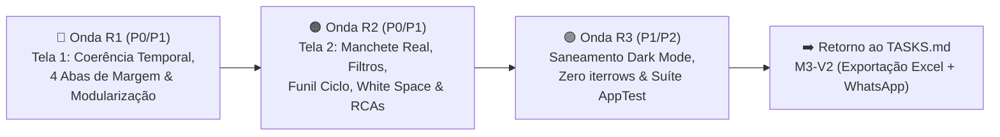

# 🛠️ Gerenciador de Refatoração & Evolução Analítica (`TASKS_REFACTORY.md`)

Plano técnico executável de **Refatoração, Correção de Coerência Analítica e Elevação de UX Executiva** da plataforma **Kyberna — Decision Intelligence B2B**, focado na **Tela 1 (Visão Executiva & Margem Real)** e na **Tela 2 (Radar Comercial, RFM & Antecipação de Churn)**.

> **Como usar:** cada tarefa possui ID único `<Onda>-<Pilar><Nº>` (ex.: `R1-S1`, `R1-V1`, `R2-S1`, `R2-V2`), avaliação de impacto de **1 a 5 estrelas (`⭐`)**, arquivos impactados, dependências, **Especificação Técnica Mastigada (Anti-Alucinação)** e **Critério de Pronto (DoD)** validado via terminal.
> Status: `[ ]` a fazer · `[~]` parcial · `[x]` concluída (DoD validado via terminal).
> Protocolo de execução: ver §1 de [`GEMINI.md`](./GEMINI.md) / [`CLAUDE.md`](./CLAUDE.md). Catálogo estratégico e ideias futuras: [`IDEIAS.md`](./IDEIAS.md). Roadmap principal: [`TASKS.md`](./TASKS.md).

---

## 🚀 Status Geral da Refatoração

- **Ciclo Atual**: `v0.3.1-refactory` (Saneamento Analítico e Evolução das Telas 1 e 2)
- **Ondas Planejadas**:
  - **R1**: Coerência Temporal, Visão Quádrupla de Margem, Modularização (< 400 linhas) e Evolução da **Tela 1 — Visão Executiva**
  - **R2**: Filtros Táticos, Funil do Ciclo de Recompra, Explorador White Space (SKU Âncora + Pitch), Quadrante Colorido de RCAs e Evolução da **Tela 2 — Radar Comercial**
  - **R3**: Padronização Cross-Page (Dark Mode `var(--kyb-*)`, Vetorização 100% sem `iterrows()` e Blindagem `AppTest`)

---

## ⭐ Matriz Resumo de Priorização das Tarefas de Refatoração

| ID | Onda / Escopo | Entrega Técnica | 🎯 Utilidade | 💰 Valor (R$) | 🚀 Demo ("Uau") | ⚙️ Viabilidade (Complexidade) | Prioridade |
|---|---|---|---|---|:---:|:---:|:---:|:---:|
| **`R1-S1`** | Tela 1 (Backend/SQL) | Sincronização temporal nos Top Drivers, filtro de Família no ABC/XYZ, Delta YoY real em 24m e queries por Família e RCA | ⭐⭐⭐⭐⭐ | ⭐⭐⭐⭐⭐ | ⭐⭐⭐⭐⭐ | ⭐⭐⭐⭐⭐ *(🟢 Baixa)* | **P0** |
| **`R1-V1`** | Tela 1 (Gráficos/UI) | KPI Cards com Caixas Master + Termômetro de Desconto/Frete, Waterfall com `%` sobre Bruto e Tendência Dupla com Linha de Meta | ⭐⭐⭐⭐⭐ | ⭐⭐⭐⭐ | ⭐⭐⭐⭐⭐ | ⭐⭐⭐⭐⭐ *(🟢 Baixa)* | **P0** |
| **`R1-V2`** | Tela 1 (Arquitetura/UI) | Visão Quádrupla de Detratores/Geradores (`Família`, `SKU`, `Lojista`, `RCA`) + Extração de `executive_sections.py` (< 400 linhas) | ⭐⭐⭐⭐⭐ | ⭐⭐⭐⭐⭐ | ⭐⭐⭐⭐⭐ | ⭐⭐⭐⭐⭐ *(🟢 Baixa)* | **P1** |
| **`R2-S1`** | Tela 2 (Backend/SQL) | Queries do Funil de Saúde do Ciclo (4 estágios), Top Oportunidades White Space (SKU Âncora + Pitch) e conexão de filtros `families`/`uf` | ⭐⭐⭐⭐⭐ | ⭐⭐⭐⭐⭐ | ⭐⭐⭐⭐⭐ | ⭐⭐⭐⭐⭐ *(🟢 Baixa)* | **P0** |
| **`R2-V1`** | Tela 2 (Gráficos) | Vetorização de `cycle_delay_scatter` (sem `iterrows`), `rfm_treemap` por Margem Líquida e `quadrant_scatter` colorido por quadrante em pt-BR | ⭐⭐⭐⭐⭐ | ⭐⭐⭐⭐⭐ | ⭐⭐⭐⭐⭐ | ⭐⭐⭐⭐⭐ *(🟢 Baixa)* | **P0** |
| **`R2-V2`** | Tela 2 (UI Topo/Risco) | Manchete Dinâmica real + Banner Temporal + 5º KPI Card (*Janela Ideal Pré-Churn*) + Filtros Táticos In-Page + Funil do Ciclo + Tabela Caixa-Branca | ⭐⭐⭐⭐⭐ | ⭐⭐⭐⭐⭐ | ⭐⭐⭐⭐⭐ | ⭐⭐⭐⭐⭐ *(🟢 Baixa)* | **P0** |
| **`R2-V3`** | Tela 2 (UI Mix/RCAs) | Explorador Acionável de Cross-Sell (White Space CNPJ a CNPJ com Pitch) + Tabela Resumo RFM + Tabela de RCAs com Positivação e Mix | ⭐⭐⭐⭐⭐ | ⭐⭐⭐⭐⭐ | ⭐⭐⭐⭐⭐ | ⭐⭐⭐⭐⭐ *(🟢 Baixa)* | **P1** |
| **`R3-V1`** | Cross-Page (UX/QA) | Saneamento de variáveis CSS Dark Mode (`var(--kyb-*)`), auditoria de `< 400 linhas` e expansão da suíte `pytest` (`services` + `ui`) | ⭐⭐⭐⭐ | ⭐⭐⭐⭐ | ⭐⭐⭐⭐⭐ | ⭐⭐⭐⭐⭐ *(🟢 Baixa)* | **P1** |

---

### 🛡️ Guia Rápido de Integração & Anti-Alucinação para Execução da Refatoração

> [!IMPORTANT]
> **Leia este bloco antes de implementar qualquer tarefa (`R1`..`R3`).**
>
> 1. **Limite Estrito de 400 Linhas por Arquivo (`GEMINI.md` §3)**:
>    - Atualmente [`src/services/executive_service.py`](./src/services/executive_service.py) tem **494 linhas** e [`src/ui/pages/1_executive.py`](./src/ui/pages/1_executive.py) tem **441 linhas** (acima do teto!).
>    - Em `R1-S1` e `R1-V2`, **reduza obrigatoriamente ambos para `< 400 linhas`** movendo blocos auxiliares de UI para `src/ui/components/executive_sections.py` e enxugando duplicações em `executive_service.py`.
>    - Na Tela 2 (`R2-V2` e `R2-V3`), extraia seções de renderização para `src/ui/components/commercial_sections.py` para manter [`src/ui/pages/2_commercial_radar.py`](./src/ui/pages/2_commercial_radar.py) sempre abaixo de **350 linhas**.
> 2. **Proibição Absoluta de `df.iterrows()` (`GEMINI.md` §4.4)**:
>    - Remova os loops `for _, row in df.iterrows():` hoje presentes em [`src/ui/components/charts.py`](./src/ui/components/charts.py) (L31) e [`src/ui/components/commercial_charts.py`](./src/ui/components/commercial_charts.py) (L75). Use list comprehensions vetorizadas sobre colunas/tuplas (`zip(...)`) ou `customdata` + `hovertemplate` nativo do Plotly.
> 3. **Ícone Azul `ⓘ` Obrigatório (`help_text: str` não-vazio)**:
>    - Todo novo `render_kpi_card`, `section_header`, `render_prescription_box` ou banner executivo (`info_tooltip_html`) **deve** receber um `help_text` claro em pt-BR explicando a regra de negócio e o significado do rodapé.
> 4. **Compatibilidade Dark Mode (`var(--kyb-*)`)**:
>    - Proibido usar cores hexadecimais estáticas (`#475569`, `#0F172A`, `#0d9488`) em strings HTML nas páginas ou seções; use sempre `var(--kyb-text)`, `var(--kyb-text-muted)`, `var(--kyb-teal)`, `var(--kyb-card-bg)` e `var(--kyb-border)`.
> 5. **Execução de Testes `AppTest` no Windows**:
>    - Testes em `tests/services/` rodam normalmente no sandbox. Testes em `tests/ui/` que instanciam `streamlit.testing.v1.AppTest` usam `socket.socketpair()` e devem ser executados com `BypassSandbox: true` e `default_timeout=10`.

---

## 📌 Quadro de Tarefas da Refatoração

---

### 🔴 Onda R1 — Coerência Analítica, 4 Visões de Margem e Evolução da Tela 1 (Visão Executiva)

> **Objetivo da Onda R1**: Eliminar todas as inconsistências de filtro temporal na Tela 1, enriquecer os KPI Cards e gráficos executivos com indicadores de erosão comercial (Desconto %, Frete+Comissão %, Caixas Master), criar a visão quádrupla de geradores/detratores de margem (`Família`, `SKU`, `Lojista`, `RCA`) e enquadrar `executive_service.py` e `1_executive.py` abaixo de 400 linhas.

#### 🧠 Serviços & Consultas Analíticas (`S` / `D`)

- [ ] **R1-S1** *(REF-EXEC-01)* — **Sincronização temporal dos Top Drivers, filtro de Família no ABC/XYZ, Delta YoY real para 24m e agregação por Família/RCA**: Corrigir `executive_service.py` e `executive_queries.py` para que 100% dos blocos da Tela 1 respeitem os filtros ativos de período e família, além de expandir os rankings de margem para 4 dimensões (`product`, `customer`, `family`, `sales_rep`) e reduzir `executive_service.py` para `< 400 linhas`.
  - *Avaliação:* 🎯 ⭐⭐⭐⭐⭐ · 💰 ⭐⭐⭐⭐⭐ · 🚀 ⭐⭐⭐⭐⭐ · ⚙️ ⭐⭐⭐⭐⭐ *(🟢 Baixa)* · **Prioridade: P0**
  - *Arquivos:* `src/services/dto.py`, `src/services/executive_queries.py`, `src/services/executive_service.py`, `tests/services/test_executive_service.py`.
  - *Depende de:* `M2-V3`
  - *Especificação Técnica Mastigada (Anti-Alucinação):*
    - **1. Expansão de `query_top_drivers()` em [`src/services/executive_queries.py`](./src/services/executive_queries.py)**:
      - Alterar assinatura para `by: Literal["product", "customer", "family", "sales_rep"] = "product"`.
      - Quando `by == "family"`: agrupar por `p.family AS name`, com `COUNT(DISTINCT p.product_id) || ' SKUs ativos' AS secondary_label`.
      - Quando `by == "sales_rep"`: fazer join com `gold.dim_sales_rep r ON f.sales_rep_id = r.sales_rep_id` e agrupar por `r.name AS name, r.region AS secondary_label`.
    - **2. Propagação de `start_date_key` e `end_date_key` em `get_top_margin_drivers()`**:
      - Adicionar `start_date_key: int | None = None` e `end_date_key: int | None = None` em `get_top_margin_drivers()` e repassá-los para `build_filter_clauses()` e nas chamadas dentro de `build_executive_dashboard()`.
    - **3. Filtro de `families` em `get_abc_xyz_overview()`**:
      - Adicionar parâmetro `families: Sequence[str] = ()` em `get_abc_xyz_overview()`. Se `families` não for vazio, filtrar `mart_df = mart_df[mart_df["family"].isin(families)]` antes de chamar `compute_abc_xyz_matrix_summary(mart_df)`.
    - **4. Delta Dinâmico Real quando `comp_start_date_key is None` (Modo 24m / `"all"`)**:
      - Remover as constantes hardcoded (`4.4`, `3.8`, `1.8`, `-0.7`, `-7.1`) de `compute_executive_kpis()`. Quando `start_date_key is None` e `comp_start_date_key is None`, calcular os deltas comparando o **Ano 2 (`20240101` a `20241231`) contra o Ano 1 (`20230101` a `20231231`)** sob os mesmos filtros geográficos/família/RCA, ou retornar `None` caso o período anterior tenha receita zero.
    - **5. Novos Campos em `ExecutivePageDTO` (`src/services/dto.py`)**:
      - Adicionar `top_family_generators_df: pd.DataFrame = Field(default_factory=pd.DataFrame)`, `top_family_destroyers_df: pd.DataFrame = Field(default_factory=pd.DataFrame)`, `top_rep_generators_df: pd.DataFrame = Field(default_factory=pd.DataFrame)` e `top_rep_destroyers_df: pd.DataFrame = Field(default_factory=pd.DataFrame)`.
    - **6. Enxugamento de `src/services/executive_service.py` (< 400 linhas)**:
      - Consolidar funções redundantes e docstrings verbosas para que `executive_service.py` fique com **$\le 380$ linhas**.
  - *DoD:* alterar `start_date_key`/`end_date_key` altera os DataFrames retornados por `get_top_margin_drivers`; filtrar `families` reduz a contagem de SKUs em `get_abc_xyz_overview`; `executive_service.py` possui < 400 linhas; `uv run pytest tests/services/test_executive_service.py -q` e `uv run mypy src` passam sem erros.

#### 🎨 Interface, UX & Visualização (`V`)

- [ ] **R1-V1** *(REF-EXEC-02)* — **Enriquecimento do Waterfall (`R$` + `%`), Tendência Dupla com Linha de Meta e KPI Cards com Termômetro de Desconto/Caixas Master**: Atualizar `waterfall_margin` e `dual_trend` em `src/ui/components/charts.py` (removendo `iterrows`) e enriquecer os sub-rodapés dos 5 KPI Cards da Tela 1.
  - *Avaliação:* 🎯 ⭐⭐⭐⭐⭐ · 💰 ⭐⭐⭐⭐ · 🚀 ⭐⭐⭐⭐⭐ · ⚙️ ⭐⭐⭐⭐⭐ *(🟢 Baixa)* · **Prioridade: P0**
  - *Arquivos:* `src/ui/components/charts.py`, `src/services/executive_queries.py`, `tests/ui/test_charts.py`.
  - *Depende de:* `R1-S1`
  - *Especificação Técnica Mastigada (Anti-Alucinação):*
    - **1. `waterfall_margin()` em [`src/ui/components/charts.py`](./src/ui/components/charts.py)**:
      - Substituir o loop `for _, row in steps_df.iterrows():` por list comprehension vetorizada sobre `zip(steps_df["amount"], steps_df.get("pct_of_gross", ...))`.
      - Formatar o texto exibido nas barras como `f"{format_brl(float(amt), compact=True, decimals=1)} ({float(pct):.1f}%)"` quando a coluna `pct_of_gross` estiver presente, permitindo ler instantaneamente quantos `%` da receita bruta são drenados em Descontos, Impostos, CPV, Comissões e Frete.
    - **2. `dual_trend()` em [`src/ui/components/charts.py`](./src/ui/components/charts.py) e `query_monthly_trend()`**:
      - Em `query_monthly_trend()`, adicionar `ROUND(SUM(discount_amount) / NULLIF(SUM(gross_revenue), 0) * 100.0, 1) AS avg_discount_pct` no `SELECT`.
      - Em `dual_trend()`, adicionar uma linha horizontal tracejada (`fig.add_hline`) no eixo secundário (`yref="y2"`) marcando a **Média Ponderada de Margem % do Período** e exibir `Margem (R$)` e `Desconto Médio (%)` no hover de cada mês.
  - *DoD:* zero ocorrências de `iterrows()` em `src/ui/components/charts.py`; barras do Waterfall exibem valor compacto e percentual; `uv run pytest tests/ui/test_charts.py -q` passa.

- [ ] **R1-V2** *(REF-EXEC-03)* — **Modularização da Tela 1 (`executive_sections.py` < 400 linhas), 4 Abas de Drivers de Margem e Saneamento Dark Mode**: Extrair os blocos visuais da Tela 1 para `src/ui/components/executive_sections.py`, implementar as 4 abas de Geradores vs. Detratores (`Por Família`, `Por Produto`, `Por Lojista`, `Por Representante`) e substituir todas as cores hexadecimais fixas por variáveis `var(--kyb-*)`.
  - *Avaliação:* 🎯 ⭐⭐⭐⭐⭐ · 💰 ⭐⭐⭐⭐⭐ · 🚀 ⭐⭐⭐⭐⭐ · ⚙️ ⭐⭐⭐⭐⭐ *(🟢 Baixa)* · **Prioridade: P1**
  - *Arquivos:* `src/ui/components/executive_sections.py` (novo), `src/ui/pages/1_executive.py`, `tests/ui/test_executive_page.py`.
  - *Depende de:* `R1-S1`, `R1-V1`
  - *Especificação Técnica Mastigada (Anti-Alucinação):*
    - **1. Sub-rodapés Executivos nos 5 KPI Cards**:
      - **Card 1 (`Faturamento Bruto`)**: `subfooter_left=f"{format_int(int(dto.kpis.total_boxes))} cx ({format_int(dto.kpis.total_orders)} ped.)"`.
      - **Card 4 (`Margem Líquida %`)**: calcular `disc_pct = dto.kpis.discount_amount / dto.kpis.gross_revenue * 100.0` e `comm_freight_pct = (dto.kpis.commission_amount + dto.kpis.freight_amount) / dto.kpis.gross_revenue * 100.0` e exibir `subfooter_left=f"Desc.: {disc_pct:.1f}% | Com.+Frete: {comm_freight_pct:.1f}%"`.
    - **2. Quatro Abas na Seção `render_drivers_section()`**:
      - Aba 1: `f"📂 Por {labels.product_family}"` (`dto.top_family_generators_df` e `dto.top_family_destroyers_df`).
      - Aba 2: `"📦 Por Produto (SKU)"` (`dto.top_generators_df` e `dto.top_destroyers_df`).
      - Aba 3: `f"👥 Por {labels.customer}"` (`dto.top_customer_generators_df` e `dto.top_customer_destroyers_df`).
      - Aba 4: `f"🧑‍💼 Por {labels.sales_rep}"` (`dto.top_rep_generators_df` e `dto.top_rep_destroyers_df` — exibida quando `scenario.capabilities.rep_efficiency` for `True`).
    - **3. Saneamento Dark Mode nos Banners**:
      - No banner de contexto temporal e na manchete executiva, trocar `color: #475569` por `color: var(--kyb-text-muted)` e `color: #0d9488` por `color: var(--kyb-teal)`.
    - **4. Limite de Linhas**:
      - `src/ui/pages/1_executive.py` e `src/ui/components/executive_sections.py` devem ter cada um **$< 300$ linhas**.
  - *DoD:* `1_executive.py` e `executive_sections.py` < 400 linhas; zero cores `#475569` ou `#0d9488` fixas em `1_executive.py`; AppTest da Tela 1 (`tests/ui/test_executive_page.py`) passa 100%.

---

### 🟠 Onda R2 — Inteligência Acionável, Funil de Ciclo, White Space e RCAs na Tela 2 (Radar Comercial)

> **Objetivo da Onda R2**: Destravar na interface da Tela 2 toda a riqueza analítica já calculada nos marts `mart_customer_risk`, `mart_rfm`, `mart_white_space` e `mart_rep_performance`: ativar a manchete dinâmica real, adicionar o 5º KPI Card (*Janela Ideal Pré-Churn*), criar os filtros táticos in-page, a Régua/Funil de Saúde do Ciclo de Recompra, o Explorador de Cross-Sell CNPJ a CNPJ com SKU Âncora + Pitch e reformular o Quadrante de RCAs com cores semânticas e eixos em português.

#### 🧠 Serviços & Consultas Analíticas (`S` / `D`)

- [ ] **R2-S1** *(REF-COM-01)* — **Queries do Funil de Ciclo (4 Estágios), Top Oportunidades White Space (SKU Âncora + Pitch) e Conexão Total de Filtros (`families`, `uf`, `quadrant`)**: Expandir `src/services/dto.py`, `src/services/commercial_queries.py`, `src/services/commercial_service.py` e `src/ui/cache.py` para alimentar os novos blocos prescritivos da Tela 2.
  - *Avaliação:* 🎯 ⭐⭐⭐⭐⭐ · 💰 ⭐⭐⭐⭐⭐ · 🚀 ⭐⭐⭐⭐⭐ · ⚙️ ⭐⭐⭐⭐⭐ *(🟢 Baixa)* · **Prioridade: P0**
  - *Arquivos:* `src/services/dto.py`, `src/services/commercial_queries.py`, `src/services/commercial_service.py`, `src/ui/cache.py`, `tests/services/test_commercial_service.py`.
  - *Depende de:* `M3-S4`
  - *Especificação Técnica Mastigada (Anti-Alucinação):*
    - **1. Evolução dos DTOs em [`src/services/dto.py`](./src/services/dto.py)**:
      - Em `CommercialKpisDTO`: adicionar `attention_customers: int = 0`, `attention_customers_pct: float = 0.0` e `attention_revenue_brl: float = 0.0` (clientes com `cr.risk_status == 'Atenção'`, isto é, $1,1 < \text{delay\_ratio} \le 1,5$).
      - Em `CommercialPageDTO`: adicionar `cycle_funnel_df: pd.DataFrame = Field(default_factory=pd.DataFrame)` e `top_white_space_deals_df: pd.DataFrame = Field(default_factory=pd.DataFrame)`.
    - **2. Novas Consultas e Ajustes em [`src/services/commercial_queries.py`](./src/services/commercial_queries.py)**:
      - **`query_cycle_health_funnel()`**: agrupa os clientes da carteira filtrada pelos 4 estágios (`No Ciclo`, `Atenção`, `Em Risco Imediato`, `Adormecido / Perdido`), retornando `risk_status`, `customer_count`, `customer_share_pct`, `annual_revenue_brl`, `annual_margin_brl` e `avg_delay_ratio` ordenados na sequência lógica do funil (`CASE cr.risk_status WHEN 'No Ciclo' THEN 1 WHEN 'Atenção' THEN 2 WHEN 'Em Risco Imediato' THEN 3 ELSE 4 END`).
      - **`query_top_white_space_deals()`**: consulta `gold.mart_white_space ws` com join em `dim_customer c`, `dim_sales_rep r` e `mart_rfm rfm`, filtrando por `regiao`, `uf`, `sales_reps`, `rfm_segment` e **`families`** (`ws.recommended_family IN (...)` quando `families` for selecionado na sidebar!). Retorna as top 100 recomendações (`rank_order = 1` ou maiores potenciais) com `customer_id`, `customer_name`, `state`, `sales_rep_name`, `rfm_segment`, `anchor_sku_name`, `recommended_family`, `recommended_top_sku`, `affinity_lift`, `potential_revenue_brl`, `potential_margin_brl` e `action_pitch`.
      - **Ajuste em `query_priority_risk_customers()`**: incluir `ROUND(cr.churn_probability * 100.0, 1) AS churn_prob_pct`, `cr.prescription_action` e ordenar priorizando clientes com atraso (`ORDER BY CASE WHEN cr.delay_ratio > 1.1 THEN 0 ELSE 1 END ASC, cr.annual_revenue_at_risk DESC`).
      - **Ajuste em `query_white_space_matrix_data()`**: aceitar e aplicar `families: Sequence[str] = ()` (`ws.recommended_family IN (...)`).
      - **Ajuste em `query_rep_performance_data()`**: aceitar `uf: str = "Todas"` (filtrando representantes que atendem clientes naquela UF caso `uf != "Todas"`) e `quadrant: str = "Todos"`.
    - **3. Atualização de `cached_commercial_dashboard()` em [`src/ui/cache.py`](./src/ui/cache.py)**:
      - Adicionar parâmetros hasháveis `families: tuple[str, ...] = ()`, `risk_status: str = "Todos"` e `rfm_segment: str = "Todos"`.
  - *DoD:* `cycle_funnel_df` soma 100% dos clientes filtrados; `top_white_space_deals_df` retorna `anchor_sku_name` e `action_pitch` não-vazios; filtro `families` filtra corretamente as recomendações White Space; todos os arquivos em `src/services/` permanecem `< 400 linhas`; `uv run pytest tests/services/test_commercial_service.py -q` passa.

#### 🎨 Gráficos & Interface da Tela 2 (`V`)

- [ ] **R2-V1** *(REF-COM-02)* — **Vetorização de `cycle_delay_scatter`, `rfm_treemap` por Margem Líquida e Reformulação do `quadrant_scatter` Colorido em Português**: Refatorar os 3 gráficos comerciais para eliminar `iterrows()`, corrigir títulos de eixo em inglês e aplicar cores semânticas por quadrante de RCA.
  - *Avaliação:* 🎯 ⭐⭐⭐⭐⭐ · 💰 ⭐⭐⭐⭐⭐ · 🚀 ⭐⭐⭐⭐⭐ · ⚙️ ⭐⭐⭐⭐⭐ *(🟢 Baixa)* · **Prioridade: P0**
  - *Arquivos:* `src/ui/components/commercial_charts.py`, `src/ui/components/charts.py`, `tests/ui/test_charts.py`.
  - *Depende de:* `R2-S1`
  - *Especificação Técnica Mastigada (Anti-Alucinação):*
    - **1. `cycle_delay_scatter()` em [`src/ui/components/commercial_charts.py`](./src/ui/components/commercial_charts.py)**:
      - Remover completamente `for _, row in subset.iterrows():`.
      - Passar `customdata=subset[["customer_name", "state", "sales_rep_name", "recency_days", "expected_cycle_days", "delay_ratio", "annual_revenue_at_risk"]].to_numpy()` e usar `hovertemplate` nativo do Plotly.
      - Adicionar linha guia pontilhada amarela para `y = 1.1x` (*Início da Janela Ideal de Abordagem*) além de `y = 1.0x` (*No Ciclo*) e `y = 1.5x` (*Risco Crítico*).
    - **2. `rfm_treemap()` em [`src/ui/components/commercial_charts.py`](./src/ui/components/commercial_charts.py)**:
      - Alterar `plot_df["size_val"] = np.maximum(plot_df["contribution_margin"], 1.0)` (tamanho = **Margem de Contribuição Líquida R$**, alinhado ao princípio *"Margem acima de Volume"*).
      - Passar `customdata` vetorizado e atualizar `hovertemplate` para mostrar: **Segmento**, **Nº de Clientes (`% da carteira`)**, **Margem de Contribuição (R$ e %)**, **Faturamento Bruto (R$)**, **Ticket Médio (R$)** e **Clientes em Risco no Segmento**.
    - **3. `quadrant_scatter()` em [`src/ui/components/charts.py`](./src/ui/components/charts.py)**:
      - Adicionar parâmetros opcionais `xaxis_title: str = "Faturamento Bruto (R$)"`, `yaxis_title: str = "Margem Líquida (%)"` e `quadrant_col: str | None = "quadrant"`.
      - Quando `quadrant_col` estiver presente no DataFrame, plotar uma trace por quadrante com cores executivas distintas:
        - `"Estrela"`: `tokens["positive"]` (Verde Esmeralda)
        - `"Volume sem margem"`: `tokens["negative"]` (Coral / Vermelho)
        - `"Margem sem volume"`: `tokens["teal_500"]` (Azul Petróleo / Teal)
        - `"Atenção"`: `tokens["warning"]` (Âmbar / Dourado)
      - Adicionar anotações discretas (`fig.add_annotation`) nos 4 cantos do gráfico identificando visualmente cada quadrante e exibir no hover todas as métricas do RCA (`Faturamento`, `Margem %`, `Desconto Médio %`, `Positivação %`, `R$ em Risco`).
  - *DoD:* zero ocorrências de `iterrows()` em `commercial_charts.py`; eixos de `quadrant_scatter` em português; 4 cores distintas por quadrante; testes em `tests/ui/test_charts.py` passam.

- [ ] **R2-V2** *(REF-COM-03)* — **Topo Executivo da Tela 2: Manchete Dinâmica Real, Banner de Escopo, 5 KPI Cards, Filtros Táticos In-Page, Funil de Ciclo e Tabela Caixa-Branca**: Atualizar a primeira metade da Tela 2 (`2_commercial_radar.py` + `src/ui/components/commercial_sections.py`).
  - *Avaliação:* 🎯 ⭐⭐⭐⭐⭐ · 💰 ⭐⭐⭐⭐⭐ · 🚀 ⭐⭐⭐⭐⭐ · ⚙️ ⭐⭐⭐⭐⭐ *(🟢 Baixa)* · **Prioridade: P0**
  - *Arquivos:* `src/ui/components/commercial_sections.py` (novo), `src/ui/pages/2_commercial_radar.py`.
  - *Depende de:* `R2-S1`, `R2-V1`
  - *Especificação Técnica Mastigada (Anti-Alucinação):*
    - **1. Banner de Escopo & Data-Âncora + Manchete Dinâmica Real**:
      - Exibir no topo o banner compacto de contexto (`⚓ Data-Âncora: 31/12/2024 | 📍 Escopo: Região/UF/RCA | 👥 Carteira: N clientes`).
      - Renderizar `dto.headline_title` e `dto.headline_text` (vindos do `CommercialPageDTO`) acompanhados de `info_tooltip_html(...)` (`ⓘ`), eliminando o texto estático duplicado.
    - **2. Barra de Filtros Táticos In-Page**:
      - Em um container horizontal de 3 colunas acima dos KPIs, disponibilizar:
        - `st.selectbox("Filtrar Status do Ciclo", ["Todos", "Atenção", "Em Risco Imediato", "Adormecido / Perdido", "No Ciclo"], key="_com_risk_filter")`
        - `st.selectbox("Filtrar Segmento RFM", ["Todos", "Campeões", "Não Pode Perder", "Fiéis", "Em Risco", "Precisam de Atenção", "Promissores", "Hibernando", "Perdidos", "Novos Clientes"], key="_com_rfm_filter")`
        - Botão ou indicador rápido do total de clientes filtrados.
    - **3. Faixa de 5 KPI Cards Executivos**:
      - **Card 1 (`Lojistas em Risco Crítico`)**: `at_risk_customers` (`delay_ratio > 1.5`), rodapé `% da carteira`, accent `"red"`.
      - **Card 2 (`Receita Anual em Risco`)**: `annual_revenue_at_risk_brl`, rodapé `Margem: R$ X`, accent `"gold"`.
      - **Card 3 (`Janela Ideal (Pré-Churn)`)**: `attention_customers` (`1.1 < delay_ratio <= 1.5`), rodapé `Faturamento: R$ Y (Abordar já!)`, accent `"brass"`.
      - **Card 4 (`Potencial White Space`)**: `white_space_potential_revenue_brl`, rodapé `Margem: R$ Z`, accent `"teal"`.
      - **Card 5 (`Positivação da Carteira`)**: `avg_positivation_pct`, rodapé `ativos de total`, accent `"green"`.
    - **4. Régua / Funil Visual de Saúde do Ciclo de Recompra (4 Estágios)**:
      - Renderizar barra/cards compactos horizontais com os 4 estágios de `dto.cycle_funnel_df` (🟢 *No Ciclo*, 🟡 *Janela Ideal 1,1x–1,5x*, 🟠 *Em Risco Imediato 1,5x–2,5x*, 🔴 *Adormecido >2,5x*) mostrando quantidade de CNPJs, `%` e R$ anualizado em cada estágio.
    - **5. Tabela Priorizada de Risco Caixa-Branca**:
      - Exibir colunas: `Lojista`, `UF`, `RCA`, `Segmento RFM`, `Status`, `Dias s/ Comprar` (`recency_days`), `Ciclo Esperado` (`expected_cycle_days`), `Atraso` (`delay_ratio`), `Prob. Churn %` (`churn_prob_pct`), `R$ em Risco` e `Oportunidade Mix`.
  - *DoD:* `dto.headline_title` renderizado na página; 5 KPI cards com `.kyb-info-icon`; filtros in-page funcionais atualizando os dados via `cached_commercial_dashboard`.

- [ ] **R2-V3** *(REF-COM-04)* — **Explorador Acionável de Cross-Sell (White Space com SKU Âncora + Pitch), Tabela Resumo RFM e Tabela Completa de RCAs**: Atualizar a segunda metade da Tela 2 para expor as oportunidades individuais de White Space e as métricas completas de eficiência de representantes.
  - *Avaliação:* 🎯 ⭐⭐⭐⭐⭐ · 💰 ⭐⭐⭐⭐⭐ · 🚀 ⭐⭐⭐⭐⭐ · ⚙️ ⭐⭐⭐⭐⭐ *(🟢 Baixa)* · **Prioridade: P1**
  - *Arquivos:* `src/ui/components/commercial_sections.py`, `src/ui/pages/2_commercial_radar.py`, `tests/ui/test_commercial_page.py`.
  - *Depende de:* `R2-V2`
  - *Especificação Técnica Mastigada (Anti-Alucinação):*
    - **1. Seção RFM & White Space Enriquecida**:
      - Abaixo do `rfm_treemap` e `white_space_heatmap`, adicionar 2 abas/expanders táticos:
        - **Aba `🎯 Top Oportunidades de Cross-Sell (CNPJ a CNPJ)`**: renderiza `dto.top_white_space_deals_df` mostrando `Lojista`, `UF`, `RCA`, `Segmento RFM`, **`Já Compra (SKU Âncora)`** (`anchor_sku_name`), **`Ofertar Família`** (`recommended_family`), **`SKU Sugerido`** (`recommended_top_sku`), **`Lift Apriori`** (`affinity_lift`), **`Potencial (R$)`** (`potential_revenue_brl`), **`Margem Potencial (R$)`** (`potential_margin_brl`) e **`Argumento de Venda (Pitch)`** (`action_pitch`).
        - **Aba `📊 Resumo Executivo dos 9 Segmentos RFM`**: renderiza `dto.rfm_summary_df` formatado com `Segmento`, `Clientes`, `% Carteira`, `Faturamento Bruto`, `Margem Contr. (R$)`, `Margem %`, `Ticket Médio` e `Clientes em Risco`.
    - **2. Seção de Eficiência de RCAs Enriquecida**:
      - Na tabela ao lado do `quadrant_scatter`, incluir as colunas: `RCA`, `Quadrante`, `Positivação %` (`positivation_pct`), `Mix (Fam./Cli)` (`avg_families_per_customer`), `Faturamento` (`gross_revenue`), `Desc. Médio %` (`avg_discount_pct`), `Margem %` (`margin_pct`), `Risco Carteira (R$)` (`revenue_at_risk_brl`), `White Space (R$)` (`white_space_potential_brl`) e `Ação Recomendada` (`action_prescription`).
    - **3. Limite de Linhas**:
      - Garantir que `src/ui/pages/2_commercial_radar.py` e `src/ui/components/commercial_sections.py` tenham cada um **$< 350$ linhas**.
  - *DoD:* tabela de oportunidades White Space exibe `SKU Âncora` e `Argumento de Venda`; tabela de RCAs exibe `Positivação %` e `Mix`; `2_commercial_radar.py` e `commercial_sections.py` < 400 linhas; `uv run pytest tests/ui/test_commercial_page.py -q` passa.

---

### 🟢 Onda R3 — Saneamento Cross-Page, Auditoria de Limites (< 400 linhas) e Blindagem de Testes

> **Objetivo da Onda R3**: Garantir que todas as alterações das Ondas R1 e R2 passem com 100% de cobertura nos testes automatizados (`services` + `ui`), zero violações de lint/tipagem (`ruff`, `mypy --strict`), zero `iterrows()` e sincronização documental com o `TASKS.md`.

- [ ] **R3-V1** *(REF-QA-01)* — **Validação Integrada Dark Mode, Checagem de Limite de 400 Linhas, Suíte Completa `pytest` e Sincronização com `TASKS.md`**: Executar bateria de testes automatizados para Telas 1 e 2, validar ausência de cores chumbadas ou arquivos acima do limite nas camadas de `services` e `ui`, e atualizar o status de `M3-V1` no `TASKS.md`.
  - *Avaliação:* 🎯 ⭐⭐⭐⭐ · 💰 ⭐⭐⭐⭐ · 🚀 ⭐⭐⭐⭐⭐ · ⚙️ ⭐⭐⭐⭐⭐ *(🟢 Baixa)* · **Prioridade: P1**
  - *Arquivos:* `tests/ui/test_executive_page.py`, `tests/ui/test_commercial_page.py`, `tests/ui/test_app.py`, `TASKS.md`, `TASKS_REFACTORY.md`.
  - *Depende de:* `R1-V2`, `R2-V3`
  - *DoD:*
    - `uv run ruff check .` e `uv run ruff format --check .` passam sem alertas;
    - `uv run mypy src` retorna 0 erros;
    - `uv run pytest -q` (incluindo `tests/services` e `tests/ui`) 100% verde;
    - Todos os arquivos em `src/services/` e `src/ui/` possuem estritamente `< 400 linhas`;
    - Tarefa `M3-V1` marcada como `[x]` em `TASKS.md` e ondas `R1`..`R3` marcadas como `[x]` em `TASKS_REFACTORY.md`.

---

## 📌 Achados & Observações Técnicas da Refatoração

- `[2026-11-06]` (`R1-S1`) `src/services/executive_service.py` atingiu 494 linhas e `src/ui/pages/1_executive.py` atingiu 441 linhas após a inclusão do demonstrativo mensal na `M3-S3` — resolvido estruturalmente nas tarefas `R1-S1` e `R1-V2` com a extração de `src/ui/components/executive_sections.py`.
- `[2026-11-06]` (`R2-V1`) Identificado uso residual de `df.iterrows()` em `charts.py` e `commercial_charts.py` e títulos de eixo em inglês em `quadrant_scatter` — endereçado em `R1-V1` e `R2-V1`.

---

## 📝 Registro Histórico de Mudanças (Changelog da Refatoração)

- **v0.3.1-refactory** *(Planejado — Aguardando início da execução)*:
  - **[2026-11-06] Criação do Plano de Refatoração (`TASKS_REFACTORY.md`)**: Estruturação das ondas `R1`, `R2` e `R3` a partir da auditoria crítica de produto, dados e UX sobre a Visão Executiva (Tela 1) e o Radar Comercial (Tela 2).

