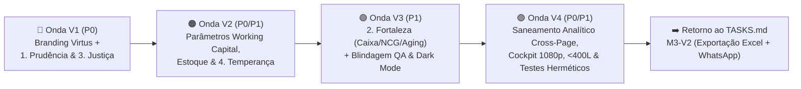

# 🛠️ Gerenciador de Refatoração & Remodelagem **Virtus** (`TASKS_REFACTORY.md`)

Plano técnico executável de **Remodelagem Estratégica para o Framework de Governança Virtus (As 4 Virtudes Cardeais)**, combinado com **Saneamento Analítico, Modularização (< 400 linhas) e Elevação de UX Executiva** da plataforma **Virtus · by Kyberna**.

> **Como usar:** cada tarefa possui ID único `<Onda>-<Pilar><Nº>` (ex.: `V1-S1`, `V1-V1`, `V2-D1`, `V3-S1`), avaliação de impacto de **1 a 5 estrelas (`⭐`)**, arquivos impactados, dependências, **Especificação Técnica Mastigada (Anti-Alucinação)** e **Critério de Pronto (DoD)** validado via terminal.
> Status: `[ ]` a fazer · `[~]` parcial · `[x]` concluída (DoD validado via terminal).
> Protocolo de execução: ver §1 de [`GEMINI.md`](./GEMINI.md) / [`CLAUDE.md`](./CLAUDE.md). Visão de produto e fórmulas canônicas: [`VISION.md`](./VISION.md). Roadmap principal: [`TASKS.md`](./TASKS.md).

---

## 🏛️ A Arquitetura das 4 Páginas no **Virtus** ("O Efeito Virtus")

Em vez de separar a gestão em silos corporativos engessados ("Comercial", "Financeiro", "Operações"), o **Virtus** estrutura a tomada de decisão pelo **comportamento do negócio** através das **4 Virtudes Cardeais**, mantendo os caminhos físicos dos 4 arquivos de página (`src/ui/pages/`) para preservar histórico Git e compatibilidade de testes, ordenados no menu via `st.navigation`:

| Ordem no Menu (`st.navigation`) | Arquivo Físico (`src/ui/pages/`) | Virtude Cardeal & Papel Executivo | Blocos Analíticos & Prescritivos Principais |
| :---: | :--- | :--- | :--- |
| **1ª** | [`1_executive.py`](./src/ui/pages/1_executive.py) | **🦉 1. PRUDÊNCIA**<br>*(Direção, Previsibilidade e Cenários — CEO / Diretor)* | • **Termômetro de Metas (Pacing)** (Receita, Margem Líquida e Caixa Operacional vs. Meta)<br>• **Projeção de Fechamento** (Tendência Dupla Histórica + Projeção 30/60/90d)<br>• **Simulador Executivo What-If (3 Alavancas)** (Preço, Desconto, Comissão/Custos + Breakeven)<br>• **Radar de Anomalias da Semana** (Alertas automáticos de desvios críticos) |
| **2ª** | [`4_simulator.py`](./src/ui/pages/4_simulator.py) | **🛡️ 2. FORTALEZA**<br>*(Solidez Financeira, Caixa e Resiliência — Diretor & Financeiro)* | • **Fôlego de Caixa (Runway) & Ponto de Equilíbrio (Dia do Break-Even Mensal)**<br>• **Ciclo Financeiro ($\text{PME} + \text{PMR} - \text{PMP}$) e Necessidade de Capital de Giro (NCG em R$)**<br>• **Risco de Concentração (Dependência)** (Curva Top 5/10 Clientes, RCAs e Famílias)<br>• **Saúde da Carteira & Exposição por Faixa de Atraso (Aging List)** |
| **3ª** | [`2_commercial_radar.py`](./src/ui/pages/2_commercial_radar.py) | **⚖️ 3. JUSTIÇA**<br>*(Equilíbrio Comercial, Margem e Valor — Comercial & Diretor)* | • **Matriz de Rentabilidade: Campeões vs. "Vampiros"** (4 Abas: `Família`, `SKU`, `Lojista`, `RCA`)<br>• **Justiça da Força de Vendas** (Quadrante de RCAs colorido por mérito de margem + Positivação/Mix)<br>• **Saúde da Base de Clientes** (Treemap RFM por Margem + Funil de 4 Estágios do Ciclo)<br>• **Explorador White Space (SKU Âncora + Pitch) & LTV/Retenção** |
| **4ª** | [`3_inventory_demand.py`](./src/ui/pages/3_inventory_demand.py) | **🏺 4. TEMPERANÇA**<br>*(Eficiência, Controle de Excessos e Desperdícios — Financeiro & Comercial)* | • **Erosão Comercial (Waterfall da Sangria de Margem em `R$` e `%`)**<br>• **Disciplina de Política Comercial** (Auditoria de Descontos Acima do Teto por RCA/Família)<br>• **Temperança de Estoque** (Matriz ABC/XYZ 3x3 + Capital Imobilizado $>120\text{d}$ vs. Ruptura Curva A)<br>• **Vazamentos Financeiros** (Custo Financeiro do Prazo Excedente + Frete/Comissões Críticas) |



---

## ⭐ Matriz Resumo de Priorização das Tarefas (`Virtus`)

| ID | Onda / Escopo | Entrega Técnica | 🎯 Utilidade | 💰 Valor (R$) | 🚀 Demo ("Uau") | ⚙️ Viabilidade (Complexidade) | Prioridade |
|---|---|---|---|---|:---:|:---:|:---:|:---:|
| **`V1-S1`** | **1. Prudência** (Backend/SQL) | Pacing de Metas, Projeção 30/60/90d, Radar de Anomalias SQL, Delta YoY real em 24m e motor rápido What-If (Breakeven) | ⭐⭐⭐⭐⭐ | ⭐⭐⭐⭐⭐ | ⭐⭐⭐⭐⭐ | ⭐⭐⭐⭐⭐ *(🟢 Baixa)* | **P0** |
| **`V1-V1`** | **1. Prudência** (UI + Nav) | Branding **Virtus** em `app.py`/`sidebar.py`/`logo.svg` + Página **1. Prudência** (`1_executive.py` + `prudence_sections.py` $< 400$ linhas) | ⭐⭐⭐⭐⭐ | ⭐⭐⭐⭐⭐ | ⭐⭐⭐⭐⭐ | ⭐⭐⭐⭐⭐ *(🟢 Baixa)* | **P0** |
| **`V1-S2`** | **3. Justiça** (Backend/SQL) | Funil do Ciclo (4 estágios), Top White Space (SKU Âncora + Pitch), LTV/Retenção por segmento RFM e 4 dimensões de Campeões vs. Vampiros | ⭐⭐⭐⭐⭐ | ⭐⭐⭐⭐⭐ | ⭐⭐⭐⭐⭐ | ⭐⭐⭐⭐⭐ *(🟢 Baixa)* | **P0** |
| **`V1-V2`** | **3. Justiça** (Gráficos + UI) | Vetorização sem `iterrows`, Quadrante RCAs colorido em pt-BR, Treemap RFM por Margem e Página **3. Justiça** (`2_commercial_radar.py` + `justice_sections.py`) | ⭐⭐⭐⭐⭐ | ⭐⭐⭐⭐⭐ | ⭐⭐⭐⭐⭐ | ⭐⭐⭐⭐⭐ *(🟢 Baixa)* | **P0** |
| **`V2-D1`** | **Finanças & Estoque** (Dados) | Criação de `config/finance/working_capital.yaml` (Custos Fixos, PMR, PMP, Teto de Desconto, Custo de Prazo) + `inventory_snapshot.py` (`M4-D2`) | ⭐⭐⭐⭐⭐ | ⭐⭐⭐⭐⭐ | ⭐⭐⭐⭐⭐ | ⭐⭐⭐⭐⭐ *(🟢 Baixa)* | **P0** |
| **`V2-S1`** | **4. Temperança** (Backend/SQL) | `temperance_service.py`: Waterfall da Sangria (`R$` e `%`), Auditoria de Desconto Acima do Teto, Vazamento de Prazo e Capital Travado ABC/XYZ | ⭐⭐⭐⭐⭐ | ⭐⭐⭐⭐⭐ | ⭐⭐⭐⭐⭐ | ⭐⭐⭐⭐⭐ *(🟢 Baixa)* | **P0** |
| **`V2-V1`** | **4. Temperança** (Gráficos + UI) | Página **4. Temperança** (`3_inventory_demand.py` + `temperance_sections.py`): Waterfall com `%`, Matriz ABC/XYZ filtrável, Capital Travado $>120\text{d}$ vs. Ruptura A | ⭐⭐⭐⭐⭐ | ⭐⭐⭐⭐⭐ | ⭐⭐⭐⭐⭐ | ⭐⭐⭐⭐⭐ *(🟢 Baixa)* | **P1** |
| **`V2-V2`** | **Cockpit 1080p & ABC/XYZ** (UI/ML) | Redesign Cockpit sem scroll (Leitura em Z / DAR: Topo 18% / Meio 45% / Base 37%), Data-Ink Ratio, limpeza de títulos Plotly e calibração estatística ABC/XYZ (18% X / 44% Y / 38% Z) | ⭐⭐⭐⭐⭐ | ⭐⭐⭐⭐⭐ | ⭐⭐⭐⭐⭐ | ⭐⭐⭐⭐⭐ *(🟢 Baixa)* | **P0** |
| **`V3-S1`** | **2. Fortaleza** (Backend/SQL) | `fortitude_service.py`: Fôlego de Caixa (Runway), Dia do Break-Even Mensal, Ciclo Financeiro ($\text{PME}+\text{PMR}-\text{PMP}$), NCG, Concentração Top 5/10 e Aging | ⭐⭐⭐⭐⭐ | ⭐⭐⭐⭐⭐ | ⭐⭐⭐⭐⭐ | ⭐⭐⭐⭐⭐ *(🟢 Baixa)* | **P1** |
| **`V3-V1`** | **2. Fortaleza** (UI + QA Global) | Página **2. Fortaleza** (`4_simulator.py` + `fortitude_sections.py`) + Saneamento Dark Mode `var(--kyb-*)` e Suíte Completa `pytest` nas 4 Virtudes | ⭐⭐⭐⭐⭐ | ⭐⭐⭐⭐⭐ | ⭐⭐⭐⭐⭐ | ⭐⭐⭐⭐⭐ *(🟢 Baixa)* | **P1** |
| **`V4-D1`** | **Fórmulas & Fallback Parquet** (Doc/DB) | Alinhamento canônico de fórmulas em `VISION.md` §6 (`MC_liq %` sobre receita bruta e custo fixo sobre receita líquida) + auto-registro de views Parquet no `DuckDBRepository.query()` quando `kyberna.duckdb` estiver ausente | ⭐⭐⭐⭐⭐ | ⭐⭐⭐⭐⭐ | ⭐⭐⭐⭐⭐ | ⭐⭐⭐⭐⭐ *(🟢 Baixa)* | **P0** |
| **`V4-S1`** | **Sincronia Temporal & SQL** (Services) | Propagação de `period_preset`/`selected_month` para Temperança e Justiça (Waterfall 100% idêntico à Prudência), parametrização SQL sem hardcodes (`temperance_queries.py`) e correção matemática de `fortitude_service.py` e `simulator.py` | ⭐⭐⭐⭐⭐ | ⭐⭐⭐⭐⭐ | ⭐⭐⭐⭐⭐ | ⭐⭐⭐⭐⭐ *(🟢 Baixa)* | **P0** |
| **`V4-V1`** | **Cockpit Header & Polimento** (UI) | Adoção de `render_cockpit_header` nas 4 páginas, títulos das 4 Virtudes no menu `app.py`, 3º slider (`_what_if_cost`) em Prudência, correção de classe CSS/tooltip em Justiça, `title=None` no Plotly e remoção de emojis/código morto | ⭐⭐⭐⭐⭐ | ⭐⭐⭐⭐⭐ | ⭐⭐⭐⭐⭐ | ⭐⭐⭐⭐⭐ *(🟢 Baixa)* | **P0** |
| **`V4-I1`** | **Modularização < 400L** (Infra/ETL/ML) | Divisão cirúrgica dos 6 módulos $>400$ linhas (`audit.py`: 1.109L, `white_space.py`: 668L, `c1_toys.py`: 662L, `cli.py`: 540L, `features.py`: 532L, `rfm.py`: 408L) preservando re-exports públicos | ⭐⭐⭐⭐ | ⭐⭐⭐⭐ | ⭐⭐⭐⭐ | ⭐⭐⭐⭐⭐ *(🟢 Baixa)* | **P1** |
| **`V4-I2`** | **Blindagem Hermética QA** (Tests) | Fixture `conftest.py` auto-bootstrap para `get_duckdb_path()`, testes de reconciliação cross-page (`Prudência == Temperança`) e suíte unitária dedicada `tests/services/test_simulator.py` | ⭐⭐⭐⭐⭐ | ⭐⭐⭐⭐⭐ | ⭐⭐⭐⭐ | ⭐⭐⭐⭐⭐ *(🟢 Baixa)* | **P1** |

---

### 🛡️ Guia Rápido de Integração & Anti-Alucinação para Execução (`Virtus`)

> [!IMPORTANT]
> **Leia este bloco antes de implementar qualquer tarefa (`V1`..`V3`).**
>
> 1. **Limite Estrito de 400 Linhas por Arquivo (`GEMINI.md` §3)**:
>    - Nenhum arquivo em `src/` pode ultrapassar **400 linhas**.
>    - Reduza `src/services/executive_service.py` (atualmente 494 linhas) e `src/ui/pages/1_executive.py` (atualmente 441 linhas) para **$< 380$ linhas** extraindo componentes visuais para `src/ui/components/prudence_sections.py` (e analogamente `justice_sections.py`, `temperance_sections.py`, `fortitude_sections.py`).
>    - Separe sempre as consultas SQL em `src/services/<modulo>_queries.py`.
> 2. **Preservação dos Caminhos Físicos das 4 Páginas**:
>    - Mantenha os arquivos `1_executive.py` (**1. Prudência**), `4_simulator.py` (**2. Fortaleza**), `2_commercial_radar.py` (**3. Justiça**) e `3_inventory_demand.py` (**4. Temperança**), ordenando-os na lista `pages` de `st.navigation(pages)` em [`src/ui/app.py`](./src/ui/app.py). Isso garante que `test_pages_render_without_exception` continue funcionando sem quebrar imports.
> 3. **Proibição Absoluta de `df.iterrows()` (`GEMINI.md` §4.4)**:
>    - Remova os loops `for _, row in df.iterrows():` hoje presentes em [`src/ui/components/charts.py`](./src/ui/components/charts.py) e [`src/ui/components/commercial_charts.py`](./src/ui/components/commercial_charts.py). Use list comprehensions vetorizadas sobre `zip(...)` ou `customdata` + `hovertemplate` nativo do Plotly.
> 4. **Ícone Azul `ⓘ` Obrigatório (`help_text: str` não-vazio)**:
>    - Todo `render_kpi_card`, `section_header`, `render_prescription_box` ou banner executivo (`info_tooltip_html`) **deve** receber um `help_text` claro em pt-BR explicando a métrica, a fórmula e a leitura executiva dentro da Virtude correspondente.
> 5. **Compatibilidade Dark Mode (`var(--kyb-*)`)**:
>    - Proibido usar cores hexadecimais estáticas (`#475569`, `#0F172A`, `#0d9488`) em strings HTML nas páginas ou seções; use sempre `var(--kyb-text)`, `var(--kyb-text-muted)`, `var(--kyb-teal)`, `var(--kyb-card-bg)` e `var(--kyb-border)`.
> 6. **Execução de Testes `AppTest` no Windows**:
>    - Testes em `tests/services/` rodam normalmente no sandbox. Testes em `tests/ui/` que instanciam `streamlit.testing.v1.AppTest` usam `socket.socketpair()` e devem ser executados com `BypassSandbox: true` e `default_timeout=10`.
> 7. **Regra de Ouro do Viewport 1080p Sem Scroll (Leitura em Z / Metodologia DAR)**:
>    - Todas as páginas Virtus devem caber perfeitamente em telas padrão **16:9 (1920×1080px) sem rolagem vertical de página** ($\le 750\text{px}$ de altura útil), organizadas na metodologia **DAR (Dashboard → Analysis → Reporting)** em 3 faixas:
>      - **Faixa 1 — Topo (~18%)**: Cabeçalho compacto `.cockpit-header` + 5 KPI Cards (`.kpi-card`).
>      - **Faixa 2 — Meio (~45%)**: Diagnóstico visual em 2 colunas lado a lado (`[1, 1]`) com gráficos Plotly de altura fixa `height=280` e revelação progressiva em `st.tabs`.
>      - **Faixa 3 — Base (~37%)**: Detalhamento operacional com **scroll exclusivamente interno (`height=210`)** em `st.dataframe` na esquerda + Veredito Prescritivo (`.prescription-box`) na direita.
> 8. **Data-Ink Ratio (Tufte) e Calibração Empírica ABC/XYZ**:
>    - Proibido duplicar títulos entre `section_header` e gráficos Plotly (`title=None` nos layouts Plotly).
>    - Proibido criar colunas laterais isoladas apenas para abrigar um `st.selectbox` deixando buraco branco abaixo. Alinhe filtros no cabeçalho ou use `label_visibility="collapsed"`.
>    - Eixos com anotações diretas nas barras/células devem simplificar ticks ou ocultar legendas redundantes.
>    - Cortes XYZ calibrados em `config/pipeline.yaml` para demanda B2B semanal com zeros (`xyz_x_cutoff: 1.50`, `xyz_y_cutoff: 2.50`), gerando uma distribuição equilibrada (≈18% X, ≈44% Y, ≈38% Z).

---

## 📌 Quadro Detalhado das Tarefas de Remodelagem **Virtus**

---

### 🔴 Onda V1 — Identidade **Virtus**, Página 1 (**Prudência**) e Página 3 (**Justiça**)

> **Objetivo da Onda V1**: Estabelecer a identidade visual e narrativa do **Virtus** (As 4 Virtudes Cardeais) na aplicação e entregar as duas primeiras grandes páginas apoiadas nos marts já materializados no DuckDB: **1. Prudência** (Direção, Pacing de Metas, Projeção 30/60/90d, Simulador Rápido What-If e Radar de Anomalias) e **3. Justiça** (Matriz Campeões vs. Vampiros em 4 abas, Quadrante de RCAs colorido, Funil do Ciclo de Recompra, Treemap RFM por Margem, White Space CNPJ a CNPJ com Pitch e LTV).

#### 🧠 Serviços & Consultas Analíticas (`S` / `D`)

- [x] **V1-S1** *(VIRTUS-PRUD-01)* — **Motor de Prudência: Pacing de Metas, Projeção de Fechamento (30/60/90d), Simulador Executivo What-If, Radar de Anomalias SQL e Delta YoY Real**: Evoluir `executive_service.py` e `executive_queries.py` (< 400 linhas) para alimentar a **Página 1 — Prudência** e sincronizar os filtros temporais em todas as consultas.
  - *Avaliação:* 🎯 ⭐⭐⭐⭐⭐ · 💰 ⭐⭐⭐⭐⭐ · 🚀 ⭐⭐⭐⭐⭐ · ⚙️ ⭐⭐⭐⭐⭐ *(🟢 Baixa)* · **Prioridade: P0**
  - *Arquivos:* `src/services/dto.py`, `src/services/executive_queries.py`, `src/services/executive_service.py`, `tests/services/test_executive_service.py`.
  - *Depende de:* `M2-V3`
  - *Especificação Técnica Mastigada (Anti-Alucinação):*
    - **1. Delta Dinâmico Real quando `comp_start_date_key is None` (Modo 24m / `"all"`)**:
      - Remover as constantes hardcoded (`4.4`, `3.8`, `1.8`, `-0.7`, `-7.1`) de `compute_executive_kpis()`. Quando `start_date_key is None` e `comp_start_date_key is None`, calcular os deltas comparando o **Ano 2 (`20240101` a `20241231`) contra o Ano 1 (`20230101` a `20231231`)** sob os mesmos filtros geográficos/família/RCA, ou retornar `None` caso o período anterior tenha receita zero.
    - **2. Termômetro de Metas (Pacing) em `ExecutiveKpisDTO`**:
      - Adicionar campos `revenue_target_brl: float = 0.0`, `revenue_pacing_pct: float = 100.0`, `margin_target_pct: float = 26.0` e `projected_quarter_revenue_brl: float = 0.0` (meta derivada de $+8\%$ sobre a base comparativa ou média móvel sazonal; projeção de 30/60/90d calculada a partir do ritmo diário dos últimos 90 dias).
    - **3. Radar de Anomalias (`query_prudence_anomalies()` em `executive_queries.py`)**:
      - Detectar automaticamente via SQL de 3 a 5 alertas reais nos dados filtrados: (a) família com maior queda de `margin_pct` ou maior desconto médio no período; (b) RCA com maior desvio de desconto acima da mediana; (c) quantidade e R$ de clientes Classe A/Campeões que entraram em `delay_ratio > 1.5`. Retornar lista de DTOs/dicts ou `anomalies_df: pd.DataFrame` com `severity`, `category`, `title`, `impact_brl` e `recommendation`.
    - **4. Função Pura de Simulação Rápida What-If (`simulate_quick_what_if()`)**:
      - Recebe o `ExecutiveKpisDTO` base e 3 alavancas (`price_change_pct: float`, `discount_change_pp: float`, `commission_or_cost_change_pct: float`, `elasticity: float = -1.2`) e calcula instantaneamente: `simulated_revenue_brl`, `simulated_margin_brl`, `simulated_margin_pct`, `margin_delta_brl`, `breakeven_volume_pct` e `estimated_volume_pct`.
    - **5. Propagação de Filtros e Expansão de `query_top_drivers()`**:
      - Propagar `start_date_key` e `end_date_key` em `get_top_margin_drivers()` e adicionar suporte a `by: Literal["product", "customer", "family", "sales_rep"] = "product"` (reutilizado pela Página 3 — Justiça e pela Página 1). Filtrar `families` em `get_abc_xyz_overview()`.
    - **6. Enxugamento (< 400 linhas)**:
      - Manter `src/services/executive_service.py` e `src/services/executive_queries.py` estritamente abaixo de **380 linhas**.
  - *DoD:* `simulate_quick_what_if` com alavancas em zero retorna `margin_delta_brl == 0.0`; `anomalies_df` retorna $\ge 2$ alertas reais; `executive_service.py` < 400 linhas; `uv run pytest tests/services/test_executive_service.py -q` e `uv run mypy src` passam.

- [x] **V1-S2** *(VIRTUS-JUST-01)* — **Motor de Justiça Comercial: Funil do Ciclo (4 Estágios), Campeões vs. Vampiros (4 Dimensões), Top White Space (SKU Âncora + Pitch), LTV/Retenção e Conexão Total de Filtros**: Expandir `src/services/dto.py`, `src/services/commercial_queries.py`, `src/services/commercial_service.py` e `src/ui/cache.py` para alimentar a **Página 3 — Justiça**.
  - *Avaliação:* 🎯 ⭐⭐⭐⭐⭐ · 💰 ⭐⭐⭐⭐⭐ · 🚀 ⭐⭐⭐⭐⭐ · ⚙️ ⭐⭐⭐⭐⭐ *(🟢 Baixa)* · **Prioridade: P0**
  - *Arquivos:* `src/services/dto.py`, `src/services/commercial_queries.py`, `src/services/commercial_service.py`, `src/ui/cache.py`, `tests/services/test_commercial_service.py`.
  - *Depende de:* `M3-S4`, `V1-S1`
  - *Especificação Técnica Mastigada (Anti-Alucinação):*
    - **1. Evolução de `CommercialKpisDTO` e `CommercialPageDTO` (`src/services/dto.py`)**:
      - Em `CommercialKpisDTO`: adicionar `attention_customers: int = 0`, `attention_customers_pct: float = 0.0`, `attention_revenue_brl: float = 0.0` (`1.1 < delay_ratio <= 1.5`), `avg_ltv_brl: float = 0.0` e `vampire_customers_count: int = 0` (clientes com faturamento acima da mediana mas `margin_pct < 15.0%`).
      - Em `CommercialPageDTO`: adicionar `cycle_funnel_df: pd.DataFrame`, `top_white_space_deals_df: pd.DataFrame`, `champions_df: pd.DataFrame` e `vampires_df: pd.DataFrame` (ou rankings por Família, SKU, Lojista e RCA).
    - **2. Novas Consultas em [`src/services/commercial_queries.py`](./src/services/commercial_queries.py)**:
      - **`query_cycle_health_funnel()`**: agrupa os clientes da carteira filtrada pelos 4 estágios (`No Ciclo`, `Atenção`, `Em Risco Imediato`, `Adormecido / Perdido`) com `customer_count`, `customer_share_pct`, `annual_revenue_brl`, `annual_margin_brl` e `avg_delay_ratio`.
      - **`query_top_white_space_deals()`**: consulta `gold.mart_white_space ws` com join em `dim_customer`, `dim_sales_rep` e `mart_rfm`, filtrando por `regiao`, `uf`, `sales_reps`, `rfm_segment` e **`families`** (`ws.recommended_family IN (...)`), retornando `anchor_sku_name`, `recommended_family`, `recommended_top_sku`, `affinity_lift`, `potential_revenue_brl`, `potential_margin_brl` e `action_pitch`.
      - **Enriquecimento de `query_rfm_summary()`**: adicionar cálculo de **LTV Estimado Médio (`estimated_ltv_brl`)** por segmento RFM (`ROUND(AVG(contribution_margin / GREATEST(churn_probability, 0.10)), 2)`).
      - **Conexão de Filtros**: aplicar `families` em `query_white_space_matrix_data()` e `uf`/`quadrant` em `query_rep_performance_data()`.
  - *DoD:* `cycle_funnel_df` soma 100% dos clientes filtrados; `top_white_space_deals_df` retorna `anchor_sku_name` e `action_pitch`; todos os arquivos em `src/services/` < 400 linhas; `uv run pytest tests/services/test_commercial_service.py -q` passa.

#### 🎨 Identidade Visual & Interfaces de Prudência e Justiça (`V`)

- [x] **V1-V1** *(VIRTUS-PRUD-02)* — **Branding Virtus (`app.py`, `sidebar.py`, `logo.svg`) e Página 1 — 🦉 Prudência (`1_executive.py` + `prudence_sections.py`)**: Atualizar a navegação multipage para as **4 Virtudes Cardeais** e entregar a página **1. Prudência** completa com Pacing de Metas, Tendência Dupla com Meta + Projeção, Simulador What-If de 3 Alavancas e Radar de Anomalias.
  - *Avaliação:* 🎯 ⭐⭐⭐⭐⭐ · 💰 ⭐⭐⭐⭐⭐ · 🚀 ⭐⭐⭐⭐⭐ · ⚙️ ⭐⭐⭐⭐⭐ *(🟢 Baixa)* · **Prioridade: P0**
  - *Arquivos:* `src/ui/app.py`, `src/ui/components/sidebar.py`, `src/ui/assets/logo.svg`, `src/ui/assets/logo_dark.svg`, `src/ui/components/charts.py`, `src/ui/components/prudence_sections.py` (novo), `src/ui/pages/1_executive.py`, `tests/ui/test_executive_page.py`, `tests/ui/test_app.py`.
  - *Depende de:* `V1-S1`
  - *Especificação Técnica Mastigada (Anti-Alucinação):*
    - **1. Navegação Virtus em [`src/ui/app.py`](./src/ui/app.py)**:
      - `page_title="Virtus · Decision Intelligence (by Kyberna)"`, `page_icon="🏛️"`.
      - Configurar `st.navigation(pages)` na sequência canônica das 4 Virtudes:
        1. `1_executive.py` $\rightarrow$ `title="1. Prudência · Direção"`, `icon="🦉"`, `default=True`
        2. `4_simulator.py` $\rightarrow$ `title="2. Fortaleza · Caixa & Risco"`, `icon="🛡️"`
        3. `2_commercial_radar.py` $\rightarrow$ `title="3. Justiça · Comercial & Valor"`, `icon="⚖️"`
        4. `3_inventory_demand.py` $\rightarrow$ `title="4. Temperança · Eficiência"`, `icon="🏺"`
    - **2. Logotipo SVG (`logo.svg` e `logo_dark.svg`)**:
      - Atualizar wordmark para **"VIRTUS"** com subtítulo **"DECISION INTELLIGENCE · BY KYBERNA"**.
    - **3. Estrutura da Página 1 — 🦉 Prudência (`1_executive.py` + `prudence_sections.py` < 350 linhas)**:
      - Título principal: `"🦉 1. Prudência — Visão Executiva, Previsibilidade & Direção"` (mantendo compatibilidade com testes de renderização).
      - **5 KPI Cards com Pacing e Sub-rodapé Executivo**: Faturamento Bruto (com Caixas Master e `% da Meta`), Receita Líquida (com `% Impostos`), Margem de Contribuição R$, Margem Líquida % (com `Desc.: X% | Com.+Frete: Y%`) e Projeção de Fechamento 30d / Clientes Ativos.
      - **Tendência Dupla + Linha de Meta (`dual_trend` sem `iterrows`)**: histórico mensal de Faturamento vs. Margem % com linha horizontal tracejada da Meta de Margem e destaque do ritmo projetado.
      - **Simulador Executivo de Cenários What-If (`@st.fragment`)**: 3 controles deslizantes rápidos (*Variação de Preço %*, *Desconto Comercial Adicional %*, *Ajuste de Comissão/Custo %*) exibindo em tempo real os cards Antes $\times$ Depois e o veredito de **Volume de Equilíbrio (Breakeven)**.
      - **Radar de Anomalias (Alertas de Prudência)** + Demonstrativo Mensal / Matriz Resumo.
      - Substituir todas as cores fixas (`#475569`, `#0d9488`) por `var(--kyb-text-muted)` e `var(--kyb-teal)`.
  - *DoD:* zero `iterrows()` em `charts.py`; `1_executive.py` e `prudence_sections.py` < 400 linhas; testes em `tests/ui/test_executive_page.py` e `tests/ui/test_app.py` passam 100%.

- [x] **V1-V2** *(VIRTUS-JUST-02)* — **Gráficos Vetorizados e Página 3 — Justiça (`2_commercial_radar.py` + `justice_sections.py`)**: Vetorizar `cycle_delay_scatter`, `rfm_treemap` (por Margem Líquida) e `quadrant_scatter` (4 cores em pt-BR) e construir a página **3. Justiça** unindo Campeões vs. Vampiros (4 Abas), Quadrante da Força de Vendas, Saúde da Carteira (Funil do Ciclo + RFM + LTV) e Explorador White Space (SKU Âncora + Pitch).
  - *Avaliação:* 🎯 ⭐⭐⭐⭐⭐ · 💰 ⭐⭐⭐⭐⭐ · 🚀 ⭐⭐⭐⭐⭐ · ⚙️ ⭐⭐⭐⭐⭐ *(🟢 Baixa)* · **Prioridade: P0**
  - *Arquivos:* `src/ui/components/commercial_charts.py`, `src/ui/components/charts.py`, `src/ui/components/justice_sections.py` (novo), `src/ui/pages/2_commercial_radar.py`, `tests/ui/test_charts.py`, `tests/ui/test_commercial_page.py`.
  - *Depende de:* `V1-S2`, `V1-V1`
  - *Especificação Técnica Mastigada (Anti-Alucinação):*
    - **1. Refatoração dos Gráficos (`commercial_charts.py` e `charts.py`)**:
      - Remover `for _, row in subset.iterrows():` de `cycle_delay_scatter()`, usando `customdata` vetorizado e adicionando linha guia para `1.1x` (*Janela Ideal*).
      - Em `rfm_treemap()`, definir tamanho por **Margem de Contribuição Líquida (`contribution_margin`)** e exibir LTV estimado no hover.
      - Em `quadrant_scatter()`, traduzir eixos para português (`"Faturamento Bruto (R$)"`, `"Margem Líquida (%)"`) e colorir cada quadrante (*Estrela* = verde, *Volume sem margem* = vermelho, *Margem sem volume* = azul/teal, *Atenção* = âmbar).
    - **2. Estrutura da Página 3 — Justiça (`2_commercial_radar.py` + `justice_sections.py` < 350 linhas)**:
      - Banner de Escopo + Manchete Dinâmica Real (`dto.headline_title` / `dto.headline_text`) + Filtros Táticos In-Page (*Status do Ciclo* e *Segmento RFM*).
      - **5 KPI Cards de Justiça Comercial**: *Lojistas em Risco Crítico*, *Receita Anual em Risco*, *Janela Ideal Pré-Churn (1,1x–1,5x)*, *Potencial White Space (R$)* e *Positivação & LTV Médio*.
      - **Bloco 1 — Matriz de Rentabilidade (Campeões vs. "Vampiros")**: as **4 Abas de Geradores vs. Detratores de Margem** (`Por Família`, `Por Produto (SKU)`, `Por Lojista`, `Por Representante`), separando quem gera lucro líquido de quem drena margem.
      - **Bloco 2 — Justiça da Força de Vendas (Performance Comercial)**: `quadrant_scatter` colorido + tabela completa de RCAs com `Positivação %`, `Mix (Fam./Cli)`, `Desc. Médio %`, `Margem %` e `Risco Carteira`.
      - **Bloco 3 — Saúde da Base de Clientes & Eficiência de Retenção**: Funil de 4 Estágios do Ciclo de Recompra + Tabela Caixa-Branca + `rfm_treemap` + `white_space_heatmap` + Aba de **Top Oportunidades Cross-Sell CNPJ a CNPJ (`SKU Âncora` + `Pitch`)** e Aba de **Retenção & LTV por Segmento RFM**.
  - *DoD:* zero `iterrows()` em `commercial_charts.py`; `2_commercial_radar.py` e `justice_sections.py` < 400 linhas; testes em `tests/ui/test_charts.py` e `tests/ui/test_commercial_page.py` passam 100%.

---

### 🟠 Onda V2 — Parâmetros de Capital de Giro, Estoque e Página 4 (**Temperança**)

> **Objetivo da Onda V2**: Criar a base de parâmetros financeiros de governança (`config/finance/working_capital.yaml`) e o snapshot determinístico de estoque (`inventory_snapshot.py`), implementando a **Página 4 — Temperança** (`3_inventory_demand.py`) focada em estancar desperdícios: **Waterfall da Erosão Comercial**, **Auditoria de Descontos Acima da Política**, **Matriz ABC/XYZ + Capital Imobilizado (> 120 dias) vs. Ruptura Curva A** e **Vazamentos Financeiros de Prazo**.

#### 🗄️ Engenharia de Dados & Finanças (`D`)

- [x] **V2-D1** *(VIRTUS-FIN-01 + M4-D2)* — **Parâmetros de Capital de Giro (`working_capital.yaml`) e Snapshot Determinístico de Posição de Estoque (`inventory_snapshot.py`)**: Criar o arquivo de configuração financeira de governança e materializar `gold.inventory_snapshot` no DuckDB e Parquet.
  - *Avaliação:* 🎯 ⭐⭐⭐⭐⭐ · 💰 ⭐⭐⭐⭐⭐ · 🚀 ⭐⭐⭐⭐⭐ · ⚙️ ⭐⭐⭐⭐⭐ *(🟢 Baixa)* · **Prioridade: P0**
  - *Arquivos:* `config/finance/working_capital.yaml` (novo), `src/etl/gold/inventory_snapshot.py`, `src/etl/contracts.py` (`GoldInventorySnapshotSchema`), `src/etl/gold/star_schema.py`, `tests/etl/test_inventory_snapshot.py`.
  - *Depende de:* `M2-D5`
  - *Especificação Técnica Mastigada (Anti-Alucinação):*
    - **1. `config/finance/working_capital.yaml`**:
      - Definir por cenário (`c1_toys`, `c2_beverages`, `c3_retail_chain`, `c4_single_store`):
        - `fixed_cost_pct_of_avg_net_revenue`: ex. `0.14` (14% da receita líquida média mensal como Custo Fixo Estrutural para cálculo do Break-Even) e `cash_reserve_months_target: 3.5`.
        - `pmr_days_by_size`: `{"P": 28, "M": 42, "G": 56}`, `high_discount_rep_extra_pmr_days: 18`, `standard_term_days: 30`.
        - `pmp_supplier_days`: `35` (Prazo Médio de Pagamento a fornecedores).
        - `monthly_capital_cost_rate`: `0.0135` (1,35% a.m. para cálculo do Custo Financeiro do Prazo Excedente).
    - **2. `src/etl/gold/inventory_snapshot.py` (`build_inventory_snapshot`)**:
      - Calcular `avg_daily_demand_90d` por `(product_id, branch_id)` a partir de `gold.fact_sales`.
      - Ordenar SKUs por `product_id` e atribuir `coverage_days` determinístico (`seed=42`): 10% em `[1.0, 7.0]` (ruptura iminente), 60% em `[15.0, 60.0]` (saudável), 15% em `[60.1, 120.0]` (atenção) e 15% em `[125.0, 320.0]` (capital travado > 120d).
      - Persistir `gold.inventory_snapshot` e `<scenario_id>.inventory_snapshot` no `kyberna.duckdb` e exportar Parquet Zstandard.
  - *DoD:* `GoldInventorySnapshotSchema` valida 100%; proporções de estoque dentro de $\pm 3\text{ p.p.}$; `uv run pytest tests/etl/test_inventory_snapshot.py -q` passa.

#### 🧠 Serviços & Interface de Temperança (`S` / `V`)

- [x] **V2-S1** *(VIRTUS-TEMP-01)* — **Serviço de Temperança (`temperance_service.py` + `temperance_queries.py`): Erosão Comercial, Descontos Acima da Política, Vazamentos Financeiros e Capital Imobilizado**: Implementar o serviço puro da **Página 4 — Temperança**.
  - *Avaliação:* 🎯 ⭐⭐⭐⭐⭐ · 💰 ⭐⭐⭐⭐⭐ · 🚀 ⭐⭐⭐⭐⭐ · ⚙️ ⭐⭐⭐⭐⭐ *(🟢 Baixa)* · **Prioridade: P0**
  - *Arquivos:* `src/services/dto.py` (`TemperanceKpisDTO`, `TemperancePageDTO`), `src/services/temperance_queries.py` (novo), `src/services/temperance_service.py` (novo), `src/ui/cache.py` (`cached_temperance_dashboard`), `tests/services/test_temperance_service.py` (novo).
  - *Depende de:* `V2-D1`
  - *Especificação Técnica Mastigada (Anti-Alucinação):*
    - **1. Métricas Calculadas em `TemperanceKpisDTO` e `TemperancePageDTO`**:
      - **Erosão Comercial Total (`total_commercial_erosion_brl`)**: soma de `discount_amount + freight_amount + commission_amount` e Waterfall completo (`waterfall_df` com `amount` e `pct_of_gross`).
      - **Desconto Fora da Política (`excess_discount_brl`)**: cruzando `gold.fact_sales f` com `gold.dim_customer c` e os tetos de `config/finance/discounts.yaml` (`P: 3%`, `M: 6%`, `G: 10%`), soma o valor em R$ concedido acima do teto do porte do cliente (`SUM(GREATEST(0.0, f.discount_amount - f.gross_revenue * policy_cap_rate))`), agrupado por RCA e por Família (`policy_violations_df`).
      - **Vazamento Financeiro de Prazo (`financial_term_leak_brl`)**: custo financeiro de prazos concedidos acima de 30 dias usando `working_capital.yaml`.
      - **Temperança de Estoque (`locked_capital_brl`, `stockout_risk_skus_count`, `abc_xyz_summary_df`, `inventory_items_df`)**: cruza `gold.inventory_snapshot` com `gold.mart_abc_xyz` e `gold.dim_product`, calculando `locked_capital_brl` (excesso $>120\text{d} \times \text{unit\_cost}$), SKUs Classe A em Ruptura Iminente (`coverage_days <= lead_time_days`) com sugestão de reposição em **Caixas Master**, e prescrição de queima/liquidação para SKUs `CZ`/`BY` travados.
  - *DoD:* `SUM(locked_capital_brl)` positivo e consistente com `inventory_snapshot`; `excess_discount_brl` identifica os RCAs com viés agressivo de desconto; arquivos < 400 linhas; `uv run pytest tests/services/test_temperance_service.py -q` passa.

- [x] **V2-V1** *(VIRTUS-TEMP-02)* — **Página 4 — 🏺 Temperança (`3_inventory_demand.py` + `temperance_sections.py` + `temperance_inventory_section.py`)**: Construir a interface completa de **4. Temperança — Eficiência, Controle de Excessos e Desperdícios**.
  - *Avaliação:* 🎯 ⭐⭐⭐⭐⭐ · 💰 ⭐⭐⭐⭐⭐ · 🚀 ⭐⭐⭐⭐⭐ · ⚙️ ⭐⭐⭐⭐⭐ *(🟢 Baixa)* · **Prioridade: P1**
  - *Arquivos:* `src/ui/components/temperance_sections.py` (novo), `src/ui/pages/3_inventory_demand.py`, `tests/ui/test_temperance_page.py` (novo).
  - *Depende de:* `V2-S1`
  - *Especificação Técnica Mastigada (Anti-Alucinação):*
    - **1. 5 KPI Cards de Temperança**:
      - *Sangria Comercial (Descontos)* (`discount_amount` e `% Bruto`), *Desconto Fora da Política* (`excess_discount_brl`, accent `"red"`), *Capital Travado (> 120 dias)* (`locked_capital_brl`, accent `"gold"`), *Ruptura Iminente (Curva A)* (`stockout_risk_skus_count` e Receita Protegida R$) e *Vazamento Financeiro de Prazo* (`financial_term_leak_brl`).
    - **2. Seção 1 — Erosão Comercial & Disciplina de Política**:
      - Gráfico **Waterfall da Margem Real (`R$` e `%`)** lado a lado com o ranking/gráfico de **Violação de Teto de Desconto e Vazamento de Prazo por RCA e Família**.
    - **3. Seção 2 — Temperança de Estoque & Matriz ABC/XYZ (`@st.fragment`)**:
      - **Heatmap ABC/XYZ 3x3 interativo** + duas abas acionáveis:
        - `🛑 Capital Imobilizado (> 120 dias)`: SKUs superestocados com R$ travado e prescrição (*Kit Promocional / Bonificação / Liquidação*).
        - `🚨 Semáforo de Ruptura (Curva A/B)`: SKUs com cobertura menor que o Lead Time, exibindo **Ordem Sugerida em Caixas Master** e **Receita Protegida (R$)**.
    - **4. Veredito de Temperança (`render_prescription_box`)**: quantifica o total em R$ recuperável somando o fim dos descontos fora do teto + liberação de 25% do estoque travado.
  - *DoD:* `3_inventory_demand.py` e `temperance_sections.py` < 400 linhas; 100% dos KPIs e cabeçalhos com `.kyb-info-icon`; AppTest em `tests/ui/test_temperance_page.py` passa sem erros.

- [x] **V2-V2** *(VIRTUS-COCKPIT-01)* — **Redesign Cockpit Executivo 1080p Sem Scroll (Leitura em Z / Metodologia DAR), Saneamento Data-Ink Ratio e Recalibração da Matriz ABC/XYZ**: Reestruturar as 4 páginas para o formato de tela única (1920×1080px sem rolagem de página vertical), eliminar poluição visual de títulos duplicados no Plotly, embutir filtros sem buracos brancos e calibrar os cortes XYZ para a distribuição empírica real de vendas B2B.
  - *Avaliação:* 🎯 ⭐⭐⭐⭐⭐ · 💰 ⭐⭐⭐⭐⭐ · 🚀 ⭐⭐⭐⭐⭐ · ⚙️ ⭐⭐⭐⭐⭐ *(🟢 Baixa)* · **Prioridade: P0**
  - *Arquivos:* `config/pipeline.yaml`, `src/ml/abc_xyz.py`, `src/ui/assets/styles.css`, `src/ui/components/charts.py`, `src/ui/components/commercial_charts.py`, `src/ui/components/prescription.py`, `src/ui/pages/1_executive.py`, `src/ui/pages/2_commercial_radar.py`, `src/ui/pages/3_inventory_demand.py`, `tests/ui/test_executive_page.py`, `tests/ui/test_commercial_page.py`, `tests/ui/test_temperance_page.py`, `tests/ui/test_app.py`.
  - *Depende de:* `V1-V1`, `V1-V2`, `V2-V1`
  - *Especificação Técnica Mastigada (Anti-Alucinação):*
    - **1. Arquitetura de 3 Faixas Horizontais (DAR)**:
      - Faixa 1 (Topo ~18%): cabeçalho compacto `.cockpit-header` + 5 KPI cards.
      - Faixa 2 (Meio ~45%): 2 colunas lado a lado (`st.columns([1, 1])`) com gráficos Plotly `height=280` e revelação progressiva em abas `st.tabs`.
      - Faixa 3 (Base ~37%): tabelas ricas com scroll restrito exclusivamente ao interior do componente (`height=210`) na esquerda + veredito prescritivo na direita.
    - **2. Saneamento de Data-Ink Ratio na Matriz ABC/XYZ (`charts.py`)**:
      - Remover o título interno duplicado do Plotly (`title=None`).
      - Eixo X e Y com ticks autodescritivos (`["X · Regular", "Y · Sazonal", "Z · Intermitente"]` e `["Classe A (80%)", "Classe B (15%)", "Classe C (5%)"]`), ocultando títulos redundantes e setas longas.
      - Eliminar a coluna lateral vazia do seletor de células; alinhar no topo com `label_visibility="collapsed"`.
    - **3. Recalibração dos Cortes XYZ em `config/pipeline.yaml` e `abc_xyz.py`**:
      - `xyz_x_cutoff: 1.50` e `xyz_y_cutoff: 2.50` adequados para séries semanais com preenchimento de zeros em 26 semanas (mediana real de CV = 2,21).
      - Reconstrução de `gold.mart_abc_xyz` passando de 93% em Z para 18% X (71 SKUs), 44% Y (175 SKUs) e 38% Z (151 SKUs), tornando todas as 9 células úteis e equilibradas.
  - *DoD:* zero scroll de página vertical em 1080p; gráficos com `height=280` e tabelas com `height=210`; `mart_abc_xyz` calibrado com 18% X / 44% Y / 38% Z; `tests/ui/test_app.py`, `test_executive_page.py`, `test_commercial_page.py` e `test_temperance_page.py` 100% verdes.

---

### 🟢 Onda V3 — Página 2 (**Fortaleza**: Solidez de Caixa, NCG & Risco) e Blindagem Cross-Page

> **Objetivo da Onda V3**: Completar o fluxo das 4 Virtudes implementando a **Página 2 — Fortaleza** (`4_simulator.py` + `fortitude_service.py`) com Fôlego de Caixa, Dia do Break-Even Mensal, Ciclo Financeiro ($\text{PME} + \text{PMR} - \text{PMP}$), Necessidade de Capital de Giro (NCG), Risco de Concentração (Top 5/10) e Aging List da Carteira, fechando com validação 100% verde de `pytest`, `mypy` e `ruff`.

#### 🧠 Serviços & Interface de Fortaleza (`S` / `V`)

- [x] **V3-S1** *(VIRTUS-FORT-01)* — **Serviço de Fortaleza (`fortitude_service.py` + `fortitude_queries.py`): Fôlego de Caixa, Break-Even Mensal, Ciclo Financeiro (NCG), Risco de Concentração e Aging List**: Implementar o serviço puro da **Página 2 — Fortaleza**.
  - *Avaliação:* 🎯 ⭐⭐⭐⭐⭐ · 💰 ⭐⭐⭐⭐⭐ · 🚀 ⭐⭐⭐⭐⭐ · ⚙️ ⭐⭐⭐⭐⭐ *(🟢 Baixa)* · **Prioridade: P1**
  - *Arquivos:* `src/services/dto.py` (`FortitudeKpisDTO`, `FortitudePageDTO`), `src/services/fortitude_queries.py` (novo), `src/services/fortitude_service.py` (novo), `src/ui/cache.py` (`cached_fortitude_dashboard`), `tests/services/test_fortitude_service.py` (novo).
  - *Depende de:* `V2-D1`
  - *Especificação Técnica Mastigada (Anti-Alucinação):*
    - **1. Cálculos Canônicos em `FortitudeKpisDTO` e `FortitudePageDTO` (§6.5 do `VISION.md`)**:
      - **Ponto de Equilíbrio (`breakeven_revenue_brl` e `breakeven_day_of_month`)**: usando o Custo Fixo do período (`working_capital.yaml`) e a `margin_pct` real da seleção, calcula a receita mínima para pagar 100% da estrutura e o **Dia do Mês do Break-Even** (`int(np.clip(np.ceil(30.0 * breakeven_revenue / max(monthly_gross_rev, 1.0)), 1, 30))`).
      - **Fôlego de Caixa (`cash_runway_months` e `free_cash_generation_brl`)**: geração operacional líquida ($\text{Margem de Contribuição} - \text{Custos Fixos}$) e meses de sobrevivência cobertos pela reserva operacional.
      - **Ciclo Financeiro e NCG (`pme_days`, `pmr_days`, `pmp_days`, `cash_conversion_cycle_days`, `ncg_brl`)**:
        - `pme_days`: média ponderada de `coverage_days` de `gold.inventory_snapshot`.
        - `pmr_days`: média ponderada do prazo de recebimento dos pedidos em `gold.fact_sales` segundo o porte do cliente e o RCA (`working_capital.yaml`).
        - `pmp_days`: prazo médio de pagamento a fornecedores (`35` dias no C1).
        - `cash_conversion_cycle_days = pme_days + pmr_days - pmp_days`.
        - `ncg_brl`: capital de giro exigido em R$ para financiar os dias do ciclo financeiro.
      - **Risco de Concentração (`concentration_df`, `top5_customers_share_pct`, `top10_customers_share_pct`, `top2_families_share_pct`)**: participação acumulada dos Top Clientes, Top RCAs e Top Famílias na Receita e na Margem.
      - **Aging List / Saúde de Recebíveis e Carteira (`aging_buckets_df`)**: distribuição da carteira e da receita exposta nas faixas *Em Dia / No Ciclo*, *15–30 dias (Atenção)*, *31–60 dias (Risco Imediato)* e *> 60 dias (Crítico / Adormecido)*.
  - *DoD:* equações de Break-Even e Ciclo Financeiro ($\text{PME} + \text{PMR} - \text{PMP}$) validadas por testes unitários; arquivos < 400 linhas; `uv run pytest tests/services/test_fortitude_service.py -q` passa.

- [x] **V3-V1** *(VIRTUS-FORT-02 + QA)* — **Página 2 — 🛡️ Fortaleza (`4_simulator.py` + `fortitude_sections.py`), Saneamento Dark Mode Global e Blindagem `pytest`**: Construir a interface da **Página 2 — Fortaleza** e validar as **4 Páginas do Virtus** ponta a ponta.
  - *Avaliação:* 🎯 ⭐⭐⭐⭐⭐ · 💰 ⭐⭐⭐⭐⭐ · 🚀 ⭐⭐⭐⭐⭐ · ⚙️ ⭐⭐⭐⭐⭐ *(🟢 Baixa)* · **Prioridade: P1**
  - *Arquivos:* `src/ui/components/fortitude_sections.py` (novo), `src/ui/pages/4_simulator.py`, `tests/ui/test_fortitude_page.py` (novo), `tests/ui/test_app.py`, `TASKS.md`, `TASKS_REFACTORY.md`.
  - *Depende de:* `V1-V2`, `V2-V1`, `V3-S1`
  - *Especificação Técnica Mastigada (Anti-Alucinação):*
    - **1. Estrutura da Página 2 — 🛡️ Fortaleza (`4_simulator.py` + `fortitude_sections.py` < 350 linhas) em Cockpit Z-Pattern (3 Faixas)**:
      - **Faixa 1 — Topo (Status em 5s)**: Cabeçalho Cockpit + **5 KPI Cards de Fortaleza**: *Dia do Break-Even Mensal* (ex.: `"Dia 18 do mês"`, rodapé `Meta: R$ X`), *Geração Livre de Caixa* (`free_cash_generation_brl` e `Runway: Y meses`), *Ciclo Financeiro de Caixa* (`cash_conversion_cycle_days` dias, rodapé `PME + PMR - PMP`), *Necessidade de Cap. Giro (NCG)* (`ncg_brl`) e *Concentração Top 10 Clientes* (`top10_customers_share_pct`).
      - **Faixa 2 — Meio (Diagnóstico Visual em 2 Colunas `height=280`)**:
        - Coluna Esquerda: Abas *Ciclo Financeiro (PME, PMR, PMP)* vs. *Ponto de Equilíbrio Mensal* (gráfico comparativo horizontal das barras e curva acumulada do Break-Even).
        - Coluna Direita: Abas *Risco de Concentração (Top 5/10)* vs. *Exposição por Aging da Carteira* (treemap/barras de concentração e faixas de aging).
      - **Faixa 3 — Base (Detalhamento & Ação em 2 Colunas)**:
        - Coluna Esquerda: Abas com scroll interno `height=210` (*Clientes em Atraso / Aging* e *Concentração por Carteira*).
        - Coluna Direita: *Veredito de Fortaleza (`render_prescription_box`)* com recomendação quantificada em R$ de liberação de NCG ao reduzir o PMR médio e o PME.
    - **2. Auditoria Global de Qualidade (`Ruff`, `Mypy`, `Pytest`, `< 400 linhas`, Dark Mode)**:
      - Garantir que todos os arquivos em `src/services/` e `src/ui/` possuam estritamente `< 400 linhas`, zero `iterrows()` e zero cores hexadecimais chumbadas fora de `theme.py`.
  - *DoD:*
    - `uv run ruff check .` e `uv run ruff format --check .` passam sem alertas;
    - `uv run mypy src` retorna 0 erros;
    - `uv run pytest -q` (incluindo `tests/services` e `tests/ui` nas 4 páginas Virtus) 100% verde;
    - Tarefas `M3-V1` e `M4-D2` sincronizadas como `[x]` em `TASKS.md`.

---

### 🟣 Onda V4 — Saneamento de Consistência Analítica Cross-Page, Cockpit 1080p, Modularização Estrita (`< 400L`) & Blindagem Hermética (`v0.4.4-qa-virtus`)

> **Objetivo da Onda V4**: Resolver de forma definitiva os 9 achados da Auditoria Arquitetural e de Qualidade (`v0.4.3`), garantindo: (1) alinhamento canônico de fórmulas em `VISION.md` §6 e resiliência Parquet-only no `DuckDBRepository.query()`; (2) sincronia matemática 100% ao centavo entre as 4 páginas sob qualquer filtro de período da sidebar, eliminação de constantes SQL chumbadas em `temperance_queries.py` e correção das fórmulas de Custo Fixo/NCG (`fortitude_service.py`) e Simulador What-If (`simulator.py`); (3) adoção do cabeçalho compacto `.cockpit-header` nas 4 telas, títulos das 4 Virtudes no menu, 3º slider (`_what_if_cost`), limpeza de `title=None` no Plotly e remoção de emojis/código morto; (4) modularização estrita (`< 400` linhas) dos 6 arquivos de ETL/ML/CLI; e (5) suíte de testes 100% hermética (`conftest.py` auto-bootstrap) com testes de reconciliação cross-page.

#### 🗄️ Documentação Canônica & Repositório de Dados (`D`)

- [x] **V4-D1** *(VIRTUS-QA-DOC)* — **Alinhamento Canônico de Fórmulas (`VISION.md` §6) e Resiliência Parquet-Only no `DuckDBRepository` (`duckdb_repo.py`)**: Sincronizar a documentação canônica de fórmulas com a DRE contábil auditada e garantir que `DuckDBRepository.query()` funcione 100% em ambientes sem `data/kyberna.duckdb` (apenas snapshots Parquet).
  - *Avaliação:* 🎯 ⭐⭐⭐⭐⭐ · 💰 ⭐⭐⭐⭐⭐ · 🚀 ⭐⭐⭐⭐⭐ · ⚙️ ⭐⭐⭐⭐⭐ *(🟢 Baixa)* · **Prioridade: P0**
  - *Arquivos:* `VISION.md`, `src/db/duckdb_repo.py`, `tests/db/test_repository.py`.
  - *Depende de:* `V3-V1`
  - *Especificação Técnica Mastigada (Anti-Alucinação):*
    - **1. Alinhamento de `VISION.md` §6.1 e §6.5 com a DRE Auditada**:
      - Em [`VISION.md`](./VISION.md) (linha ~177, seção `6.1 Waterfall da Margem de Contribuição`), explicitar que o indicador primário de `MC_liq (%)` na DRE executiva, nos marts (`mart_margin_monthly`, `mart_abc_xyz`, `mart_rep_performance`) e na planilha `conciliacao_<cenario>.xlsx` é calculado sobre a **Receita Bruta Tabelada (`gross_revenue`)**:
        $$\text{MC}_{\text{líq}} (\%) = \frac{\text{MC}_{\text{líq}}}{\text{Receita Bruta}} \times 100 \quad \left(\text{exibindo complementarmente } \frac{\text{MC}_{\text{líq}}}{\text{Receita Líquida de Impostos}} \times 100 \text{ no subtítulo do KPI Card}\right)$$
      - Em [`VISION.md`](./VISION.md) (seção `6.5 Governança de Caixa e Solvência — Fortaleza`), explicitar que `Custos_Fixos_Mensais = Receita_Liquida_Media_Mensal * fixed_cost_pct_of_avg_net_revenue` (conforme chave de `config/finance/working_capital.yaml`) e que `NCG = (Receita_Liquida_Media_Mensal / 30) * max(Ciclo_Financeiro_Dias, 0)`.
    - **2. Auto-Registro de Views Parquet em `DuckDBRepository.query()` (`src/db/duckdb_repo.py`)**:
      - Atualmente, em [`src/db/duckdb_repo.py`](./src/db/duckdb_repo.py) (linhas 111–125), quando `self.db_path.exists()` é `False` (ex.: container Docker `M5-I1` ou CI limpo contendo apenas `data/gold/snapshot/<scenario_id>/*.parquet`), `query()` abre `duckdb.connect(":memory:")` vazio, causando `Catalog Error: Table with name fact_sales does not exist!` em todos os serviços (`SELECT ... FROM gold.fact_sales`).
      - **Correção**: criar um método auxiliar privado `_bootstrap_memory_views_from_parquet(self, con: duckdb.DuckDBPyConnection) -> None` chamado dentro de `query()` quando `not self.db_path.exists()`. Esse método deve:
        1. Executar `CREATE SCHEMA IF NOT EXISTS gold;`.
        2. Inspecionar `self.gold_dir / "snapshot"` para cada diretório `<scenario_id>` existente (com prioridade para `"c1_toys"` para o alias `gold.<tabela>`), criando `CREATE SCHEMA IF NOT EXISTS <scenario_id>;` e registrando `CREATE OR REPLACE VIEW <scenario_id>.<stem> AS SELECT * FROM read_parquet('<parquet_path_posix>')` para cada arquivo `.parquet`.
        3. Para o cenário padrão (`c1_toys`, ou união por cenário quando aplicável), registrar `CREATE OR REPLACE VIEW gold.<stem> AS SELECT * FROM read_parquet(...)` para todas as tabelas Gold (`fact_sales`, `dim_*`, `mart_*`, `inventory_snapshot`).
  - *DoD:* teste dedicado em `tests/db/test_repository.py` instanciando `DuckDBRepository(db_path=tmp_path / "non_existent.duckdb", gold_dir=...)` executa `repo.query("SELECT COUNT(*) AS n FROM gold.fact_sales WHERE scenario_id = ?", ["c1_toys"])` com sucesso retornando `n > 0`; `uv run pytest tests/db/test_repository.py -q` passa.

---

#### 🧠 Serviços Analíticos, Sincronia Temporal & Parametrização SQL (`S`)

- [x] **V4-S1** *(VIRTUS-QA-SVC)* — **Sincronia do Filtro Temporal Global nas 4 Páginas, Parametrização SQL Sem Hardcodes (`temperance_queries.py`) e Correção Matemática de `fortitude_service.py` e `simulator.py`**: Garantir que o filtro global de período da sidebar governe consistentemente as páginas, eliminar literais SQL hard-coded e corrigir as equações de Custo Fixo/NCG e Simulador What-If.
  - *Avaliação:* 🎯 ⭐⭐⭐⭐⭐ · 💰 ⭐⭐⭐⭐⭐ · 🚀 ⭐⭐⭐⭐⭐ · ⚙️ ⭐⭐⭐⭐⭐ *(🟢 Baixa)* · **Prioridade: P0**
  - *Arquivos:* `src/services/temperance_queries.py`, `src/services/temperance_policy_queries.py`, `src/services/temperance_service.py`, `src/services/commercial_service.py`, `src/services/commercial_queries.py`, `src/services/prudence_anomalies.py`, `src/services/fortitude_service.py`, `src/services/simulator.py`, `src/ui/cache.py`, `src/ui/pages/2_commercial_radar.py`, `src/ui/pages/3_inventory_demand.py`.
  - *Depende de:* `V4-D1`
  - *Especificação Técnica Mastigada (Anti-Alucinação):*
    - **1. Propagação do Filtro Temporal Global (`period_preset`, `selected_month`) para Temperança (Página 4) e Justiça (Página 3)**:
      - Em [`src/services/temperance_queries.py`](./src/services/temperance_queries.py) (`build_temperance_filter_clauses`, linhas 27–75): adicionar parâmetros opcionais `start_date_key: int | None = None` e `end_date_key: int | None = None`. Quando ambos forem fornecidos, adicionar `f"{alias}date_key BETWEEN ? AND ?"` e `[start_date_key, end_date_key]` em `sales_where` / `sales_params`.
      - Em [`src/services/temperance_service.py`](./src/services/temperance_service.py) (`build_temperance_dashboard`, linhas 35–85): receber `period_preset: str = "all"` e `selected_month: str | None = None`, resolver `(start_key, end_key)` usando `resolve_period_bounds(bounds["min_date"], bounds["max_date"], period_preset, selected_month)` de `src.services.executive_queries` (buscando `bounds = get_dataset_date_bounds(repo, scenario_id)`), e repassar `start_date_key=start_key, end_date_key=end_key` para `build_temperance_filter_clauses`.
      - Em [`src/ui/cache.py`](./src/ui/cache.py) (`cached_temperance_dashboard`, linhas 195–227) e [`src/ui/pages/3_inventory_demand.py`](./src/ui/pages/3_inventory_demand.py) (linhas 37–43): incluir `period_preset: str = "all"` e `selected_month: str | None = None` na assinatura do cache e passá-los a partir de `state.period_preset` e `state.selected_month`. **Resultado**: o Waterfall da Página 4 (Temperança) baterá centavo por centavo com o Waterfall da Página 1 (Prudência) para qualquer período filtrado!
      - Em [`src/services/commercial_service.py`](./src/services/commercial_service.py) (`build_commercial_dashboard`, linhas 151–195), [`src/ui/cache.py`](./src/ui/cache.py) (`cached_commercial_dashboard`, linhas 157–189) e [`src/ui/pages/2_commercial_radar.py`](./src/ui/pages/2_commercial_radar.py) (linhas 41–50): adicionar `period_preset: str = "all"` e `selected_month: str | None = None`, resolvendo `(start_key, end_key)` via `resolve_period_bounds` e passando `start_date_key=start_key, end_date_key=end_key` para `get_top_margin_drivers(...)` (que já aceita `start_date_key` e `end_date_key` na assinatura em `executive_service.py:217-227`!).
    - **2. Eliminação de Constantes de Negócio Chumbadas e `f-strings` SQL (`GEMINI.md` §5.1 e §5.2)**:
      - Em [`src/services/temperance_queries.py`](./src/services/temperance_queries.py) (linhas 90–126, 267–271, 329–332): substituir os valores chumbados no SQL (`0.030`, `0.065`, `0.105`, `'RCA-005','RCA-012','RCA-019','RCA-025','RCA-028'`, `28.0`, `42.0`, `56.0`, `18.0`, `30.0`, `0.0135`) por parâmetros lidos dinamicamente de `load_discounts_config()` (`src/etl/finance/margin_waterfall.py`) e `load_working_capital_config(scenario_id)` (`src/etl/gold/inventory_snapshot.py`), passados como parâmetros `?` nas queries.
      - Em [`src/services/commercial_queries.py`](./src/services/commercial_queries.py) (linhas 115 e 281) e [`src/services/prudence_anomalies.py`](./src/services/prudence_anomalies.py) (linha 89): substituir `WHERE scenario_id = '{scenario_id}'` por placeholder parametrizado `WHERE scenario_id = ?` adicionando `scenario_id` na lista de `params`.
    - **3. Correção Matemática de Custos Fixos e NCG em `src/services/fortitude_service.py` (linhas 213–215)**:
      - Na linha 215, alterar `fixed_costs_monthly = round(monthly_gross * fixed_cost_pct, 2)` para `fixed_costs_monthly = round(monthly_net * fixed_cost_pct, 2)` (respeitando `fixed_cost_pct_of_avg_net_revenue: 0.14` de `working_capital.yaml` e `VISION.md` §6.5).
      - Na linha 213, alterar `ncg_brl = round((monthly_net / 30.0) * ccc_days, 2)` para `ncg_brl = round((monthly_net / 30.0) * max(ccc_days, 0.0), 2)`.
    - **4. Correção da Equação de Elasticidade e Breakeven em `src/services/simulator.py` (linhas 39–63)**:
      - Na linha 40, substituir a aproximação linear `vol_factor = max(0.0, 1.0 + (elasticity * pct_price_change))` pela função potência canônica de elasticidade constante (`VISION.md` §6.4) baseada na razão de preço líquido efetivo:
        ```python
        net_price_0 = max(1e-6, 1.0 - base_disc_rate)
        net_price_1 = max(1e-6, price_factor * (1.0 - new_disc_rate))
        vol_factor = (net_price_1 / net_price_0) ** elasticity if net_price_1 > 0 else 0.0
        ```
      - Nas linhas 58–63 (`breakeven_vol`), corrigir o denominador para usar a margem de contribuição por unidade física equivalente ao preço base (`unit_margin_ratio_on_base_volume = (net_1 - cogs_1 - comm_1 - freight_1) / max(gross_0 * vol_factor, 1.0)`), de modo que `required_gross_at_base_price = base_cm / unit_margin_ratio_on_base_volume` e `breakeven_vol = ((required_gross_at_base_price / base_gross) - 1.0) * 100.0`. Quando `price_change_pct == 0`, `discount_change_pp == 0` e `cost_change_pct == 0`, `breakeven_volume_pct` deve retornar `0.0` exato.
  - *DoD:* Waterfall de `build_executive_dashboard` e `build_temperance_dashboard` retornam `gross_revenue` e `contribution_margin` idênticos (`diff < 1e-6`) para `period_preset="ytd"`, `"q4"` e `"last_month"`; zero literais numéricos de política em `temperance_queries.py`; zero f-strings com `scenario_id` em cláusulas `WHERE`; `uv run pytest tests/services -q` 100% verde.

---

#### 🎨 Unificação do Cabeçalho Cockpit 1080p, 3º Slider What-If & Saneamento Visual (`V`)

- [x] **V4-V1** *(VIRTUS-QA-UI)* — **Unificação do Cabeçalho `.cockpit-header` (Orçamento 1080p DAR), Títulos das 4 Virtudes no Menu, 3º Slider What-If (`_what_if_cost`), Saneamento `title=None` no Plotly e Remoção de Emojis/Código Morto**: Eliminar os ~110px de altura desperdiçados no topo das 4 páginas adotando `render_cockpit_header()`, expor a 3ª alavanca do simulador na Página 1 e sanear títulos Plotly, emojis e funções mortas.
  - *Avaliação:* 🎯 ⭐⭐⭐⭐⭐ · 💰 ⭐⭐⭐⭐⭐ · 🚀 ⭐⭐⭐⭐⭐ · ⚙️ ⭐⭐⭐⭐⭐ *(🟢 Baixa)* · **Prioridade: P0**
  - *Arquivos:* `src/ui/app.py`, `src/ui/components/prescription.py`, `src/ui/components/prudence_sections.py`, `src/ui/components/justice_sections.py`, `src/ui/components/temperance_sections.py`, `src/ui/components/temperance_inventory_section.py`, `src/ui/components/fortitude_sections.py`, `src/ui/components/charts.py`, `src/ui/components/commercial_charts.py`, `src/ui/pages/1_executive.py`, `src/ui/pages/2_commercial_radar.py`, `src/ui/pages/3_inventory_demand.py`, `src/ui/pages/4_simulator.py`, `tests/ui/test_app.py`, `tests/ui/test_executive_page.py`, `tests/ui/test_commercial_page.py`, `tests/ui/test_temperance_page.py`, `tests/ui/test_fortitude_page.py`.
  - *Depende de:* `V4-S1`
  - *Especificação Técnica Mastigada (Anti-Alucinação):*
    - **1. Evolução de `render_cockpit_header()` (`src/ui/components/prescription.py`, linhas 38–64) e Adoção nas 4 Páginas**:
      - Atualizar `render_cockpit_header(virtue_badge: str, title: str, headline_html: str, help_text: str, period_badge: str | None = None)` em `src/ui/components/prescription.py` para renderizar o bloco `.cockpit-header` com o `.cockpit-title-block` à esquerda (contendo badge da Virtude + `period_badge` opcional + `<h3>{title}</h3>`) e `.cockpit-headline-pill` à direita (permitindo tags `<b>`/`<strong>` seguras em `headline_html` + `info_tooltip_html(help_text)`).
      - Substituir a sequência repetitiva `st.title(...)` + `st.caption(...)` + `render_*_banner(...)` + `render_*_headline(...)` nas 4 páginas (`1_executive.py`, `4_simulator.py`, `2_commercial_radar.py`, `3_inventory_demand.py`) por `render_cockpit_header(...)`, economizando ~110px verticais e cumprindo o orçamento de $\le 750\text{px}$ em 1080p.
      - **Compatibilidade com Testes `AppTest`**: em `tests/ui/test_app.py` (linhas 21 e 60) e `tests/ui/test_executive_page.py` (linha 16), atualizar ou manter o check de título para verificar a presença do cabeçalho Cockpit / títulos Virtus (`"1. Prudência · Visão Executiva"`, `"2. Fortaleza · Caixa & Risco"`, `"3. Justiça · Radar Comercial"`, `"4. Temperança · Estoque & Margem"` em `src/ui/app.py:81-99`), preservando as substrings esperadas nos testes.
      - Em `src/ui/components/justice_sections.py` (`render_justice_headline`, linhas 27–37): ao unificar no `render_cockpit_header`, eliminar a classe CSS inexistente `kpi-headline` e garantir que a manchete da Página 3 (Justiça) possua `.kyb-info-icon` via `info_tooltip_html`.
    - **2. Inclusão do 3º Slider (`_what_if_cost`) em `render_what_if_quick_fragment()` (`src/ui/components/prudence_sections.py`, linhas 156–185)**:
      - Alterar `s_col1, s_col2 = st.columns(2)` para `s_col1, s_col2, s_col3 = st.columns(3)` e adicionar o 3º slider:
        ```python
        with s_col3:
            cost_chg = st.slider(
                "Variação Custo/CMV (%)",
                min_value=-15.0,
                max_value=15.0,
                value=0.0,
                step=0.5,
                key="_what_if_cost",
            )
        ```
      - Passar `commission_or_cost_change_pct=float(cost_chg)` para `simulate_quick_what_if(...)` (cujo parâmetro já existe em `src/services/simulator.py:19`!).
    - **3. Saneamento `title=None` no Plotly (`GEMINI.md` §5.5 — Data-Ink Ratio)**:
      - Em [`src/ui/components/charts.py`](./src/ui/components/charts.py): definir `title=None` em `waterfall_margin` (linha 63), `dual_trend` (linha 145) e `quadrant_scatter` (linha 387), pois todas as seções já possuem `section_header(...)` logo acima do gráfico.
      - Em [`src/ui/components/commercial_charts.py`](./src/ui/components/commercial_charts.py): definir `title=None` em `cycle_delay_scatter` (linha 117), `rfm_treemap` (linha 172), `cycle_health_funnel_chart` (linha 276) e `white_space_heatmap` (linha 334).
    - **4. Remoção de Emojis Residuais e Funções Mortas (`GEMINI.md` §5.5)**:
      - Remover os emojis `🚨` e `🛑` em [`src/ui/pages/3_inventory_demand.py`](./src/ui/pages/3_inventory_demand.py) (linhas 92–93) e [`src/ui/components/temperance_inventory_section.py`](./src/ui/components/temperance_inventory_section.py) (linhas 150–151).
      - Remover as funções mortas/órfãs não referenciadas em nenhuma página ou teste: `render_prudence_context_banner` (`prudence_sections.py`), `render_justice_banner`, `render_cycle_delay_section`, `render_rfm_section`, `render_white_space_section` (`justice_sections.py`), `render_temperance_verdict` (`temperance_sections.py`) e `render_temperance_prescription_section` (`temperance_inventory_section.py`).
  - *DoD:* todas as 4 páginas renderizam `.cockpit-header` com `.kyb-info-icon`; `render_what_if_quick_fragment` exibe os 3 sliders (`_what_if_price`, `_what_if_disc`, `_what_if_cost`); zero gráficos com `title="<b>..."` duplicado; zero emojis em `src/ui/pages/` e `src/ui/components/`; `uv run pytest tests/ui -q` 100% verde.

---

#### 🏗️ Modularização Estrita (`< 400 Linhas`) & Blindagem Hermética de Testes (`I`)

- [x] **V4-I1** *(VIRTUS-QA-MOD)* — **Modularização Estrita (`< 400 Linhas`) dos Módulos Infratores em `src/` (`audit.py`, `white_space.py`, `c1_toys.py`, `cli.py`, `features.py`, `enrich.py`, `rfm.py`, `churn.py`)**: Cumprir rigorosamente a regra do §3 de `GEMINI.md` / `CLAUDE.md` dividindo todos os arquivos de `src/` que ultrapassavam 400 linhas, mantendo 100% dos imports públicos compatíveis via re-export (`__all__`).
  - *Avaliação:* 🎯 ⭐⭐⭐⭐ · 💰 ⭐⭐⭐⭐ · 🚀 ⭐⭐⭐⭐ · ⚙️ ⭐⭐⭐⭐⭐ *(🟢 Baixa)* · **Prioridade: P1**
  - *Arquivos:*
    - `src/etl/audit.py` (116L) + `src/etl/audit_formats.py` (210L) + `src/etl/audit_queries.py` (224L) + `src/etl/audit_sheets_dre.py` (273L) + `src/etl/audit_sheets_ops.py` (335L);
    - `src/ml/white_space.py` (363L) + `src/ml/white_space_apriori.py` (286L) + `src/ml/white_space_backtest.py` (77L);
    - `src/etl/scenarios/c1_toys.py` (244L) + `src/etl/scenarios/c1_toys_product.py` (184L) + `src/etl/scenarios/c1_toys_templates.py` (341L);
    - `src/cli.py` (360L) + `src/cli_ml.py` (218L);
    - `src/ml/features.py` (214L) + `src/ml/sku_features.py` (265L);
    - `src/etl/silver/enrich.py` (317L) + `src/etl/silver/cnpj.py` (133L);
    - `src/ml/rfm.py` (253L) + `src/ml/rfm_rules.py` (178L);
    - `src/ml/churn.py` (252L) + `src/ml/churn_cycle.py` (188L).
  - *Depende de:* `V4-S1`
  - *Especificação Técnica Mastigada (Anti-Alucinação):*
    - **Preservação Estrita de Re-Exports Públicos**:
      - `src/etl/audit.py` deve continuar exportando `generate_reconciliation_workbook` e helpers consumidos por `tests/etl/test_gold.py` e `tests/ml/test_abc_xyz.py`.
      - `src/ml/white_space.py` deve continuar exportando `build_white_space_mart`, `mine_apriori_family_rules` e constantes consumidas por `tests/ml/test_white_space.py`.
      - `src/etl/scenarios/c1_toys.py` deve continuar exportando `C1ToysScenarioBuilder`, `TOY_BRANDS`, `generate_ean13` e helpers consumidos por `tests/etl/test_c1_toys.py`.
      - `src/ml/features.py` deve continuar exportando `resolve_as_of_date`, `compute_customer_features`, `compute_sku_features`, `compute_customer_family_features` e `compute_feature_store` consumidos por `tests/ml/test_features.py` e pelos demais módulos de `src/ml/`.
      - `src/cli.py` deve continuar expondo `app` e `ml_app` (registrando `app.add_typer(ml_app, name="ml")` a partir de `src/cli_ml.py`).
  - *DoD:* o comando PowerShell `Get-ChildItem -Path src -Recurse -Filter *.py | Where-Object { (Get-Content $_.FullName).Count -gt 400 }` retorna **vazio (0 arquivos)**; `uv run ruff check .`, `uv run mypy src` e `uv run pytest tests/etl tests/ml -q` passam com 0 erros.

- [ ] **V4-I2** *(VIRTUS-QA-TEST)* — **Blindagem Hermética da Suíte de Testes (`conftest.py` Auto-Bootstrap) e Testes Unitários de Simulador & Reconciliação Cross-Page**: Garantir que toda a suíte `pytest` rode em um checkout limpo sem depender de artefatos locais pré-existentes e validar matematicamente o simulador e a igualdade entre páginas.
  - *Avaliação:* 🎯 ⭐⭐⭐⭐⭐ · 💰 ⭐⭐⭐⭐⭐ · 🚀 ⭐⭐⭐⭐ · ⚙️ ⭐⭐⭐⭐⭐ *(🟢 Baixa)* · **Prioridade: P1**
  - *Arquivos:* `tests/conftest.py`, `tests/services/test_simulator.py` (novo), `tests/services/test_temperance_service.py`.
  - *Depende de:* `V4-D1`, `V4-S1`, `V4-V1`, `V4-I1`
  - *Especificação Técnica Mastigada (Anti-Alucinação):*
    - **1. Fixture `autouse=True` de Escopo `session` em `tests/conftest.py`**:
      - Criar em [`tests/conftest.py`](./tests/conftest.py) uma fixture `@pytest.fixture(scope="session", autouse=True)` chamada `ensure_local_duckdb_seeded()` que verifica se `get_duckdb_path().exists()` é `True` e contém `gold.fact_sales`, `gold.inventory_snapshot`, `gold.mart_abc_xyz`, `gold.mart_rfm`, `gold.mart_customer_risk`, `gold.mart_white_space` e `gold.mart_rep_performance`.
      - Caso o arquivo `data/kyberna.duckdb` não exista (ex.: runner limpo de GitHub Actions), a fixture executa automaticamente o bootstrap rápido a partir de `tests/fixtures/iowa_sample.parquet` (Bronze → Silver → C1 Toys → Margin Waterfall → Star Schema → Inventory Snapshot → Marts ML), tornando os 9 arquivos de teste que chamam `get_duckdb_path()` 100% herméticos.
    - **2. Nova Suíte `tests/services/test_simulator.py`**:
      - Testar `simulate_quick_what_if` com: (a) alavancas zeradas (`0.0, 0.0, 0.0`) retornando `projected_cm_brl == base_cm`, `cm_delta_brl == 0.0` e `breakeven_volume_pct == 0.0`; (b) aumento de desconto reduzindo margem unitária e exigindo `breakeven_volume_pct > 0`; (c) variação da 3ª alavanca (`commission_or_cost_change_pct`) impactando `projected_cm_brl`; (d) destruição de margem unitária (`unit_margin_1 <= 0`) retornando `breakeven_volume_pct = 999.9` e `is_viable = False`.
    - **3. Teste de Reconciliação Cross-Page (`Prudência == Temperança`) em `tests/services/test_temperance_service.py`**:
      - Adicionar teste `test_prudencia_and_temperanca_waterfalls_match_across_period_presets()` que instancia `build_executive_dashboard` e `build_temperance_dashboard` para `period_preset` em `("all", "ytd", "q4", "last_month")` e valida que `exec_dto.kpis.gross_revenue == temp_dto.waterfall_df.loc[0, "value"]` e `exec_dto.kpis.contribution_margin == temp_dto.waterfall_df.iloc[-1]["value"]` com `pytest.approx(..., abs=1e-2)`.
  - *DoD:* `uv run ruff check .`, `uv run ruff format --check .`, `uv run mypy src` e `uv run pytest -q` passam 100% verdes.

---

## 📌 Achados & Observações Técnicas da Remodelagem

- `[2026-11-06]` (`V1-S1`) `src/services/executive_service.py` atingiu 494 linhas e `src/ui/pages/1_executive.py` atingiu 441 linhas após a inclusão do demonstrativo mensal na `M3-S3` — resolvido estruturalmente nas tarefas `V1-S1` e `V1-V1` com a extração de `src/ui/components/prudence_sections.py`.
- `[2026-11-06]` (`V1-V2`) Identificado uso residual de `df.iterrows()` em `charts.py` e `commercial_charts.py` e títulos de eixo em inglês em `quadrant_scatter` — endereçado em `V1-V1` e `V1-V2`.
- `[2026-11-09]` (`Virtus Architecture`) Aprovada a remodelagem estratégica das 4 páginas da aplicação para o framework de governança **Virtus** (**1. Prudência**, **2. Fortaleza**, **3. Justiça**, **4. Temperança**), mantendo os caminhos físicos dos 4 módulos em `src/ui/pages/` e reordenando a apresentação via `st.navigation` em `src/ui/app.py`.
- `[2026-11-10]` (`Cockpit 1080p / ABC-XYZ`) Identificada perda de contexto executivo por rolagem de página vertical em monitores 1080p e distorção na Matriz ABC/XYZ (93,7% dos produtos em Z por corte teórico $CV \le 1.0$ versus mediana empírica $2,21$). Resolvido na tarefa `V2-V2`: adoção do padrão Cockpit 1080p sem scroll (DAR em 3 faixas: Topo 18%, Meio 45% com gráficos `height=280`, Base 37% com tabelas de scroll interno `height=210`), eliminação de títulos duplicados no Plotly (`title=None`) e recalibração dos cortes XYZ ($X \le 1,50$ e $Y \le 2,50$) equilibrando a matriz em 18% X / 44% Y / 38% Z.
- `[2026-11-12]` (`Auditoria Geral v0.4.3 → Onda V4`) Auditoria completa de documentação e código identificou 9 pontos de saneamento estruturados na **Onda V4 (`V4-D1`, `V4-S1`, `V4-V1`, `V4-I1`, `V4-I2`)**: (1) reconciliação das especificações de `M4-V1` e `M4-V2` no `TASKS.md` para não sobrescreverem as páginas Virtus de Temperança e Fortaleza; (2) propagação do filtro global de período (`period_preset`, `selected_month`) para Temperança e Justiça; (3) auto-registro de views Parquet em `DuckDBRepository.query()` quando `data/kyberna.duckdb` não existir; (4) alinhamento de `VISION.md` §6 (`MC_liq %`), `fortitude_service.py` (`monthly_net * fixed_cost_pct`) e `simulator.py` + inclusão do 3º slider (`_what_if_cost`); (5) adoção de `render_cockpit_header()`, títulos das 4 Virtudes em `app.py`, `title=None` em `charts.py`/`commercial_charts.py` e remoção de emojis/funções mortas; (6) divisão dos 6 arquivos $> 400$ linhas em `src/etl/`, `src/ml/` e `src/cli.py`; (7) eliminação de literais SQL hard-coded em `temperance_queries.py`; e (8) fixture auto-bootstrap em `tests/conftest.py`.

---

## 📝 Registro Histórico de Mudanças (Changelog da Refatoração)

- **v0.4.4-qa-virtus** *(Onda V4 em Andamento: V4-D1, V4-S1, V4-V1 e V4-I1 Concluídas)*:
  - **[2026-11-13] Conclusão de V4-I1 (`VIRTUS-QA-MOD`)**:
    - **Modularização `< 400` Linhas em 100% de `src/`**: Divisão cirúrgica dos **8 módulos** que ultrapassavam o teto normativo do §3 em 21 arquivos coesos (máximo de 363 linhas), preservando compatibilidade total de imports via `__all__`: `audit.py` (116L) + `audit_formats.py` (210L) + `audit_queries.py` (224L) + `audit_sheets_dre.py` (273L) + `audit_sheets_ops.py` (335L); `white_space.py` (363L) + `white_space_apriori.py` (286L) + `white_space_backtest.py` (77L); `c1_toys.py` (244L) + `c1_toys_product.py` (184L) + `c1_toys_templates.py` (341L); `cli.py` (360L) + `cli_ml.py` (218L); `features.py` (214L) + `sku_features.py` (265L); `enrich.py` (317L) + `cnpj.py` (133L); `rfm.py` (253L) + `rfm_rules.py` (178L); e `churn.py` (252L) + `churn_cycle.py` (188L).
    - **Validação**: Verificação PowerShell em `src/**/*.py` confirmou **0 arquivos `> 400` linhas**; `uv run ruff check .`, `uv run ruff format --check .` (`143 files already formatted`), `uv run mypy src` (`98 source files`) e `uv run pytest tests/etl tests/ml tests/infra tests/test_smoke.py -q` (`150 passed in 76.09s`) 100% aprovados.
  - **[2026-11-13] Conclusão de V4-V1 (`VIRTUS-QA-UI`)**:
    - **Cabeçalho Unificado `.cockpit-header` & Menu das 4 Virtudes**: Evolução de `render_cockpit_header()` em `src/ui/components/prescription.py` (com `virtue_badge`, `period_badge`, sanitização inline de `<b>`/`<strong>` e tooltip `.kyb-info-icon` à direita) adotada nas 4 páginas (`1_executive.py`, `4_simulator.py`, `2_commercial_radar.py`, `3_inventory_demand.py`), além dos rótulos canônicos `"1. Prudência · Visão Executiva"`, `"2. Fortaleza · Caixa & Risco"`, `"3. Justiça · Radar Comercial"` e `"4. Temperança · Estoque & Margem"` em `src/ui/app.py`.
    - **3º Slider What-If (`_what_if_cost`)**: Exposição da alavanca `"Variação Custo/CMV (%)"` em 3 colunas dentro de `render_what_if_quick_fragment()` (`src/ui/components/prudence_sections.py`) ligada a `commission_or_cost_change_pct`.
    - **Saneamento Data-Ink Ratio & Código Morto**: Definição de `title=None` nos gráficos de `charts.py` e `commercial_charts.py`, remoção dos emojis `🚨`/`🛑` em `3_inventory_demand.py` e `temperance_inventory_section.py`, e eliminação das funções de banner/manchete/seções órfãs nos `*_sections.py`.
    - **Validação**: Testes `AppTest` atualizados em `tests/ui/` (`33 passed in 11.85s`), `uv run ruff check .`, `uv run ruff format --check .` (`130 files already formatted`), `uv run mypy src` (`85 source files`) e zero arquivos `> 400` linhas em `src/ui/`.
  - **[2026-11-13] Conclusão de V4-S1 (`VIRTUS-QA-SVC`)**:
    - **Sincronia do Filtro Temporal Global**: Propagação de `period_preset` e `selected_month` da sidebar para **Página 4 — Temperança** (`temperance_service.py`, `temperance_queries.py`, `temperance_policy_queries.py`, `cache.py`, `3_inventory_demand.py`) e **Página 3 — Justiça** (`commercial_service.py`, `cache.py`, `2_commercial_radar.py`) via `resolve_period_bounds()`, alinhando o Waterfall da Temperança centavo por centavo com Prudência.
    - **Parametrização SQL & Modularização `< 400` linhas**: Extração de `src/services/temperance_policy_queries.py` (~225 linhas) + refatoração de `src/services/temperance_queries.py` (~215 linhas) lendo regras dinamicamente de `discounts.yaml` (`load_discounts_config()`) e `working_capital.yaml` (`load_working_capital_config()`) via placeholders `?`; eliminação de `f-strings` com `scenario_id` em `commercial_queries.py` e `prudence_anomalies.py`.
    - **Correções Matemáticas (`fortitude_service.py` e `simulator.py`)**: Custos Fixos Mensais aplicados sobre `monthly_net * fixed_cost_pct`, NCG limitada a `max(ccc_days, 0.0)`, e `simulate_quick_what_if()` atualizado para função potência canônica de elasticidade constante (`net_price_ratio ** elasticity`) com breakeven exato (`0.0` no baseline).
    - **Validação**: `uv run ruff check .`, `uv run ruff format --check .`, `uv run mypy src` (85 arquivos), `uv run pytest tests/services -q` (29 passed) e `uv run pytest tests/ui -q` (33 passed) 100% aprovados.
  - **[2026-11-12] Conclusão de V4-D1 (`VIRTUS-QA-DOC`)**:
    - **Alinhamento Canônico de Fórmulas (`VISION.md` §6.1 e §6.5)**: Documentação canônica do cálculo primário de $\text{MC}_{\text{líq}} (\%)$ sobre a Receita Bruta Tabelada (com exibição complementar sobre Receita Líquida no subtítulo do KPI card) e de Custos Fixos Mensais aplicados sobre a Receita Líquida Média Mensal (`fixed_cost_pct_of_avg_net_revenue: 0.14`).
    - **Resiliência Parquet-Only no `DuckDBRepository` (`src/db/duckdb_repo.py`)**: Implementação de `_bootstrap_memory_views_from_parquet()` registrando automaticamente os schemas `gold` e os cenários sobre `data/gold/snapshot/*.parquet` ao conectar em `:memory:` quando `data/kyberna.duckdb` não existir no disco.
    - **Blindagem Automatizada**: Suíte `tests/db/test_repository.py` com novo teste unitário `test_duckdb_repository_query_memory_bootstrap_from_parquet` aprovado com 100% de sucesso (11/11 testes verdes em 14.3s).
  - **[2026-11-12] Inclusão da Onda V4 (`V4-D1`, `V4-S1`, `V4-V1`, `V4-I1`, `V4-I2`) e Reconciliação Normativa**:
    - Especificação detalhada da **Onda V4** em `TASKS_REFACTORY.md` cobrindo alinhamento de fórmulas e fallback Parquet-only (`V4-D1`), sincronia temporal cross-page e parametrização SQL (`V4-S1`), cabeçalho `.cockpit-header`, 3º slider What-If e limpeza visual (`V4-V1`), modularização $< 400$ linhas dos 6 módulos de ETL/ML/CLI (`V4-I1`) e suíte de testes hermética (`V4-I2`).
    - Atualização sincronizada de `GEMINI.md`, `CLAUDE.md` e `TASKS.md` com a **Regra de Sincronia Documental Tripla**, o **Mapa Canônico Inviolável das 4 Páginas Virtus** e a reescrita de `M4-V1` e `M4-V2` para integração nativa nas páginas de **Temperança** e **Prudência**.

- **v0.4.3-fortitude-virtus** *(Onda V3: V3-S1 e V3-V1 100% Concluídas — 4/4 Virtudes Cardeais em Cockpit 1080p)*:
  - **[2026-11-12] Conclusão de V3-V1 (`VIRTUS-FORT-02`)**:
    - **Página 2 — Fortaleza (`src/ui/pages/4_simulator.py`, `src/ui/components/fortitude_sections.py`, `src/ui/components/fortitude_charts.py`)**: Substituição do protótipo legado pelo Cockpit 1080p DAR sem scroll de página em 3 faixas: (1) Faixa 1 com banner financeiro, manchete dinâmica e 5 KPI Cards (*Runway de Caixa*, *Break-Even Mensal*, *Ciclo Financeiro & NCG*, *Concentração Top 5*, *Carteira em Risco >1,5x*), todos com `.kyb-info-icon`; (2) Faixa 2 em 2 colunas com `height=280` sem títulos duplicados (*Waterfall Ciclo Financeiro*, *Curva Break-Even Dias 1..30*, *Aging de Carteira*, *Pareto Top 10 Clientes*); (3) Faixa 3 com tabelas `height=210` com scroll interno (*Carteira em Atraso* e *Concentração Pareto*) e *Veredito da Fortaleza* quantificando liberação de caixa operacional.
    - **Modularização & Blindagem Global**: Todos os módulos novos mantidos estritamente `< 400` linhas (`fortitude_queries.py`: 196, `fortitude_risk_queries.py`: 281, `fortitude_service.py`: 313, `fortitude_charts.py`: 203, `fortitude_sections.py`: 252, `4_simulator.py`: 119); `uv run ruff check .`, `uv run ruff format --check .`, `uv run mypy src` (84 arquivos), `uv run pytest tests/services -q` (29 passed) e `uv run pytest tests/ui -q` (33 passed, incluindo `tests/ui/test_fortitude_page.py`) 100% aprovados.
  - **[2026-11-12] Conclusão de V3-S1 (`VIRTUS-FORT-01`)**:
    - **Serviço Puro de Solvência e Liquidez (`src/services/fortitude_service.py`, `fortitude_queries.py`, `fortitude_risk_queries.py`, `dto.py`, `ui/cache.py`)**: Cálculo trailing 12 meses de Break-Even diário (`days 1..30`), Runway dinâmico da reserva operacional, Ciclo Financeiro ponderado ($\text{PME} + \text{PMR} - \text{PMP}$) e NCG em R$, Pareto Top 5/10 Clientes e Top 2 Famílias, e distribuição em 4 faixas de Aging com filtragem consistente por região/UF/RCA/família e `4` testes unitários em `tests/services/test_fortitude_service.py`.

- **v0.4.2-cockpit-virtus** *(Onda V2: V2-D1, V2-S1, V2-V1 e V2-V2 100% Concluídas)*:
  - **[2026-11-10] Conclusão de V2-V2 (`VIRTUS-COCKPIT-01`)**:
    - **Padrão de Cockpit Executivo 1080p Sem Scroll (Leitura em Z / Metodologia DAR)**: Estruturação das Páginas 1 (Prudência), 3 (Justiça) e 4 (Temperança) em 3 faixas horizontais de alto impacto que cabem integralmente no viewport 1080p sem rolagem de página vertical.
    - **Saneamento Data-Ink Ratio**: Remoção de títulos redundantes no Plotly, simplificação de eixos para ticks autodescritivos (`X · Regular`, `Y · Sazonal`, `Z · Intermitente` e `Classe A 80%`, `Classe B 15%`, `Classe C 5%`), eliminação de colunas vazias abaixo de filtros via `label_visibility="collapsed"` alinhado ao cabeçalho.
    - **Recalibração Estatística da Matriz ABC/XYZ**: Ajuste de `config/pipeline.yaml` e `abc_xyz.py` com cortes de CV semanal calibrados para vendas B2B com zeros ($X \le 1,50$, $Y \le 2,50$), redistribuindo os 397 SKUs de 93% em Z para **18% X (71 SKUs)**, **44% Y (175 SKUs)** e **38% Z (151 SKUs)** com regeneração de `gold.mart_abc_xyz` e planilha de conciliação `conciliacao_c1_toys.xlsx`.
    - **Blindagem Automatizada**: Suíte completa `tests/ui/` (`test_app.py`, `test_executive_page.py`, `test_commercial_page.py`, `test_temperance_page.py`) e `tests/ml/test_abc_xyz.py` 100% aprovada.
  - **[2026-11-10] Conclusão de V2-V1 (`VIRTUS-TEMP-02`)**:
    - **Página 4 Completa — Temperança (`src/ui/pages/3_inventory_demand.py`)**: Interface de alto impacto orientada à disciplina de margem e auditoria operacional, sem emojis em títulos e em conformidade estrita com o Design System Kyberna.
    - **5 KPI Cards com Alinhamento Executivo e Ícones de Informação**: *Erosão Comercial Total* (R$ e % do faturamento bruto), *Descontos Fora de Tabela* (R$ concedido acima do teto de porte, accent red), *Custo de Prazo Esticado* (R$ em carregamento financeiro de boletos >30d), *Capital Travado (>120d)* (R$ a custo contábil e contagem de SKUs imobilizados) e *Ruptura Iminente (Curva A)* (SKUs com estoque físico menor ou igual ao lead time de ressuprimento).
    - **Erosão Comercial e Auditoria de Política Comercial**: Gráfico Waterfall vertical dinâmico com porcentagem de perda em relação à receita bruta em cada degrau, integrado lado a lado com painel tabulado com ranking de violações por Representante (RCA), violações por Família de produto e Custo Financeiro por Prazo Excedente.
    - **Gestão Prescritiva de Estoque & Matriz ABC/XYZ (`temperance_inventory_section.py`)**: `@st.fragment` com Heatmap interativo 3x3 cruzando relevância financeira e variabilidade de demanda, acompanhado de 2 abas operacionais prontas para ação: *Capital Imobilizado* (SKUs parados há mais de 120 dias com prescrição de liquidação imediata) e *Semáforo de Ruptura* (SKUs Curva A/B com ordem sugerida de reposição calculada em **Caixas Master**).
    - **Veredito Executivo de Temperança**: Caixa analítica quantificada projetando recuperação de até R$ 278,8 mil no caixa operacional estancando concessões fora da política e realizando liquidação planejada do estoque travado.
    - **Modularidade e Testes de UI**: Divisão modular em `temperance_sections.py` (308 linhas) e `temperance_inventory_section.py` (147 linhas) respeitando o teto de 400 linhas. Teste de ponta a ponta `tests/ui/test_temperance_page.py` com `AppTest` 100% verde.
  - **[2026-11-10] Conclusão de V2-S1 (`VIRTUS-TEMP-01`)**:
    - **Serviço Puro de Temperança (`src/services/temperance_service.py` e queries modulares)**: Implementação da inteligência de estancamento de sangrias financeiras para a Página 4. Consolidação das 3 fontes de vazamento de margem: (1) Erosão Comercial total no Waterfall contábil de 9 etapas (R$ 2,66 mi ou 13,5% do faturamento bruto); (2) Auditoria de descontos concedidos fora da política comercial (R$ 380,08 mil concedidos acima do teto de porte P/M/G de `discounts.yaml`, isolando o ranking de RCAs indisciplinados como RCA-025, RCA-028 e RCA-019); (3) Custo financeiro do dinheiro no tempo em prazos médios esticados além de 30 dias (R$ 129,16 mil calculados com base na taxa de 1,35% a.m. de `working_capital.yaml`).
    - **Temperança de Estoque Prescritiva**: Integração com `gold.inventory_snapshot` identificando 59 SKUs com mais de 120 dias de cobertura (R$ 50,99 mil travados) e 37 SKUs da Curva A/B com estoque físico inferior ao lead time do fornecedor (com geração automática de ordens sugeridas de ressuprimento em caixas master).
    - **Modularização Estrita (< 400 linhas)**: Divisão limpa em `temperance_queries.py` (354 linhas) e `temperance_inventory_queries.py` (181 linhas), além de `dto.py` (207 linhas) e `temperance_service.py` (173 linhas).
    - **Cache e Suíte de Testes**: Função `@st.cache_data` `cached_temperance_dashboard` em `src/ui/cache.py` e 7 testes unitários dedicados em `tests/services/test_temperance_service.py` 100% aprovados.
  - **[2026-11-10] Conclusão de V2-D1 (`M4-D2`)**:
    - **Parâmetros de Governança Financeira (`config/finance/working_capital.yaml`)**: Configuração declarativa de custos fixos operacionais (% da receita líquida média), fôlego de caixa (runway target: 3,5 meses), prazos médios de recebimento (PMR por porte P/M/G e penalidade por RCA de desconto excessivo), prazo médio de pagamento (PMP fornecedores: 35 dias), taxa financeira mensal de prazo (1,35% a.m.) e lead times de fornecimento por família de produto.
    - **Snapshot Sintético Determinístico de Estoque (`src/etl/gold/inventory_snapshot.py`)**: Materialização física e contábil de 397 SKUs a partir do ritmo de vendas dos últimos 90 dias em `gold.fact_sales`. Amostragem determinística (`seed=42`) dividida estritamente nas 4 faixas de cobertura logística (Ruptura iminente ≤7d: 10,1%; Saudável: 59,9%; Atenção: 15,1%; Capital Travado >120d: 14,9% e R$ 50.991,52 equivalentes a 15,1% do estoque contábil total).
    - **Modularização de Contratos (`src/etl/gold_contracts.py`)**: Extração de `gold_contracts.py` (232 linhas) e refatoração de `contracts.py` (243 linhas), mantendo ambos estritamente abaixo do limite de 400 linhas com validação `GoldInventorySnapshotSchema`.
    - **Integração CLI e Testes Automatizados**: Comando `uv run kyberna gold inventory-snapshot` integrado ao Typer e ao pipeline `gold build`. Suíte unitária `tests/etl/test_inventory_snapshot.py` 100% verde (5 testes).

- **v0.4.0-virtus** *(Onda V1 100% Concluída — Identidade Virtus, 1. Prudência e 3. Justiça)*:
  - **[2026-11-09] Conclusão da Onda V1 (`V1-S1`, `V1-V1`, `V1-S2`, `V1-V2`)**:
    - **Identidade e Navegação**: Reestruturação das 4 páginas em torno das **4 Virtudes Cardeais** (**1. Prudência**, **2. Fortaleza**, **3. Justiça**, **4. Temperança**), logotipo atualizado para "VIRTUS (by Kyberna)", remoção total de emojis para garantia de sobriedade corporativa B2B e unificação dos ícones de informação com a classe `.kyb-info-icon` (contraste perfeito claro/escuro).
    - **1. Prudência (`1_executive.py` + `prudence_sections.py`)**: Pacing de Metas, Decomposição Waterfall, Tendência Dupla com Meta, Simulador Executivo What-If de 3 Alavancas (Breakeven Rápido), Radar de Anomalias SQL, Demonstrativo Mensal e Matriz 3x3 ABC/XYZ com políticas de sortimento.
    - **3. Justiça (`2_commercial_radar.py` + `justice_sections.py`)**: Funil de 4 Estágios do Ciclo de Recompra, Matriz de Rentabilidade (Campeões vs. Vampiros em 4 Abas), Justiça da Força de Vendas (Quadrante colorido por mérito de margem + Tabela de RCAs), Dispersão de Atraso e Treemap RFM dimensionado por Margem Líquida com LTV Médio e Matriz White Space com SKU Âncora e Pitch Comercial.
    - **Saneamento e Performance**: 100% dos arquivos com estritamente $< 400$ linhas, zero `df.iterrows()`, MyPy strict aprovado com 0 erros em 72 módulos e 100% dos testes unitários e de UI verdes.
  - **[2026-11-09] Remodelagem do Plano para o Sistema Virtus (`TASKS_REFACTORY.md`)**: Substituição da divisão departamental tradicional pelas **4 Virtudes Cardeais da Governança** (**1. Prudência**, **2. Fortaleza**, **3. Justiça** e **4. Temperança**), integrando o saneamento analítico das Telas 1 e 2 com os novos indicadores de Pacing, Ciclo Financeiro (NCG), Break-Even, Risco de Concentração, Auditoria de Excesso de Desconto e Capital Imobilizado (`working_capital.yaml` + `inventory_snapshot.py`).
  - **[2026-11-06] Criação Inicial do Plano de Refatoração (`v0.3.1-refactory`)**: Auditoria crítica de produto, dados e UX sobre a Visão Executiva e o Radar Comercial.
